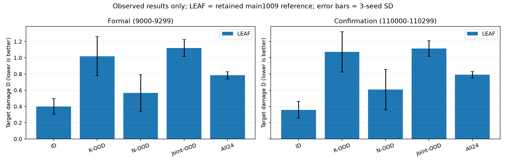

# main_1013_base：HAD基线输入对齐重训

更新：2026-10-13 17:06:00（北京时间）。

当前训练完成 0/6。未运行、停止、失败和未满配额的结果均不记为正式完成。

## 输入差异与公平性设置

原LEAF/REFIL输入为10维实体基础特征加9维红方上一动作；旧SPECTra/TransfQMix仅10维。新版本在actor、online/target mixer及冻结评估统一补齐19维，首步/蓝方/目标动作段为零。时序GRU/token保留，旧10维权重不续训。

| 项目 | 冻结设置 |
|---|---|
| 方法与种子 | SPECTra、TransfQMix；0/1/2，共6模型 |
| 训练 | 每模型1M物理步；N∈{4,6,8,10}，K∈{1,2,3}；8环境；每批8次更新 |
| 共同控制 | replay5000，batch32，γ0.99，clip10，target每200局，ε1→0.05/100k |
| 奖励/对手 | damage；势函数塑形β1、范围4000；reactive/rush；100步；二维随机目标 |
| 方法自身设置 | Adam、lr0.001、Double-Q、TD(λ0.6)、半MSE；原GRU/SAQA或Transformer/token结构 |
| 验证 | 50点；每点4配置×25局；9500–9599；best仅保留，不替代final |
| 正式/确认 | All24各300局；9000–9299 / 110000–110299；每模型每阶段7200局 |
| 环境 | had-workbench-2.1.0 / rebuild-calibrated-v3-r7-target-initialization |

采用共同HAD任务/观测/采样控制，保留作者关键结构及优化参数。这不是完整原论文复现或充分调参声明。SPECTra原GRF探索退火500k，本次共享100k；官方SMACv2也有100k配置。SPECTra原GRF每采集8局更新一次，此处8次；TransfQMix原单进程每局一次，此处按8局批次执行8次。所有差异在运行前固定，不按测试成绩调整。

原作者配置：[SPECTra GRF](https://raw.githubusercontent.com/funny-rl/SPECTra/ffababf6187216c9d16b2109ee8ef6fe5fdf1172/SPECTra_GRF/config/algs/spectra_qmix_plus.yaml)、[SPECTra SMACv2](https://raw.githubusercontent.com/funny-rl/SPECTra/ffababf6187216c9d16b2109ee8ef6fe5fdf1172/SPECTra_SMACv2/config/algs/ss_qmix.yaml)、[TransfQMix](https://raw.githubusercontent.com/mttga/pymarl_transformers/2ef0a0726f1f186097b4b560509ceb5a801fdafe/src/config/algs/transf_qmix.yaml)。

## 数据覆盖与实际结果

| 模型/种子 | 训练状态 | 正式局数/7200 | 确认局数/7200 |
|---|---|---|---|
| SPECTra/0 | 未启动 | 0 | 0 |
| SPECTra/1 | 未启动 | 0 | 0 |
| SPECTra/2 | 未启动 | 0 | 0 |
| TransfQMix/0 | 未启动 | 0 | 0 |
| TransfQMix/1 | 未启动 | 0 | 0 |
| TransfQMix/2 | 未启动 | 0 | 0 |

仅三训练种子、各配置均满300局时汇总均值±种子SD；缺失单元显示待完成。D是累计目标损伤，不是失败率或胜率。

| 方法 | 阶段 | ID | K-OOD | N-OOD | Joint-OOD | All24 |
|---|---|---|---|---|---|---|
| LEAF（归档参照） | 正式 | 0.4009±0.0969 | 1.0197±0.2412 | 0.5666±0.2258 | 1.1196±0.1043 | 0.7845±0.0434 |
| LEAF（归档参照） | 确认 | 0.3587±0.1029 | 1.0714±0.2473 | 0.6084±0.2492 | 1.1138±0.0945 | 0.7901±0.0395 |
| SPECTra | 正式 | 待完成 | 待完成 | 待完成 | 待完成 | 待完成 |
| SPECTra | 确认 | 待完成 | 待完成 | 待完成 | 待完成 | 待完成 |
| TransfQMix | 正式 | 待完成 | 待完成 | 待完成 | 待完成 | 待完成 |
| TransfQMix | 确认 | 待完成 | 待完成 | 待完成 | 待完成 | 待完成 |



图中只包含真实已完成数据；新基线未运行时，比较图仅展示LEAF归档参照。训练曲线在真实训练数据产生后更新。

## LEAF参照与结论边界

最终LEAF为本地regir_nomem。优先引用main1009的original正式/确认单元（每配置、每种子300局），引用现有数据和模型，不复制目录。旧训练未完整保存环境版本，不能反向证明所有历史训练物理细节一致。归档仅有配置级汇总时，不补造逐局显著性检验。

输入不一致是确定的公平性缺口。补齐后性能如何以本次真实结果为准；训练未完成时不形成优劣结论，不保证改善或声称排除了所有超参数敏感性。

## SSH运行与进度

在远程Open-SCORE目录使用：

```bash
mkdir -p outputs/main_1013_base
nohup python -u scripts/main1013_base.py run --devices 0,1 --jobs-per-gpu 3 --max-jobs 6 --resume > outputs/main_1013_base/run.log 2>&1 &
python scripts/main1013_base.py progress --watch-seconds 3
python scripts/main1013_base.py stop
```

每卡最多3个模型任务，总计最多6个，训练/正式/确认共用槽位。--resume恢复完整批次并跳过已提交场景。停止在批次/对局边界保存；OOM不静默改batch、预算或模型。progress只读，Ctrl+C仅关闭面板。没有实测速率时ETA显示待估。

远程需保留只读参照文件：outputs/main/had/regir_nomem/models/main0928/seed_0/config.json、outputs/main/experiment.json、outputs/main/had/loop_summary.csv，以及归档协议元数据outputs/backup/experiment.json。不需要复制LEAF模型权重。--reference-output可指定同结构的参照根目录。

单独阶段：plan、train、eval、confirm、report；所有阶段默认同一输出。未新增GRU重置、短跑、额外种子或超参数搜索。
