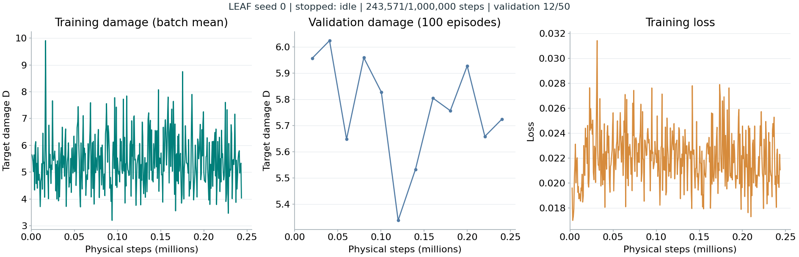

# LEAF SkyHAD 固定翼 seed0 训练报告

更新时间：2026-10-17T03:30:10+08:00（Asia/Shanghai，UTC+8）。本报告与下图按实际日志原地更新。

## 当前状态

- 状态：`stopped`；阶段：`idle`。
- 物理步：已采集 243,571 / 1,000,000；完整采集批次 243,571；可恢复检查点 243,571。
- 验证：完成 12 / 50 个验证点（每点 4 种配置 × 25 局）；已写入验证数据 1200 局。
- 最新训练批次 D：4.03706；最新验证 D：5.7247；已完成验证点最低 D：5.33836；最新 loss：0.0210551。
- 正式终评：未运行；本次命令仅训练及训练内验证。

采集中的物理步仅用于展示进度；恢复训练只使用完整采集与参数更新批次的检查点。缺少数据的面板显示 waiting，不补造训练或验证结果。

## 实验配置

| 项目 | 实际配置 |
|---|---|
| 算法 / 内部键 | LEAF / `regir_nomem` |
| 训练种子 / run | 0 / `train` |
| 载具 / 动作 | `UAV_fixedwing` / `acceleration` |
| 任务 / 空间维度 | `damage` / 3 |
| 物理版本 / 协议 | `skyhad-4.3.0` / `skyhad-4.3` |
| 训练分布 / 每局上限 | `mixed_le10` / 100 物理步 |
| 蓝方规则 | `reactive + rush` |
| 实体特征 / 动作数 | 12 维 / 27 |
| 训练深度 / 验证深度 | `[1, 2, 3, 4]` / 4 |
| 并行环境 / 每批学习更新 | 8 / 8 |
| 实现版本 | `skyhad_fixedwing_entity12_v1` |

完整生效物理参数与特征布局见 [experiment.json](experiment.json)；模型配置见 [config.json](had/regir_nomem/models/seed_0/config.json)。伤害任务的原始整局回报为 R=-D，D 越低越好；训练目标保留配置中的 potential shaping。

## 训练与验证曲线



训练 D 与 loss 为实际完整采集/学习批次记录；验证 D 只显示已收齐 100 局的验证点。日志使用 `had/learning.csv`、`had/episodes.csv` 与 `had/progress.csv`；当前保留验证最优 `best.pt` 及训练恢复文件，尚无合格的 `final.pt`。仅在物理预算与全部 50 个验证点均完成后标记 completed。原始记录、权重和恢复文件仅保存在本地，不随 Git 发布。

## 运行命令

```powershell
& D:\Software\Anaconda\envs\torch310\python.exe -X utf8 Open-SCORE/scripts/train.py --stage single --method regir_nomem --seed 0 --steps 1000000 --output Open-SCORE/outputs/main_Sky --devices 0 --env-agent-type UAV_fixedwing --env-agent-action-type acceleration --spatial-dim 3 --task-mode damage --progress tqdm --live-curves --resume
```

中断后在同一命令末尾添加 `--resume` 继续。状态与停止分别使用原训练脚本的 `--stage status` / `--stage stop`，并传入相同 `--output`。

后续正式终评命令如下，当前训练任务不会自动执行：

```powershell
& D:\Software\Anaconda\envs\torch310\python.exe -X utf8 Open-SCORE/scripts/eval.py --stage final --method regir_nomem --seed 0 --output E:\Code\Open_Score\Open-SCORE\outputs\main_Sky --workers 2 --device cpu
```
