# 独有结果归档

更新：2026-10-26。本目录分类保存与当前LEAF/HAD研究无关但独有的结果、模型、配置和必要图片。本文件是唯一归档说明；当前正式结果及论文证据统一见[主实验报告](../docs/LEAF_主实验结果分析.md)。原来源日期、预算、缺失记录、运行状态与协议作为事实保留，不把旧成果解释成当前受控比较。

| 分类 | 内容 | 入口 |
|---|---|---|
| HAD / extra_variants | M1–M5额外循环结构、冻结反馈、自适应预算及独立确认 | [数据](had/extra_variants/data)、[模型](had/extra_variants/models)、[必要图](had/extra_variants/figures) |
| HAD / historical_protocols | ARR/IAR、count、no-SG、旧查询与旧probe、额外训练及早期独有诊断 | [数据](had/historical_protocols/data)、[模型](had/historical_protocols/models) |
| HAD / baseline_entity10 | 原10维SPECTra/TransfQMix，含验证、正式与确认来源 | [数据](had/baseline_entity10/data)、[模型](had/baseline_entity10/models) |
| SMACv2 | 旧环境胜率、学习过程、不同budget/method集及权重资格 | [数据](smacv2/data)、[模型](smacv2/models)、[图](smacv2/figures) |
| other | 环境未登记的QMIX学习记录 | [数据](other/data) |

归档模型按方法、运行和种子存放；来源版本与原配置归`backup/summary.json`（本地完整汇总；必要表与索引见 [experiment.json](experiment.json)）的`source_configurations`及路径映射，不在目录复制整套历史版本。保留独有final/best和必要配置；共享当前基线只引用主数据中的同一权重。协议与决策登记见[experiment.json](experiment.json)，不把未启动、失败或缺终评的登记描述成完成。

LEAF的720回合冻结干预、另存270回合、同状态动作/Q-margin与runtime边界已并入主报告第4.11节；其原始数据属于主目录，不属于此处额外结构成果。


Git 保留本报告、必要图和 [experiment.json](experiment.json) 中的协议、来源索引与历史表。`backup/summary.json`、原始 CSV/JSONL、模型和恢复状态只在完整本地工作区保存；下文原始数据/模型链接用于该完整工作区，单独克隆 Git 不含这些大文件。路径按仓库根目录解释，可随对应数据迁移；当前原始数据工作区为 `E:/Code/Open_Score`，临时 Git worktree 不复制另一套数据。Git 提交和推送不构成原始数据、模型或恢复状态的备份。

## HAD / extra_variants

### 1. 主要结论

**五个候选中，M4 的直接实体状态承接与前两轮整合获得最清楚的奖励证据；继续加深到四轮、当前自适应退出和相对 LEAF 的性能优势均未成立。** M4 适合保留为有限步实体整合的研究结果，当前性能主线仍是 LEAF。

- M4 的正常四轮原生 D 为 0.9445；重置 EntityGRU 的直接 hidden 后为 4.8730，损失 **3.9286**，训练种子与场景条件区间均为正。
- M4 原生六配置池的 R1→R2 收益为 **2.4767**，两个区间均为正；完整24配置中 **72/72 配置×种子单元**同向改善，但三种子 t95 仍跨零。R2→R4 的三个种子整体结果均退化。
- M3 在小原生池有 R2→R4 读取收益；完整池的收益较小、种子区间跨零，不能据此确认更深读取的泛化价值。
- 五方法均没有稳定优于实际预算匹配随机的自适应收益。M4 独立确认同样没有优势，Joint-OOD 中随机反而更好。
- SMAC 与历史闸门结果独立保留。已有曲线、历史胜率或名为 `final.pt` 的权重，不自动表示当前预算下的训练和正式评估已完成。

### 2. 共同基础、结构与评估口径

#### 2.1 五种循环结构

五候选继承 LEAF 的 REFIL 局部编码、imagined 分组训练、Temporal GRU、FlexQMIX 和 TD 目标。循环宽度64、attention为4 heads、FFN宽度128，轮间共享参数。本步 query 不输入上一物理时刻的 GRU hidden；Temporal GRU 和记忆、上一动作特征仍保留。

候选使用选中轮的末端读出，与局部表示融合后进入 Temporal GRU。这里的局部—全局融合不同于原 LEAF 的跨轮 learned JK 融合；新旧整体差异也包含训练深度抽样与读出方式，不能当作只增加一个反馈模块的单因素比较。

| 方法／注册名 | 实际结构 | 待检验的作用 |
|---|---|---|
| M1 `regir_loop_nomem` | 实体更新保留原观测锚定；读出更新下一轮私有 query | 读取结果修正下一次关注条件 |
| M2 `regir_bidirectional_nomem` | 在 M1 上将私有 query 加入实体 attention 的 K/V | 实体更新与读取形成双向反馈 |
| M3 `regir_requery_nomem` | 实体 context 与 reader K/V 只计算一次，随后迭代 query | 以较小边际计算反复修正读取 |
| M4 `regir_entitygru_nomem` | attention 消息和原观测进入共享 EntityGRU，承接上一轮实体 hidden | 当前决策内有限步、门控实体状态整合 |
| M5 `regir_slotgru_nomem` | 四个 slots 对实体竞争聚合，再由共享 SlotGRU 更新 | 固定工作空间内的迭代聚合 |

M4的节点GRU更新与[Gated Graph Sequence Neural Networks](https://arxiv.org/abs/1511.05493)的状态整合思想相关，M5的竞争聚合与[Slot Attention](https://proceedings.neurips.cc/paper/2020/hash/8511df98c02ab60aea1b2356c013bc0f-Abstract.html)相关；已有构件先例不提供本任务奖励或收敛保证。

M3/M5 的前置实体 context 仍含稠密 attention；小读取工作空间不能推出整个模型随实体数线性扩展。实际候选配置及冻结评估协议见 `backup/summary.json`（本地完整汇总；必要表与索引见 [experiment.json](experiment.json)） 的来源配置与 [experiment.json](experiment.json) 的协议登记；本文公式解释保留成果，不表示这些额外候选仍在当前算法入口中。

#### 2.2 实际完成范围与统计单位

main1009 的15个候选训练任务均完成1M环境步，每方法使用训练种子0/1/2；正式权重为各自 final，best只解释验证波动。训练按 observer、按决策均匀抽取R1–R4，并将深度保存到replay，使online、target、Double Q和imagined分支沿用对应深度。75,000条训练验证回合及原学习记录保留于historical_protocols/data的合并表，候选冻结深度与机制数据位于extra_variants/data。

正式eval为24配置×3训练种子，每配置每臂300场，比较fixed1–fixed4、adaptive与预算随机。ID calibration使用42000–42039，家族selection使用40000–40099，正式eval使用9000–9299，独立confirm使用110000–110299。**ID预先锁定M4家族，confirm只评fixed4/adaptive/random；二轮不是独立确认过的新赢家。** 原生机制池为六配置各十场景、三份训练权重，每臂180回合。

环境版本为 `had-workbench-2.1.0`，物理协议为 `rebuild-calibrated-v3-r7-target-initialization`。D是目标伤害，越低越好，奖励为−D。先对配置等权求每训练种子的均值，再报告三种子均值±样本SD；配对t95使用df=2。原生场景条件bootstrap反映固定三份权重下的场景不确定性，不能替代训练种子不确定性。

24配置包括ID 4、K-OOD 4、N-OOD 6、Joint-OOD 8、Extra 2；All24按配置等权。不同版本的相同注册名仍保留版本与checkpoint身份，历史重复或不同回报记录不增加独立样本数。

### 3. 五方法整体结果

#### 3.1 固定深度、自适应与随机

下表均为正式eval的All24 D±训练种子SD。各出口使用同一方法的既有final，不是分别从头训练的固定深度模型。

| 方法 | R1 | R2 | R3 | R4 | adaptive | random |
|---|---|---|---|---|---|---|
| M1 | 1.9508±1.0340 | 1.2849±0.7802 | 1.3444±0.7726 | 1.5298±0.7878 | 1.2997±0.7816 | 1.2835±0.7744 |
| M2 | 2.0926±1.3055 | 1.0939±0.7085 | 1.4185±0.5390 | 1.9976±0.6301 | 1.1763±0.6025 | 1.1983±0.6220 |
| M3 | 1.3569±0.9253 | 1.2742±0.7758 | 1.2346±0.7088 | 1.2162±0.6558 | 1.2625±0.7465 | 1.2932±0.8010 |
| M4 | 3.1390±0.9961 | **0.8506±0.3446** | 0.9284±0.3927 | 0.9940±0.4455 | 0.8750±0.3573 | 0.8761±0.3637 |
| M5 | 1.7753±0.3199 | 1.6419±0.1785 | 1.6139±0.0889 | 1.6275±0.0837 | 1.6154±0.1271 | 1.6328±0.1611 |

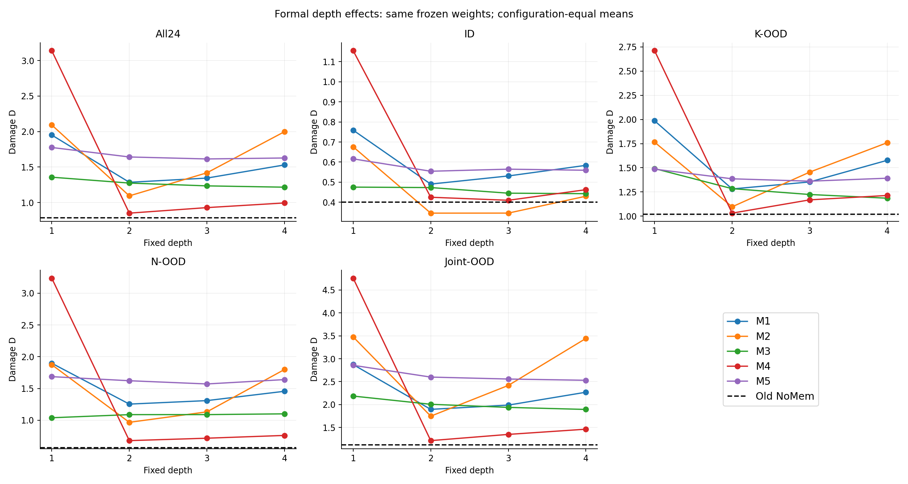

M1/M2/M4的主要改善发生在前两轮，继续加深出现退化；M3的均值随深度缓慢改善；M5没有清晰的单调规律。M4二轮是新候选中观察到的最低均值，不能用这一事后出口选择替代预先冻结的家族确认。

| 方法 | 正式R2→R4奖励收益 | 种子t95 | 判断 |
|---|---|---|---|
| M1 | −0.2448 | [−0.4905, +0.0008] | 三种子均退化，区间仍跨零 |
| M2 | −0.9037 | [−1.1001, −0.7073] | 当前模型加深明显退化 |
| M3 | +0.0580 | [−0.2407, +0.3568] | 较小均值收益，训练种子证据不足 |
| M4 | −0.1435 | [−0.4581, +0.1711] | 三种子整体均退化 |
| M5 | +0.0144 | [−0.3136, +0.3423] | 方向与稳定性均不清楚 |

#### 3.2 训练过程

M4验证终点D为 **0.4020±0.1304**，末五点均值为 **0.3687±0.0406**。seed1的终点及N/Joint-OOD较弱，是其较大种子差异的重要来源。训练验证只覆盖固定ID池，不替代正式外推；验证最优、末段均值均不替换预定final。


随机深度训练中，第1/2/3/4轮被执行的概率为100%/75%/50%/25%，最终出口被直接抽到的概率均为25%。轮间参数共享，深出口反传也经过前面实体更新；不能说深轮完全没训练。深层状态覆盖、出口目标竞争及混合时序历史与固定出口的差异，都可能影响结果，现有实验没有区分主因。

### 4. M4：有限步实体状态整合

#### 4.1 完整计算路径

对于当前observer，E为当前实体表示，l为本地REFIL表示，h为进入本物理时刻的Temporal hidden，固定query为 `b0=Query(own_features, zero_history)`。每个物理时刻重置实体工作状态，`H0=E`：

```text
for r = 1 ... R:
    normalized = LN(H_previous)
    message_r = SharedEntityAttention(normalized, normalized, normalized, mask)
    input_r = concatenate(LN(E), MessageLN(message_r))
    updated_r = SharedEntityGRU(input_r, hidden=H_previous)
    normalized_r = ResidualLN(updated_r)
    H_r = FFNResidualLN(normalized_r + SharedFFN(FFNLN(normalized_r)))
    H_r = mask_invalid_entities(H_r)
    read_r = SharedReader(QueryLN(b0), H_r, H_r, mask)

encoded_R = local_REFIL + W_fuse(read_R)
candidate_hidden_R = TemporalGRU(encoded_R, entering_hidden)
Q_R = action_head(candidate_hidden_R)
```

EntityGRU输入宽度128、hidden宽度64，同一GRUCell共享于实体和轮次；attention和FFN也轮间共享。第一轮hidden为初始E，第一轮同样执行GRU。每轮原观测E继续进入输入，直接hidden承接上一轮实体状态。**EntityGRU处理当前决策内的关系状态，原Temporal GRU处理跨物理时刻记忆。**

固定深度只提交选中出口的Temporal hidden。自适应预览各轮Q/hidden时，候选都从同一个进入hidden出发，退出后只提交选中者；循环轮次不作为新的物理时间。每轮已经有全连接attention，因而不应把第二轮的作用解释为第一次才能看到更远实体。

#### 4.2 直接承接与前两轮的奖励证据

| 实验 | 奖励收益／切断损失 | 训练种子t95 | 场景条件95 |
|---|---|---|---|
| 原生hidden reset | +3.9286 | [+2.3697, +5.4874] | [+3.4289, +4.4499] |
| 原生六配置R1→R2 | +2.4767 | [+0.4012, +4.5522] | [+2.0852, +2.8809] |
| 正式All24 R1→R2 | +2.2885 | [−0.5297, +5.1066] | 本表不报告 |
| 正式All24 R2→R4 | −0.1435 | [−0.4581, +0.1711] | 本表不报告 |

`entity_gru_hidden_reset`将GRU直接hidden改回E，但attention消息仍从上一轮状态计算，第一轮保持不变。正常R4 D=0.9445，重置后D=4.8730；三个种子损失均为正。这是**已训练M4对直接状态承接路径的奖励依赖**，不是移除全部循环，也不等于从头训练后GRU优于其他结构。

正式R1→R2在72/72单元改善，All24均值下降72.90%；完整池的三种子区间仍跨零，应与小原生池的双区间支持一起理解。R2→R4三种子收益为 **−0.1773、−0.2498、−0.0034**，24配置均值只有一个微小改善；当前证据更接近有限整合后饱和或退化，而非持续精炼。

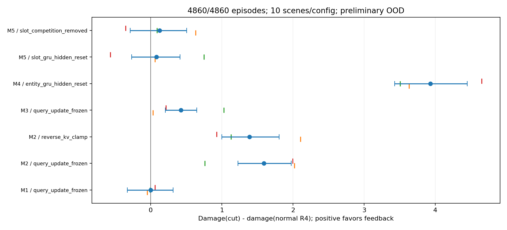

#### 4.3 独立确认与主方法参照

| 方法／出口 | eval All24 D±SD | confirm All24 D±SD |
|---|---|---|
| M4 R2 | 0.8506±0.3446 | 未评此出口 |
| M4 R4 | 0.9940±0.4455 | 0.9951±0.4655 |
| M4 adaptive | 0.8750±0.3573 | 0.8900±0.3752 |
| M4 random | 0.8761±0.3637 | 0.8868±0.3642 |
| LEAF R4（主实验参照） | 0.7845±0.0434 | 0.7901±0.0395 |


M4二轮仍比LEAF二轮的D=0.7928更高、种子SD更大；独立confirm中LEAF也保持较低均值与较小种子差异。M4 adaptive相对LEAF的confirm奖励收益为−0.1000，配对种子区间跨零：应报告这些样本结果，不宣称已证明两者的统计优越性。完整LEAF深度结果与HAD基线见[主报告](../docs/LEAF_主实验结果分析.md)。

同轮数参照中，LEAF的R1/R2/R3/R4分别为0.8022/0.7928/0.7891/0.7845；M4分别为3.1390/0.8506/0.9284/0.9940。M4相对LEAF奖励收益的配对种子t95依次为[−4.5006,−0.1731]、[−0.9728,+0.8572]、[−1.1723,+0.8936]、[−1.3777,+0.9586]。候选内部的一轮→二轮恢复不能代替相对LEAF的增益证据。

M4最合适的表述是“当前决策内、带实体状态承接的有限步消息整合”。二轮是既有随机深度训练模型的出口，尚非单独从头训练并独立确认的两轮新方法；从头训练的结构对照仍是循环贡献的缺口。

### 5. 其他候选与反馈机制

原生六配置池的切断损失如下，正值表示正常路径D更低。

| 方法 | 切断 | D损失 | 种子t95 | 场景条件95 |
|---|---|---|---|---|
| M1 | query update frozen | +0.0007 | [−0.1354, +0.1369] | [−0.3298, +0.3160] |
| M2 | query update frozen | +1.5921 | [−0.1966, +3.3807] | [+1.2266, +1.9749] |
| M2 | reverse K/V clamp | +1.3879 | [−0.1753, +2.9511] | [+0.9976, +1.8046] |
| M3 | query update frozen | +0.4244 | [−0.8962, +1.7449] | [+0.2064, +0.6492] |
| M4 | entity hidden reset | +3.9286 | [+2.3697, +5.4874] | [+3.4289, +4.4499] |
| M5 | slot hidden reset | +0.0806 | [−1.5520, +1.7132] | [−0.2691, +0.4114] |
| M5 | competition removed | +0.1234 | [−1.1014, +1.3481] | [−0.2885, +0.5060] |

**M1：** 读后query反馈参与计算，但切断奖励区间均跨零；主要收益发生在前两轮，不支持持续深轮或有效自适应的主张。

**M2：** 两种反馈切断有固定权重下的场景损失，训练种子区间仍跨零；正式R2→R4收益−0.9037、种子区间完全为负。存活实体数与局部加深价值的关系只是一条探索线索，不能覆盖整体深轮退化或停止器没有随机优势的事实。

**M3：** 原生R2→R4收益 **0.3127**，种子t95 **[0.0152,0.6102]**、条件95 **[0.0554,0.5543]**，三个种子均正，支持这个小池中的额外读取。正式All24收益仅 **0.0580**，三种子为 **−0.0266/+0.1957/+0.0049**，t95 **[−0.2407,0.3568]**；虽24配置中17个均值改善，主要收益集中于seed1，N-OOD四轮均值还略差于二轮。因此保留“固定context上的低边际成本迭代读取”，不把小池结果提升为稳健外推结论。

**M5：** slot表示和竞争路由未完全坍缩，但hidden与competition切断均没有稳定奖励损失，三至四轮也无清晰规律。固定四slot的表示差异不能充当物理分工、可扩展性或保护收益的证明。

#### 5.1 M1：读出反馈更新 query

每轮先固定比例锚定初始证据，再更新并读取：

$
A_r=0.75H_{r-1}+0.25E,\quad
H_r=F_{\mathrm{stable}}(A_r;m),\quad
u_r=\operatorname{Read}(\operatorname{LN}(b_{r-1}),H_r).
$

需要下一轮时：

$
\begin{aligned}
\widehat b_r&=b_0+W_{\mathrm{feedback}}\operatorname{LN}(u_r)+b_{\mathrm{feedback}},\\
g_r&=\sigma(W_{\mathrm{gate}}
[\operatorname{LN}(b_{r-1});\operatorname{LN}(\widehat b_r)]+b_g),\\
b_r&=(1-g_r)\odot b_{r-1}+g_r\odot\widehat b_r.
\end{aligned}
$

query gate 是逐维可训练门，权重/偏置零初始化，所以初值0.5；**不是固定0.5反馈强度**。25%实体锚定才是固定选择，现有实验未证明其最优。末轮退出后不更新下一 query。

动态 query 只影响读取，**不影响 M1 实体 context 更新**。反馈存在，但现有结果没有稳定深轮收益，不作为主线。


#### 5.2 M2：query 参与实体更新

在 M1 基础上，把上一 query 当接收者私有 K/V token：

$
K_r=V_r=[\operatorname{LN}(A_r);\operatorname{LN}(b_{r-1})].
$

实体 attention 的 Q 仍来自 $\operatorname{LN}(A_r)$。这个 token 不是新物理实体，也不是防御者间通信，由此形成 query→实体→读出→query 的双向通路。当前二轮后明显退化，不能讲成深轮协商增益。


#### 5.3 M3：反复读取同一份上下文

初始化仅一次：

$
C=F_{\mathrm{stable}}(E;m),\qquad
(K_{\mathrm{read}},V_{\mathrm{read}})=\operatorname{ProjectKV}(C).
$

随后 query 经 M1 的门更新并读缓存 K/V，实体 $C$ 不再变化。循环放在“怎样提问”，而非重新加工全部实体。

缓存减少后续 K/V 投影和 context 更新；前置 dense context、REFIL host 仍在，不能称整个策略线性复杂度。完整池深读均值收益较小、种子区间跨零，保留为效率探索。


#### 5.4 M5：四个 slots 竞争聚合实体

M5 先构建一次 context $C$，固定其 K/V。四个 slots 初始化：

$
S_0=\operatorname{LearnedSeeds}_{4\times64}
+W_{\mathrm{own}}b_0+b_{\mathrm{own}}.
$

slot query 与实体 key 点积后，对每个实体先沿**slot 轴** softmax 形成竞争，再对每个 slot 沿**实体轴**归一化。令 $v_e=1$ 表示实体有效：

$
A_{s,e}=\operatorname{softmax}_{s}(L_{s,e}),\quad
\widetilde A_{s,e}=\frac{v_eA_{s,e}}{\max(\sum_jv_jA_{s,j},10^{-8})},\quad
U_s=\sum_e\widetilde A_{s,e}V_e.
$

SlotGRU 用 $S_{r-1}$ 为 hidden 整合 $U$，再做 residual FFN；固定 query 从 slots 读取。无有效实体时按 mask 置零。**竞争路由是单头64维点积**，4头仅用于前置 context MHA 和 reader。

其故事是固定工作空间内的迭代聚合，与 Slot Attention 接近；不同于 Set Transformer ISAB，也不保证 slots 自动对应物理任务。当前没有稳定的 hidden/竞争路由奖励证据，简要保留探索。


### 6. 自适应预算与状态级反事实

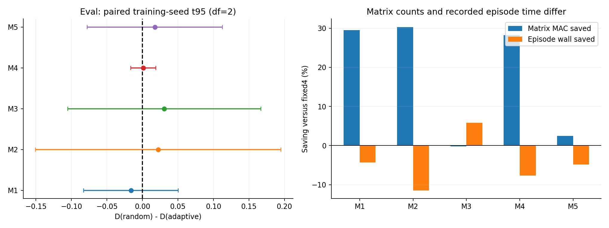


#### 6.1 实际预算随机对照

| 方法／阶段 | 实际匹配单元 | 三seed均匹配配置 | 匹配子集adaptive对random奖励收益 | 种子t95 | 对R4节省MAC |
|---|---|---|---|---|---|
| M1 eval | 71/72 | 23/24 | −0.01786 | [−0.08945, +0.05373] | 29.54% |
| M2 eval | 64/72 | 20/24 | +0.03049 | [−0.16846, +0.22943] | 30.29% |
| M3 eval | 72/72 | 24/24 | +0.03067 | [−0.10517, +0.16651] | −0.17% |
| M4 eval | 72/72 | 24/24 | +0.00114 | [−0.01644, +0.01872] | 28.20% |
| M5 eval | 72/72 | 24/24 | +0.01741 | [−0.07783, +0.11264] | 2.49% |
| M4 confirm | 71/72 | 23/24 | −0.00510 | [−0.03526, +0.02507] | 28.13% |

实际匹配容差为5%；confirm表剔除任一seed失配的整个配置。M4全部24配置confirm收益为 **−0.0033 [−0.0327,0.0262]**，Joint-OOD为 **−0.0228 [−0.0324,−0.0133]**，三种子均负。五方法都没有稳定的状态定向优势。

M4的ID资格可凭MAC节省通过：选型时节省25.91%，但对random的奖励收益为−0.0176。`qualified`确认的是预定规则下的资格，不是停止器已识别值得加深的状态。

M4 R2/R4/adaptive/random的正式MAC/episode分别为 **10.075/16.757/12.032/11.997G**。adaptive节省矩阵计算，但记录episode时长相对R4在eval/confirm反而增加 **7.65%/1.10%**。MAC只覆盖记录的矩阵乘加，整局成本还受轨迹长度影响；时长包含环境、调度与诊断，不能据此宣称已实现推理加速。LEAF成本缺失不记为零，也不作成本倍数比较。


#### 6.2 困难状态是否更需要深轮

CF从各方法自己的fixed4前缀取step0/5/10，每快照最多两个存活observer，仅将一个observer当前深度强制为1/2/4，之后继续四轮。当前深度同时影响动作和提交的Temporal hidden，尾局差是总效应。每方法五配置、各十物理场景、三份权重；同场景的多个step/observer不是独立样本。

M4的 `Δ2=D(当前R2)−D(当前R4)` 为 **−0.0650**，种子t95 **[−0.1586,0.0287]**，条件95 **[−0.1275,−0.0105]**，五配置均值全部为负。900个干预中44个四轮更好、64个更差、792个不变；当前停止器选为四轮的145条描述均值为−0.1955，没有积极的深轮受益识别迹象。

控制 `seed×配置×step` 后，M4存活数量斜率 **0.00303 [−0.0166,0.0260]**、竞争斜率 **0.00121 [−0.0140,0.0157]**，partial R²仅 **0.000299**。M2的存活数量斜率有正向探索迹象，但总体加深收益仍负、完整四轮仍更差。十个“方法×物理指标”探索比较未作家族多重校正，不足以建立统一的简单/复杂计算分配规律。


#### 6.3 冻结的退出规则

相邻轮使用合法 Q 方向与候选 Temporal hidden 判断稳定性。每轮预览从**同一个进入 hidden**计算：

$
\widehat h_r=\operatorname{GRU}_{\mathrm{time}}
(\ell+W_fu_r+b_f,\ h_{t-1}).
$

合法 Q 中心化、单位归一化得到 $v_r$。从第二轮起，greedy 动作相同，且至少两个合法动作、前后 Q 非退化且非并列，并满足

$
\max\left(\|v_r-v_{r-1}\|_2,\
\frac{\|\widehat h_r-\widehat h_{r-1}\|_2}
{\max(\|\widehat h_{r-1}\|_2,10^{-6})}\right)\le\tau
$

则退出，否则最多四轮。**没有第一轮自适应早退**。只提交所选 hidden，预览不连续推进物理时间。

阈值由 ID calibration 冻结，独立 ID selection 选择方法家族，不按 OOD 奖励重调；不是训练 ACT halting 网络，learned fusion 也不是停止器。fixed/random 只计算选中出口的 Temporal head，adaptive 在每个仍活动轮预览。预算随机使用与实际矩阵 MAC 接近的深度概率，按真实调用计入 host、前置 context、reader、反馈和 temporal preview；实际差距不超过5%才按匹配口径比较。MAC 不包括所有元素运算，也不是墙钟速度。当前无稳定超越预算随机的证据。


## HAD / historical_protocols


本节把原主报告中的独有历史资料归入唯一归档说明。source_version、保存配置、原显示名与查询/count等字段保留为来源事实；它们不重新定义当前LEAF与七个保留变体的基底，也不将跨版本汇总变成当前同协议单因素证据。

来源main0928的另两项归档探索保留原四组D均值±三训练种子SD：

| 历史探索 | ID | K-OOD | N-OOD | Joint-OOD |
|---|---:|---:|---:|---:|
| ARR | 0.469±0.091 | 1.221±0.344 | 1.778±1.292 | 2.370±1.164 |
| +Count | 0.596±0.145 | 1.301±0.427 | 1.075±0.449 | 1.685±0.844 |

这些探索均归补充，不进入当前八方法设计表。

#### 7.1 旧no-SG协议：Full与Single

以下使用来源main0921的互斥四组，D为三种子均值，**±为95% t区间半宽（df=2）**，不是主表的SD。

| 方法 | ID | K-OOD | N-OOD | Joint-OOD |
|---|---:|---:|---:|---:|
| Full（旧ReGIR） | 0.419±0.383 | 1.036±0.463 | 0.861±0.794 | 1.477±1.091 |
| Single from scratch | 0.429±0.693 | 1.225±2.046 | **0.742±0.983** | 1.674±2.643 |

Single 在人数外推的均值低于Full；Full的seed0四组均优于Single，但seed1/2均反向，区间较宽。这一历史结果本身已经否定“多轮每个种子、每个外推轴都更好”的说法。该协议保留历史query且未采用SG，不能直接替代当前LEAF设计对照。

完整旧家族均值如下；其各配置、逐种子、原始区间见 `backup/summary.json`（本地完整汇总；必要表与索引见 [experiment.json](experiment.json)） 的 `historical_report_tables`，导入旧no-SG行不重复计为新增训练。

| 方法 | ID D | K-OOD D | N-OOD D | Joint-OOD D |
|---|---:|---:|---:|---:|
| Full | 0.419 | 1.036 | 0.861 | 1.477 |
| Single | 0.429 | 1.225 | 0.742 | 1.674 |
| KV0 | 0.526 | 1.326 | 1.076 | 1.690 |
| Fixed4 | 1.520 | 3.664 | 4.461 | 6.974 |
| Untied4 | 0.321 | 0.860 | 0.486 | 1.165 |
| Last | 0.627 | 1.187 | 1.076 | 1.795 |
| No-count | 0.341 | 0.819 | 0.945 | 1.132 |
| No-REFIL | 0.331 | 1.028 | 0.887 | 1.472 |

#### 7.2 历史SG/counts-on协议：ARR、IAR与Single

来源main0923的表使用 **D-IQM [层级bootstrap 95%区间]**。Single、ARR、IAR有五种子；其余设计三种子。五种子IQM裁去两端各一个，三种子IQM等于均值；bootstrap重采样种子与配置，10,000次、随机种子20260924。不同种子数、count设置和汇总方法使它不能与主报告的当前八方法表直接合并排名。

| 方法 | ID | K-OOD | N-OOD | Joint-OOD |
|---|---:|---:|---:|---:|
| Direct read（R0） | 0.992 [0.558,1.523] | 2.174 [1.320,3.053] | 2.659 [1.833,3.665] | 3.765 [2.281,5.434] |
| Single from scratch | 0.617 [0.353,1.312] | 1.366 [0.957,2.461] | 2.159 [0.767,3.671] | 2.569 [1.274,4.152] |
| ARR | 0.394 [0.255,0.616] | 1.179 [0.745,1.545] | 0.908 [0.511,1.793] | 1.529 [0.972,2.071] |
| IAR | 0.461 [0.272,0.672] | 1.241 [0.772,2.051] | 0.817 [0.662,1.173] | 1.491 [1.132,2.314] |
| Looped SG | 0.305 [0.173,0.493] | 0.695 [0.427,1.021] | 0.745 [0.407,1.316] | 1.130 [0.639,1.826] |
| Untied4 | 0.383 [0.224,0.612] | 1.116 [0.600,1.934] | 0.701 [0.543,0.853] | 1.598 [1.008,2.627] |
| ARR–NoMem | 0.471 [0.278,0.707] | 1.242 [0.760,1.868] | 0.770 [0.486,1.201] | 1.384 [0.874,1.966] |
| ARR–NoREFIL | 0.734 [0.351,1.299] | 1.875 [0.824,3.601] | 2.215 [0.964,4.372] | 2.658 [1.248,4.765] |
| ARR–Fixed4 | 0.495 [0.346,0.719] | 1.403 [0.825,2.336] | 0.859 [0.673,1.083] | 1.695 [0.924,3.001] |
| Tied Fixed4 | 0.443 [0.251,0.658] | 1.332 [0.909,1.908] | 1.953 [0.997,3.297] | 2.700 [1.652,3.939] |
| ARR–NoCount | 0.537 [0.324,0.827] | 1.060 [0.674,1.423] | 0.950 [0.396,1.616] | 1.613 [0.705,2.562] |

ARR–NoMem 的注册名为 `regir_kv0_nomem`，属于另一设计，不能改名为主方法 `regir_nomem`。这版Single相对R0均值改善，ARR/IAR相对Single的外推IQM更低，但历史闸门没有建立Single显著优于R0的基础条件。闸门的 O-IQM 为R0=2.866、Single=2.031、ARR=1.240、IAR=1.160；训练失败标记分别2/3、1/5、0/5、0/5。标记判据是最终验证D>1或500k验证D>3，描述训练表现，不是环境运行失败。选择ARR保留用户决策来源，不写成自动检验已证明赢家。

#### 7.3 单轮训练的历史登记与来源边界

**历史单轮训练登记。**

| 来源协议 | 单轮注册名 | 训练与评估深度 | 种子与预算 | 同版循环参照 |
|---|---|---|---|---|
| 旧 no-SG，来源main0921 | `regir_r1`（Single） | `global_depths=[1]`，eval=1 | 0/1/2，每种子1M | Full `regir` |
| SG/counts-on，来源main0923 | `regir_r1_sg`（Single） | `[1]`，eval=1 | 0–4，每种子1M | ARR、IAR、Looped SG |
| 来源main0928，count-off保存设置 | `regir_r1_sg`（Single） | `[1]`，eval=1 | 0/1/2，每种子1M | LEAF及七个保留变体；原键见主报告 |


三版均有历史完成预算及终评记录；相同物理步预算不等于相同计算预算。早期部分来源只有报告/汇总，缺本地逐局raw或weights时不描述成可从模型重执行的完整实验。main0928的当前One round按主报告统一采用LEAF基底解释，保存键仅为兼容标识。

#### 7.4 早期主快照及旧关系probe

最早来源main使用“pool / equal / targets”三个集合，集合不严格互斥，统计还含早期运行状态。Full的D均值为0.419/0.750/1.330，Single为0.429/0.664/1.524；这些数值保留为历史快照，不改名为当前ID/K/N/Joint。旧NDS以Random=0、Rule=1归一化，大于1表示优于Rule；不能与原始D拼接。该快照seed0单局的四轮平均权重约0.27/0.26/0.24/0.24，属于旧带历史query方法，不是当前LEAF约99%前两轮的记录。

来源main0921的Full冻结深度在10/30/50v同人数K2的D（±95%t半宽）为：R1 0.574±0.338 / 0.923±0.267 / 1.136±0.624；R4 0.499±0.295 / 0.930±0.839 / 1.070±1.034。真正Single为0.520±0.850 / 0.794±1.158 / 0.799±1.079。训练设计、冻结出口、固定计算reader和probe回答不同问题，不能互相充当对照。

旧probe使用500条共同真实轨迹、5配置各100场景，动作前缀由Full seed0与REFIL seed0各半生成，再以三个Full checkpoint重建hidden；ID内标准化并选择ridge正则，OOD分explore与confirm，包含H0、随机初始化与置乱标签控制。50v50 K2确认集最近目标线性可解码R²：训练H0=0.697±0.015、H1=0.858±0.092、H4=0.817±0.079、随机H4=0.767±0.039。另一防御者标签训练H0=0.335±0.004、H2=0.641±0.065、H4=0.597±0.190，随机H4=0.655±0.120；不平衡标签训练H0=−0.356±0.035、H4=−0.032±0.367，随机H4=+0.231±0.358。随机控制有时更高，故不能讲成高阶关系随轮次单调增长，更不能移植为当前LEAF的probe结果。完整标签、排除样本与逐checkpoint表保留在`historical_report_tables`。

#### 7.5 ARR/IAR/SG 的深度、reader与意图干预

在来源main0923，10/30/50同人数K2的ARR R1/R4 D-IQM为0.512/0.612、0.978/1.012、1.100/1.018；IAR为0.573/0.546、0.890/0.922、1.211/1.059；Looped SG为0.401/0.433、0.763/0.795、0.934/0.904。随机深度支线的收益方向随配置改变。ARR-Fixed4的R1/R4为4.498/0.628、9.143/0.878、12.290/0.960；Untied4为6.419/0.458、12.837/0.825、17.265/0.789，说明固定深度训练的模型不能靠冻结早退替代单轮重训。

ARR在50v50 K2的learned/read1/read2/read3/read4/uniform D-IQM为1.018/1.100/8.271/11.852/14.357/10.355；30v30 K12为2.442/2.449/13.260/22.090/26.596/19.997。强制晚轮读出大幅变差，read1与learned接近；这些是冻结策略依赖，而非对应reader独立重训的收益。IAR的uniform、shuffle和oracle intent干预没有一致优势；50v50 K2 L4的五种子均值1.026，oracle均值1.066，这里的均值不等于其D-IQM 1.059。

来源main0928的SG、ARR、Fixed4、Untied4还保存48,600个历史深度回合，R4复用10,800场；SG reader非默认臂9,000场，默认臂复用1,800场。SG在50v50 K2的R1/R4/R6 D均值1.672/1.156/1.152，ARR为2.316/2.582/2.606；Fixed4、Untied4的R1早退严重退化。SG reader在50v50 K2 learned/read1/read4/uniform为1.156/1.670/17.175/4.736，30v30 K12为3.369/4.156/27.990/10.810。这些完整数值与误差仍存于归档summary的原派生统计，属于该来源的历史冻结诊断，不并入当前LEAF的R1–R6矩阵。

历史probe的coverage、dynamics、deeprounds、global、readout-attention、intent文件分别记录27/22/14/16/13/5个完成项；数量表示已有文件覆盖，不替代权重及协议资格。历史全队时延有独立设备、真实前缀、batch1、float32/关闭TF32、50预热与200同步计时定义，统计actor编码而非环境或mixer。没有合格测量的旧表保留缺失，已有时延不移植给当前LEAF。

#### 7.7 历史查询、数量、锚定与意图结构

下列公式保留旧源文件的结构区别，属于历史来源说明。

#### 历史查询输入

三种查询区别为：

$
\begin{aligned}
q_{\mathrm{ReGIR}}&=W_q[E_{\mathrm{self}};h_{t-1}]+b_q,\\
q_{\mathrm{SG}}&=W_q[E_{\mathrm{self}};\operatorname{stopgrad}(h_{t-1})]+b_q,\\
q_{\mathrm{NoMem}}&=W_q[E_{\mathrm{self}};0]+b_q.
\end{aligned}
$

SG 仅切断历史 hidden 进入 query 的梯度，query 参数仍学习，Temporal GRU 时序反传仍保留。NoMem 连前向的 query 历史输入也移除。


数量编码对允许作为 key 的红方、蓝方、目标分别计算

$
\rho(n)=\left[\left(\frac{a}{a+2}\right)^2,\mathbf1[n=0]\right],
\qquad a=\max(n-1,0).
$

拼接为6维，经 MLP 映射并加到实体 context attention 的 Q 输入。NoMem 虽仍有 count_cond 字段和相关模块，但 global 路径的显式 count 注入已关闭，**不能据字段存在称它使用 count FiLM**。关闭 count 也不意味着完全无法感知数量，实体集合本身仍随规模变化。


#### ARR：状态反复访问固定初始实体

ARR 对应 rer_update=kv0。普通循环每轮用上一状态作 K/V，ARR 始终用初始 $E$：

$
\widetilde H^{(r)}=H^{(r-1)}
+\operatorname{MHA}_{\theta}
(\operatorname{LN}(H^{(r-1)})+c,\ E,\ E;m).
$

$c$ 仅在启用 count 时存在；之后仍有 residual FFN、各轮读取和融合。**固定的是实体更新的 K/V，最终 reader 仍读 $H^{(r)}$**。其动机是让变化的状态反复访问未被递归改写的原始证据。

ARR 有 SG、NoMem、NoREFIL、Fixed4、No-count 组合。ARR–NoMem（regir_kv0_nomem）保持固定初始 K/V，不是主 regir_nomem，也不是 M3：ARR 持续更新整个实体集合，M3 固定 context，只迭代读取 query。

#### IAR：ARR 中加入预测队友意图

IAR 从各轮工作状态预测可见队友的动作分布，将其嵌入加入下一轮 K/V：

$
p_j^{(r)}=\operatorname{softmax}(W_{\mathrm{intent}}H_j^{(r)}+b),\qquad
K_j^{(r+1)}=V_j^{(r+1)}
=E_j+W_{\mathrm{embed}}p_j^{(r)}.
$

嵌入只用于有效队友，不用于接收者自身、攻击者或目标。预测交叉熵用 replay 中队友同一物理时刻的实际动作作标签，默认权重0.02；意图嵌入零初始化。它是预测行为条件，不是收到队友真实当前动作的通信。

oracle、shuffle、uniform 是冻结诊断，oracle 真实动作不属于部署方法。现有意图干预与正式成绩未建立稳定额外收益，IAR 保留为历史探索。


#### 7.8 其他已实现或登记分支

##### 7.8.1 读出探索、Refine与Set2

以下保存未进入当前八方法表的注册与结构探索。Refine、Set2及早期REFIL扩展在本地材料中主要保留登记和结构说明，不能以实现入口推断有完成训练、正式评估或迁移后的新结果。

| 配置 / 变体 | 实际结构 |
|---|---|
| regir_nomem_static | 全局可训练 round logits 决定权重，不随状态/接收者变化；不是固定均值 |
| regir_nomem_scorenorm | 读出 L2 归一化×$\sqrt d$ 后评分，融合 value 仍用原读出 |
| Refine：regir_refine_nomem | NoMem + stable context + 初始实体锚定 + 末轮读出 |
| Refine–R1 / Fixed4 / Untied4 | 固定一轮、固定四轮或四轮独立参数 |
| Refine–NoInput | 去锚定，保留其余设置 |
| Refine–FixedInput | 固定25%初始状态混合，代替学习门 |
| Refine–Mix | 保留 stable / input 设置，恢复 learned fusion |
| Set-style 两层：regir_set2_nomem | 两个不共享 stable context block，固定两层、末层读取；不是完整 Set Transformer 复现 |

Refine 的 input gate 从 $[\operatorname{LN}(E);\operatorname{LN}(H_{\mathrm{previous}})]$ 计算：

$
H_{\mathrm{in}}=(1-g)\odot H_{\mathrm{previous}}+g\odot E.
$

初始 bias 令 $g=0.25$。这是可学习的实体输入门，不同于 M1/M2 固定25%锚定，也不同于 M1–M3 query 门。

组合名的含义：kv0=ARR，intent=意图嵌入，sg=历史查询 stop-gradient，nomem=零历史 query，noaux=只删意图辅助损失。早期 regir_r1_nomem 继承 count-on，不能与 count-off 的 regir_nomem_r1 合并身份。

历史仅有pending登记的组合按source_version单独保存，包括Single–NoMem、Single–NoREFIL、Single–No-count、IAR–NoAux、IAR–NoMem、循环–Intent与IAR–NoREFIL；不能把这些登记代替主报告当前已完成的LEAF–One round或LEAF–No host结果。

##### 7.8.2 早期REFIL扩展

| 分支 | 具体结构 |
|---|---|
| REFIL–Local mild / mid | imagined 分组以0.15/0.30混合距离相关采样；不是新增实体循环 |
| REFIL–Count | 无 global 循环；数量嵌入对基础特征作缩放/偏移，初始 scale=1、shift=0；是否先做 LayerNorm 取决于历史配置 |
| REFIL–Cycle | 共享实体更新 + 中间读取融合的前身；refil_cycle / regia 是 ReGIR 历史别名 |
| REFIL–Card | 按红/蓝/目标分别 attention 读取，类型间 gate 汇合，再组合数量嵌入；无实体逐轮更新 |
| REFIL–Slot | 默认10个 learned slots，反复对初始实体 cross-attend，再 slot self-attention、FFN、读取融合；无 M5 的竞争归一化与 SlotGRU |
| REFIL–Feedback | 各接收者从自身工作状态预测动作偏好，按实体来源注入下一轮可见存活红方 token（含自身）；无 IAR 监督 CE，不是 M1 私有 query 更新 |

这些早期独有结果按来源保留，不与当前主性能均值混合。ALMA FullObs、Blue、Event、NoMask 分支改变任务划分、观测掩码或分配触发，不属于 LEAF 循环变体，归补充资料。

##### 7.8.3 历史内部标识速查

| 家族 | 主要名称 |
|---|---|
| 原循环与控制 | regir、regir_sg、regir_nomem；regir_r0[_sg]、regir_r1[_sg]、regir_fixed4[_sg]、regir_untied4[_sg]、regir_last[_sg]、regir_norefil[_sg]、regir_nocount、regir_count_sg |
| ARR | regir_kv0[_sg]、regir_kv0_nomem、regir_kv0_norefil[_sg]、regir_kv0_fixed4[_sg]、regir_kv0_nocount[_sg] |
| IAR / intent | regir_kv0_intent_sg、regir_kv0_intent_noaux_sg、regir_kv0_intent_nomem、regir_intent_sg、regir_kv0_intent_norefil_sg |
| 历史其他控制 | regir_prenorm、regir_r1_nomem、regir_r1_norefil_sg、regir_r1_nocount_sg |
| Refine 子变体 | regir_refine_nomem、regir_refine_r1_nomem、regir_refine_noinput_nomem、regir_refine_fixedinput_nomem、regir_refine_mix_nomem、regir_refine_fixed4_nomem、regir_refine_untied4_nomem |
| 新循环核心 | M1 regir_loop_nomem；M2 regir_bidirectional_nomem；M3 regir_requery_nomem；M4 regir_entitygru_nomem；M5 regir_slotgru_nomem |

[_sg] 是表内简写，不是可直接输入的名字。表中同时包含当前实现名和历史保存名；regir_nomem、regir_last_sg、regir_norefil_sg、regir_count_sg 等不能仅因保存名称就假定当前注册表有完整同名入口。完成状态以保存配置、权重与报告共同判断，同名跨来源记录分开解释；本文不是新增训练的操作指南。


### 早期移植与恢复诊断

以下是旧移植轮次已记录的故障与测量，保留其发生条件，不把这些记录当作当前实现的新验证。早期数据位于[early_diagnostics](had/historical_protocols/data/early_diagnostics)，原配置见总元数据。REFIL上游对照提交为`ffe23a1c62fd3f7304e700e69b30dcb0c29586cc`；ALMA、DCG、SPECTra上游出处同时见当前Baseline文档。

- 早期FlexQMIX捐赠实现把`nonneg=abs`默认施加于偏置与V，关闭PopArt后造成`Q_tot≥−1`，无法覆盖真实负回报。修正为偏置/V保持有符号，单调性仍由乘个体Q的非负权重保证。其固定空槽平均还把偏置与V乘上存活比例，之后改按有效query计数归一化。
- 早期B0固定槽编码器曾为训练未激活的实体槽建参数；后按10红、10蓝、3目标建槽并拒绝越界加载。该结构本身顺序敏感，不能借由空槽随机参数获得可靠外推。
- 旧首轮在B0 591k、QMIX-Atten 409k、REFIL 300k步受控停止，原始权重与记录当时已经删除；只保留诊断，不描述成现存可恢复结果。REFIL验证曾从D=6.41降至3.99（约260k步）；B0的abs混合权重分支出现Q_tot约+622.8、loss 237,309、梯度范数2.47e6，说明该旧组合发生发散，不能把它归因为当前LEAF。
- 旧一阶TD信用传播诊断在约133,312步记录Q_tot约−1.54，目标更新约每9,000物理步一次，而首次损伤中位约30步；随后塑形、探索退火及GRU修改属于各自实际旧配置。历史塑形测量记录非零奖励步约10.6%→100%、奖励SD约0.42→0.23；不把这些旧测量搬作当前方法的独立收益。
- 首次4-worker吞吐尝试工具中断于2,495物理步、56次更新，训练循环约110.641秒，没有恢复点，至多一批400步未落盘量无法精确核实。后续可靠停止保存3,425和13,458步并延续训练，恢复身份及测量区间分别保存，不混作单次吞吐值。
- 早期ALMA曾采用mask任务条件与六标签容量；当前正式模型的full-observation路径和十二标签容量以其实际保存配置为准。旧吞吐旁路测量约39秒/周期，对照QMIX-Atten约20秒/周期，只描述当时CPU单核、4-worker的组合。

### 历史闸门与其他探索


main0923试训的O是N-OOD、K-OOD、Joint-OOD三组等权；五种子IQM去掉两端各一个，三种子IQM等于均值。历史闸门摘要如下，不与main1009的All24均值混算。

| 历史家族 | 训练种子数 | O-IQM D | 失败数 |
|---|---|---|---|
| R0直接读出 | 3 | 2.866 | 2 |
| C单轮训练 | 5 | 2.031 | 1 |
| A ARR | 5 | 1.240 | 0 |
| B IAR | 5 | 1.160 | 0 |

C相对R0的改善概率0.849未达到预定0.90阈值，地基检查未通过；B对A也未满足优势判据。最终分支A在2026-09-27由用户选择，不是自动闸门已经证明某一关系阶梯。IAR最后一轮预测准确率在10v10 K2为0.585、30v30 K2为0.579，高于多数类0.292/0.318；它说明预测任务可读，不单独证明预测辅助损失改善奖励。详细判定和协议文字保留于 [experiment.json](experiment.json) 的 `source_protocol_notes`。

当前LEAF与七个保留变体的正式表现归[主报告](../docs/LEAF_主实验结果分析.md)。ARR/Looped/IAR、旧协议与独有诊断见本文件的historical_protocols分类；未启动、失败或缺少终评的工作按实际状态保存。


## baseline_entity10

以下是原10维模型的保存结果，误差为三训练种子样本SD；它们不进入当前19维基线比较，也不能用于补填新模型缺失的碰撞/拦截/受损事件指标。

| 方法/指标 | ID | K-OOD | N-OOD | Joint-OOD |
|---|---:|---:|---:|---:|
| SPECTra D↓ | 2.662±0.070 | 6.933±0.670 | 6.455±1.403 | 11.184±0.352 |
| SPECTra C↓ (%) | 13.06±0.75 | 20.71±1.60 | 28.92±1.54 | 31.25±1.63 |
| TransfQMix D↓ | 2.157±0.235 | 6.128±1.822 | 6.226±0.708 | 10.597±2.786 |
| TransfQMix C↓ (%) | 16.86±2.86 | 21.67±6.71 | 27.14±4.78 | 27.34±8.43 |

原TransfQMix的独立确认参照池All24为正式6.6379±1.3225、确认6.6259±1.3394；该参照与旧主表分别保留，不覆盖19维模型的4.2518±0.7733、4.2549±0.7413。

原10维SPECTra seed0仍被当前14条展示轨迹使用，因此唯一该模型留在[主目录trajectory_entity10](../Open-SCORE/outputs/main/had/spectra/models/trajectory_entity10/seed_0)，artifact_id=`53e7f877dd9548a784e6d7376b42b7e2`。其余原10维模型归本分类；不把该模型当作当前19维SPECTra。

逐局与学习数据为[episodes.csv](had/baseline_entity10/data/episodes.csv)、[learning.csv](had/baseline_entity10/data/learning.csv)，来源身份及独立确认协议见总元数据。

## SMACv2


SMACv2独立于本说明HAD候选实验。历史矩阵为5v5、10v10、12v12、15v15、20v20、10v11、10v12、10v15，每配置300局；10v10只计一次。main0921报告中的六方法八配置正式表为空，不能解释为零胜率。main0923修订训练预算为5M联合环境步，保留训练验证曲线和历史胜率登记。

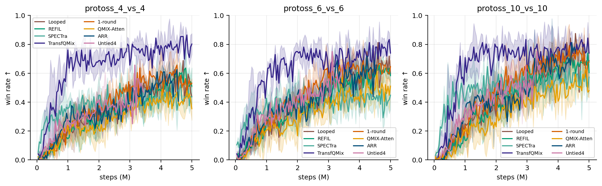

同类历史图另外保留[选定方法曲线](smacv2/figures/learning_selected_methods.png)与[约1.8M步的部分方法快照](smacv2/figures/learning_partial_snapshot.png)。三图的方法集与预算覆盖不同，部分曲线不能充当5M完整结果。

*图保留protoss_4_vs_4、protoss_6_vs_6、protoss_10_vs_10的既有验证胜率。曲线描述已经发生的训练验证，不补齐正式外推覆盖或改变权重资格。*

以下为旧main0923报告登记的三个训练种子胜率均值；完整逐种子、区间、checkpoint与覆盖登记见 [历史表与元数据](experiment.json) 的 `historical_report_tables`。旧表的±采用95% t半宽，不当作样本SD搬入本表。

| 历史方法 | 5v5 | 10v10 | 12v12 | 15v15 | 20v20 | 10v11 | 10v12 | 10v15 |
|---|---|---|---|---|---|---|---|---|
| REFIL | 0.578 | 0.648 | 0.608 | 0.574 | 0.443 | 0.210 | 0.049 | 0.000 |
| SPECTra | 0.382 | 0.449 | 0.429 | 0.378 | 0.283 | 0.122 | 0.026 | 0.000 |
| TransfQMix | 0.743 | 0.770 | 0.770 | 0.741 | 0.697 | 0.307 | 0.076 | 0.000 |

**训练完成、登记资格与终评覆盖分别按实际证据记录。** 本次保留的SMAC TransfQMix seed0/1/2权重，其checkpoint metadata均为 `progress.t_env=5000000`、`progress.status=completed`、`config.t_max=5000000`，支持三种子完成5M训练。旧inventory未登记这三份checkpoint，train仍标pending；归档同时保留 `registered_qualified=false`，不据过时pending否认训练完成，也不据权重或历史表补造正式终评覆盖。1-round、QMIX-Atten、ARR、Looped及IAR在旧main0923正式表仍为空。本说明因此不宣称关系方法已在SMAC复现HAD优势。


## other

未注册QMIX探索的239条学习记录保存于[learning.csv](other/data/learning.csv)；环境未登记，不能据此确认完整训练或正式评估，也不推断为SMAC结果。

## 数据与来源边界

| 成果 | 文件 |
|---|---|
| M1–M5冻结深度、实验臂与确认记录 | [loop_records.jsonl](had/extra_variants/data/loop_records.jsonl)、[loop_summary.csv](had/extra_variants/data/loop_summary.csv) |
| M1–M5原生机制记录与分析 | [mechanism_records.jsonl](had/extra_variants/data/mechanism_records.jsonl)、[mechanism_analysis.json](had/extra_variants/data/mechanism_analysis.json) |
| 候选验证派生分析 | [validation_analysis.json](had/extra_variants/data/validation_analysis.json) |
| 旧协议逐局与学习记录 | [episodes.csv](had/historical_protocols/data/episodes.csv)、[learning.csv](had/historical_protocols/data/learning.csv) |
| 旧probe与早期诊断 | [probe](had/historical_protocols/data/probe)、[early_diagnostics](had/historical_protocols/data/early_diagnostics) |
| 旧时延记录 | [timing.csv](had/historical_protocols/data/timing.csv) |
| SMACv2逐局与学习结果 | [数据目录](smacv2/data) |
| 完成状态、历史表、配置、来源映射 | `backup/summary.json`（本地完整汇总；必要表与索引见 [experiment.json](experiment.json)） |
| 原协议与决策 | [experiment.json](experiment.json) |


清理前完整字段核对补齐了1,154条独有历史诊断：M1 559、M2 349、M3 6、M5 240，M4没有本项遗漏。它们涉及反事实、深度执行、MAC和反馈计数，标为 `historical_scientific_diagnostic_variant` 且 `official_aggregate=false`。归档的循环逐场/机制文件共806,398条，原正式记录及表中成绩不变。另将486个mechanism汇总单元的归档协议标签纠正为原始记录实际使用的 `leaf1009_native_feedback_v1`，所有数值保持原样。重复计时差异保留汇总，不作为额外奖励样本；来源与字段核对口径见 `summary.json` 的 `archive.retention_verification`。

归并前主性能来源包含17学习方法367,200个正式回合、Rule/Random各7,200场、255,000条验证、15,300条dup辅助、48,600条历史深度与9,000条历史reader；当时canonical episodes为709,500行，learning为157,065条。这是来源合并前的规模登记，不能当作当前backup或当前主报告的单独回合数。

既有补充151,200条基线正式数据与14,400条锚点和canonical一致，不增加独立评估数。补充6,300条dup记录有2,398个损伤冲突、最大差19.68796079；错误环境标签的补充b2配置也未覆盖正确登记。这6,300条旧协议诊断原样保留于 [历史协议episodes.csv](had/historical_protocols/data/episodes.csv)，归档保留来源冲突与排除口径。

历史来源的科学记录范围分别保存：循环探索合并前934,110条唯一正式记录、747条历史回报变体、1,154条独有科学诊断变体与4,626个单元汇总；诊断变体保留原协议、checkpoint、MAC、反馈计数及浮点原值，并标记official_aggregate=false。它们不作为新增独立奖励样本。只保留报告/汇总而缺逐场raw或本地weights的来源明确按这一范围解释；0923导入的历史基线权重仍属于main0921来源，不复制成另一次训练。

归并前旧HAD文件覆盖为171,026条逐局、67,996条学习、806,398条循环记录、3,762条循环汇总、8,769条原生机制和60条旧时延。当前文件按上述类别存储，最新实际覆盖见summary.json；不以旧合并文件行数补造完成任务或独立样本。


## 早期独有结果与来源归并

旧 stash/index `5b9fffd` 中的下列来源尚未包含在既有 177 张历史表内，因此按原协议、预算与完成状态并入本报告。现有 177 张表与新增 21 张独有表统一保存在 [experiment.json](experiment.json) 的 `historical_report_tables`；另保留 57 份少量配置快照和 10 张必要原图。旧 main 报告/分章的六张表已在既有归档中，不重复新增；不恢复旧版本目录、重复报告、日志、PDF 副本或 `main.zip`。以下文字和表格是历史快照，不是新运行结果。

只确认了报告、配置和图片留档的来源，不推断当前存在完整 raw 或模型。main_v3 原登记 13/15 项训练完成，ALMA seed1/2 未开始；若原状态 complete 与不足预算的步数并存，保留这项事实，不改写为当前已完成训练。main_v4 的 REFIL/C−LN 复用既有模型和记录，不增加训练次数。ALMA 探针 NoMask 的 failed 状态与单种子 SD=0 均按原文保留，SD=0 不表示没有训练不确定性。

### 早期动态分组主线（main_v1）

归档日期：2026-09-14。本目录合并原 S1/S2 与 v2–v7：只保留结论、必要图表和少量配置快照。模型权重、sqlite 与其余大型文件已删除，不能再从本目录复现当时评估。各版底层、环境、任务难度和预算不同，胜率不能画成跨版本进步曲线。

原分散报告已收束到这一份。更细的文字若仍需要，见 Git 历史中的 `实验报告/实验报告_*.md`。

#### 总判据

这一主线没有得到可部署的动态分组学习方法。能稳定打出结构的是规则或带真实模拟器的规划；神经网络路线要么不优于同协议规则，要么未完成正式对照。2026-09-08 该主线停止后，研究改到 HAD damage 跨规模对照，见 main_v2（历史来源） 与 main_v3（历史来源）。

#### S1 / S2 与早期 Stage3

S1 用 REFIL-QMIX 做单目标、人数占优的局部防守。1,000,123 步后选优模型独立成功 **985/1,200（82.08%）**。这是局部执行器，不是完整上层分组。


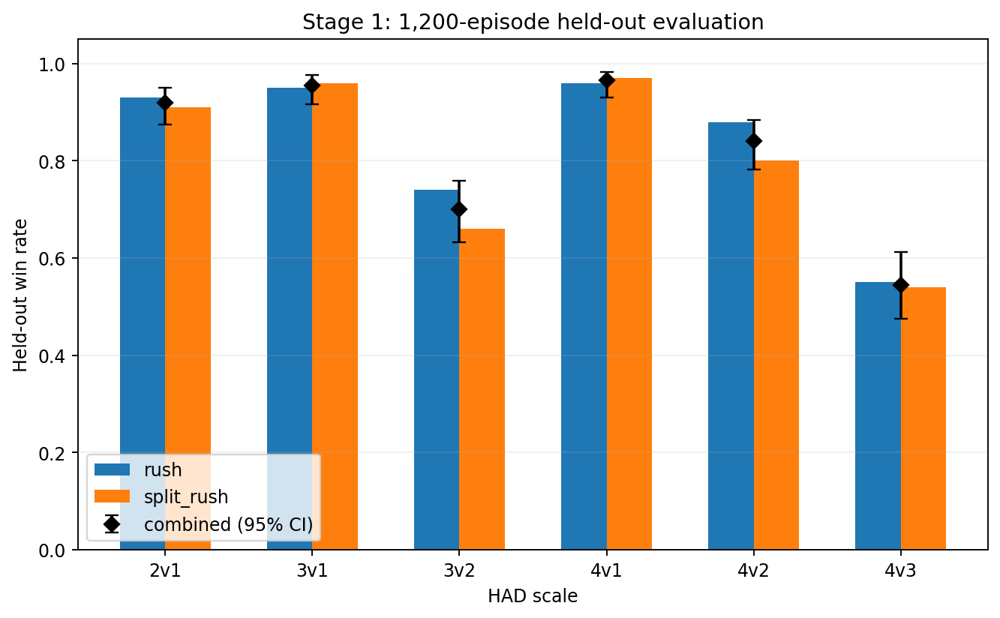

S2 在冻结 S1 上预测胜负与剩余时间。第一轮核心 Brier **0.1127**、时间 MAE **3.47**；身份对齐后为 **0.0757 / 2.69**。两次运行分别记账，不合并成一条曲线。


早期 Stage3 的身份分配、联盟搜索与未知上层推断按各自旧协议解释，不并入后续固定对手主线。

#### v2：学习释放对照规则释放

冻结局部执行器后，比较 PPO 选择释放＋重建（selective）与规则释放＋同一重建器（rule）。三种子、每模型约 100k 步，正式 1,800 局。

| 双方人数 | selective | rule |
|---:|---:|---:|
| 8 | 1.7% | 1.0% |
| 12 | 1.7% | 3.7% |
| 16 | 3.0% | 5.0% |

学习释放没有一致优势。


#### v3：更长训练仍未超过规则

修正冻结底层计数输入后，比较结构化候选 PPO、教师初始化 PPO 与候选 Double DQN。共同训练种子 20260906，正式各 500 局。验证选优成功 **83 / 84 / 90**，同协议规则 **98/500**。三路都没有超过规则；输入适配收益不算上层学习收益。


#### v4：共享规则底层上的直接学习与价值搜索

全部上层改用同一规则底层。三路 RL 各 200k 步，正式主表 **24 / 22 / 18 / 500**；B1/B2/B3 为 **19 / 20 / 0 / 500**，规则 **13/500**。全局 S2 排序约 **44.7%**。没有可靠的新学习优势。


#### v5：混合难度六路线

14/14 臂、21,000 正式执行完成。真实模拟器规划：rollout **58.8%**、MCTS-DPW **62.0%**，额外模拟约 400 倍环境步，不能当作可部署学习方法。候选 PPO / AR-PPO / ExIt 为 **14.9% / 18.3% / 17.6%**，未明确优于规则 **17.4%**。BRIDGE **21.0%**，区间跨 0。公共冻结 B1 **23.9%** 的优势主要来自较易配比。

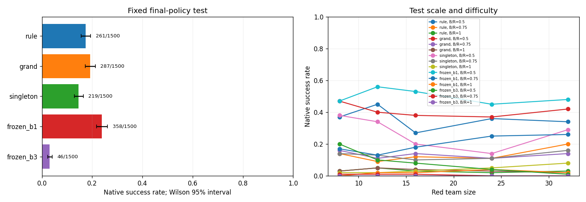


#### v6：新环境后中止

改用 HAD Workbench。S2 joint_v2 三份 40 epoch 完成，测试排序 **50.20%–52.67%**。RL 三条第一种子中止：ALMA_Alloc 约 69 万步、MAPPO_Intent 约 201 万步（2M 检查点主场景 21/800）、ALMA_S2 约 15 万步。规则主场景 13/800。六方法完整比较取消。


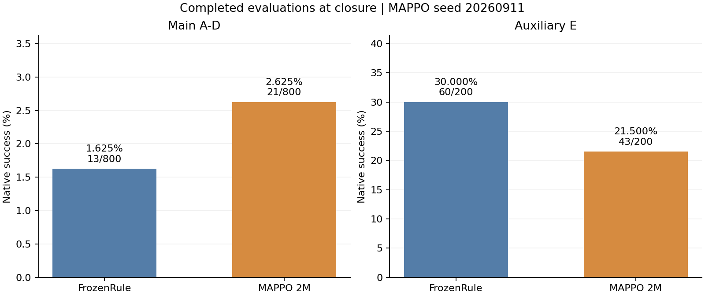


#### v7：环境标定与覆盖规则

不训练网络。协议 `rebuild-calibrated-v3-r2`。200 局 8v8：覆盖规则 **86/200**，历史分组规则 **152/200**，随机加速度 **2/200**。G2（随机胜率）未过，其余门禁过。与 v2–v6 胜率不可比。


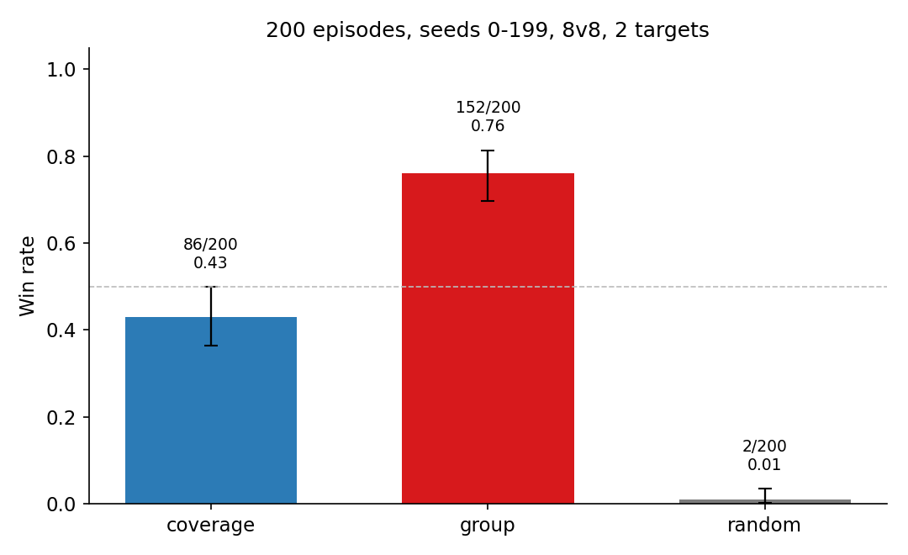

### 跨规模攻防泛化 v2（目录现为 main_v2）

更新时间：2026-09-10T16:15:17+08:00。比较 B0、B2、REFIL，各 3 个训练种子。 三种子均已结束。
训练的是红方，团队回报 $R=-D$（逐步奖励 $r_t=-\Delta D_t$）。训练池 $N\in\{4,6,8,10\}$、$K\in\{1,2,3\}$ 均匀采样；验证只看池内 4 配置；最终评估 14 个配置各 300 局。竖虚线右侧为未见规模。逐局与 loss 仍在同目录 CSV。

#### 结论

红方回报越高越好。训练池内随机约 $-5.28$，规则约 $-1.46$。三条学习曲线贴着随机，阴影是 3 个训练种子的标准差；全程到不了规则。
1M 步结束时验证回报 B0 $-6.30\pm0.75$，B2 $-6.86\pm1.35$，REFIL $-6.78\pm1.64$。后期没有稳定变好，最终评估用的是途中 best，不是曲线最右端。
原因在行为上：训练池内规则拦截率 0.73，随机 0.28，B0/B2/REFIL 为 0.28/0.30/0.31，接近随机。B2 同队碰撞死亡占比 0.27，高于随机 0.07 和规则 0.02。

#### 训练曲线

纵轴是红方整局回报 $R=-D$，与训练目标一致。每 2 万步在池内 4 配置上贪心 100 局，实线为三种子均值，色带为标准差。随机/规则是同一 4 配置上的水平基准（各 300 局，无训练种子）。途中不评外推。

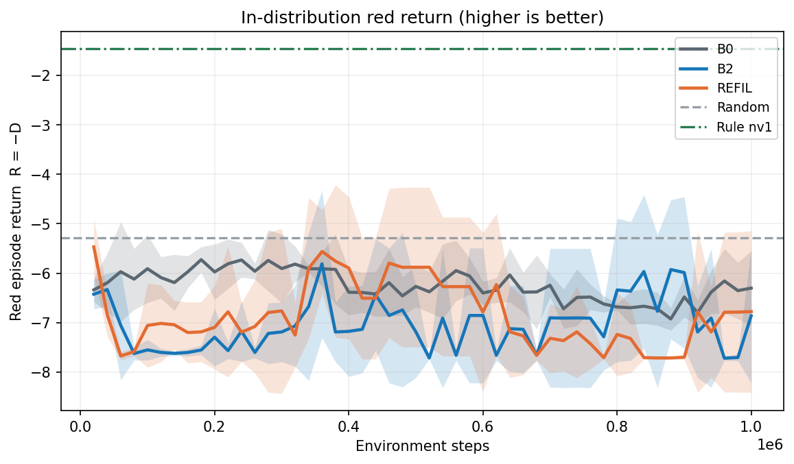

#### 最终评估

best 模型，每配置 300 局。图中误差线与表中 ± 都是跨训练种子的标准差。随机与规则锚点各 300 局，无训练种子。

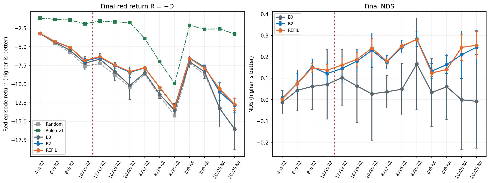

| 配置 | 轴 | 随机 D | 规则 D | B0 D | B2 D | REFIL D |
|---|---|---|---|---|---|---|
| 4v4 K2 | 训练池内 | 3.2220 | 1.1531 | 3.247±0.113 | 3.211±0.021 | 3.219±0.024 |
| 6v6 K2 | 训练池内 | 4.5503 | 1.3331 | 4.412±0.305 | 4.311±0.156 | 4.314±0.050 |
| 8v8 K2 | 训练池内 | 5.7461 | 1.4293 | 5.481±0.468 | 5.086±0.165 | 5.104±0.090 |
| 10v10 K3 | 训练池内 | 7.6034 | 1.9341 | 7.202±0.922 | 6.915±0.311 | 6.826±0.152 |
| 12v12 K2 | 外推 | 7.2507 | 1.5533 | 6.665±0.750 | 6.421±0.337 | 6.329±0.214 |
| 16v16 K2 | 外推 | 8.7998 | 1.6704 | 8.349±1.216 | 7.519±0.364 | 7.458±0.235 |
| 20v20 K2 | 外推 | 10.4198 | 1.7615 | 10.189±1.880 | 8.421±0.702 | 8.337±0.389 |
| 8v12 K2 | 外推 | 8.6772 | 3.8983 | 8.502±0.363 | 7.843±0.153 | 7.821±0.079 |
| 8v16 K2 | 外推 | 11.6272 | 7.0049 | 11.404±0.554 | 10.482±0.141 | 10.464±0.054 |
| 8v20 K2 | 外推 | 14.2530 | 9.9265 | 13.530±0.928 | 13.028±0.150 | 13.039±0.035 |
| 8v8 K4 | 外推 | 7.2015 | 2.1373 | 7.033±0.810 | 6.528±0.181 | 6.571±0.085 |
| 8v8 K6 | 外推 | 8.7262 | 2.6500 | 8.362±0.938 | 7.730±0.256 | 7.871±0.027 |
| 20v20 K4 | 外推 | 13.2383 | 2.6079 | 13.250±2.486 | 11.006±1.182 | 10.644±0.654 |
| 20v20 K6 | 外推 | 15.9305 | 3.2901 | 16.031±2.781 | 12.833±0.994 | 12.716±0.815 |

| 配置 | 轴 | B0 NDS | B2 NDS | REFIL NDS |
|---|---|---|---|---|
| 4v4 K2 | 训练池内 | -0.012±0.055 | 0.005±0.010 | 0.002±0.011 |
| 6v6 K2 | 训练池内 | 0.043±0.095 | 0.074±0.048 | 0.073±0.015 |
| 8v8 K2 | 训练池内 | 0.061±0.108 | 0.153±0.038 | 0.149±0.021 |
| 10v10 K3 | 训练池内 | 0.071±0.163 | 0.121±0.055 | 0.137±0.027 |
| 12v12 K2 | 外推 | 0.103±0.132 | 0.146±0.059 | 0.162±0.038 |
| 16v16 K2 | 外推 | 0.063±0.171 | 0.180±0.051 | 0.188±0.033 |
| 20v20 K2 | 外推 | 0.027±0.217 | 0.231±0.081 | 0.241±0.045 |
| 8v12 K2 | 外推 | 0.037±0.076 | 0.174±0.032 | 0.179±0.017 |
| 8v16 K2 | 外推 | 0.048±0.120 | 0.248±0.030 | 0.252±0.012 |
| 8v20 K2 | 外推 | 0.167±0.215 | 0.283±0.035 | 0.281±0.008 |
| 8v8 K4 | 外推 | 0.033±0.160 | 0.133±0.036 | 0.125±0.017 |
| 8v8 K6 | 外推 | 0.060±0.154 | 0.164±0.042 | 0.141±0.004 |
| 20v20 K4 | 外推 | -0.001±0.234 | 0.210±0.111 | 0.244±0.062 |
| 20v20 K6 | 外推 | -0.008±0.220 | 0.245±0.079 | 0.254±0.064 |

#### 行为诊断

与训练曲线相同的 4 个训练池配置。左图：蓝方被拦下的比例，越高说明红方越像在防守。右图：红方死于同队碰撞的人数占比，越低越好。误差线为训练种子标准差。


#### 运行状态

| 方法 | 种子 | 状态 | 已训步 | 预算 | 验证点 | best 验证 D | best 步数 |
|---|---|---|---|---|---|---|---|
| B0 | 0 | completed | 1000000 | 1000000 | 50/50 | 5.0159 | 60249 |
| B0 | 1 | completed | 1000000 | 1000000 | 50/50 | 5.1014 | 300156 |
| B0 | 2 | completed | 1000000 | 1000000 | 50/50 | 5.8012 | 540077 |
| B2 | 0 | completed | 1000000 | 1000000 | 50/50 | 4.9374 | 360245 |
| B2 | 1 | completed | 1000000 | 1000000 | 50/50 | 5.2840 | 440217 |
| B2 | 2 | completed | 1000000 | 1000000 | 50/50 | 4.8098 | 800296 |
| REFIL | 0 | completed | 1000000 | 1000000 | 50/50 | 4.8278 | 380376 |
| REFIL | 1 | completed | 1000000 | 1000000 | 50/50 | 4.9039 | 380097 |
| REFIL | 2 | completed | 1000000 | 1000000 | 50/50 | 4.8873 | 1000000 |

### 跨规模攻防泛化 main v3

更新时间：2026-09-14T20:01:35+08:00。比较 QMIX、REFIL、DCG、SPECTra、ALMA，各 3 个训练种子。 已完成 13/15 次训练。
本版本修复了 v2 的团队价值下界、$b_1$/$V$ 随规模缩放、红方全灭尾段与有序空槽四处问题，诊断见 v2 报告（历史来源） 与 差异清单（历史来源）。规则与随机锚点与算法无关；已有配置沿用 v2 的 300 局种子，新增配置按同一种子批补齐。
训练的是红方，团队回报 $R=-D$（逐步奖励 $r_t=-\Delta D_t$）。训练池 $N\in\{4,6,8,10\}$、$K\in\{1,2,3\}$ 均匀采样；验证只看池内 4 配置；最终评估 23 个配置各 300 局。外推分三条线：等规模 10/15/20/25/30/40v 同数，1:2 的 2v4/4v8/8v16/15v30/20v40，以及 10/15/20/30v 同数上的目标数 K=2/4/6。逐局与 loss 仍在同目录 CSV。
对照基线 QMIX 是实体注意力 mixer 的 QMIX，不是有序展平那一支。ALMA 是唯一的分层臂，低层与该 QMIX 同构，差别是多一层子任务分配：上层每 5 步把红方分到目标子任务；低层看全场，分配作为任务嵌入；mixer 是单路团队 Q，低层 TD 用团队回报。硬掩码原版和其余适配臂见 ALMA 探针（历史来源）。蓝方按“当前最近目标”归属，这是公开几何量；蓝方私有指派不进入红方输入。

#### 结论

红方回报越高越好。训练池内随机约 $-5.28$，规则约 $-1.46$。已有 1M 验证回报的方法：QMIX $-2.35\pm1.35$；REFIL $-0.74\pm0.12$；DCG $-2.08\pm0.39$；SPECTra $-2.78\pm0.15$；ALMA $-1.52\pm0.00$。最终评估用途中 best，不是曲线最右端。
QMIX高于随机、低于规则；REFIL达到或超过规则；DCG高于随机、低于规则；SPECTra高于随机、低于规则；ALMA高于随机、低于规则。
训练池内拦截率：规则 0.73，随机 0.28，QMIX 0.61，REFIL 0.77，DCG 0.68，SPECTra 0.60，ALMA 0.75。QMIX 同队碰撞死亡占比 0.11，随机 0.07，规则 0.02。

另有未列入对照的备选结果：B0（有序展平 QMIX，槽位按训练池定义，只评池内 4 配置）seed 0 池内验证回报 $-4.05$，拦截率 0.44；GNN（一层图卷积接到同一套 QMIX）seed 0 池内验证回报 $-3.24$，拦截率 0.58。不当正式基线，原始记录仍在 CSV。

#### 训练曲线

纵轴是红方整局回报 $R=-D$，与训练目标一致。每 2 万步在池内 4 配置上贪心 100 局，实线为三种子均值，色带为标准差。随机/规则是同一 4 配置上的水平基准（各 300 局，无训练种子）。途中不评外推。


#### 最终评估

best 模型，每配置 300 局。三张图分别是等规模 1:1、红蓝 1:2、以及目标数扩充。目标点图按 10/15/20/30v 分成四格，颜色与另外两张图相同。图中误差线与表中 ± 都是跨训练种子的标准差。随机与规则锚点各 300 局，无训练种子。

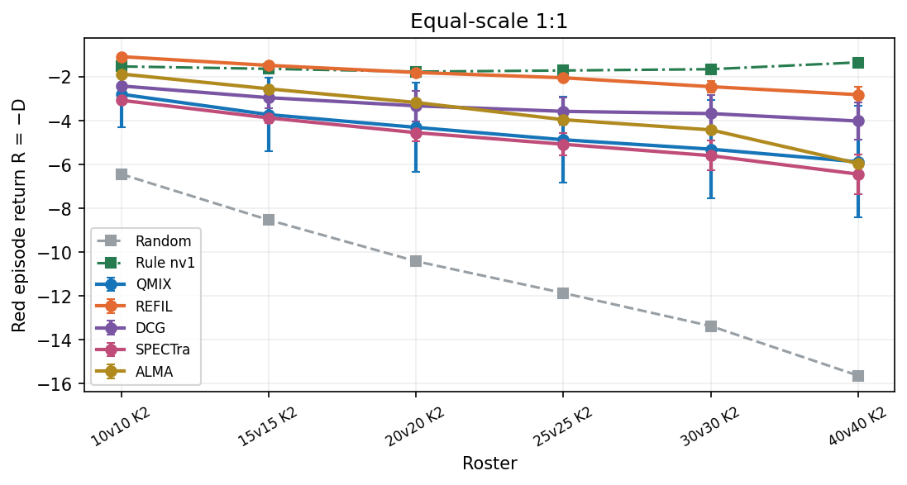


| 配置 | 轴 | 随机 D | 规则 D | QMIX D | REFIL D | DCG D | SPECTra D | ALMA D |
|---|---|---|---|---|---|---|---|---|
| 4v4 K2 | 训练池内 | 3.2220 | 1.1531 | 1.481±0.959 | 0.452±0.116 | 1.246±0.165 | 1.771±0.081 | 0.829 |
| 6v6 K2 | 训练池内 | 4.5503 | 1.3331 | 2.055±1.192 | 0.648±0.062 | 1.639±0.180 | 2.208±0.100 | 1.212 |
| 8v8 K2 | 训练池内 | 5.7461 | 1.4293 | 2.491±1.317 | 0.799±0.171 | 1.925±0.307 | 2.704±0.048 | 1.568 |
| 10v10 K3 | 训练池内 | 7.6034 | 1.9341 | 3.310±1.743 | 1.222±0.115 | 2.804±0.464 | 3.614±0.217 | 2.127 |
| 10v10 K2 | 等规模 | 6.4427 | 1.5252 | 2.793±1.509 | 1.078±0.117 | 2.416±0.535 | 3.070±0.051 | 1.868 |
| 15v15 K2 | 等规模 | 8.5340 | 1.6346 | 3.724±1.687 | 1.477±0.084 | 2.951±0.496 | 3.875±0.228 | 2.549 |
| 20v20 K2 | 等规模 | 10.4198 | 1.7615 | 4.307±2.024 | 1.801±0.104 | 3.323±0.697 | 4.548±0.378 | 3.171 |
| 25v25 K2 | 等规模 | 11.8713 | 1.7102 | 4.873±1.971 | 2.043±0.124 | 3.576±0.626 | 5.078±0.510 | 3.956 |
| 30v30 K2 | 等规模 | 13.3796 | 1.6516 | 5.303±2.245 | 2.449±0.256 | 3.677±0.861 | 5.599±0.681 | 4.421 |
| 40v40 K2 | 等规模 | 15.6423 | 1.3405 | 5.880±2.547 | 2.815±0.357 | 4.019±0.839 | 6.444±0.914 | 5.955 |
| 2v4 K2 | 1:2 | 3.8324 | 2.4111 | 2.647±0.478 | 2.230±0.072 | 2.841±0.152 | 2.781±0.052 | 2.348 |
| 4v8 K2 | 1:2 | 6.8170 | 4.1372 | 4.737±0.815 | 4.082±0.070 | 4.799±0.584 | 4.723±0.075 | 4.189 |
| 8v16 K2 | 1:2 | 11.6272 | 7.0049 | 8.134±0.921 | 7.460±0.194 | 8.124±0.760 | 8.011±0.247 | 7.525 |
| 15v30 K2 | 1:2 | 17.2523 | 10.5098 | 12.165±1.407 | 11.439±0.162 | 12.526±1.083 | 12.214±0.494 | 11.760 |
| 20v40 K2 | 1:2 | 21.2913 | 12.0435 | 14.442±1.397 | 13.296±0.259 | 14.768±1.465 | 14.592±0.975 | 13.725 |
| 10v10 K4 | 目标外推 | 8.1708 | 2.2271 | 3.871±2.029 | 1.428±0.178 | 3.098±0.582 | 4.291±0.419 | 2.428 |
| 10v10 K6 | 目标外推 | 10.0892 | 2.9133 | 4.528±2.448 | 1.682±0.274 | 4.236±1.301 | 5.338±0.661 | 2.767 |
| 15v15 K4 | 目标外推 | 10.8758 | 2.3953 | 4.834±2.593 | 1.845±0.193 | 4.040±0.700 | 5.504±0.360 | 3.271 |
| 15v15 K6 | 目标外推 | 13.1273 | 3.0755 | 5.752±3.018 | 2.256±0.216 | 5.036±1.455 | 7.104±0.855 | 3.783 |
| 20v20 K4 | 目标外推 | 13.2383 | 2.6079 | 5.494±2.491 | 2.467±0.122 | 4.497±0.669 | 6.581±0.794 | 4.156 |
| 20v20 K6 | 目标外推 | 15.9305 | 3.2901 | 6.918±3.554 | 2.921±0.225 | 5.552±1.272 | 8.552±1.200 | 4.962 |
| 30v30 K4 | 目标外推 | 16.9090 | 2.2192 | 7.002±3.016 | 3.329±0.274 | 5.023±0.715 | 8.424±0.990 | 5.583 |
| 30v30 K6 | 目标外推 | 20.8863 | 3.0635 | 8.625±4.130 | 3.986±0.372 | 6.479±1.358 | 10.810±1.021 | 7.197 |

| 配置 | 轴 | QMIX NDS | REFIL NDS | DCG NDS | SPECTra NDS | ALMA NDS |
|---|---|---|---|---|---|---|
| 4v4 K2 | 训练池内 | 0.841±0.463 | 1.339±0.056 | 0.955±0.080 | 0.701±0.039 | 1.157 |
| 6v6 K2 | 训练池内 | 0.776±0.370 | 1.213±0.019 | 0.905±0.056 | 0.728±0.031 | 1.038 |
| 8v8 K2 | 训练池内 | 0.754±0.305 | 1.146±0.040 | 0.885±0.071 | 0.705±0.011 | 0.968 |
| 10v10 K3 | 训练池内 | 0.757±0.308 | 1.126±0.020 | 0.847±0.082 | 0.704±0.038 | 0.966 |
| 10v10 K2 | 等规模 | 0.742±0.307 | 1.091±0.024 | 0.819±0.109 | 0.686±0.010 | 0.930 |
| 15v15 K2 | 等规模 | 0.697±0.245 | 1.023±0.012 | 0.809±0.072 | 0.675±0.033 | 0.868 |
| 20v20 K2 | 等规模 | 0.706±0.234 | 0.995±0.012 | 0.820±0.081 | 0.678±0.044 | 0.837 |
| 25v25 K2 | 等规模 | 0.689±0.194 | 0.967±0.012 | 0.816±0.062 | 0.669±0.050 | 0.779 |
| 30v30 K2 | 等规模 | 0.689±0.191 | 0.932±0.022 | 0.827±0.073 | 0.663±0.058 | 0.764 |
| 40v40 K2 | 等规模 | 0.683±0.178 | 0.897±0.025 | 0.813±0.059 | 0.643±0.064 | 0.677 |
| 2v4 K2 | 1:2 | 0.834±0.336 | 1.127±0.051 | 0.698±0.107 | 0.740±0.037 | 1.044 |
| 4v8 K2 | 1:2 | 0.776±0.304 | 1.021±0.026 | 0.753±0.218 | 0.782±0.028 | 0.981 |
| 8v16 K2 | 1:2 | 0.756±0.199 | 0.902±0.042 | 0.758±0.164 | 0.782±0.053 | 0.887 |
| 15v30 K2 | 1:2 | 0.755±0.209 | 0.862±0.024 | 0.701±0.161 | 0.747±0.073 | 0.815 |
| 20v40 K2 | 1:2 | 0.741±0.151 | 0.865±0.028 | 0.705±0.158 | 0.724±0.105 | 0.818 |
| 10v10 K4 | 目标外推 | 0.723±0.341 | 1.134±0.030 | 0.854±0.098 | 0.653±0.070 | 0.966 |
| 10v10 K6 | 目标外推 | 0.775±0.341 | 1.172±0.038 | 0.816±0.181 | 0.662±0.092 | 1.020 |
| 15v15 K4 | 目标外推 | 0.712±0.306 | 1.065±0.023 | 0.806±0.082 | 0.633±0.042 | 0.897 |
| 15v15 K6 | 目标外推 | 0.734±0.300 | 1.082±0.021 | 0.805±0.145 | 0.599±0.085 | 0.930 |
| 20v20 K4 | 目标外推 | 0.728±0.234 | 1.013±0.012 | 0.822±0.063 | 0.626±0.075 | 0.854 |
| 20v20 K6 | 目标外推 | 0.713±0.281 | 1.029±0.018 | 0.821±0.101 | 0.584±0.095 | 0.868 |
| 30v30 K4 | 目标外推 | 0.674±0.205 | 0.924±0.019 | 0.809±0.049 | 0.578±0.067 | 0.771 |
| 30v30 K6 | 目标外推 | 0.688±0.232 | 0.948±0.021 | 0.808±0.076 | 0.565±0.057 | 0.768 |

#### 行为诊断

与训练曲线相同的 4 个训练池配置。左图：蓝方被拦下的比例，越高说明红方越像在防守。右图：红方死于同队碰撞的人数占比，越低越好。误差线为训练种子标准差。


#### 运行状态

| 方法 | 种子 | 状态 | 已训步 | 预算 | 验证点 | best 验证 D | best 步数 |
|---|---|---|---|---|---|---|---|
| QMIX | 0 | complete | 940349 | 1000000 | 50/50 | 3.5500 | 940349 |
| QMIX | 1 | completed | 1000000 | 1000000 | 50/50 | 1.0614 | 980067 |
| QMIX | 2 | completed | 1000000 | 1000000 | 50/50 | 2.0668 | 1000000 |
| REFIL | 0 | complete | 920269 | 1000000 | 50/50 | 0.5878 | 920269 |
| REFIL | 1 | completed | 1000000 | 1000000 | 50/50 | 0.7418 | 960004 |
| REFIL | 2 | completed | 1000000 | 1000000 | 50/50 | 0.7167 | 960207 |
| DCG | 0 | completed | 1000000 | 1000000 | 50/50 | 1.6917 | 980316 |
| DCG | 1 | completed | 1000000 | 1000000 | 50/50 | 2.1101 | 920129 |
| DCG | 2 | completed | 1000000 | 1000000 | 50/50 | 1.3814 | 620146 |
| SPECTra | 0 | completed | 1000000 | 1000000 | 50/50 | 2.4869 | 980139 |
| SPECTra | 1 | completed | 1000000 | 1000000 | 50/50 | 2.5534 | 940250 |
| SPECTra | 2 | complete | 1000000 | 1000000 | 50/50 | 2.6089 | 1000000 |
| ALMA | 0 | completed | 1000014 | 1000000 | 50/50 | 1.4669 | 980177 |
| ALMA | 1 | 未开始 | 0 | 1000000 | 0/50 | — | — |
| ALMA | 2 | 未开始 | 0 | 1000000 | 0/50 | — | — |

#### 可靠性问题与三个改进方案

本节为 2026-09-13 的调研与方案分析。数值来自本版本已经完成的正式终评及已保存轨迹；未追加环境运行、训练或评估。下述三个方案均未实施，其预期收益属于待验证假设。文献采用原始论文与作者实现，检索范围包含 2025–2026 年工作。

**建议先从 REFIL 做小范围风险表示微调，再根据剩余失败类型决定是否引入动态责任分配或约束策略学习。** 当前最明确的问题是大规模内部碰撞损耗增长，以及平均损伤目标与整局可靠性之间的差别。“反应慢”有物理时序与隐藏意图方面的解释，但尚没有日志支持其平均决策延迟。

##### 1. 当前数据比原有平均分多说明了什么

本节的“严格零损伤完成”定义为：`terminated_naturally == true && D < 1e-9 && blue_left == 0`。它要求自然结束、目标没有受损且蓝方已全部退出；并不要求每个蓝方死亡都归类为 `intercepted`，因为该归类排除了碰撞。它也不表示红方全部存活。当前“1:1”指红蓝初始数量相等，已有正式配置没有字面意义的单红对单蓝实验。

正式 23 配置中有 18 个等人数配置，REFIL 共 18×3×300=16,200 局。其中严格零损伤完成 5,756 局，占 **35.53%**；单看 D=0 有 5,785 局，其中 29 局为截断。故当前成绩并非主要依赖拖到时间上限，但也距离稳定整局防守很远。

下表每个 REFIL 配置合计三个训练种子、900 局；规则每配置 300 局。训练种子与环境种子是不同随机性来源，不把 900 局当作 900 次独立训练。各训练种子使用相同的 300 个环境种子 9000–9299。正式配置与检查点筛选沿用现有协议。

| 等规模配置 | REFIL 严格完成 | 规则严格完成 | REFIL 同队碰撞死亡/初始红数 | 规则同口径 | REFIL 平均 D | 规则平均 D |
|---|---:|---:|---:|---:|---:|---:|
| 10v10 K2 | 362/900，40.22% | 43/300，14.33% | 4.73% | 2.73% | 1.078 | 1.525 |
| 15v15 K2 | 321/900，35.67% | 55/300，18.33% | 7.13% | 3.51% | 1.477 | 1.635 |
| 20v20 K2 | 279/900，31.00% | 49/300，16.33% | 8.96% | 4.17% | 1.801 | 1.762 |
| 25v25 K2 | 264/900，29.33% | 61/300，20.33% | 10.72% | 4.64% | 2.043 | 1.710 |
| 30v30 K2 | 253/900，28.11% | 77/300，25.67% | 12.98% | 5.71% | 2.449 | 1.652 |
| 40v40 K2 | 214/900，23.78% | 97/300，32.33% | 16.47% | 7.44% | 2.815 | 1.340 |

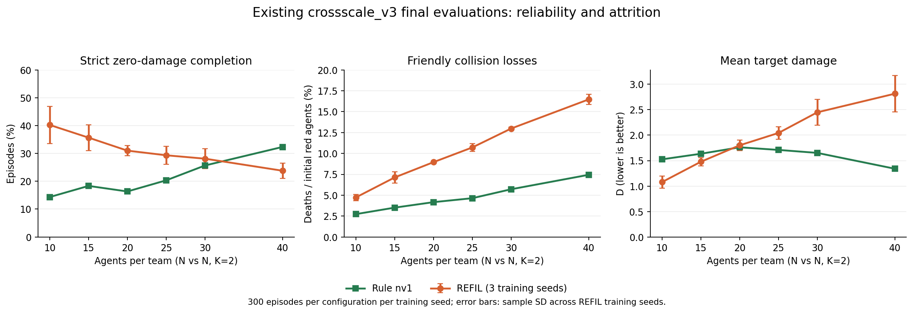

图：由已有终评绘制。REFIL 误差线为三个训练种子的样本标准差；规则只有一组环境种子结果。左图是上述严格完成率，中图是同队碰撞死亡占初始红方比例，右图是原始目标伤害。底层原始数据仍为 episodes.csv（历史来源），没有重新生成实验样本。

**首先，REFIL 是最佳学习方法，但不是在所有规模上都超过规则。** 40v40 K2 时，其平均每局约有 6.59 名红方死于同队碰撞，规则为 2.98 名；其平均 D 约为规则的 2.10 倍。REFIL 至少出现一次红红碰撞的局比例从 10v10 的 22.11% 上升到 40v40 的 98.89%。仅展示训练池内 3.56% 的同队碰撞死亡比例，会掩盖大规模损耗。

**其次，平均损伤与可靠完成可以给出不同排序。** 20v20 时 REFIL 的严格完成率高于规则，但平均 D 略高；30v30 时这种差别仍存在。不能仅凭平均 D 的一个排序，断言某方法在“稳定零漏防”上也更好。当前验证只最小化四个池内配置各 25 局的平均 D，并未直接优化严格完成率、尾部损伤或内部碰撞率。定义见 protocol.py（历史来源）。

**第三，同队碰撞与漏防相关，但现有数据还没有给出因果贡献。** 20v20 K2 的 REFIL 中，无同队碰撞死亡的 306 局平均 D=0.857，零损伤率 51.96%；出现这种死亡的 594 局平均 D=2.287，零损伤率 21.38%。初始几何与任务难度也可能同时造成碰撞和漏防，不能把两组差直接解释为消除碰撞后的收益。

**第四，存在至少两类不同失败过程。** 已存的 40v40 K2、REFIL seed 0、环境种子 9001，第一步已有红方死亡，第五步才出现首个蓝方死亡；整局同队碰撞死亡 10 名红方。第 34 步目标首次受损时红方已全灭、蓝方尚余 5 名，最终 D=7.810。另一条 20v20 K2、seed 0、环境种子 9000，整局同队碰撞死亡 2 名，第 43 步目标首次受损，最终 D=1，结束仍有 1 名红方存活。前者体现早期损耗与资源耗尽，后者说明漏防也会发生在尚有可用个体时。原始轨迹（历史来源）

这些轨迹仅覆盖每配置的环境种子 9000、9001，不代表总体；它们保存事后状态与动作，缺少完整物理事件流和策略意图，不能判断哪架红方“已经看见威胁却犹豫了几步”。

##### 2. 误伤、响应与可行性必须按实际环境解释

**“误伤”在当前记录中主要指红红碰撞，不能等同于友方爆炸伤害。** 原生爆炸逻辑不会让红方爆炸直接伤到红方。需要分开的现象是红红扫掠碰撞、多个红方围绕同一蓝方同时自毁造成的资源重复消耗，以及蓝方爆炸对附近红方的连带伤害。当前总表能量化第一类，无法仅用死亡汇总精确量化第二类。红红碰撞对数与死亡人数也不是固定的一比二关系。统计归因（历史来源）；原生爆炸与事件顺序（历史来源）

**REFIL 已经每个物理步决策，并且有 GRU。** 五步命令间隔属于蓝方重选目标；不能将 ALMA 的高层周期问题套在 REFIL 上。九个动作控制加速度，零动作是零加速度，并不表示刹车。实体输入已包含有效红蓝位置、速度和生命状态，且实际编码有相对实体视图；因此“补一个 RNN”“补相对位置”并不是针对当前实现的新解决方案。REFIL 配置（历史来源）；实体输入（历史来源）

**物理更新顺序会造成可见的一步响应延后。** 当前 dt=1 秒，位置及碰撞轨迹先按旧速度计算，动作随后改变速度，最早影响下一步位移。因此，在当前状态已经注定发生的本步扫掠碰撞，无法靠本步九动作选择挽救；若做预测或动作筛选，必须覆盖到动作能够产生差异的后续物理段。一个仅检查本步位置的一步安全 mask 在这里没有预期的动作区分能力。动力学实现（历史来源）

**最终消灭蓝方不等于及时保护目标。** 原生事件先确定开火标志，再基于统一状态结算；红方同一步消灭蓝方，不能撤销蓝方已经触发的目标伤害。这使及时预判比单纯追近更加重要，但还不能据此量化当前策略迟延。结算顺序（历史来源）

**蓝方意图在切换瞬间并非完全可观测。** 蓝方每五步或伤亡事件后重新抽样目标，其选择受当前布局影响；红方能看到物理状态，但不能读取蓝方私有目标。新目标在抽样瞬间未必已体现在位置和速度上。RNN 可以依据后续运动推断，却不能从相同可观测状态准确预知一次未公开的随机选择。蓝方策略（历史来源）；调度入口（历史来源）

**初始人数相同并不保证每个样本都存在零损伤策略。** 初始化只保证一定的位置间隔，不检查初始速度造成的首步碰撞、覆盖可行性或时空匹配。随机位置与速度允许出现首步动作无力改变的风险；个体损耗和不同抵达时刻也会破坏数量上的平衡。已有证据不能给出这些样本占比，更不能据此认定当前失败主要不可避免。初始化逻辑（历史来源）

原生碰撞循环还存在需要谨慎解释的顺序依赖：外层跳过已死亡对象，但一个对象在内层刚被判死后，仍可能继续参与后续碰撞检查；同时，更晚进入外层的死亡对象会被跳过。未按事件发生时刻完整重建之前，不能把每个多机死亡都解释为策略的一次独立错误，也不能从源码估计该机制贡献了多少损失。本次未改变物理协议。碰撞循环（历史来源）

**跨规模同时带来了更复杂的局部拥挤与交互。** 当前初始化空间尺度不会按人数线性扩张，数量扩展并非只有实体表长度变化。平均注意力能接收任意数量，不代表已经学会在更多相互竞争个体中保留风险信息。另一方面，当前奖励没有直接红红碰撞项，碰撞主要通过后续目标伤害影响回报，信用传递较间接；训练的折扣塑形目标与报告的未折扣 D 也应分开说明。训练奖励与尾段处理（历史来源）

### 跨规模攻防泛化 main v4

更新时间：2026-09-15T22:24:50+08:00。比较 REFIL-L0.15、REFIL-L0.30、REFIL-C、REFIL-C−LN、REFIL，以及规则锚点。 三个新臂的 seed 0 均已结束。
本批先训两个算法、三个任务，全部 seed 0。局部协作两臂只改 REFIL 辅助分组：先抽原版共享 $p$，再按与随机中心的距离缩放，$\pi_e=p\,s_e$，$s_e=(1-\eta)+\eta\exp(-d_{ie}^{2}/(2r^{2}))$。两臂 $r=0.4$（约 1000 m），$\eta=0.15$（更贴近原版）与 $\eta=0.30$（仍温和）。数量条件一臂只加 $\phi_2$ 有界计数，FiLM 调节注意力输出；分组仍是原版 REFIL。原版 REFIL、规则和随机复用 main v3（历史来源） 的 seed 0 / 锚点，不重跑。去 LN 的数量臂 REFIL-C−LN 复用 main v5（历史来源） seed 0，不重跑、不拷贝目录。
评估协议与 v3 相同：1M 物理步、50 次池内验证（4 配置×25 局）、终评 23 个配置各 300 局，指标 $D$ 与 NDS。图上学习方法一律用 seed 0，不把 v3 三种子均值画成对照。三种子接口已留，本批不排队。不把 C 与 G 叠在同一臂，也不做多尺度数量编码。
训练的是红方，团队回报 $R=-D$。训练池 $N\in\{4,6,8,10\}$、$K\in\{1,2,3\}$ 均匀采样；验证只看池内 4 配置。外推分三条线：等规模 10/15/20/25/30/40v 同数，1:2 的 2v4/4v8/8v16/15v30/20v40，以及 10/15/20/30v 同数上的目标数 K=2/4/6。逐局与 loss 仍在同目录 CSV。

#### 结论

红方回报越高越好。训练池内随机约 $-5.28$，规则约 $-1.46$。已有 1M 验证回报的方法（seed 0）：REFIL-L0.15 $-0.95$；REFIL-L0.30 $-1.42$；REFIL-C $-0.69$；REFIL-C−LN $-1.18$；REFIL $-0.60$。最终评估用途中 best，不是曲线最右端。
REFIL-L0.15达到或超过规则；REFIL-L0.30达到或超过规则；REFIL-C达到或超过规则；REFIL-C−LN达到或超过规则；REFIL达到或超过规则。
训练池内拦截率：规则 0.73，随机 0.28，REFIL-L0.15 0.74，REFIL-L0.30 0.70，REFIL-C 0.78，REFIL-C−LN 0.72，REFIL 0.77。

#### 分析

三臂配置与落盘一致：局部两臂 `imagine_group=mixed_distance`、$r=0.4$，$\eta=0.15$ / $0.30$；数量臂 `count_cond=phi2`、分组仍是原版。1M、50/50 验证、终评 23 配置×300 局均写完。评估时 pad 随 `n_agents`/`n_entities`/`n_tasks` 更新，数量切片红 / 蓝 / 目标槽不错位。去 LN 的数量臂复用 main v5（历史来源） seed 0 的同一套 $\phi_2$ FiLM（`count_ln=False`），不拷贝目录。
距离分组按约定是独立 Bernoulli：$s_e=(1-\eta)+\eta\exp(-d^2/(2r^2))$，$\pi_e=p\,s_e$，中心实体用未缩放的 $p$。给定 $p=0.5$ 时，任意实体与中心同组的概率恒为 $0.5$，距离并不制造“靠近就编进同一组”。它主要把组 A 的期望规模从 $p$ 压到 $p\,\bar s<p$。$\eta$ 越大，$\bar s$ 越小，组越瘦。终评里 L0.30 几乎处处差于 L0.15，两者都差于原版 REFIL，与这个收缩方向一致。带 LN 的数量臂在注意力输出上始终做 LayerNorm 再 FiLM；即使 $\alpha=\beta=0$，前向也与原版 REFIL 不完全相同。去掉 LN 之后，$\alpha=\beta=0$ 时前向与原版一致，学到的计数条件仍是另一条臂。
池内末点验证回报（seed 0，$R=-D$，越高越好）：REFIL-L0.15 $-0.95$；REFIL-L0.30 $-1.42$；REFIL-C $-0.69$；REFIL-C−LN $-1.18$；REFIL $-0.60$。规则约 $-1.46$。
终评 23 个配置中，最低 $D$ 次数：REFIL-L0.15 1，REFIL-L0.30 0，REFIL-C 3，REFIL-C−LN 0，REFIL 19。L0.30 的 $D$ ≥ L0.15 ≥ REFIL 的配置有 19/23。带 LN 的数量臂 $D$ 低于原版 REFIL 的配置有 3/23；去 LN 的有 0/23。训练池内最低平均 $D$ 是 REFIL；等规模最低平均 $D$ 是 REFIL；1:2最低平均 $D$ 是 REFIL；目标外推最低平均 $D$ 是 REFIL。
训练池内相对 REFIL：REFIL-L0.15 +0.42，REFIL-L0.30 +0.60，REFIL-C +0.17，REFIL-C−LN +0.47。等规模相对 REFIL：REFIL-L0.15 +0.54，REFIL-L0.30 +1.64，REFIL-C +0.46，REFIL-C−LN +0.95。1:2相对 REFIL：REFIL-L0.15 +0.06，REFIL-L0.30 +0.35，REFIL-C +0.09，REFIL-C−LN +0.17。目标外推相对 REFIL：REFIL-L0.15 +0.84，REFIL-L0.30 +2.11，REFIL-C +0.78，REFIL-C−LN +1.44。
等规模与目标外推上，原版 REFIL 的优势随编队变大而拉开；L0.30 在 30/40v 和 $K=6$ 掉得最明显。1:2 线上各学习方法彼此接近，大编队都略差于规则，说明劣势兵力下分组或计数都没有改掉原版已经碰到的墙。
池内同队碰撞死亡占比：规则 0.020，REFIL-L0.15 0.068，REFIL-L0.30 0.059，REFIL-C 0.039，REFIL-C−LN 0.055，REFIL 0.034。
以上都是单一种子。不能把 L0.15 与数量臂相对原版的差距读成显著变差，方向却一致：这几处改动都没有超过已修正的原版 REFIL。

#### 训练曲线

纵轴是红方整局回报 $R=-D$，与训练目标一致。每 2 万步在池内 4 配置上贪心 100 局。当前各学习方法只有 seed 0，没有跨训练种子色带。REFIL 是 v3 seed 0 的复用曲线；REFIL-C−LN 是 v5 seed 0 的复用曲线。点划线是同一 4 配置上的规则基准（300 局）。图上不画随机，以免纵轴被拉开；随机数字仍在终评表里，并用于 NDS。途中不评外推。


#### 最终评估

best 模型，每配置 300 局。三张图分别是等规模 1:1、红蓝 1:2、以及目标数扩充。目标点图按 10/15/20/30v 分成四格，颜色与另外两张图相同。当前为 seed 0，表中不写跨训练种子标准差。图上只留规则锚点；随机仍在表中，复用 v3 各 300 局。

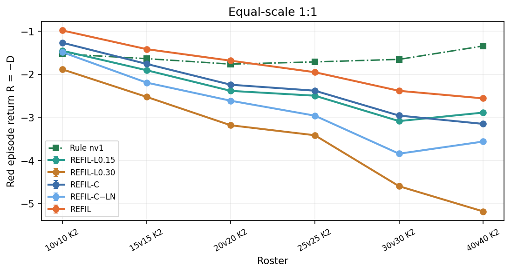


| 配置 | 轴 | 随机 D | 规则 D | REFIL-L0.15 D | REFIL-L0.30 D | REFIL-C D | REFIL-C−LN D | REFIL D |
|---|---|---|---|---|---|---|---|---|
| 4v4 K2 | 训练池内 | 3.2220 | 1.1531 | 0.664 | 0.559 | 0.315 | 0.582 | 0.360 |
| 6v6 K2 | 训练池内 | 4.5503 | 1.3331 | 0.962 | 1.000 | 0.722 | 0.949 | 0.580 |
| 8v8 K2 | 训练池内 | 5.7461 | 1.4293 | 1.169 | 1.455 | 0.888 | 1.202 | 0.605 |
| 10v10 K3 | 训练池内 | 7.6034 | 1.9341 | 1.559 | 2.058 | 1.434 | 1.800 | 1.118 |
| 10v10 K2 | 等规模 | 6.4427 | 1.5252 | 1.451 | 1.884 | 1.264 | 1.485 | 0.980 |
| 15v15 K2 | 等规模 | 8.5340 | 1.6346 | 1.903 | 2.522 | 1.757 | 2.191 | 1.414 |
| 20v20 K2 | 等规模 | 10.4198 | 1.7615 | 2.383 | 3.182 | 2.240 | 2.612 | 1.682 |
| 25v25 K2 | 等规模 | 11.8713 | 1.7102 | 2.495 | 3.414 | 2.379 | 2.959 | 1.950 |
| 30v30 K2 | 等规模 | 13.3796 | 1.6516 | 3.085 | 4.598 | 2.957 | 3.843 | 2.382 |
| 40v40 K2 | 等规模 | 15.6423 | 1.3405 | 2.888 | 5.184 | 3.150 | 3.560 | 2.557 |
| 2v4 K2 | 1:2 | 3.8324 | 2.4111 | 2.212 | 2.199 | 2.245 | 2.242 | 2.153 |
| 4v8 K2 | 1:2 | 6.8170 | 4.1372 | 4.140 | 4.082 | 3.930 | 4.185 | 4.013 |
| 8v16 K2 | 1:2 | 11.6272 | 7.0049 | 7.502 | 7.656 | 7.351 | 7.538 | 7.387 |
| 15v30 K2 | 1:2 | 17.2523 | 10.5098 | 11.275 | 11.780 | 11.297 | 11.454 | 11.257 |
| 20v40 K2 | 1:2 | 21.2913 | 12.0435 | 13.105 | 13.983 | 13.578 | 13.367 | 13.139 |
| 10v10 K4 | 目标外推 | 8.1708 | 2.2271 | 1.887 | 2.227 | 1.774 | 2.178 | 1.271 |
| 10v10 K6 | 目标外推 | 10.0892 | 2.9133 | 2.303 | 2.513 | 2.127 | 2.487 | 1.438 |
| 15v15 K4 | 目标外推 | 10.8758 | 2.3953 | 2.376 | 3.323 | 2.246 | 2.915 | 1.642 |
| 15v15 K6 | 目标外推 | 13.1273 | 3.0755 | 2.848 | 3.802 | 2.932 | 3.492 | 2.023 |
| 20v20 K4 | 目标外推 | 13.2383 | 2.6079 | 2.978 | 4.280 | 2.733 | 3.565 | 2.337 |
| 20v20 K6 | 目标外推 | 15.9305 | 3.2901 | 3.889 | 5.411 | 3.608 | 4.580 | 2.733 |
| 30v30 K4 | 目标外推 | 16.9090 | 2.2192 | 3.747 | 6.066 | 3.918 | 4.803 | 3.074 |
| 30v30 K6 | 目标外推 | 20.8863 | 3.0635 | 4.748 | 7.373 | 4.997 | 5.553 | 3.563 |

| 配置 | 轴 | REFIL-L0.15 NDS | REFIL-L0.30 NDS | REFIL-C NDS | REFIL-C−LN NDS | REFIL NDS |
|---|---|---|---|---|---|---|
| 4v4 K2 | 训练池内 | 1.236 | 1.287 | 1.405 | 1.276 | 1.384 |
| 6v6 K2 | 训练池内 | 1.115 | 1.103 | 1.190 | 1.119 | 1.234 |
| 8v8 K2 | 训练池内 | 1.060 | 0.994 | 1.125 | 1.053 | 1.191 |
| 10v10 K3 | 训练池内 | 1.066 | 0.978 | 1.088 | 1.024 | 1.144 |
| 10v10 K2 | 等规模 | 1.015 | 0.927 | 1.053 | 1.008 | 1.111 |
| 15v15 K2 | 等规模 | 0.961 | 0.871 | 0.982 | 0.919 | 1.032 |
| 20v20 K2 | 等规模 | 0.928 | 0.836 | 0.945 | 0.902 | 1.009 |
| 25v25 K2 | 等规模 | 0.923 | 0.832 | 0.934 | 0.877 | 0.976 |
| 30v30 K2 | 等规模 | 0.878 | 0.749 | 0.889 | 0.813 | 0.938 |
| 40v40 K2 | 等规模 | 0.892 | 0.731 | 0.873 | 0.845 | 0.915 |
| 2v4 K2 | 1:2 | 1.140 | 1.149 | 1.117 | 1.119 | 1.182 |
| 4v8 K2 | 1:2 | 0.999 | 1.021 | 1.077 | 0.982 | 1.046 |
| 8v16 K2 | 1:2 | 0.893 | 0.859 | 0.925 | 0.885 | 0.917 |
| 15v30 K2 | 1:2 | 0.887 | 0.812 | 0.883 | 0.860 | 0.889 |
| 20v40 K2 | 1:2 | 0.885 | 0.790 | 0.834 | 0.857 | 0.881 |
| 10v10 K4 | 目标外推 | 1.057 | 1.000 | 1.076 | 1.008 | 1.161 |
| 10v10 K6 | 目标外推 | 1.085 | 1.056 | 1.110 | 1.059 | 1.206 |
| 15v15 K4 | 目标外推 | 1.002 | 0.891 | 1.018 | 0.939 | 1.089 |
| 15v15 K6 | 目标外推 | 1.023 | 0.928 | 1.014 | 0.959 | 1.105 |
| 20v20 K4 | 目标外推 | 0.965 | 0.843 | 0.988 | 0.910 | 1.025 |
| 20v20 K6 | 目标外推 | 0.953 | 0.832 | 0.975 | 0.898 | 1.044 |
| 30v30 K4 | 目标外推 | 0.896 | 0.738 | 0.884 | 0.824 | 0.942 |
| 30v30 K6 | 目标外推 | 0.906 | 0.758 | 0.892 | 0.860 | 0.972 |

#### 行为诊断

与训练曲线相同的 4 个训练池配置。左图：蓝方被拦下的比例，越高说明红方越像在防守。右图：红方死于同队碰撞的人数占比，越低越好。当前为 seed 0。图上不画随机。


#### 运行状态

| 方法 | 种子 | 状态 | 已训步 | 预算 | 验证点 | best 验证 D | best 步数 |
|---|---|---|---|---|---|---|---|
| REFIL-L0.15 | 0 | completed | 1000000 | 1000000 | 50/50 | 0.9460 | 1000000 |
| REFIL-L0.30 | 0 | completed | 1000000 | 1000000 | 50/50 | 1.0972 | 740193 |
| REFIL-C | 0 | completed | 1000000 | 1000000 | 50/50 | 0.6750 | 820073 |
| REFIL-C−LN | 0 | 复用 v5 | 780139 | 1000000 | 50/50 | 1.0754 | 780139 |
| REFIL | 0 | 复用 v3 | 920269 | 1000000 | 50/50 | 0.5878 | 920269 |

### ALMA 场景适配对照（alma_probe_v3）

更新时间：2026-09-14T20:02:38+08:00。这是 main v3 的补充对照，只留验证记录和本报告，不保留权重。主实验中的 ALMA 已换成全场臂，名称仍是 ALMA；硬掩码原版留在这里。 五臂对照已齐：四条适配臂有本目录验证记录，硬掩码三种子为迁移前留档。
适配臂各 1 个种子、1,000,000 物理步、50 个池内验证点。硬掩码 ALMA 原为三种子正式训练，逐局 CSV 未转入本目录，数字抄自迁移前主报告。主报告结论以 main v3（历史来源） 为准。
前三刀是递进关系；**ALMA-NoMask** 从全场臂分叉。**ALMA-掩码** 是原论文默认硬掩码路径。

- **ALMA-掩码**（`alma`）：目标子任务，硬掩码，每任务一个 Q，子任务奖励，每 5 步分配。
- **ALMA-全场**（`alma_fullobs`）：去掉硬掩码，低层看全场；单路团队 Q，团队回报。主实验现用这一路，仍称 ALMA。
- **ALMA-蓝方**（`alma_blue`）：在全场之上把子任务改成活着的蓝方槽，训练垫 10、评估宽 40。
- **ALMA-事件**（`alma_event`）：在蓝方子任务之上改为伤亡 / 公开最近目标变化 / 最多 10 步再分配。
- **ALMA-NoMask**（`alma_nomask`）：全场任务标签在注意力之前进入实体；每任务一个 Q，子任务奖励。

对照虚线来自 main v3 的 QMIX / REFIL seed 0 第 50 个验证点，以及同一套规则 / 随机锚点。

#### 结论

红方回报越高越好。v3 池内随机约 $-5.28$，规则约 $-1.46$。
1M 末验证回报：ALMA-掩码 $-6.07\pm0.47$；ALMA-全场 $-1.52\pm0.00$；ALMA-蓝方 $-1.88\pm0.00$；ALMA-事件 $-4.88\pm0.00$；ALMA-NoMask $-6.79\pm0.00$。全场接近规则；蓝方次之；事件高于随机、低于规则；掩码与 NoMask 后期塌缩，接近随机。主实验因此用全场臂作为 ALMA。

#### 硬掩码 ALMA 留档

三种子正式训练曾在 main v3 完成。迁移时逐局验证记录未能写入本目录，下表抄自当时主报告，不是重新评估。seed 0 末点约 $-6.57$，三种子末点均值 $-6.07\pm0.47$，池内拦截率 0.38。

| 种子 | 来源 | 已训步 | 验证点 | best 验证回报 | best 步数 |
|---|---|---|---|---|---|
| 0 | archived | 1000000 | 50/50 | -3.7300 | 280358 |
| 1 | archived | 1000000 | 50/50 | -4.7500 | 580119 |
| 2 | archived | 1000000 | 50/50 | -4.7000 | 200113 |

#### 训练池内验证曲线

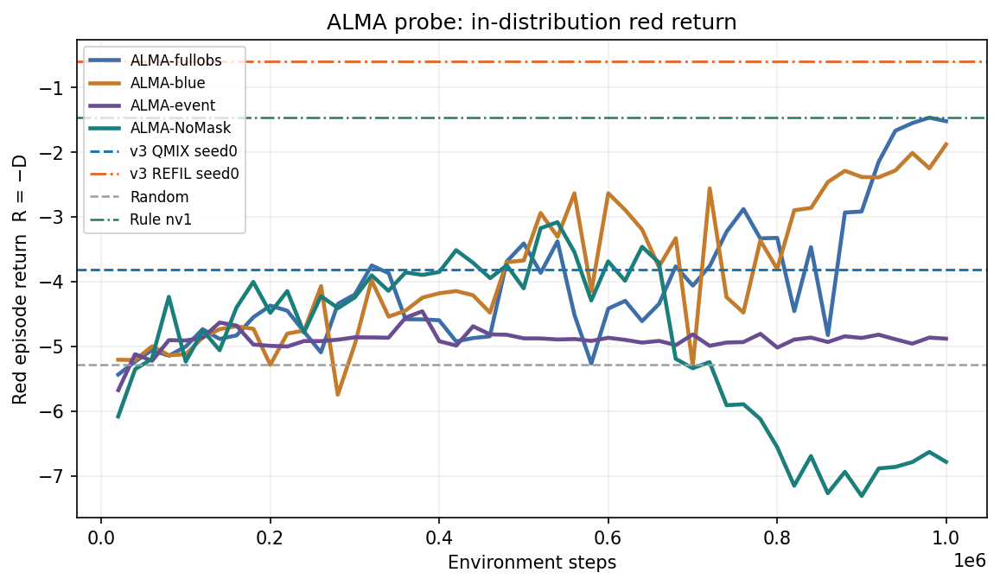

#### 当前验证点

| 方法 | 验证点 | 步数 | 回报 | 标准差 |
|---|---|---|---|---|
| ALMA-掩码 | 50 | 1000000 | -6.0700 | 0.4700 |
| ALMA-全场 | 50 | 1000014 | -1.5217 | 0.0000 |
| ALMA-蓝方 | 50 | 1000000 | -1.8805 | 0.0000 |
| ALMA-事件 | 50 | 1000000 | -4.8822 | 0.0000 |
| ALMA-NoMask | 50 | 1000000 | -6.7857 | 0.0000 |

#### 运行状态

| 方法 | 种子 | 状态 | 已训步 | 预算 | 验证点 | best 验证回报 | best 步数 |
|---|---|---|---|---|---|---|---|
| ALMA-全场 | 0 | completed | 1000014 | 1000000 | 50/50 | -1.4669 | 980177 |
| ALMA-蓝方 | 0 | completed | 1000000 | 1000000 | 50/50 | -1.8805 | 1000000 |
| ALMA-事件 | 0 | completed | 1000000 | 1000000 | 50/50 | -4.4594 | 380094 |
| ALMA-NoMask | 0 | failed | 1000000 | 1000000 | 50/50 | -3.0823 | 540072 |

### main_v2 已存故障证据

这是旧数据的分析，未执行新训练或评估。旧 B2/REFIL 的非负 V 和 softmax 混合造成 Q_tot≥−1 下界，已存自然终止标签 −5.455414122 无法表示；各 84 条评估轨迹的折扣回报均低于 −1，均值为 −5.49/−5.20。红方全灭后的旧状态分支恒零，但两条已存尾段仍新增 D=7 与 12.1399。B0/B2/REFIL 各 12,600 局终评的时限截断为 395/469/439。旧建议和静态证明不表示新训练或性能已完成；全部六张原分析表（含方案比较）保存在 `experiment.json`，下列为真实日志汇总。

| 方法/种子 | 局内团队 Q 均值的平均 | 局内个体 Q 均值的平均 |
|---|---:|---:|
| B2/0 | −0.928834 | −1172.664 |
| B2/1 | −0.928681 | −1133.564 |
| B2/2 | −0.953460 | −2325.771 |
| REFIL/0 | −0.872672 | −248.290 |
| REFIL/1 | −0.933234 | −1747.330 |
| REFIL/2 | −0.954304 | −1366.277 |

| 方法 | seed 0 | seed 1 | seed 2 | 三种子合计 |
|---|---:|---:|---:|---:|
| B0 | 0.1832% | 0.0965% | 0.1197% | 0.1331% |
| B2 | 5.5066% | 3.8399% | 5.6130% | 4.9865% |
| REFIL | 3.5888% | 7.4660% | 4.9712% | 5.3420% |

### 已归并分支的成果身份

`leaf/main1009-dual-route@608d9c2` 的既有成果与两种时延协议归当前主数据及主报告；环境中 280 场时延与无环境的 1,400 次固定输入调用分别记账。`remote_train@1fa1fa6`（导入提交 `f4ffe5b`）中的 manifest、13 份压缩 CSV 切片、21 对 final/config 是已复用的 main0921 来源，当前主目录/归档按 source_version、checkpoint 和 artifact_map 登记，不增加训练次数或独立样本。`experiment/main1013@b42a238` 只有 memory-placement 实现与待执行协议，无新完成成果，不混入正式结果。完整源提交号和保留范围见 `experiment.json/source_refs`；旧提交号记录来源，不承诺删除旧分支后能永久恢复整个旧目录。
