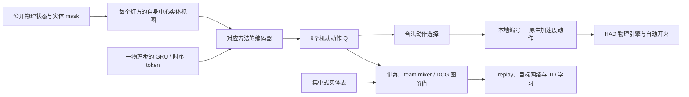
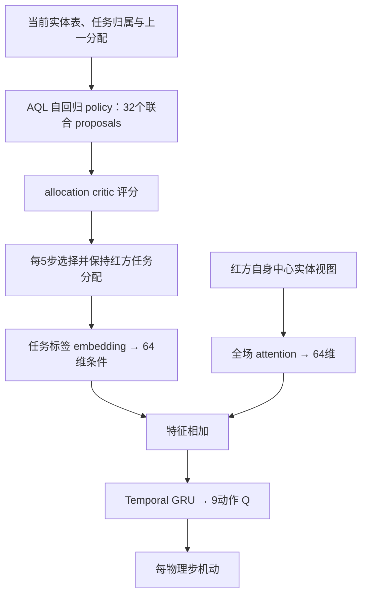
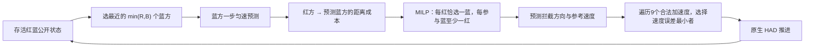

# LEAF 对比基线与 Rule 实现说明

更新：2026-10-14。本文说明 **HAD 主实验中的学习基线、Rule 和 Random 实际怎样计算与训练**，依据现有源码、保留权重的 config.json 和归并后的实验登记。它与[方法与变体说明](LEAF_方法与变体说明.md)、[主实验结果分析](LEAF_主实验结果分析.md)配套阅读：前者介绍 NoMem 及其变体，后者给出成绩与统计；本文负责解释对手方法的实现。

## 1. 总结：主实验到底在和什么比较

主实验包含七个学习基线，加上两个不训练的策略。它们的名字指的是**本项目的 HAD 适配版本**，不能仅按原论文名称猜测网络。

| 报告名称 | 保存方法名 | 实际核心 | 时间记忆 | 动作如何确定 |
|---|---|---|---|---|
| REFIL | refil | 一层自身查询的实体注意力 + imagined 分组辅助 TD + FlexQMIX | 每个红方的64维 GRU | 个体合法动作 Q 的贪心 / ε-greedy |
| REFIL-matched | refil_matched | REFIL 的 attention 后增加残差 MLP，使 actor 参数接近 NoMem | 64维 GRU | 同 REFIL |
| QMIX-Atten | b2_qmix_atten | REFIL 同型 actor + FlexQMIX，关闭 imagined 辅助训练 | 64维 GRU | 个体合法动作 Q 的贪心 / ε-greedy |
| DCG | dcg | 注意力 + GRU；个体 utility 与两两 payoff；完整协调图 | 64维 GRU | 8轮 Max-Sum 得到联合动作，再施加探索 |
| SPECTra | spectra | 类型投影 + 自身查询注意力 SAQA；集合超网络生成动态 mixer | 64维 GRU | 个体合法动作 Q 的贪心 / ε-greedy |
| ALMA | alma | 学习目标任务分配 AQL；任务条件 attention + GRU + FlexQMIX | 64维 GRU；另保留任务分配 | 每5步分配任务；每步输出9动作 Q |
| TransfQMix | transfqmix | actor 与 mixer 均使用 Transformer；时序 token 承接历史 | actor 32维 token；mixer 三个32维 token | 个体合法动作 Q 的贪心 / ε-greedy |
| Rule | rule_nv1 | 一步蓝方位置预测 + 0–1 整数指派 + 离散加速度控制 | 无学习记忆；每步重算 | 集中式 MILP 指派后逐机选动作 |
| Random | random / random_accel | 每个存活红方每步均匀随机选合法机动动作 | 随机数流 | 每个动作概率1/9 |

需要先记住四点：

1. **QMIX-Atten 在这里用的是 FlexQMIX**，不是把固定长度全局 state 展平后交给原始 QMIX。
2. **所有七个学习基线都有时间记忆**。TransfQMix 用时序 token，其余用 GRU；NoMem 的名称也不表示删除时间记忆。
3. **Rule 是 nv1 整数指派与一步预测拦截**。早期覆盖规则、原生 RulePolicy、蓝方 reactive 对手都是不同实现。
4. 各方法共享任务与环境步预算，但编码、学习目标、优化器和推理计算不同。已有结果证明的是这些保留实现之间的性能差异，不能直接解释成严格相同计算量下的比较。

## 2. 共同任务、输入与动作接口

### 2.1 它们控制什么，学习什么

主实验为二维 HAD damage 任务：红方防御者保护目标，蓝方按照固定策略类别进攻。学习策略只控制红方。每个物理步输出各红方的机动动作，开火、自毁、碰撞和目标伤害由原生 HAD 引擎处理；模型没有单独的开火或“选择攻击实体”动作。

学习采用集中式团队价值训练。REFIL、QMIX-Atten、SPECTra、ALMA、TransfQMix 通过 mixer 学习团队 Q；DCG 直接将图中的 utility 和 payoff 合成团队 Q。物理动作执行不需要普通单调 mixer，但 DCG 需要联合动作消息计算，ALMA 需要上层任务分配。HAD 当前实体接口提供公开场景信息，不能据此宣称已经验证了任意局部观测场景下的通信限制。

正式性能指标为累计目标损伤 D，越小越好；未塑形回报 R=−D。damage 模式目标损伤不以目标初始 HP 封顶，不能将 D 当成失败率或胜率。

训练奖励另包含势函数塑形：

$$
r_t^{train}=-\Delta D_t+\beta\,[\gamma\Phi(s_{t+1})-\Phi(s_t)],
$$

其中保存配置的 β=1、γ=0.99；Φ 是存活蓝方接近最近目标的负向势函数，距离尺度为4000。自然结束与时间截断分别处理，红方全灭后仍推进蓝方的物理尾段。正式报告统计的是完整物理伤害，**不把塑形奖励作为论文成绩**。damage 路径也不能仅因配置保留 friendly_penalty 字段，就写成实际加入了友方碰撞惩罚。

接口和奖励细节见[环境封装](../Open-SCORE/open_score/envs/had_wrapper.py)及[HAD 环境与问题建模](HAD_环境与问题建模.md)。

### 2.2 输入不是图片，而是实体集合

基础实体特征为10维：

| 字段 | 含义 |
|---|---|
| x、y | 位置，按2500归一化 |
| vx、vy | 速度，按120归一化 |
| alive、health | 存活与归一化生命值特征 |
| target_damage_share | 目标累计损伤除以开局蓝方数量；用于目标行 |
| is_red、is_blue、is_target | 三类实体标记 |

每个 observer 的 actor 使用临时的自身中心视图：

- 自身移到第0行，保留自身绝对位置、速度。
- 其他实体的位置、速度减去自身位置、速度。
- 死亡、padding 和不可用实体按 mask 排除；mask=True 表示无效。
- 保留实体身份对应的槽位，死亡后不把其他红方的历史 hidden 挪过来。

REFIL、REFIL-matched、QMIX-Atten、DCG、ALMA 启用 entity_last_action：红方实体追加上一动作9维 one-hot，蓝方和目标的这一段为零，首步为零。因此这些 actor 的输入宽度是 **19**。归档 SPECTra 和 TransfQMix 权重使用基础 **10维**输入。这是确定的信息条件差异，不能仅凭旧成绩断言其影响大小。

`main1013_base` 将当前 HAD 两个基线的 actor、online/target mixer 和冻结评估输入统一补齐为19维，读取实际执行的 `actions_onehot[t-1]`，不读取本步动作。新投影从头训练；加载历史 `entity_last_action=false` 权重仍使用10维。SMACv2 保留原生输入，开关仍关闭。obs_last_action=false 与 entity_last_action=true 可以同时成立，它们是不同开关；当前七方法均不额外附加 agent ID。六个模型及其验证、正式与确认评估均已完成并归入main；结果和历史10维对照统一见[主报告](LEAF_主实验结果分析.md)，当前比较使用`paper_current`。

actor 的相对实体视图和训练 mixer 的集中式绝对实体表也不是同一个张量。基础特征与视图转换见[features.py](../Open-SCORE/open_score/envs/features.py)和[entity_encoder.py](../Open-SCORE/open_score/models/entity_encoder.py)。

### 2.3 场景人数、padding 与参数尺寸要分开

实际训练场景为红蓝平衡人数 N∈{4,6,8,10}、目标数 K∈{1,2,3}。当前训练回放接口上界为10红、10蓝、3目标，评估接口为50红、50蓝、12目标。部分旧配置保存了更大的 padding 上界；**保存槽数不等于当时每局真实人数**。

集合编码器的参数由特征宽度和 embedding 宽度决定，能重新构建更大的实体表。DCG 按运行 agent 槽位建立候选图边，SPECTra 按槽位生成 mixer 矩阵，TransfQMix 增加实体 token。加载权重时依据 checkpoint 保存配置还原算法，再按当前接口重建运行尺寸；并非在评估时训练新参数。槽位适配也不表示每步按存活数自动裁去全部图或 mixer 计算。ALMA 还有任务标签容量限制，见第7节。

这说明结构可以加载、表达更大场景，是否有效仍由正式 OOD 结果判断。

### 2.4 九个动作是九个加速度基元

二维动作包括零加速度、四个轴向和四个归一化对角方向，来自原生27个三维动作中的 z=0 子集。学习网络使用本地编号0–8，由接口映射成原生动作编号；规则直接在允许的原生动作集合上选动作。

**动作0是零加速度，飞机继续惯性运动，不是静止。** 存活红方可选9动作；死亡与 padding 槽只允许动作0。训练的 ε-greedy 在合法动作中随机探索，评估物理动作的 ε=0。ALMA 的上层 proposal 仍可能采样，不能因此将整个 ALMA 推理写成完全确定性。



此图是共有接口概览；DCG 的联合动作计算和 ALMA 的上层分配分别见后文。

## 3. REFIL：自身查询的实体注意力与 imagined 辅助训练

### 3.1 基础网络怎样前向

[REFIL 原论文](https://proceedings.mlr.press/v139/iqbal21a.html)利用随机实体分组辅助学习关系分解。本项目采用保留的 ALMA/REFIL attention、imagined 和 FlexQMIX 核心，再适配 HAD 输入、时间记忆与 mask。

HAD actor 的实际尺寸为：

```text
每个实体19维
  → 共享 Linear(19,128) + ReLU
  → 128维、4头实体 attention（自身是 query，实体集合是 K/V）
  → Linear(128,64) + ReLU
  → GRUCell(64,64)，承接上一个物理时刻 hidden
  → Linear(64,9)
```

可概括为：

$$
e_i=\operatorname{ReLU}\!\left[
W_2\operatorname{ReLU}\!\left(
\operatorname{MHA}(\operatorname{ReLU}(W_1X))_i
\right)\right],
$$
$$
h_{i,t}=\operatorname{GRUCell}(e_{i,t},h_{i,t-1}),\qquad
Q_i=W_Qh_{i,t}+b_Q.
$$

这里每个 observer 只读取自己的 attention 输出。它没有 NoMem 中“先更新全部实体工作状态，再从自身 query 读取”的 global 循环，也没有跨空间轮次融合。GRU 的跨物理步递归必须与 LEAF 的决策内循环区分。

### 3.2 imagined 分支到底做什么

每次训练 minibatch 中，每条轨迹先采样分组概率 p∼U(0,1)，再给实体采样二分标签。这一分组在该条轨迹内保持不变。相同网络产生三个序列：

1. **正常分支**：使用真实可用实体关系。
2. **within 分支**：只允许组内实体关系。
3. **interaction 分支**：只允许跨组实体关系。

分组 mask 叠加真实可用性 mask；即使 imagined 分支屏蔽了自身 key，attention 的自身 query 仍保留真实自身特征。三个分支共享参数，各自展开时序 GRU。

它们不是新对局，也不重新选择训练动作。三个分支都评价 replay 中的同一动作；两个 imagined 分支组合成一个 imagined team Q，正常分支的下一状态生成共同 TD 目标 y：

$$
L_{\mathrm{REFIL}}
=(1-\lambda)\langle(Q_{\mathrm{tot}}-y)^2\rangle
+\lambda\langle(Q_{\mathrm{tot}}^{imagine}-y)^2\rangle,
\qquad \lambda=0.5.
$$

评估和正常 acting 只走完整分支。实现见[imagined 输入构造](../Open-SCORE/open_score/algos/pymarl/modules/agents/agent.py)与[QLearner](../Open-SCORE/open_score/algos/pymarl/learners/q_learner.py)。

### 3.3 FlexQMIX 怎样合并个体 Q

FlexQMIX 的四个 attention hypernet 从集中式实体表生成第一层权重 W₁、偏置 b₁、第二层权重 W₂ 和状态项 V(s)：

$$
Q_{\mathrm{tot}}=\operatorname{ELU}(\mathbf qW_1+b_1)W_2+V(s).
$$

hypernet embedding=128、4 heads，混合宽度32。混合权重非负，b₁ 与 V(s) 保留符号；当前 softmax_mixing_weights 沿32维混合轴归一化，**不是沿 agent 轴分配一个总和为1的红方权重**。vector/scalar hypernet 对真实存活 agent query 平均，避免 padding 数量直接缩放偏置。

在固定状态与其他 mixer 输入下，团队值对个体 Q 单调，因而执行阶段可以采用各红方的合法动作 argmax。[QMIX 的原始单调分解思想](https://proceedings.mlr.press/v80/rashid18a.html)与这里的实体 hypernet 实现要分开描述。

源码为[FlexQMIX](../Open-SCORE/open_score/algos/pymarl/modules/mixers/flex_qmix.py)；[本地 mixer 包装](../Open-SCORE/open_score/models/mixers.py)处理分块、未填 replay 与执行内存，不是新的算法变体。

## 4. QMIX-Atten 与 REFIL-matched：分别控制什么

### 4.1 QMIX-Atten：关闭 imagined 学习

QMIX-Atten 的 actor、64维时序 GRU 和 FlexQMIX 与上述 REFIL 同型。关键区别是 **agent.imagine=false**：

- 不构建 within / interaction 分支。
- 不计算 imagined team Q 和辅助损失。
- 仅学习普通的一步 Double-Q 团队 TD 目标。

虽然保存配置仍有 lmbda=0.5，关闭 imagine 后该值不参与损失。因此它是“实体 attention + 时序 GRU + FlexQMIX”的对照，不应描述成普通扁平 state QMIX。

NoMem 保留 REFIL 的局部编码与 imagined 学习，额外引入当前实体工作状态、共享上下文更新和自身条件读取。因此与 REFIL 的比较比“与完全不同的 Transformer 方法比较”更接近共同基础；仍不能单凭这项整体比较拆出每一个新增模块的贡献。

### 4.2 REFIL-matched：增加容量，不增加实体循环

REFIL-matched 保留 REFIL 的 attention、GRU、FlexQMIX 和 imagined 损失，只在64维 attention 输出与 GRU 之间增加残差 MLP：

$$
\widetilde e=e+W_b\operatorname{ReLU}(W_ae+b_a)+b_b.
$$

尺寸为 **64→576→64**，末层权重和偏置零初始化。增加参数：

$$
64\times576+576+576\times64+64=74{,}368.
$$

主报告保留的 actor 参数账本为：REFIL 102,025、REFIL-matched 176,393、NoMem 175,754。matched 比 NoMem 多639，约0.36%。因此它提供了**actor 参数接近的 MLP 容量对照**，并非严格相同总训练参数、FLOPs 或推理时延的控制实验。

它没有增宽 GRU，没有更新实体工作状态，也没有多轮读取。matched_hidden=576 来自保留配置；本文不补造一个当前仓库没有保留的自动等参搜索过程。

实现见[EntityAgent 中的 matched 残差](../Open-SCORE/open_score/models/entity_encoder.py)；配置依据见第11节。

## 5. DCG：图上显式协同，而非独立 Q 贪心

[DCG 原论文](https://proceedings.mlr.press/v119/boehmer20a.html)把团队动作价值分解为个体 utility 和图边的两两 payoff，再用消息传递寻找联合动作。本项目保留这一核心，将原扁平观察输入替换为 HAD 实体 attention。

### 5.1 编码、节点与 payoff

DCG 输入19维实体，使用128维、4头 attention 和64维 GRU。其后：

- utility：共享 Linear(64,9)。
- payoff：共享 Linear(128,81)，接收两个红方 hidden 的拼接，输出9×9动作表。
- 保存配置的两个 hidden_dim 和 payoff_rank 均为 null：**当前是线性头与完整 payoff 表，不是隐藏层 MLP 或低秩版本**。
- 正反端点各算一次，再交换反向动作轴后平均，保证边的端点交换一致性。

$$
f_{ij}(a_i,a_j)=\tfrac12\left[
g(h_i,h_j)_{a_i,a_j}+g(h_j,h_i)_{a_j,a_i}
\right].
$$

协调图只有红方节点。蓝方和目标通过观察编码影响 h_i，不成为图节点。保存配置使用 full 完整无向图，没有学习拓扑或按距离筛边。

### 5.2 图按开局身份保留，不随死亡缩成存活图

用 V₀、E₀ 表示该局开局存在的红方与对应完整图边：

$$
Q_{\mathrm{tot}}
=\frac{\sum_{i\in V_0}f_i(a_i)}{\max(|V_0|,1)}
+\frac{\sum_{(i,j)\in E_0}f_{ij}(a_i,a_j)}{\max(|E_0|,1)}.
$$

padding 节点和边不参与；真实红方死亡后仍保留开局节点和边的身份及分母，当前 hidden 清零、合法动作只剩0。不能写成“每步只在存活红方之间重新构图”。

真实 N 个红方有 N(N−1)/2 条有效边；例如10个真实红方时为45条。实际实现先按运行 n_agents 槽位构建并计算候选边，再以开局 mask 排除 padding；并没有将整个计算图物理裁成每局真实人数。增大运行槽位会增加成对价值与消息计算，参数共享本身并不使这一计算变成常数成本。

### 5.3 八轮 Max-Sum 选择联合动作

归一化后的 utility / payoff 用于同步消息：

$$
m_{i\to j}^{(k)}(a_j)=
\max_{a_i\in\mathcal A_i}\left[
\bar f_i(a_i)+
\sum_{\ell\in\mathcal N(i)\setminus j}m_{\ell\to i}^{(k-1)}(a_i)
+\bar f_{ij}(a_i,a_j)
\right].
$$

当前 msg_iterations=8、msg_normalized=true、msg_anytime=true。每条消息减去目标端合法动作上的均值；每轮由节点的 utility 加入消息得到候选联合动作，anytime 保留团队值最高的候选。完整图有环，**八轮消息不保证全局精确最优**；代码里的 STAR 特殊求解路径不是当前保存实验。

探索仍可逐红方随机选合法动作；评估执行 Max-Sum 联合选择。一步 Double-Q 中，online DCG 选下一联合动作，target DCG 评价其团队值，无单独 mixer。

关键源码：[DCG controller](../Open-SCORE/open_score/algos/dcg_patch/dcg_controller.py)、[特征 GRU](../Open-SCORE/open_score/algos/dcg_patch/rnn_feature_agent.py)、[DCG learner](../Open-SCORE/open_score/algos/dcg_patch/dcg_learner.py)。

DCG 的“八轮”是动作图上的优化消息；LEAF 的 R1–R4 是动作 Q 输出前的实体表征更新。二者并非同一种循环，不能直接按轮数认定等算力。

## 6. SPECTra：类型化集合编码与随人数变化的混合器

[SPECTra 原论文](https://arxiv.org/abs/2503.11726)讨论集合结构的策略与混合器，以及实体目标动作的解耦。HAD 只有固定9个机动动作，本文介绍的是保留源码里的 **HAD 路径**。

### 6.1 actor：类型投影、一次自身查询、GRU

归档权重输入是10维自身中心实体视图，不含上一动作或 agent ID。self、ally、enemy、target 使用四套 Linear(10,64) 类型投影，再合成一个集合；`main1013_base` 的四套投影改为 Linear(19,64)，SAQA、GRU和动作头保持原结构：

$$
z_i=\operatorname{LayerNorm}\!\left[
e_{\mathrm{self}}+\operatorname{MHA}(e_{\mathrm{self}},E,E)
\right].
$$

该 SAQA 为4 heads、每头16维；自身是唯一 query。不是对三种其他实体分别做三次 attention，也没有三个独立“组 token”。此 attention 后没有额外 FFN，接 GRUCell(64,64)，动作头为 **64→64 ReLU→9**。

HAD 不走 SMAC 的目标动作 query-key 输出头，也不走足球 pass pooling。可以讨论其类型编码和集合结构；不能在 HAD 方法图中画一个实际未执行的“对每个敌人输出攻击动作”分支。

### 6.2 mixer：中间 Q 宽度随 N 变化

mixer 有两个独立 ST_HyperNet。每套从集中式10维实体表出发，用红方、蓝方、目标三类 Linear(10,32) 投影，以红方 token 为 query、全部有效实体为 K/V，经过4头 residual attention 与 LayerNorm。

attention 表征 X 随后经过两条独立的 **32→32 ReLU→32 残差 MLP**，形成权重特征 X_w=X+MLP_w(X) 与偏置特征 X_b=X+MLP_b(X)。QueryKeyBlock 生成 **N_pad×N_pad** 权重；学习 seed 的 PoolingQueryKeyBlock 生成 **1×N_pad** 偏置。N_pad 是运行 agent 槽位数；mask 后才等效于有效节点子矩阵，并未物理裁成每局真实人数。Q/K 分数按每头维度缩放、对头平均，**这一步没有 softmax**。最终：

$$
Q_{\mathrm{tot}}
=\sum_j\left[
\operatorname{ELU}(\mathbf q|W_1|+b_1)|W_2|+b_2
\right]_j.
$$

W₁、W₂ 取绝对值；b₁、b₂ 保留符号。死亡 / padding 对应的 Q、权重行列和偏置均清零。参数共享使 mixer 可适配运行槽位数；保存 mixing_embed_dim=32 **不代表这里使用固定 N→32→1 的普通 QMIX 网络**。

低层执行个体合法动作 argmax。学习采用 Adam、Double-Q 和 TD(λ=0.6)。源码见[HAD actor](../Open-SCORE/open_score/algos/spectra_patch/spectra_rnn_agent.py)、[attention 与 QK 模块](../Open-SCORE/open_score/algos/spectra_patch/spectra_attention.py)、[mixer](../Open-SCORE/open_score/algos/spectra_patch/spectra_mixer.py)、[learner](../Open-SCORE/open_score/algos/spectra_patch/nq_learner.py)。

## 7. ALMA：学习任务分配，再执行任务条件动作

[ALMA 原论文](https://proceedings.neurips.cc/paper_files/paper/2022/hash/2f27964513a28d034530bfdd117ea31d-Abstract-Conference.html)以层级任务分配组织多智能体控制。本项目的主 ALMA 保存配置是 **targets 子任务、固定5步分配周期、full_obs 低层、单个 team Q**；不能与其他 ALMA probes 混用。

### 7.1 任务怎样定义

- 每个真实保护目标对应一个 task。
- 目标实体归到自身 task；蓝方根据当前几何最近目标归到 task，**不读取蓝方内部真实指派**。
- 红方的 task 由学习的 allocator 产生。
- 在物理步0、5、10……重新分配，期间保留分配；不是当前蓝方那种伤亡事件触发版本。

保存 n_tasks=3、n_extra_tasks=9，总任务标签 embedding 容量为12。extra 指备用标签宽度，**不是增加9个真实任务**。评估加载维持总宽度12，以真实评估任务接口更新 extra 数；旧 extra=3 的权重只有6个标签容量，不能替代当前可支持12目标的权重。

### 7.2 上层 AQL 怎样给红方分任务

policy 用 pointer 形式逐红方自回归分配。实体 embedding=128，加入上一分配的信息；非红方实体按 task 汇聚，产生任务表征。每次生成 **32个联合分配 proposals**，critic 根据全场实体、任务标签与 agent / non-agent 数量特征评价 proposals，选择估计价值最大的分配。

critic 为 attention 集合网络，不是手写距离成本。训练有分配探索与 proposal 探索；AQL 将高价值 proposal 的搜索结果摊销到 policy。

评估关闭两种 ε 覆盖，但 TaskEmbedder 的标签排列和 proposal 采样仍有随机性。固定种子应按现有评估协议重置随机流，不应将它描述成确定性的规则指派。

### 7.3 当前低层没有按 task 遮住场景

HAD 低层仍为19维实体输入、128维 attention、64维 GRU、9动作头。任务 embedding 为128维，经 Linear(128,64) **加在 attention 后的64维特征上**。

保存配置未启用 task_embed_in_attn；subtask_cond=full_obs 保留全场有效实体。mixer_subtask_cond=null，故 FlexQMIX 输出一个团队 Q，低层学习 team reward；并未走“每个 task 一个独立 Q、一个独立奖励”的路径。mask_subtask_actions=false，任务标签也不限制物理9动作。



### 7.4 AQL 与低层是两套学习目标

低层用普通团队 Double-Q TD。上层 critic 和 policy 另有优化器：

$$
L_Q=\left\langle
\left(Q_{\mathrm{alloc}}(s,z)
-\left[\bar R+\gamma(1-d)Q_{\mathrm{alloc}}^-(s',z^*)\right]\right)^2
\right\rangle,
$$
$$
L_\pi=-\langle\log\pi(z^*\mid s)\rangle-0.01H(\pi).
$$

当前 interval 模式的 $\bar R$ 是分配区间内团队奖励未折扣求和后除以5；不是使用 γ⁵ 的 SMDP 分配目标。最近150K环境步内的 replay 足够采样时，每次低层更新还另抽样更新 AQL。

sel_task_upd=true 指自回归过程更新被选中 task 的 embedding，**不是额外 task-selection 辅助损失**。本次保存配置也没有开启 COPA / VI 或 LEAF 的 intent 辅助目标。

实现见[任务 mask 构造](../Open-SCORE/open_score/envs/features.py)、[allocation policy](../Open-SCORE/open_score/algos/pymarl/modules/agents/allocation_policies.py)、[allocation critic](../Open-SCORE/open_score/algos/pymarl/modules/agents/allocation_critics.py)、[实体 controller](../Open-SCORE/open_score/algos/pymarl/controllers/entity_controller.py)与[QLearner](../Open-SCORE/open_score/algos/pymarl/learners/q_learner.py)。

## 8. TransfQMix：用时序 token 代替 GRU

[TransfQMix 原论文](https://aamas.csc.liv.ac.uk/Proceedings/aamas2023/pdfs/p1679.pdf)将实体 Transformer 用于 actor 和团队混合器。本项目为参照固定上游操作的独立 HAD 实现，源码集中于[transfqmix/__init__.py](../Open-SCORE/open_score/algos/transfqmix/__init__.py)，不是完整官方训练工程的原封复制。

### 8.1 actor 的记忆怎样更新

归档权重输入10维实体，不附加上一动作或 ID，所有类型共用 Linear(10,32)。`main1013_base` 补齐实体上一动作后使用 Linear(19,32)，actor 和中央 mixer 同步接入，仍不附加 ID。每个红方保存一个32维 memory token，首步为零。每步将上一 token 放在实体 token 前：

```text
[上一步 memory token, 当前自身与其他有效实体 tokens]
  → 2个 Transformer blocks
  → 第一个输出 token = 本步 memory
  → Linear(32,9) = 动作 Q
```

每个 block 为4个 heads，**每头宽度32**，不是把32均分成4份；Q/K/V 由32映射到128，拼接后映射回32。FFN 为32→128 ReLU→32，使用 residual、LayerNorm，dropout=0。

这里还有一个实现细节：**两层 K/V 均使用本步最初嵌入的 token，只有 query / 输出逐层推进**。它不等同于每层都重建 K/V 的普通 TransformerEncoder。两层参数也不是 LEAF 的共享空间循环参数。

该模型没有 GRU；memory token 通过物理时刻递推和序列反传学习历史。死亡红方的旧 memory、新 memory 和 Q 清零。

### 8.2 mixer 也有自己的时间历史

mixer 输入为：

```text
[集中式实体 tokens, actor 本步 memory tokens, mixer 上步三个 temporal tokens]
```

全部宽度32，同样采用两层、4个全宽 heads 和固定原始 K/V。三个 mixer 时序 token 首步全零，每步更新，分别用于 b₁、w₂、b₂。从红方输出 token 生成第一层权重 $W_1\in\mathbb R^{N_{\mathrm{pad}}\times32}$：

$$
Q_{\mathrm{tot}}
=\operatorname{ELU}(\mathbf q|W_1|+b_1)|w_2|
+\operatorname{ReLU}(L(b_2^{token})).
$$

b₁ 保留符号，权重非负，最终 b₂ 经线性层与 ReLU。actor memory 进入 mixer 前 detach：actor 从选中动作 Q 的路径学习，mixer 的 hidden 输入不向 actor 反传；actor 自身跨时间反传仍保留。

当前死亡 agent 的 Q、memory 和 W₁ 行清零。团队人数可变，三个 mixer 时序 token 的数量固定。

学习采用 Adam、Double-Q、TD(λ=0.6)。保存配置继承的 rnn_hidden_dim=64、encoder=attention 等字段不决定真实 actor；必须看 builder 和上述专用 forward。

## 9. Rule 与 Random：没有训练权重的两条锚点

### 9.1 正式表里的 Rule 对应哪个实现

正式锚点入口[anchors.py](../Open-SCORE/open_score/eval/anchors.py)指定：

```python
Rule:   architecture="hierarchical", grouping="nv1", control="predictive_intercept"
Random: architecture="end_to_end", policy="random_accel"
Blue:   architecture="hierarchical", grouping="reactive", control="rush"
```

Rule 类名是 CoveragePolicy / CoverageExecutor，版本为 rule_nv1_v1。类名保留兼容，**不意味着仍执行早期覆盖算法**。完整数学细节还可读[现行规则说明](three_layer_rule_mathematical_spec.md)。

### 9.2 nv1 第一步：选择本步能承担的蓝方

设存活红方为 R、存活蓝方为 B。蓝方按到最近红方的当前距离排序：

$$
d_b=\min_{i\in R}\|p_i-p_b\|_2.
$$

按距离、再按蓝方 ID 打破并列，选前 min(|R|,|B|) 个蓝方构成 B*。因此红方不足时，本步只考虑最近的 |R| 个蓝方，其他蓝方继续运动，但不进入此次指派，也没有额外避让责任。下一步重新选择。

代码计算三维欧氏距离；二维模式高度一致，等价于平面距离。

### 9.3 第二步：一步匀速预测与0–1整数指派

预测蓝方下一步位置：

$$
\widehat p_b=p_b+v_b\Delta t,\qquad
c_{ib}=\|p_i-\widehat p_b\|_2.
$$

不预测蓝方加速度、转向、边界反弹或下一次目标切换，也不展开完整剩余时域。求解：

$$
\min_x\sum_{i\in R,b\in B^*}c_{ib}x_{ib},
$$
$$
x_{ib}\in\{0,1\},\qquad
\sum_bx_{ib}=1,\qquad
\sum_ix_{ib}\ge1.
$$

每个红方恰好负责一个参与蓝方，每个参与蓝方至少由一个红方负责；两方数量相等时是一对一，多余红方可以共同负责同一蓝方。

实际调用 SciPy milp，mip_rel_gap=0；**没有调用匈牙利算法**。求解后验证整数性、边界、行和与列覆盖；求解或验证失败直接报错，不悄悄回到旧规则。

这里优化的是当前预测距离，不是长期 damage，也没有全局最优拦截保证。

### 9.4 第三步：把指派变成离散机动动作

对被指派蓝方的预测位置 q，设 d=||q−p||、指向 q 的单位向量为 u，当前速度方向与 u 的夹角为 θ：

$$
s_{\mathrm{cmd}}
=\operatorname{clip}\!\left(
\min\!\left[
v_{\max},\frac d{\Delta t},
\frac{a_{\max}}{\max(\theta,10^{-3})}
\right],
v_{\min},v_{\max}
\right),\qquad
v_{\mathrm{ref}}=s_{\mathrm{cmd}}u.
$$

遍历合法加速度基元，用代码内的一步运动学得到 v_next(a)，选择：

$$
a^*=\arg\min_{a\in\mathcal A_{\mathrm{valid}}}
\|v_{\mathrm{next}}(a)-v_{\mathrm{ref}}\|_2^2.
$$

相同误差选择较小原生动作 ID。一步运动学先更新并裁剪位置 p+vΔt，再更新并裁剪速度 v+a_max aΔt，最后清除越界方向速度。当前 nv1 调用使用一步 remaining_steps，不传额外 forbidden 避让集合。

Group.target 保存的是**保护目标 ID**，不是蓝方 ID。精确红→蓝关系存在 last_plan["assignment"] 中，executor 直接跟随该蓝方预测位置，不再按保护目标重新匹配。保护目标 metadata 从蓝方公开位置、速度的最近直线经过关系推断。



每个物理步重求。缓存只避免同一步、同一公开状态重复求解，并不是跨步缓存站位。缺少蓝方或目标时有 guard 分支；这与 MILP 求解失败回退是不同情况。

实现全部在[coverage_rule.py](../Open-SCORE/open_score/rules/coverage_rule.py)。

### 9.5 Random 是动作随机，不是随机分组

DirectActionPolicy 用场景种子初始化随机流，每个物理步对每个存活红方调用 rng.choice(action_ids)，故9个合法动作均匀采样。死亡实体动作0；它不运行 MILP，不决定保护目标，也不朝最近目标飞行。

Random 没有训练种子和 final.pt。它与 Rule 一样是策略锚点，不是“训练失败的模型”。

### 9.6 固定蓝方 reactive + rush 是什么

蓝上层在开局、每5步及红蓝伤亡事件后重决策。reactive 根据红方对各目标的公开覆盖和蓝方到目标的平均距离，采样一个目标，将全部存活蓝方指派给该目标。默认距离尺度下：

$$
C_k=\sum_{i\in R}\max(0,h_i)e^{-\|p_i-g_k\|/850},
\qquad
T_k=\frac{\operatorname{mean}_{b\in B}\|p_b-g_k\|}{5000},
$$
$$
P(k)=\operatorname{softmax}_k(-2C_k-0.25T_k).
$$

h_i 此处是物理生命值，**不是神经网络 hidden**。蓝下层 rush 每步在合法加速度基元中最大化与已指派目标位移方向的点积；死亡或未指派者输出0。这与 nv1 的下一步速度误差匹配不同。对手读取公开物理状态，不读取红方待执行动作。

共享的是场景种子、对手策略和事件规则，**不是所有红方方法都会遭遇完全相同的蓝方动作序列**：各自红方位置和伤亡时刻不同，会改变 reactive 概率和重决策事件。学习路径和锚点路径都用 scene_seed XOR 0x375AC18F 初始化蓝方随机流。

此公式来自本机可读的独立 HAD 依赖：had_env/grouping/opponents.py，rush 位于 grouping/adapter.py；本机源码根为 E:/Code/SkyHAD/had_env，不要求其他机器采用该绝对路径。接口与事件执行可在[had_wrapper.py](../Open-SCORE/open_score/envs/had_wrapper.py)及[coverage_rule.py](../Open-SCORE/open_score/rules/coverage_rule.py)交叉核对。原生实现也允许 scene_scale 缩放距离尺度，正式协议以记录的环境参数为准。

### 9.7 原生 RulePolicy、旧覆盖规则不等于论文 Rule

open_score.rules 同时导出原生 RulePolicy 与本项目 CoveragePolicy，容易混淆：

| 名称 | 所在角色 | 实际含义 |
|---|---|---|
| CoveragePolicy / nv1 | 正式红方 Rule | 本文的整数指派 + 一步预测 |
| RulePolicy("rule") | 原生分组策略 | 目标人数配额后按交互半径拆空间连通组 |
| RulePolicy("grand") | 原生分组策略 | 目标配额与身份匹配，每目标一个大组 |
| RulePolicy("static_rule") | 原生分组策略 | 开局生成分组，此后仅移除死亡成员 |
| RulePolicy("random") | 原生分组策略 | 在候选 Grouping 中随机选择，**不是 Random 加速度** |
| 原生 RuleExecutor | 原生分组执行器 | 另一套组约束责任匹配与短步位置外推控制 |
| 旧覆盖规则 v7 | 历史实现 | 曾包含全剩余时域预测、D’Hondt、匈牙利等；不代表 nv1 |
| reactive + rush | 蓝方对手 | 事件式选目标 + 每步飞行 |

当前原生 grand / rule 的配额是最大余数法，不能把历史覆盖规则的 D’Hondt 名称移给它。原生分组定义位于 HAD 依赖的 grouping/policies.py 与 grouping/actions.py，执行器位于 grouping/rules.py。旧源码已移除的细节只能依据历史资料解释，不从现行实现补写。

[现行规则说明](three_layer_rule_mathematical_spec.md)中“本次没有运行新评估”描述2026-09-09当时的实现修改；后续主实验已登记 Rule / Random 各7,200场，二者不能混为同一个时间范围。

## 10. 实际训练设置与比较边界

### 10.1 保存配置的关键差异

以下来自第11节列出的 HAD 权重配置。相同方法的保留训练来源有版本差异时，以对应权重配置为准，不用注册默认值替换历史配置。

| 方法 | actor 实体输入 | 时间状态 | 优化器 / LR | 低层 TD | ε退火环境步 | imagined |
|---|---:|---|---|---|---:|---|
| REFIL | 19 | GRU64 | RMSprop / 5e−4 | 一步 Double-Q | 100,000 | λ=0.5 |
| REFIL-matched | 19 | GRU64 | RMSprop / 5e−4 | 一步 Double-Q | 100,000 | λ=0.5 |
| QMIX-Atten | 19 | GRU64 | RMSprop / 5e−4 | 一步 Double-Q | 100,000 | 关闭 |
| DCG | 19 | GRU64 | RMSprop / 5e−4 | 图价值一步 Double-Q | 50,000 | 关闭 |
| SPECTra | 19 | GRU64 | Adam / 1e−3 | Double-Q + TD(λ=0.6) | 100,000 | 关闭 |
| ALMA | 19 | GRU64 | RMSprop / 5e−4；另有 AQL 两优化器 | 一步 Double-Q；另有分配目标 | 100,000 | 关闭 |
| TransfQMix | 19 | token32 | Adam / 1e−3 | Double-Q + TD(λ=0.6) | 100,000 | 关闭 |

共同保存设置为 γ=0.99、replay 容量5,000回合、batch=32、梯度裁剪10、目标网络每200回合硬更新、ε从1降至0.05、每训练种子1M物理环境步。RMSprop 的 alpha=0.99、eps=1e−5。

以上表格中SPECTra/TransfQMix采用已完成的`main1013_base`权重配置，其余方法沿用既有配置；旧10维权重另作历史保留。本次仅重训 SPECTra/TransfQMix 三种子，共6模型：输入统一19维、8个环境进程、每可采样收集批更新8次（含预算末批），其余共同控制与最终LEAF对齐；保留基线自身 Adam/1e−3、TD(λ=0.6)和核心结构。SPECTra作者GRF的探索退火为500k，而本实验共享100k；作者SMACv2也有100k配置。原GRF每采集8局更新1次，本实验改为8次。TransfQMix原单进程每局1次，此处按8局批次执行。该适配不宣称完整论文复现或充分调参；正式与确认采用独立场景、只评分完成训练的final；每模型保留5,000条验证、正式/确认各7,200条记录，总计116,400条，已归并到main。

**更新次数应看执行入口。** 普通方法当前按 training_iters=8 更新；TransfQMix 虽保存 training_iters=1，入口特判按实际收集 episode_batch.batch_size 更新，通常8局对应8次。不得据该保存字段推断 TransfQMix 每批只训练一次。ALMA 的分配更新另计，REFIL 的三个训练分支也额外消耗计算。

当前入口与旧权重保存字段共同解释配置；若需要比较历史实际更新总量，应读其运行 metadata，不能仅从当前代码推回所有旧运行。本文不新增运行或补造计算量。

### 10.2 两种 TD 目标不是同一件事

一步 Double-Q 的普通形式是：

$$
y_t=r_t+\gamma(1-d_t)
Q_{\mathrm{tot}}^-(s_{t+1},\mathbf a^*_{t+1}),
$$

online 网络选择合法下一动作，target 网络评价；DCG 选联合图动作，其余单调分解方法选各体动作。

SPECTra / TransfQMix 的 TD(λ) 还将一步 bootstrap 与后续回报递推结合。令 $B_{t+1}$ 为 Double-Q 下一状态团队值，$m_t$ 为 replay 有效步指示：

$$
G_t=m_t\left[
r_t+\gamma(1-d_t)
\left\{(1-\lambda m_{t+1})B_{t+1}
+\lambda m_{t+1}G_{t+1}\right\}
\right],\qquad \lambda=0.6.
$$

时间截断与自然终止单独处理，不把 padding 当成真实未来奖励。REFIL / DCG 的 masked MSE 与 SPECTra / TransfQMix 的 1/2 masked MSE 也不是完全相同的目标缩放。

### 10.3 正式结果如何对应这些实现

主学习比较取`paper_current`：SPECTra/TransfQMix使用19维`main1013_base`结果，其余沿用原主表；旧10维`paper1007`独立保留。各学习方法使用三个训练种子0/1/2、final.pt；正式池为24配置，每配置每训练种子300场，共同场景编号9000–9299。分组为 ID、K-OOD、N-OOD、Joint-OOD 和额外配置。best.pt 不替代正式 final.pt。

Rule / Random 不训练，每方法24×300=7,200场；误差按场景统计，**不是三个训练种子的标准差**。归并重复包不增加独立样本数。

旧来源有 archive_protocol=legacy_had_protocol_unspecified 标记。保留数据可以定位方法、场景和成绩；当前源码不能反向证明旧运行所有物理细节逐位一致。环境版本的限制和来源冲突保留在[主报告](LEAF_主实验结果分析.md)及[归并元数据](../Open-SCORE/outputs/main/summary.json)。

## 11. 源码、权重配置与历史支线索引

### 11.1 本文使用的保存配置

下面列 seed 0 作为结构索引；正式结果仍是全部三个训练种子，不把一个配置文件当成三种子统计。

| 方法 | HAD 保存配置 |
|---|---|
| REFIL | [config.json](../Open-SCORE/outputs/main/had/refil/models/main0921/seed_0/config.json) |
| REFIL-matched | [config.json](../Open-SCORE/outputs/main/had/refil_matched/models/main0921/seed_0/config.json) |
| QMIX-Atten | [config.json](../Open-SCORE/outputs/main/had/b2_qmix_atten/models/main0921/seed_0/config.json) |
| DCG | [config.json](../Open-SCORE/outputs/main/had/dcg/models/main0921/seed_0/config.json) |
| SPECTra | [config.json](../Open-SCORE/outputs/main/had/spectra/models/main1013_base/seed_0/config.json) |
| ALMA | [config.json](../Open-SCORE/outputs/main/had/alma/models/main0921/seed_0/config.json) |
| TransfQMix | [config.json](../Open-SCORE/outputs/main/had/transfqmix/models/main1013_base/seed_0/config.json) |

新基线的加载配置、final.pt和best.pt按`main/had/<方法>/models/main1013_base/seed_<种子>`保存，未覆盖旧10维权重。日期形式的模型来源路径只用于追溯；报告方法名称仍使用表中的结构名。QMIX-Atten 的另一历史目录有错误 SMAC 环境登记，不能用其26动作、5M步配置替代本表的 HAD 保存配置。

当前代码分派见[algos 入口](../Open-SCORE/open_score/algos/__init__.py)与[模型 builder](../Open-SCORE/open_score/models/entity_encoder.py)；冻结模型的身份、动作与时间状态适配见[entity_env.py](../Open-SCORE/open_score/envs/entity_env.py)。

### 11.2 移植来源与本地改动

| 方法族 | 保留实现的来源 | 主要 HAD 适配 |
|---|---|---|
| REFIL / QMIX-Atten / ALMA | ALMA / REFIL 核心，源码标注上游 commit 81bd5c475972b982ce470b1ed78154ec39d236da | 相对几何、GRU、实体 / 死亡 mask、padding、任务定义、训练与分块执行 |
| DCG | 核心上游 commit 4de100cddf7c3a7035cd89a47d7c1b8a878e7428 | 实体 attention 输入；当前完整图；共享 replay / 更新设置；保留身份 mask |
| SPECTra | 核心上游 commit ffababf6187216c9d16b2109ee8ef6fe5fdf1172 | 去掉足球固定实体切片，增加目标类型与空集合处理，使用 HAD 9动作头 |
| TransfQMix | 参照[作者代码](https://github.com/mttga/pymarl_transformers) commit 2ef0a0726f1f186097b4b560509ceb5a801fdafe 的独立实现 | HAD actor 动作头、实体 mask、三 token mixer 初始化与训练接入 |
| Rule / Random | 本项目规则锚点 | 当前 nv1 与 random_accel；调用原生 HAD 物理过程 |

原论文说明思想，当前源码说明本地实现，保存配置说明保留模型采用了哪个分支。这三层证据不能互相替代。例如 vendored REFIL YAML 的 recurrent=false，不能用来否认本次 HAD 保存配置的 recurrent=true；TransfQMix 继承了 GRU 相关字段，也不能用来宣称它实际执行 GRU。

### 11.3 其他历史基线简述

当前代码还保留两个可辨认支线；**代码存在不等于本次七基线正式矩阵包含它们**：

| 支线 | 具体实现 | 使用边界 |
|---|---|---|
| QMIX-Base / B0 | 按固定槽顺序展平实体与可见性 mask，FC→GRU64→9动作；普通 padded QMIX | pool_slots 固定，超出训练池的人数 / 目标数拒绝加载，不用随机新增参数假装外推 |
| GNN-QMIX | 共享自身 / 邻居线性消息、完整或 kNN 实体图、一次邻居聚合与 mean pooling，接 GRU 和 FlexQMIX | 不是 DCG payoff 图；是否有成绩以对应历史记录为准 |

源代码分别在[FlattenEncoder / GraphEncoder](../Open-SCORE/open_score/models/entity_encoder.py)及[对应 mixer](../Open-SCORE/open_score/models/mixers.py)。ALMA 的 targets / 其他分配 probes、SMAC 的目标动作头与原生 RulePolicy 分组实验也须保留原协议，不并入本次 HAD 主表。

## 12. 对 NoMem 论文故事的实际意义

这些基线覆盖了不同的协同方式：REFIL 用分组辅助价值学习，DCG 显式建模两两动作 payoff，ALMA 学习任务分配，SPECTra 强化集合编码 / 混合结构，TransfQMix 用 Transformer 承接实体与时间历史。

NoMem 应聚焦**当前实体上下文加工、自身条件读取与时序记忆的分工**：

- 相对 REFIL / QMIX-Atten：新增决策内实体工作状态与读取，而非仅给自身 attention 换个名称。
- 相对 REFIL-matched：性能比较有参数接近的 MLP 容量参照，支持继续讨论结构；不直接证明同算力优势。
- 相对 DCG：通过表征处理群体关系，而非求解显式两两动作图。
- 相对 ALMA / Rule：端到端学习机动价值，不将防御决策预先压成目标分配或最短预测距离。
- 相对 SPECTra / TransfQMix：区别应落在实际上下文更新、固定当前 query 读取和时间信息入口，而非笼统声称“使用 attention”或“支持可变实体”。

现有结果支持 NoMem 联合结构的保护性能。跨方法比较不能代替同设置消融：它尚未单独证明深轮、Fusion 或随机深度各自产生稳定收益，也尚缺与当前 NoMem 查询和训练协议一致的单轮重训对照。完整数值与证据界限以[主实验结果分析](LEAF_主实验结果分析.md)为准；五个新循环候选属于[补充实验结果分析](LEAF_补充实验结果分析.md)。

本文不重新计算成绩、不调整协议、不新增对局，旨在让**方法描述、baseline 实现和结果解释使用同一套实际定义**。
