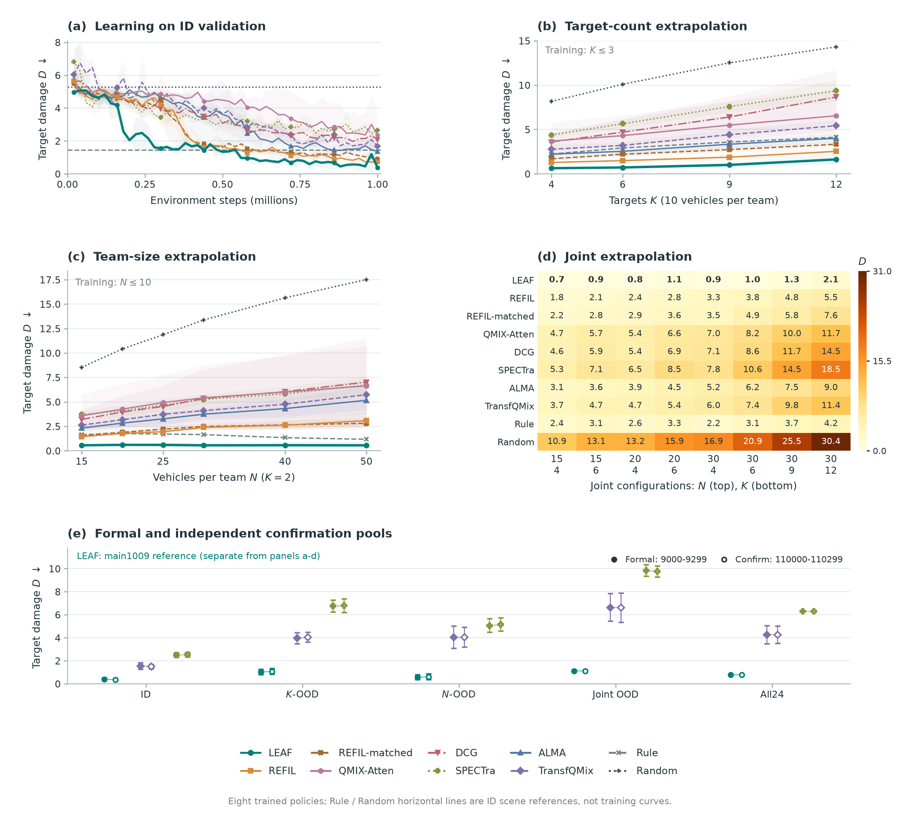
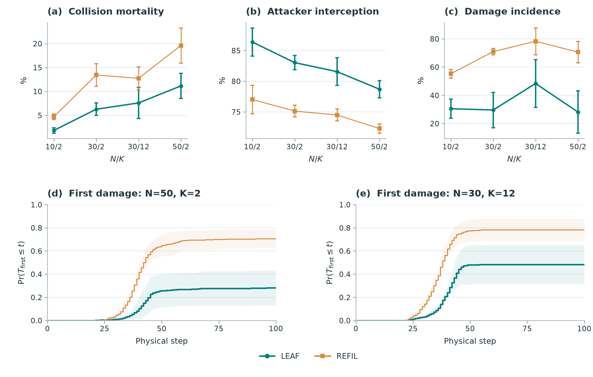
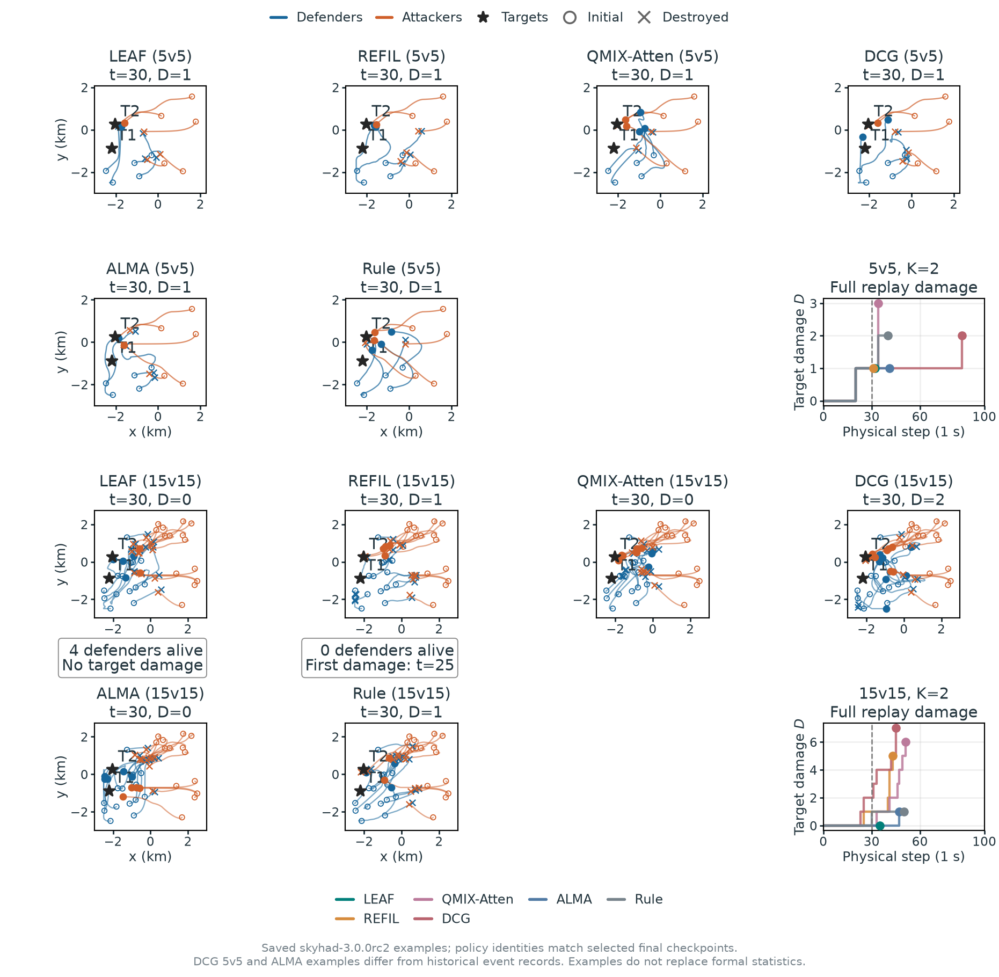

# LEAF 主实验结果分析：群体保护与双轴外推

更新：2026-10-26。本报告只保留 LEAF、七个当前学习基线和 Rule / Random 共十种策略。方法见[方法说明](LEAF_方法与变体说明.md)，基线见[实现说明](LEAF_Baseline与Rule实现说明.md)，环境见[问题建模](HAD_环境与问题建模.md)。结果源为 [aggregates.json](../Open-SCORE/outputs/main/had/aggregates.json) 与 [summary.json](../Open-SCORE/outputs/main/summary.json)；本文更新仅整理、筛选和绘制已保存数据，没有运行训练、评估、环境回放或新增计时。

公开仓库包含代码、保存配置、聚合统计及图片。原始 CSV / JSONL / 压缩逐步记录与模型权重保留本地；克隆仓库可以检查实现和本报告、重绘聚合图，完整复算成绩或运行已有模型需要相应本地材料。文中原始数据路径均为本地材料索引。

## 1. 问题、设计目标与结果

多目标攻防中，攻击者威胁与它指向的目标及附近队友有关。LEAF 先共享更新当前实体上下文，再以接收者自身状态读取各轮表示，融合后交给时序 GRU。实体工作状态每个物理时刻重新初始化，时序 hidden 跨物理时刻保留。

正式比较中，LEAF 在 ID、目标数外推、人数外推和联合外推四组的平均目标损伤均低于七个学习基线。相对 REFIL，四组 D 分别减少 0.310、0.800、1.635、2.211；接近参数量的 REFIL-matched 仍落后。跨方法比较保留历史来源，不能据此声称全部训练运行采用逐位相同的物理环境。

同三份 LEAF final 的 R1–R6 完整冻结矩阵展示执行深度变化：R1–R4 属训练范围，R5/R6 属推理深度外推。All24 的 R2→R4 平均收益仅 0.008249，训练种子 t95 跨零；不同配置和种子没有统一最优深度。正常路径约 99% 融合权重落在前两轮；权重不等于奖励的因果贡献，也不实现提前停止。

## 2. 方法与实验口径

### 2.1 LEAF的实际前向

每个物理时刻、每个接收者将可见实体编码为集合E，初始化当前决策内的工作状态H0=E。工作宽度64，attention为4 heads，FFN宽度128；上下文更新、reader和轮间评分器各自在轮间共享参数，死亡、不可见及padding实体按实际mask处理。

```text
当前实体观测与上一动作特征 -> 实体表示E，初始化H0
当前自身表示 -> 固定接收者query q
for r = 1 ... R:
    H_r = SharedEntityAttention/FFNContext(H_previous, mask)
    read_r = SharedReader(q, H_r, H_r, mask)
global_read = sum_r softmax(SharedScore(read_r)) * read_r
encoded = local_REFIL + W_fuse(global_read)
hidden_t = TemporalGRU(encoded, entering_temporal_hidden)
Q_t = action_head(hidden_t)
```

固定query不读取上一物理时刻GRU hidden；Temporal GRU、上一动作特征和跨时刻记忆仍保留。跨轮读出融合与局部—全局特征融合是不同操作。主方法保留REFIL局部attention、imagined分组训练、FlexQMIX与TD目标，训练采样R1–R4，正式执行R4。实现见[实体编码器](../Open-SCORE/open_score/models/entity_encoder.py)和[方法注册](../Open-SCORE/open_score/algos/__init__.py)。

### 2.2 正式性能口径

主性能表使用 `comparison` 比较视图：LEAF及其余方法采用既有正式统计，SPECTra和TransfQMix采用19维输入重训结果。保留当前模型身份，不把不同模型混合平均。训练种子0/1/2，每种子1M物理环境步；训练人数 N∈{4,6,8,10}、目标数 K∈{1,2,3}独立采样。正式 checkpoint 为完成预算的 **final**，best 仅作为训练内验证最优模型存档。每个 final 在每配置300个共同场景9000–9299上评估。

HAD 为二维抽象攻防，固定 reactive+rush 攻击策略，最长100个物理步。主指标为累计目标损伤 **D↓**，奖励 **R=−D↑**；累计损伤不受初始目标血量上限截断，也不等同于胜率。训练可含 shaping，报告奖励不含 shaping。下表固定使用 D；引用现有图时图中的 R 仍为 −D。

| 组别 | 配置数 | 配置 `(己方N, 对方N, 目标K)` |
|---|---:|---|
| ID | 4 | (4,4,2)、(6,6,2)、(8,8,2)、(10,10,3) |
| K-OOD | 4 | (10,10,4/6/9/12) |
| N-OOD | 6 | (15/20/25/30/40/50, 同人数, 2) |
| Joint-OOD | 8 | N=15/20/30各K4、K6，另加(30,30,9)、(30,30,12) |
| Extra | 2 | (5,5,2)、(10,10,2)，单独保存 |

先在每个种子内对场景平均，再对组内配置等权，最后报告三种子均值±**样本SD**。All24 对24个配置等权，不是对四个组均值等权。Rule、Random 没有训练种子，其误差为300个共同场景所得的场景SD，标记为 †；SD 不等于95%区间。历史 IQM、bootstrap 或 t 区间保留各自名称，不与本表误差混用。

验证每20k步进行一次，共50点，每点4个ID配置各25局，使用固定9500–9599场景，独立于正式池。学习图按验证序号对齐种子，横轴取实际 `t_env` 均值；不平滑，阴影为样本SD。验证末点与 final 终评来自不同场景，数值可以不同。公开分组、逐配置与学习曲线统计取 `comparison`，其中 `confirmation` 保存当前两项19维基线的独立确认，`confirmation_reference` 单列 LEAF 的 main1009 参照池。本地原始材料为 `had/episodes.csv`、`had/learning.csv`，不随仓库发布。

此次输入对齐实验已完成SPECTra和TransfQMix各三个种子，共六个模型；每模型1M物理步、50个验证点、5,000条验证及正式/确认各7,200条记录，共116,400条逐局数据，已按来源身份并入main。actor、online/target mixer和冻结评估均使用10维实体基础特征加9维红方上一动作，首步及蓝方、目标的动作段为零。共同控制为8个环境进程、每可采样收集批8次更新、replay 5,000、batch 32、γ=0.99、clip 10、每200局硬更新target和100k步ε退火；damage任务采用β=1、范围4,000的势函数塑形，二维随机目标、reactive/rush对手和100步时限。保留基线自身Adam/1e−3、Double-Q、TD(λ=0.6)、半MSE及原结构，不能称为与LEAF全部超参数统一。环境登记为had-workbench-2.1.0 / rebuild-calibrated-v3-r7-target-initialization；正式与确认场景分别为9000–9299和110000–110299。


LEAF 的训练/验证来源为 main0928，其余既有基线主要来自 main0921；历史训练环境登记不完整。LEAF 深度/确认参照为 main1009，当前 SPECTra / TransfQMix 为 main1013_base。来源名、模型身份、场景池和协议分别保留，不能用当前依赖版本反向补写历史运行。

## 3. 十种策略的正式比较

**表1. 当前正式目标损伤：`comparison`，均值±样本SD。**

| 方法 | ID D↓ | K-OOD D↓ | N-OOD D↓ | Joint-OOD D↓ |
|---|---:|---:|---:|---:|
| **LEAF** | **0.405±0.097** | **0.996±0.233** | **0.575±0.235** | **1.097±0.105** |
| REFIL | 0.715±0.049 | 1.796±0.304 | 2.209±0.277 | 3.308±0.303 |
| QMIX-Atten | 2.318±1.431 | 5.009±2.497 | 5.139±3.111 | 7.415±3.970 |
| DCG | 2.028±0.437 | 5.839±1.920 | 5.021±2.658 | 8.092±3.909 |
| SPECTra | 2.485±0.209 | 6.743±0.528 | 5.049±0.589 | 9.838±0.490 |
| ALMA | 1.326±0.193 | 3.022±0.344 | 3.605±0.742 | 5.375±1.036 |
| REFIL-matched | 0.914±0.165 | 2.493±0.280 | 2.269±0.312 | 4.170±0.760 |
| TransfQMix | 1.529±0.283 | 3.953±0.495 | 4.024±0.968 | 6.630±1.203 |
| Rule † | 1.462±0.717 | 3.212±1.126 | 1.545±0.881 | 3.060±0.976 |
| Random † | 5.280±1.577 | 11.271±2.888 | 12.894±4.382 | 18.356±4.305 |

**表2. 同队碰撞死亡比例 C↓：百分比均值±SD，误差单位为百分点。新19维基线未保存此终评指标。**

| 方法 | ID | K-OOD | N-OOD | Joint-OOD |
|---|---:|---:|---:|---:|
| LEAF | 1.33±0.45 | 1.70±0.62 | 6.29±1.32 | 4.97±1.26 |
| REFIL | 2.97±0.42 | 4.71±0.67 | 12.86±2.14 | 10.34±1.69 |
| QMIX-Atten | 10.82±9.56 | 12.42±9.75 | 16.38±5.43 | 15.37±7.34 |
| DCG | 9.05±3.36 | 14.97±4.68 | 19.70±8.52 | 19.26±10.20 |
| SPECTra | 未记录 | 未记录 | 未记录 | 未记录 |
| ALMA | 7.42±1.13 | 9.05±1.66 | 18.42±3.84 | 15.92±3.86 |
| REFIL-matched | 4.12±0.46 | 6.86±2.30 | 12.40±3.09 | 12.02±4.17 |
| TransfQMix | 未记录 | 未记录 | 未记录 | 未记录 |
| Rule † | 1.98±4.47 | 2.70±3.57 | 5.70±3.30 | 4.48±2.44 |
| Random † | 7.24±7.24 | 9.10±6.25 | 23.59±5.19 | 19.21±4.49 |

LEAF 在四组 D 均值上领先全部学习基线；在当前保存碰撞指标的学习基线中，其碰撞比例也更低。新19维SPECTra和TransfQMix终评没有保存碰撞、拦截或受损回合比例，不使用其他模型的结果补写这些指标。Rule 在 N-OOD、Joint-OOD 的碰撞比例更低，因而保护收益不等于每个条件下碰撞最少。LEAF actor 参数175,754，REFIL102,025，REFIL-matched176,393，后者仅多639（约0.36%）；参数匹配结果削弱仅以模型大小解释性能的说法，但没有提供时延结论。



*图1. 当前十种策略的学习验证和外推比较统一展示D↓，验证为50点均值±训练种子SD；SPECTra和TransfQMix采用19维模型，其余沿用原来源。K、N外推展示均值与种子SD，Joint配置用共享线性色阶。Rule / Random 水平线为 ID 场景参考，不是训练曲线；八个学习策略包含 REFIL-matched。(e)展示正式与独立确认All24；其中LEAF参照来自另存深度/确认池，不覆盖(a)–(d)或表1的正式来源。[同源矢量图](../Open-SCORE/outputs/main/had/figures/fig_comparison.pdf)。*

验证第10点（约0.2M步）LEAF 的 R=−2.046±0.028，REFIL=−4.429±0.284；第50点分别为−0.373±0.066和−0.738±0.122。这是固定ID验证池的观察，不将两点推广为所有点或所有任务的样本效率结论。既有基线验证记录保持来源身份；六个19维重训模型的30,000条验证记录独立标记来源，当前SPECTra/TransfQMix曲线使用这些记录。

**19维重训模型的正式与独立确认。** 新基线的正式All24分别为SPECTra **6.2871±0.0289**、TransfQMix **4.2518±0.7733**，两者在独立确认池分别为 **6.2964±0.0723**、**4.2549±0.7413**。误差均为三训练种子样本SD，All24包含两项Extra配置。两基线的损伤仍高于 LEAF；这说明所保存训练和评估范围内的结果，不提供跨方法差距的单一因果解释。

## 4. 机制、正常保护、深度与独立确认

### 4.1 正常执行：主要读取早期实体上下文

正常深度研究包含450个唯一回合单元：三个模型种子×三个配置×十个共同场景×（LEAF L1–L4、REFIL）。其中180个已有匹配回合复用，270个新增保存；一次前向完成但保存失败的尝试已登记恢复。没有新增训练。正常L4有90回合、3,392个物理决策步、38,693个活跃防御者决策。原始向量、权重和物理状态见 `had/regir_nomem/mechanisms/results.json.gz`（本地材料）。

**表4. 正常路径损伤D，十场景机制子集，均值±三模型SD。**

| 配置 | L1 | L2 | L3 | L4 | REFIL |
|---|---:|---:|---:|---:|---:|
| 10v10 K2 | 0.516±0.252 | 0.614±0.122 | 0.341±0.166 | 0.341±0.166 | 0.959±0.655 |
| 30v30 K2 | 0.412±0.418 | 0.798±0.352 | 0.289±0.102 | 0.435±0.159 | 2.138±0.757 |
| 30v30 K12 | 2.675±0.993 | 2.074±0.980 | 3.131±0.235 | 2.338±0.843 | 7.061±0.692 |

多个正常出口都形成可用策略，但奖励排序随配置变化：10v10的L3/L4相同，30v30 K2的L3均值更好，K12的L3反而更差。L2相对L4在前两个配置均为3/3种子降低奖励；因此前两轮读出权重高不等于执行恰好二轮总能最好。

**表5. 正常融合权重与变化，均值±三模型SD。**

| 配置 | α1 (%) | α2 (%) | α3 (%) | α4 (%) | 接收者SD (pp) | 相邻步变化 (pp) |
|---|---:|---:|---:|---:|---:|---:|
| 10v10 K2 | 75.645±6.638 | 23.264±6.480 | 1.066±0.253 | 0.025±0.016 | 11.444±2.208 | 5.491±0.861 |
| 30v30 K2 | 75.217±7.412 | 23.538±7.092 | 1.213±0.515 | 0.032±0.030 | 13.906±3.602 | 5.337±1.418 |
| 30v30 K12 | 73.664±7.517 | 25.175±7.420 | 1.137±0.147 | 0.023±0.013 | 12.680±3.017 | 5.362±1.146 |

α先在模型内平均活跃防御者决策，再对三个模型等权。接收者差异为同状态活跃防御者α1的总体SD，再平均物理状态；相邻步变化只连接两步均存活的同一防御者，先求回合均值再对场景等权。前两轮合计98.909±0.265%、98.755±0.542%、98.839±0.157%；这描述正常网络读取的分配，不把权重当作奖励因果贡献。


*共享机制图：(a)八种冻结干预相对本地standard的配对ΔD；(b)正常R4融合权重及接收者/时间变化；(c)冻结R1–R6；(d)八干预的同状态动作变化。各区保留自身记录池，误差为三个模型的样本SD；正式保护另见fig_protection。第4.10节解释干预、Q-margin及runtime边界。*

压力与α1的相关在三个配置分别−0.087±0.156、−0.361±0.233、−0.027±0.576，不支持统一的压力调节规律。晚轮读出范数较大，不能仅凭小权重断定无影响，也不能仅凭表征相似度宣称过平滑。

### 4.2 正式群体保护与典型轨迹

回到每配置300个正式场景，I为攻击方被拦截比例，P为发生过目标损伤的回合比例。各误差为三训练种子SD，比例单位为百分比。

| 配置 | 方法 | D↓ | C↓ (%) | I↑ (%) | P↓ (%) |
|---|---|---:|---:|---:|---:|
| 10v10 K2 | LEAF | 0.462±0.085 | 1.82±0.58 | 86.38±2.31 | 30.44±6.74 |
| 10v10 K2 | REFIL | 1.027±0.073 | 4.69±0.59 | 77.00±2.32 | 55.22±3.10 |
| 30v30 K2 | LEAF | 0.557±0.264 | 6.26±1.28 | 83.02±1.16 | 29.56±12.51 |
| 30v30 K2 | REFIL | 2.393±0.235 | 13.43±2.36 | 75.11±0.96 | 70.89±2.36 |
| 30v30 K12 | LEAF | 2.121±0.796 | 7.57±3.28 | 81.54±2.26 | 48.33±16.86 |
| 30v30 K12 | REFIL | 5.457±0.911 | 12.73±2.38 | 74.48±0.95 | 78.22±9.48 |
| 50v50 K2 | LEAF | 0.557±0.371 | 11.14±2.63 | 78.68±1.39 | 28.11±15.03 |
| 50v50 K2 | REFIL | 3.080±0.821 | 19.59±3.69 | 72.27±0.77 | 70.56±7.65 |



*图3. 正式全300场景统计，含无损回合；首次损伤累计发生曲线没有剔除非事件回合。截于[0,1]只用于显示。限制到100步的时间统计不等于每个回合实际首次命中时间。图中仅保留 LEAF 与 REFIL。*

保护优势不能解释成消除重复追击。已有三种子×100场景辅助几何指标中，50v50 K2的LEAF重复追击43.93±4.20%，REFIL35.49±1.50%，但R分别−0.666±0.611和−3.405±0.753；30v30 K2同样为32.50%与28.27%。damage集中度HHI仅在D>0回合定义，无损回合不补零；最差10%奖励也不自动等于预定义失败事件。



*图4. 只展示 LEAF、REFIL、QMIX-Atten、DCG、ALMA 和 Rule 已保存的两规模示例。学习模型为 seed0 final、场景9000，checkpoint_id 与当前保留 final 一致。快照取物理步30或更早终止，累计损伤曲线止于真实终止。没有提供当前 SPECTra、TransfQMix、REFIL-matched 或 Random 的对应轨迹，因此本图不展示它们，也未重新运行对局。*

展示数据来自 `skyhad-3.0.0rc2 / skyhad-v3-rigid-body-task-start-combat`，与正式历史池分别解释。DCG 的5v5和 ALMA 两规模与历史事件登记有差异，示例不覆盖正式统计。LEAF 两规模最终 D/终止步为1/32、0/35；REFIL 为1/31、5/43。15v15 的步30，LEAF 仍有4名防御者且目标无损，REFIL 于步25首次受损、步27失去最后防御者。单场不能代替300场景排序。本地逐步材料为 `had/trajectories.json.gz`，绘图时先按方法和当前 final 身份筛选。

### 4.3 LEAF R1–R6：完整冻结深度补评

这部分保留既有冻结深度协议，对原LEAF三个final在24配置×300场景9000–9299上固定R1–R6评估，`selection_use=false`。训练最大深度4，R5/R6是推理外推。补充包覆盖 **432/432单元、129,600逻辑评估**，其中R4复用21,600场，新增完成108,000场；它只有experiment、summary和单元CSV，**新增108,000场逐场JSONL未提供**。因此可复算种子均值与t区间，不能从本地缺失的逐场数据计算补评场景bootstrap。

**表6. LEAF冻结权重深度，D均值±三训练种子SD。**

| 深度 | All24 | ID | K-OOD | N-OOD | Joint-OOD | Extra |
|---|---:|---:|---:|---:|---:|---:|
| R1 | 0.8022±0.1849 | 0.4194±0.1436 | 1.0821±0.3344 | 0.6086±0.2540 | 1.0968±0.2704 | 0.4099±0.1108 |
| R2 | 0.7928±0.0493 | 0.3962±0.1029 | 1.0508±0.2097 | 0.5978±0.2121 | 1.1076±0.1257 | 0.3955±0.0841 |
| R3 | 0.7891±0.0471 | 0.4042±0.1000 | 1.0330±0.2563 | 0.5646±0.2394 | 1.1258±0.1043 | 0.3978±0.0935 |
| R4 | 0.7845±0.0434 | 0.4009±0.0969 | 1.0197±0.2412 | 0.5666±0.2258 | 1.1196±0.1043 | 0.3951±0.0851 |
| R5 | 0.7851±0.0425 | 0.4025±0.0980 | 1.0204±0.2435 | 0.5689±0.2284 | 1.1181±0.1006 | 0.3959±0.0858 |
| R6 | 0.7849±0.0423 | 0.4025±0.0980 | 1.0204±0.2435 | 0.5689±0.2284 | 1.1177±0.1002 | 0.3959±0.0858 |

**表7. All24配对深度收益，`D浅−D深`，正值表示加深有益；t95为三种子、df=2。**

| 比较 | 平均收益 | 训练种子t95 |
|---|---:|---:|
| R1→R2 | +0.009379 | [−0.390163,+0.408922] |
| R2→R4 | +0.008249 | [−0.008362,+0.024859] |
| R1→R4 | +0.017628 | [−0.380959,+0.416215] |
| R4→R5 | −0.000520 | [−0.003566,+0.002525] |
| R4→R6 | −0.000405 | [−0.003877,+0.003067] |

R1→R2三种子收益分别−0.171547、+0.136147、+0.063537；R2→R4为+0.007100、+0.002211、+0.015435，方向一致但很小。各分组对应收益的t95也跨零。R5/R6的总体均值接近R4，逐配置仍有细微变化；R5→R6只有3个配置均值改变，不能据此证明实体状态严格收敛。R1的三种子All24为0.5887、0.9048、0.9130，R4为0.7531、0.7664、0.8340；SD收窄是本次冻结出口观察，不能推广为训练方差的普遍改善。

各组R1–R6曲线见第4.1节的共享机制图；对应数据池、正式保护与冻结干预分别保存。

*共享机制图(c)的误差带为三训练种子SD；R5/R6超出训练深度。原LEAF的learned JK在新增轮次时扩大softmax候选集合，闭环轨迹也会改变Temporal hidden，所以该表不是只增加一次attention更新的纯因果效应。该评估池与表1的`comparison`正式汇总分别保留，细微数值差异不覆盖原表。*

### 4.4 人数外推的逐配置R1–R6

配置记为己方N v 对方N、目标K。数值为三训练种子D均值；每行最低值加粗，并列最低值全部加粗。

| 配置 | R1 | R2 | R3 | R4 | R5 | R6 |
|---|---:|---:|---:|---:|---:|---:|
| 15v15 K2 | 0.601843 | 0.576655 | 0.550153 | **0.547014** | 0.549236 | 0.549236 |
| 20v20 K2 | 0.630839 | 0.614122 | 0.602319 | 0.599578 | 0.594382 | **0.592159** |
| 25v25 K2 | 0.662712 | 0.639421 | **0.601082** | 0.612026 | 0.610078 | 0.610078 |
| 30v30 K2 | 0.642557 | 0.594796 | 0.568358 | **0.537001** | 0.549478 | 0.549478 |
| 40v40 K2 | 0.549711 | 0.596637 | **0.522798** | 0.543154 | 0.541949 | 0.544172 |
| 50v50 K2 | 0.564012 | 0.565282 | **0.543111** | 0.560596 | 0.568207 | 0.568207 |

### 4.5 目标数外推的逐配置R1–R6

配置记为己方N v 对方N、目标K。数值为三训练种子D均值；每行最低值加粗，并列最低值全部加粗。

| 配置 | R1 | R2 | R3 | R4 | R5 | R6 |
|---|---:|---:|---:|---:|---:|---:|
| 10v10 K4 | 0.730383 | 0.648261 | 0.641951 | 0.637177 | **0.634638** | **0.634638** |
| 10v10 K6 | 0.801271 | 0.742968 | 0.739926 | 0.727494 | **0.726383** | **0.726383** |
| 10v10 K9 | 1.135082 | 1.091205 | 1.028640 | **1.027406** | 1.032602 | 1.032602 |
| 10v10 K12 | **1.661490** | 1.720943 | 1.721341 | 1.686585 | 1.688048 | 1.688048 |

### 4.6 联合外推的逐配置R1–R6

配置记为己方N v 对方N、目标K。数值为三训练种子D均值；每行最低值加粗，并列最低值全部加粗。

| 配置 | R1 | R2 | R3 | R4 | R5 | R6 |
|---|---:|---:|---:|---:|---:|---:|
| 15v15 K4 | 0.829219 | 0.751930 | 0.745071 | 0.731787 | **0.731560** | **0.731560** |
| 15v15 K6 | 1.047030 | **0.885992** | 0.924854 | 0.916760 | 0.914163 | 0.914163 |
| 20v20 K4 | 0.962340 | 0.873812 | 0.827960 | 0.803394 | 0.801843 | **0.799069** |
| 20v20 K6 | 1.070570 | **1.061977** | 1.071589 | 1.095353 | 1.104167 | 1.104167 |
| 30v30 K4 | **0.859193** | 0.882921 | 0.912859 | 0.924329 | 0.918474 | 0.918474 |
| 30v30 K6 | 1.071756 | 1.094030 | **0.958024** | 0.972180 | 0.966204 | 0.966204 |
| 30v30 K9 | 1.296415 | **1.243541** | 1.369273 | 1.345823 | 1.344087 | 1.344087 |
| 30v30 K12 | **1.637831** | 2.066622 | 2.197002 | 2.167380 | 2.163967 | 2.163967 |

三张表来自主汇总的nomem_depth_analysis，逐种子单元见`had/loop_summary.csv`（本地材料）。人数外推中不同N的最佳出口不同，目标与联合外推中也同时出现浅轮和深轮最低值；例如30v30 K12的R1均值低于R4，50v50 K2的R2与R3排序又不同。组平均不能替代这些配置差异，也不能以事后逐行选择最低值当作一条已验证的部署策略。

### 4.7 独立场景池确认

以下confirm使用起始场景110000的另一场景池，三份LEAF final复用既有训练结果，seed0为final@1000006，其余为final@1000000；每配置300场。环境登记为had-workbench-2.1.0 / rebuild-calibrated-v3-r7-target-initialization。best和末段验证均值不替代预定final。

| 方法/出口 | 参照eval All24 D±SD | 独立confirm All24 D±SD |
|---|---:|---:|
| LEAF R4 | **0.7845±0.0434** | **0.7901±0.0395** |
| REFIL | 2.1394±0.1719 | 2.0857±0.1905 |
| SPECTra（19维） | 6.2871±0.0289 | 6.2964±0.0723 |
| TransfQMix（19维） | 4.2518±0.7733 | 4.2549±0.7413 |

新19维基线采用本次完成的三个final，正式/确认各21,600场，以上All24取`comparison`及其`confirmation`；不同模型身份的历史确认没有并入这些均值。新基线确认分组结果如下：

| 方法（19维） | ID | K-OOD | N-OOD | Joint-OOD |
|---|---:|---:|---:|---:|
| SPECTra | 2.5251±0.1938 | 6.7793±0.5893 | 5.1562±0.5746 | 9.7550±0.4917 |
| TransfQMix | 1.4911±0.1962 | 4.0353±0.4261 | 4.0360±0.8674 | 6.6108±1.2653 |

独立池中LEAF仍保持较低D均值，数值与这一参照eval接近。这里LEAF的0.7845来自深度补评/确认参照池；主性能comparison的All24为 **0.785439**，它与表1的正式分组统计同源。两套统计分别保存，不能用深度池值覆盖正式表或据小数差异声称新的训练结果。

### 4.8 LEAF 同权重不同出口的已保存决策时延

仅保留 seed0 final 执行 R1–R4 的已保存记录，两配置均为20个场景9000–9019；共160个回合、8个单元。测量来源为 `skyhad-3.0.0 / skyhad-v3-rigid-body-task-start-combat`，不覆盖正式性能池。硬件为 RTX 5070 Ti、i7-14700KF、Windows、PyTorch 2.13.0+cu130、CUDA 13.0，Float32、TF32关闭，CPU各1线程。

闭环计时在每次 policy.act 前后同步 CUDA，包含实体/batch整理、传输、全队 actor、时间状态更新、合法动作及解码；排除加载、reset、预热、环境物理、对手、mixer和文件写入。主均值按至少一名防御者存活的调用加权，方括号为20回合有效步均值的样本SD；这是场景/运行波动，不是训练种子不确定度。

| LEAF 出口 | 对局30v30 K2，ms [SD] | 对局50v50 K2，ms [SD] | 固定人数30，ms | 固定人数50，ms |
|---|---:|---:|---:|---:|
| R1 | 7.242 [1.013] | 7.474 [0.912] | 6.100 | 5.845 |
| R2 | 8.366 [1.246] | 8.667 [0.918] | 7.053 | 7.216 |
| R3 | 9.762 [1.925] | 9.550 [1.116] | 7.985 | 8.108 |
| R4 | 10.322 [1.160] | 10.586 [1.206] | 9.095 | 8.878 |

固定人数列来自另存的每单元100次直接决策：8个单元共800次，没有环境推进。每人数使用同一固定合成输入，紧凑实体表含 N 名防御者、N 名攻击者和2个目标，均存活；零 GRU 状态与固定上一动作在计时外恢复。计时包含 MAC 输入处理、actor、动作选择及列表回传CPU，排除初次上传与特征生成。它与闭环计时的 padding 和适配器工作不同，不能用列间差值分解模块成本。


*图6. 上排为已保存回合均值（可用时显示小点，否则为已保存均值±SD）与有效步加权均值（大点）；下排为100次直接决策的均值。图仅描绘同一 LEAF 的四个出口。[PDF](../Open-SCORE/outputs/main/had/figures/fig_decision_timing.pdf)。*

本机样本中 R4 约为 R1 的1.42–1.43倍闭环耗时和1.49–1.52倍固定输入耗时。人数差异不是严格单调，结果不推广为跨硬件速度保证或训练吞吐。完整调用记录保留本地 `had/decision_timing.json`，公开 `summary.json` 保存所选八单元聚合值；本次没有新增计时。

### 4.9 LEAF 覆盖关系的已保存受控线性探针

保留同三份 LEAF 冻结模型的 H0/H1/H2 读出，三配置为10v10 K2、30v30 K2、50v50 K2。每配置100个模板，每模板四个交叉标签状态及两个远处阴性状态；70个模板拟合、30个模板留出，四状态共用模板切分。H0并非训练过的部署出口；时序 hidden 置零，分类器没有用留出集调参。这些是既有受控静态状态的分析，未运行环境或重新拟合。

| 配置 | LEAF H0准确率，% | LEAF H1，% | LEAF H2，% | H2−H1的训练种子t95 |
|---|---:|---:|---:|---|
| 10v10 K2 | 50.00±1.67 | 51.67±3.82 | 53.33±3.00 | [-7.36, 10.69] pp |
| 30v30 K2 | 50.00±1.44 | 51.39±5.42 | 51.67±1.67 | [-11.49, 12.05] pp |
| 50v50 K2 | 50.56±1.27 | 50.83±2.50 | 52.22±1.27 | [-3.39, 6.17] pp |
| Three-config equal mean | 50.19±0.32 | 51.30±2.70 | 52.41±0.98 | [-6.85, 9.07] pp |


三种读出的留出准确率接近50%机会水平，H2−H1的区间跨零，远处阴性误报仍高。因此没有形成可靠的覆盖关系线性解码证据；线性分类失败也不证明信息不存在。标签为指定队友是否在目标300米内的几何关系，不是实际拦截成功率；静态零历史状态与真实战斗轨迹不同。完整所选结果、切分与Q敏感性补充见 `summary.json#coverage_binding_probe`；局部Q变化本身不证明威胁解释正确。

### 4.10 LEAF冻结干预、同状态诊断与动作稳定边界

冻结辅助池为720回合：3种子×3配置（10v10 K2、50v50 K2、30v30 K12）×10场景×（7个LEAF臂+REFIL）。read1与L1的同状态Q最大差0，按登记复用；标准策略、本地干预配对，不覆盖正式300场景值。48,705个活跃agent决策的同状态诊断使用相同进入TemporalGRU的hidden，诊断动作不执行。

另存270回合包含90个标准复核、90个H0旁路、90个固定均值fusion；重复标准不增加独立样本。下表使用各臂与**同runtime本地standard**的配对 ΔR，均值±三种子SD。

| 干预 | 10v10 K2 | 50v50 K2 | 30v30 K12 |
|---|---:|---:|---:|
| L1 | −0.175±0.418 | +0.109±0.205 | −0.337±0.749 |
| L2 | −0.273±0.047 | +0.001±0.205 | +0.264±1.259 |
| 强制read4 | −6.728±3.186 | −19.937±12.955 | −25.558±16.414 |
| uniform融合 | −3.607±3.099 | −8.837±11.604 | −17.662±15.789 |
| 完整关系残差置零 | −5.950±1.525 | −13.695±6.899 | −18.788±1.144 |
| 每物理步TemporalGRU重置 | −1.423±0.760 | −1.294±0.869 | −1.655±2.563 |
| H0直接读取旁路 | −7.556±1.365 | −18.962±5.828 | −32.968±8.447 |
| 固定校准均值fusion | +0.006±0.109 | +0.092±0.121 | −0.612±0.471 |

read4、uniform、完整残差置零及H0旁路均9/9种子×配置下降；TemporalGRU重置8/9下降，但K12 seed0有+1.281反例。固定fusion前两配置接近或略高，K12三种子下降，约10%同状态动作改变；它使用同一事实池校准，不能视为独立部署收益。L2同状态动作改变约1.13–1.66%，L1约18–21%，read4约73–77%，uniform约61–65%，完整残差置零约75–78%，GRU重置约58–63%。这些定位冻结策略依赖，不证明删除模块后从头训练仍会失败。

最低10%的Q-margin决策包含约78–81%的L2动作变化；48,705个决策中L2改变753次，满足局部充分稳定条件的38,620个决策均未改动作。这是固定事实轨迹的局部诊断，不是跨策略性能保证。原始记录、同状态诊断和配对统计统一见 `had/regir_nomem/mechanisms/results.json.gz`（本地材料），按数据池分别保存。

runtime必须按真实来源区分：旧720回合记录`had-workbench-2.1.0 / rebuild-calibrated-v3-r7-target-initialization`；另存270回合记录`skyhad-3.0.0 / skyhad-v3-rigid-body-task-start-combat`；本报告所用展示轨迹为`skyhad-3.0.0rc2`及相同SkyHAD协议。90个标准复核的初始状态与11结果字段一致，是当前配对的实测依据，不代替完整环境等价证明。旧180个standard/REFIL与正式池比对有167个11字段全匹配、13个seed2差异（其中5个奖励不同），故辅助配对始终用本地standard。二维粒子/加速度实现不改称六自由度真实飞行验证。

本节干预统计归入 [aggregates.json](../Open-SCORE/outputs/main/had/aggregates.json) 的 `mechanism.frozen`，正常读取与正式保护分别取 `mechanism.normal`、`mechanism.formal`。相同场景下复核和复用记录保持原身份，不扩大独立样本数。

## 5. 结论与证据范围

LEAF 的正式聚合结果支持本任务内的整体保护和实体规模外推表现；同三份 final 的冻结 R1–R6 支持不同执行深度下可用的部署策略。不同出口的排序随配置与种子改变，没有回报单调改进、状态严格收敛或自动提前停止的保证。

冻结干预定位已有策略对上下文、读取、融合和时序记忆的依赖；它不能替代删除模块后从头训练的对照。正常权重与轨迹是行为描述，线性探针也没有可靠解码指定覆盖关系。历史环境、辅助池与正式池的差异限制了更强因果或复现主张。本文没有 MAC 结果，不将本机时延推广为跨硬件结论。

## 附录 A. 数据与模型索引

| 内容 | 公开入口与本地覆盖范围 |
|---|---|
| 正式、验证及独立确认聚合 | [aggregates.json](../Open-SCORE/outputs/main/had/aggregates.json)，仅十种策略；Rule/Random为场景SD，其余为三训练种子SD |
| 冻结深度、时延与LEAF探针 | [summary.json](../Open-SCORE/outputs/main/summary.json)；R1–R6共432单元，新增108,000场逐场记录未提供 |
| 实验与历史来源说明 | [experiment.json](../Open-SCORE/outputs/main/experiment.json)，来源身份不表示全部历史物理过程相同 |
| 当前模型结构配置 | `had/<method>/models/seed_<seed>/config.json`，公开24份配置；final/best权重保留本地 |
| 逐局、学习、单元记录 | 本地 `had/episodes.csv`、`had/learning.csv`、`had/loop_summary.csv`；可能含其他历史行，须显式按方法、来源、协议及实验臂筛选 |
| 机制、时延、示例轨迹 | 本地 `had/regir_nomem/mechanisms/results.json.gz`、`had/decision_timing.json`、`had/trajectories.json.gz`；公开图从保存材料筛选后重绘 |
| 图表 | [figures](../Open-SCORE/outputs/main/had/figures)，六组PNG/PDF；缺少本地轨迹时绘图入口跳过该图，其余从公开聚合重绘 |

## 附录 B. 当前名称与内部标识

| 显示名称 | 内部标识 |
|---|---|
| LEAF | regir_nomem |
| REFIL | refil |
| REFIL-matched | refil_matched |
| QMIX-Atten | b2_qmix_atten |
| DCG | dcg |
| SPECTra（19维） | spectra |
| ALMA | alma |
| TransfQMix（19维） | transfqmix |
| Rule | rule_nv1 |
| Random | random_accel；历史来源字段为random |

`regir_nomem`只表示query不读上一时刻hidden，Temporal GRU及上一动作仍保留。Random的来源别名保留在聚合 `source_method`，没有改写本地原始记录。
