# LEAF 主实验结果分析：威胁情境编码、群体保护与双轴外推

更新：2026-10-14。主方法统一称为 **LEAF**；保存数据中的内部标识只用于定位已有实验。当前主数据、必要模型和图片归于 [outputs/main](../Open-SCORE/outputs/main)。方法计算见[方法与变体说明](LEAF_方法与变体说明.md)，基线定义见[Baseline 与 Rule 实现说明](LEAF_Baseline与Rule实现说明.md)。

## 1. 问题、设计目标与结果

论文整理版见 [LEAF v4](../Papers/v4/README.md)及其 [PDF](../Papers/v4/main.pdf)。v4 将本报告结果重组为对比、历史设计比较、机制与补充分析四部分，统一使用 D↓ 展示；容量与精炼设计控制集中放在补充分析，仅重绘已有结果，不改变下述正式统计与来源口径。

多目标攻防中，攻击者的威胁取决于它指向哪个目标、这个目标又已经被谁覆盖，也就是由攻击者、目标和队友共同构成的威胁情境。部署时实体规模会变、可用于关系推理的计算深度也可能变。LEAF设计目标是一个策略同时适应两种变化。

LEAF先通过共享循环更新当前实体上下文，再由接收者自身状态读取各轮表示，融合后交给时序GRU作出动作决策。实体工作状态在每个物理时刻重新初始化；时序hidden跨物理时刻保留。正常执行记录显示约99%的融合权重落在前两轮，并随接收者和物理时刻变化。这连接了威胁情境编码与个体决策，但不把读取权重当作奖励贡献。

正式HAD比较中，LEAF在ID、目标数外推、人数外推和联合外推四组的平均目标损伤低于全部七个学习基线。相对REFIL，四组D减少 **0.310、0.800、1.635、2.211**，三个训练种子均改善；参数接近的REFIL-matched仍落后。正常保护统计和真实轨迹进一步展示拦截、目标受损与碰撞的实际行为。

执行深度的完整冻结矩阵使用同三份final、24配置、R1–R6。R1–R4属于训练深度范围，R5/R6属于推理深度外推。All24的R2→R4平均收益为 **0.008249**，训练种子t95跨零；R5/R6与R4接近。性能排序随配置和种子改变，因此双轴适应的证据是已有策略在不同规模和出口上的实际表现，不是越深越好或计算自动分配的保证。

## 2. 方法与实验口径

### 2.1 LEAF的实际前向

每个物理时刻、每个接收者将可见实体编码为集合E，初始化当前决策内的工作状态H0=E。工作宽度64，attention为4 heads，FFN宽度128；上下文更新、reader和轮间评分器各自在轮间共享参数，死亡、不可见及padding实体按实际mask处理。

```text
当前实体观测与上一动作特征 -> 实体表示E，初始化H0
当前自身表示 -> 固定接收者query q
for r = 1 ... R:
    H_r = SharedEntityAttention/FFNContext(H_previous, mask)
    read_r = SharedReader(q, H_r, H_r, mask)
global_read = sum_r softmax(SharedScore(read_r)) * read_r
encoded = local_REFIL + W_fuse(global_read)
hidden_t = TemporalGRU(encoded, entering_temporal_hidden)
Q_t = action_head(hidden_t)
```

固定query不读取上一物理时刻GRU hidden；Temporal GRU、上一动作特征和跨时刻记忆仍保留。跨轮读出融合与局部—全局特征融合是不同操作。主方法保留REFIL局部attention、imagined分组训练、FlexQMIX与TD目标，训练采样R1–R4，正式执行R4。实现见[实体编码器](../Open-SCORE/open_score/models/entity_encoder.py)和[方法注册](../Open-SCORE/open_score/algos/__init__.py)。

### 2.2 正式性能口径

主性能表使用 `paper_current` 比较视图：LEAF及其余方法沿用 `paper1007` 的正式统计，SPECTra和TransfQMix采用 `source_version=main1013_base` 的19维输入重训结果。历史 `paper1007` 保持原样，不把旧、新模型混合平均。训练种子0/1/2，每种子1M物理环境步；训练人数 N∈{4,6,8,10}、目标数 K∈{1,2,3}独立采样。正式 checkpoint 为完成预算的 **final**，best 仅作为训练内验证最优模型存档。每个 final 在每配置300个共同场景9000–9299上评估。

HAD 为二维抽象攻防，固定 reactive+rush 攻击策略，最长100个物理步。主指标为累计目标损伤 **D↓**，奖励 **R=−D↑**；累计损伤不受初始目标血量上限截断，也不等同于胜率。训练可含 shaping，报告奖励不含 shaping。下表固定使用 D；引用现有图时图中的 R 仍为 −D。

| 组别 | 配置数 | 配置 `(己方N, 对方N, 目标K)` |
|---|---:|---|
| ID | 4 | (4,4,2)、(6,6,2)、(8,8,2)、(10,10,3) |
| K-OOD | 4 | (10,10,4/6/9/12) |
| N-OOD | 6 | (15/20/25/30/40/50, 同人数, 2) |
| Joint-OOD | 8 | N=15/20/30各K4、K6，另加(30,30,9)、(30,30,12) |
| Extra | 2 | (5,5,2)、(10,10,2)，单独保存 |

先在每个种子内对场景平均，再对组内配置等权，最后报告三种子均值±**样本SD**。All24 对24个配置等权，不是对四个组均值等权。Rule、Random 没有训练种子，其误差为300个共同场景所得的场景SD，标记为 †；SD 不等于95%区间。历史 IQM、bootstrap 或 t 区间保留各自名称，不与本表误差混用。

验证每20k步进行一次，共50点，每点4个ID配置各25局，使用固定9500–9599场景，独立于正式池。学习图按验证序号对齐种子，横轴取实际 `t_env` 均值；不平滑，阴影为样本SD。验证末点与 final 终评来自不同场景，数值可以不同。数据入口为 [episodes.csv](../Open-SCORE/outputs/main/had/episodes.csv)、[learning.csv](../Open-SCORE/outputs/main/had/learning.csv) 和 [aggregates.json](../Open-SCORE/outputs/main/had/aggregates.json)；当前分组、逐配置与学习曲线统计取 `paper_current`，新基线独立确认取其 `confirmation`，历史统计保留在 `paper1007`。

此次输入对齐实验已完成SPECTra和TransfQMix各三个种子，共六个模型；每模型1M物理步、50个验证点、5,000条验证及正式/确认各7,200条记录，共116,400条逐局数据，已按来源身份并入main。actor、online/target mixer和冻结评估均使用10维实体基础特征加9维红方上一动作，首步及蓝方、目标的动作段为零。共同控制为8个环境进程、每可采样收集批8次更新、replay 5,000、batch 32、γ=0.99、clip 10、每200局硬更新target和100k步ε退火；damage任务采用β=1、范围4,000的势函数塑形，二维随机目标、reactive/rush对手和100步时限。保留基线自身Adam/1e−3、Double-Q、TD(λ=0.6)、半MSE及原结构，不能称为与LEAF全部超参数统一。环境登记为had-workbench-2.1.0 / rebuild-calibrated-v3-r7-target-initialization；正式与确认场景分别为9000–9299和110000–110299。

## 3. HAD基线与LEAF设计对照

### 3.1 LEAF与七个学习基线、Rule和Random

**表1. 当前正式目标损伤：`paper_current`，均值±样本SD。**

| 方法 | ID D↓ | K-OOD D↓ | N-OOD D↓ | Joint-OOD D↓ |
|---|---:|---:|---:|---:|
| **LEAF** | **0.405±0.097** | **0.996±0.233** | **0.575±0.235** | **1.097±0.105** |
| REFIL | 0.715±0.049 | 1.796±0.304 | 2.209±0.277 | 3.308±0.303 |
| QMIX-Atten | 2.318±1.431 | 5.009±2.497 | 5.139±3.111 | 7.415±3.970 |
| DCG | 2.028±0.437 | 5.839±1.920 | 5.021±2.658 | 8.092±3.909 |
| SPECTra | 2.485±0.209 | 6.743±0.528 | 5.049±0.589 | 9.838±0.490 |
| ALMA | 1.326±0.193 | 3.022±0.344 | 3.605±0.742 | 5.375±1.036 |
| REFIL-matched | 0.914±0.165 | 2.493±0.280 | 2.269±0.312 | 4.170±0.760 |
| TransfQMix | 1.529±0.283 | 3.953±0.495 | 4.024±0.968 | 6.630±1.203 |
| Rule † | 1.462±0.717 | 3.212±1.126 | 1.545±0.881 | 3.060±0.976 |
| Random † | 5.280±1.577 | 11.271±2.888 | 12.894±4.382 | 18.356±4.305 |

**表2. 同队碰撞死亡比例 C↓：百分比均值±SD，误差单位为百分点。新19维基线未保存此终评指标。**

| 方法 | ID | K-OOD | N-OOD | Joint-OOD |
|---|---:|---:|---:|---:|
| LEAF | 1.33±0.45 | 1.70±0.62 | 6.29±1.32 | 4.97±1.26 |
| REFIL | 2.97±0.42 | 4.71±0.67 | 12.86±2.14 | 10.34±1.69 |
| QMIX-Atten | 10.82±9.56 | 12.42±9.75 | 16.38±5.43 | 15.37±7.34 |
| DCG | 9.05±3.36 | 14.97±4.68 | 19.70±8.52 | 19.26±10.20 |
| SPECTra | 未记录 | 未记录 | 未记录 | 未记录 |
| ALMA | 7.42±1.13 | 9.05±1.66 | 18.42±3.84 | 15.92±3.86 |
| REFIL-matched | 4.12±0.46 | 6.86±2.30 | 12.40±3.09 | 12.02±4.17 |
| TransfQMix | 未记录 | 未记录 | 未记录 | 未记录 |
| Rule † | 1.98±4.47 | 2.70±3.57 | 5.70±3.30 | 4.48±2.44 |
| Random † | 7.24±7.24 | 9.10±6.25 | 23.59±5.19 | 19.21±4.49 |

LEAF 在四组 D 均值上领先全部学习基线；在当前保存碰撞指标的学习基线中，其碰撞比例也更低。新19维SPECTra和TransfQMix终评没有保存碰撞、拦截或受损回合比例，不据旧10维模型补写这些指标。Rule 在 N-OOD、Joint-OOD 的碰撞比例更低，因而保护收益不等于每个条件下碰撞最少。LEAF actor 参数175,754，REFIL102,025，REFIL-matched176,393，后者仅多639（约0.36%）；参数匹配结果削弱仅以模型大小解释性能的说法，但没有提供时延结论。

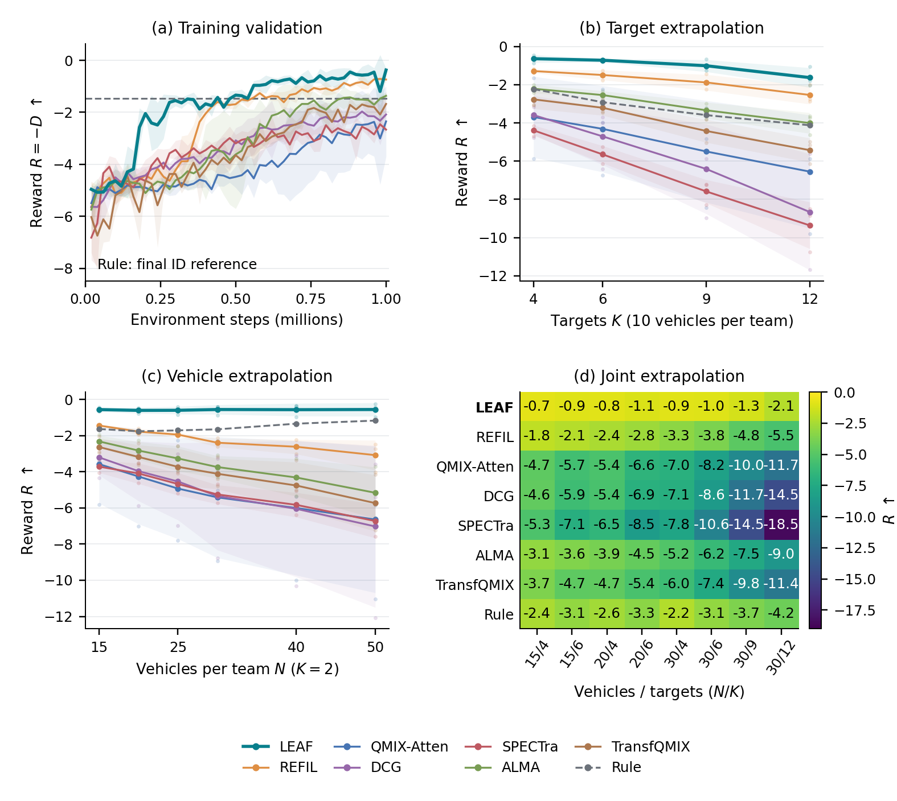

*图1. 学习曲线为50点验证R均值±训练种子SD；SPECTra和TransfQMix曲线及损伤统计取新19维模型，其余沿用原来源。K、N外推保留种子点，Joint配置用共享线性色阶。Rule虚线为正式参考。[当前论文比较图](../Papers/v4/figures/fig_comparison.pdf)。*

验证第10点（约0.2M步）LEAF 的 R=−2.046±0.028，REFIL=−4.429±0.284；第50点分别为−0.373±0.066和−0.738±0.122。这是固定ID验证池的观察，不将两点推广为所有点或所有任务的样本效率结论。既有七学习基线的105,000条验证逐局记录继续保留；本次新增六模型的30,000条验证记录独立标记来源，当前SPECTra/TransfQMix曲线使用这些新记录，不重复计为额外训练。

**新19维模型与历史10维对照。** 新基线的正式All24分别为SPECTra **6.2871±0.0289**、TransfQMix **4.2518±0.7733**，两者在独立确认池分别为 **6.2964±0.0723**、**4.2549±0.7413**。误差均为三训练种子样本SD，All24包含两项Extra配置。补齐输入后的两基线损伤低于原10维主表均值，但仍高于LEAF；这只说明本次预定训练和评估下的结果，不证明输入是跨方法差距的唯一成因。

| 历史方法（10维）/指标 | ID | K-OOD | N-OOD | Joint-OOD |
|---|---:|---:|---:|---:|
| SPECTra D↓ | 2.662±0.070 | 6.933±0.670 | 6.455±1.403 | 11.184±0.352 |
| SPECTra C↓ (%) | 13.06±0.75 | 20.71±1.60 | 28.92±1.54 | 31.25±1.63 |
| TransfQMix D↓ | 2.157±0.235 | 6.128±1.822 | 6.226±0.708 | 10.597±2.786 |
| TransfQMix C↓ (%) | 16.86±2.86 | 21.67±6.71 | 27.14±4.78 | 27.34±8.43 |

历史权重与`paper1007`统计保留，不与19维模型混合。第4.2节的SPECTra轨迹及历史时延仍对应原10维权重，不作为新模型行为或速度结果。SPECTra原GRF训练使用500k探索退火且每采集8局更新一次，本文共享100k并每批8次；其作者SMACv2亦有100k配置。TransfQMix原单进程每局一次，此处按8局批次8次。上述适配在运行前固定，不声称完整原论文复现或充分调参。

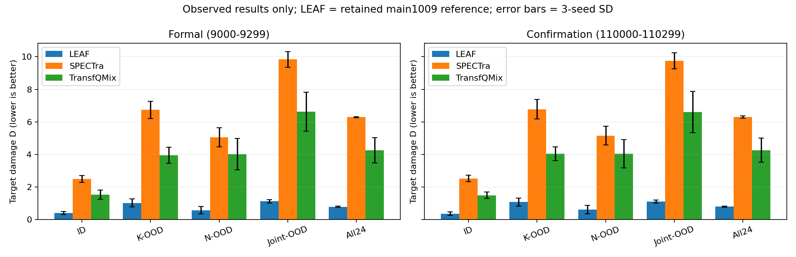

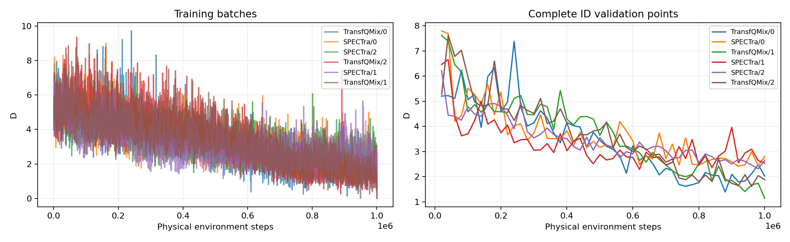

*图1b–c. 保留输入对齐实验的正式/确认比较和实际训练/验证曲线。图1b的LEAF归档参照来自main1009/深度池，与本报告主表的paper1007分别保留；新两基线来自main1013_base。训练曲线按各模型真实采集批次展示，验证曲线仅使用完整100场验证点。*

### 3.2 LEAF与七个历史设计变体

**表3. 历史保存配置的八方法设计比较，source_version=main0928，D均值±三训练种子SD；并非全部只改变LEAF的一项设计。**

| 方法 | ID | K-OOD | N-OOD | Joint-OOD |
|---|---:|---:|---:|---:|
| **LEAF** | 0.405±0.097 | 0.996±0.233 | 0.575±0.235 | 1.097±0.105 |
| LEAF–Memory query | 0.527±0.227 | 1.529±0.734 | 0.998±0.621 | 1.946±1.229 |
| LEAF–Last read | 0.434±0.083 | 1.020±0.100 | 0.652±0.160 | 1.269±0.202 |
| LEAF–Fixed depth | 0.407±0.204 | 1.004±0.665 | 0.659±0.184 | 1.265±0.230 |
| LEAF–No host | 0.510±0.138 | 1.768±0.621 | 1.263±0.653 | 2.319±0.889 |
| LEAF–Direct read | 0.928±0.210 | 1.958±0.457 | 2.020±0.446 | 3.196±0.687 |
| LEAF–One round | 0.609±0.272 | 1.203±0.402 | 1.355±0.884 | 2.157±1.006 |
| LEAF–Unshared rounds | 0.476±0.183 | 1.127±0.157 | 0.543±0.156 | 1.232±0.253 |

七个保留变体按名义设计轴组织：Memory query向接收者query加入截断梯度的历史hidden；Direct read直接读取H0；One round从头训练和执行均只做一轮；No host移除REFIL基础attention、imagined分组及关联辅助损失，但保留自身投影残差；Last read改用所执行出口的末轮读出；Fixed depth改用固定四轮训练；Unshared rounds将轮间共享上下文更新改为独立参数。

**保存配置的归因边界。** 核对全部24份配置可见，LEAF三个种子启用`global_query_no_memory=true`；其余七个`*_sg`设计的三个种子均设置`global_query_detach_memory=true`，未启用`global_query_no_memory`（默认false）。截断梯度不删除前向历史输入，因此Direct read、One round、No host、Last read、Fixed depth、Unshared rounds相对LEAF还改变了query历史条件，不能统称只改一项的LEAF消融。Memory query是查询历史入口的直接对照；Direct read与One round保留相同历史query，可以比较该历史基底上的情境加工。No host还按宿主组合删除，不能分别归因于attention或某一loss。Fixed depth的具体限制继续见第4.9节。

相对Direct read，One round的四组D减少 **0.319、0.755、0.665、1.039**，各组2/3种子改善、seed2反向。相对One round，LEAF减少 **0.204、0.207、0.780、1.060**。这些是分别训练所得的架构比较；Direct read与One round使用相同的历史query条件，但LEAF与它们还存在query输入差异。冻结同一LEAF权重执行R1回答另一个问题。

Memory query相对LEAF的四组D高 **0.122、0.533、0.424、0.849**；LEAF在ID为3/3种子更好、三个OOD组各2/3。历史hidden保留在Temporal GRU，并不因为当前query不读历史而消失。两方法seed1的既有采集并发分别为6和12，其余均为12，调度差异仍随数据保留。

LEAF相对No host的四组D减少 **0.105、0.772、0.688、1.222**，这是同时存在宿主组合和query历史条件差异的观察，不能单独归因于宿主。Last read和Fixed depth均值接近LEAF，Unshared rounds在N-OOD均值更低；One round在10v10 K12的R=−1.548±0.439，LEAF为−1.625±0.515。因此现有结果不支持融合、随机深度或共享参数各自带来普遍独立增益。

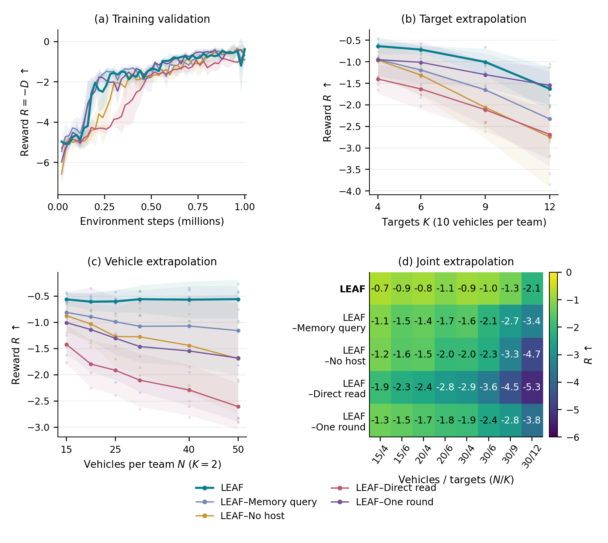

*图2. 全部八方法保持LEAF参照，展示验证过程、种子差异和逐配置表现；表3保留同口径D与SD。*

### 3.3 从头训练的一轮与冻结一轮

LEAF–One round在训练阶段始终使用一轮更新，并以一轮执行，三种子各1M环境步，但保存配置仍使用截断梯度的历史query。第4.3节的冻结R1沿用多深度训练完成的LEAF final和无历史query，仅改变整场推理出口。两者不能用于仅归因多深度训练的单项比较。相同物理步训练预算不等于相同计算预算；冻结早退也不能代替从头训练的一轮架构。Direct read配置可能登记深度1，但直接读取未加工H0，没有一轮实体交互。

## 4. 机制、正常保护、深度与独立确认

### 4.1 正常执行：主要读取早期实体上下文

正常深度研究包含450个唯一回合单元：三个模型种子×三个配置×十个共同场景×（LEAF L1–L4、REFIL）。其中180个已有匹配回合复用，270个新增保存；一次前向完成但保存失败的尝试已登记恢复。没有新增训练。正常L4有90回合、3,392个物理决策步、38,693个活跃防御者决策。原始向量、权重和物理状态见 [v3正常机制数据](../Papers/v3/data/mechanism1008.json.gz)。

**表4. 正常路径损伤D，十场景机制子集，均值±三模型SD。**

| 配置 | L1 | L2 | L3 | L4 | REFIL |
|---|---:|---:|---:|---:|---:|
| 10v10 K2 | 0.516±0.252 | 0.614±0.122 | 0.341±0.166 | 0.341±0.166 | 0.959±0.655 |
| 30v30 K2 | 0.412±0.418 | 0.798±0.352 | 0.289±0.102 | 0.435±0.159 | 2.138±0.757 |
| 30v30 K12 | 2.675±0.993 | 2.074±0.980 | 3.131±0.235 | 2.338±0.843 | 7.061±0.692 |

多个正常出口都形成可用策略，但奖励排序随配置变化：10v10的L3/L4相同，30v30 K2的L3均值更好，K12的L3反而更差。L2相对L4在前两个配置均为3/3种子降低奖励；因此前两轮读出权重高不等于执行恰好二轮总能最好。

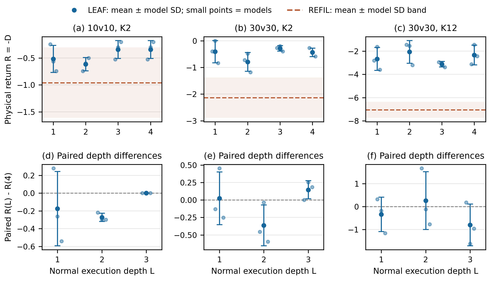

**表5. 正常融合权重与变化，均值±三模型SD。**

| 配置 | α1 (%) | α2 (%) | α3 (%) | α4 (%) | 接收者SD (pp) | 相邻步变化 (pp) |
|---|---:|---:|---:|---:|---:|---:|
| 10v10 K2 | 75.645±6.638 | 23.264±6.480 | 1.066±0.253 | 0.025±0.016 | 11.444±2.208 | 5.491±0.861 |
| 30v30 K2 | 75.217±7.412 | 23.538±7.092 | 1.213±0.515 | 0.032±0.030 | 13.906±3.602 | 5.337±1.418 |
| 30v30 K12 | 73.664±7.517 | 25.175±7.420 | 1.137±0.147 | 0.023±0.013 | 12.680±3.017 | 5.362±1.146 |

α先在模型内平均活跃防御者决策，再对三个模型等权。接收者差异为同状态活跃防御者α1的总体SD，再平均物理状态；相邻步变化只连接两步均存活的同一防御者，先求回合均值再对场景等权。前两轮合计98.909±0.265%、98.755±0.542%、98.839±0.157%；这描述正常网络读取的分配，不把权重当作奖励因果贡献。

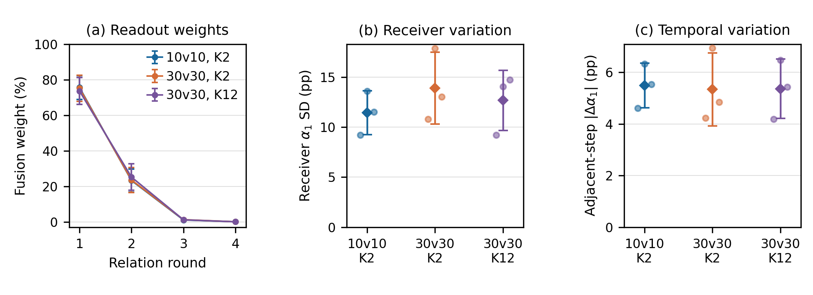

压力与α1的相关在三个配置分别−0.087±0.156、−0.361±0.233、−0.027±0.576，不支持统一的压力调节规律。晚轮读出范数较大，不能仅凭小权重断定无影响，也不能仅凭表征相似度宣称过平滑。

### 4.2 正式群体保护与典型轨迹

回到每配置300个正式场景，I为攻击方被拦截比例，P为发生过目标损伤的回合比例。各误差为三训练种子SD，比例单位为百分比。

| 配置 | 方法 | D↓ | C↓ (%) | I↑ (%) | P↓ (%) |
|---|---|---:|---:|---:|---:|
| 10v10 K2 | LEAF | 0.462±0.085 | 1.82±0.58 | 86.38±2.31 | 30.44±6.74 |
| 10v10 K2 | REFIL | 1.027±0.073 | 4.69±0.59 | 77.00±2.32 | 55.22±3.10 |
| 30v30 K2 | LEAF | 0.557±0.264 | 6.26±1.28 | 83.02±1.16 | 29.56±12.51 |
| 30v30 K2 | REFIL | 2.393±0.235 | 13.43±2.36 | 75.11±0.96 | 70.89±2.36 |
| 30v30 K12 | LEAF | 2.121±0.796 | 7.57±3.28 | 81.54±2.26 | 48.33±16.86 |
| 30v30 K12 | REFIL | 5.457±0.911 | 12.73±2.38 | 74.48±0.95 | 78.22±9.48 |
| 50v50 K2 | LEAF | 0.557±0.371 | 11.14±2.63 | 78.68±1.39 | 28.11±15.03 |
| 50v50 K2 | REFIL | 3.080±0.821 | 19.59±3.69 | 72.27±0.77 | 70.56±7.65 |

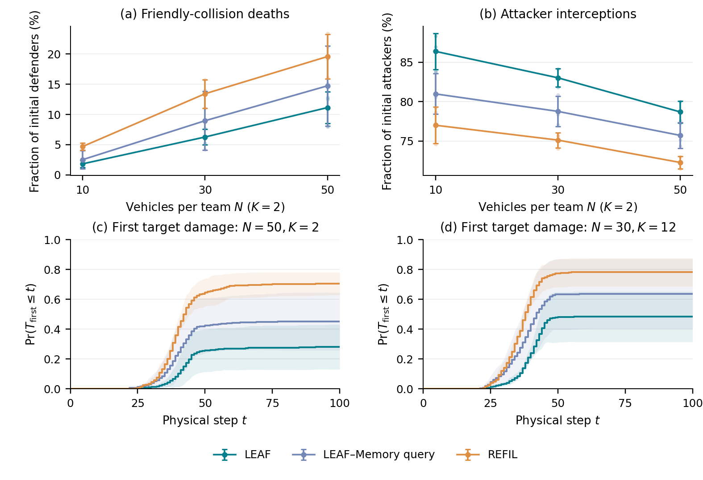

*图3. 正式全300场景统计，含无损回合；首次损伤累计发生曲线没有剔除非事件回合。截于[0,1]只用于显示。限制到100步的时间统计不等于每个回合实际首次命中时间。LEAF–Memory query为query使用历史的参照。*

保护优势不能解释成消除重复追击。已有三种子×100场景辅助几何指标中，50v50 K2的LEAF重复追击43.93±4.20%，REFIL35.49±1.50%，但R分别−0.666±0.611和−3.405±0.753；30v30 K2同样为32.50%与28.27%。damage集中度HHI仅在D>0回合定义，无损回合不补零；最差10%奖励也不自动等于预定义失败事件。

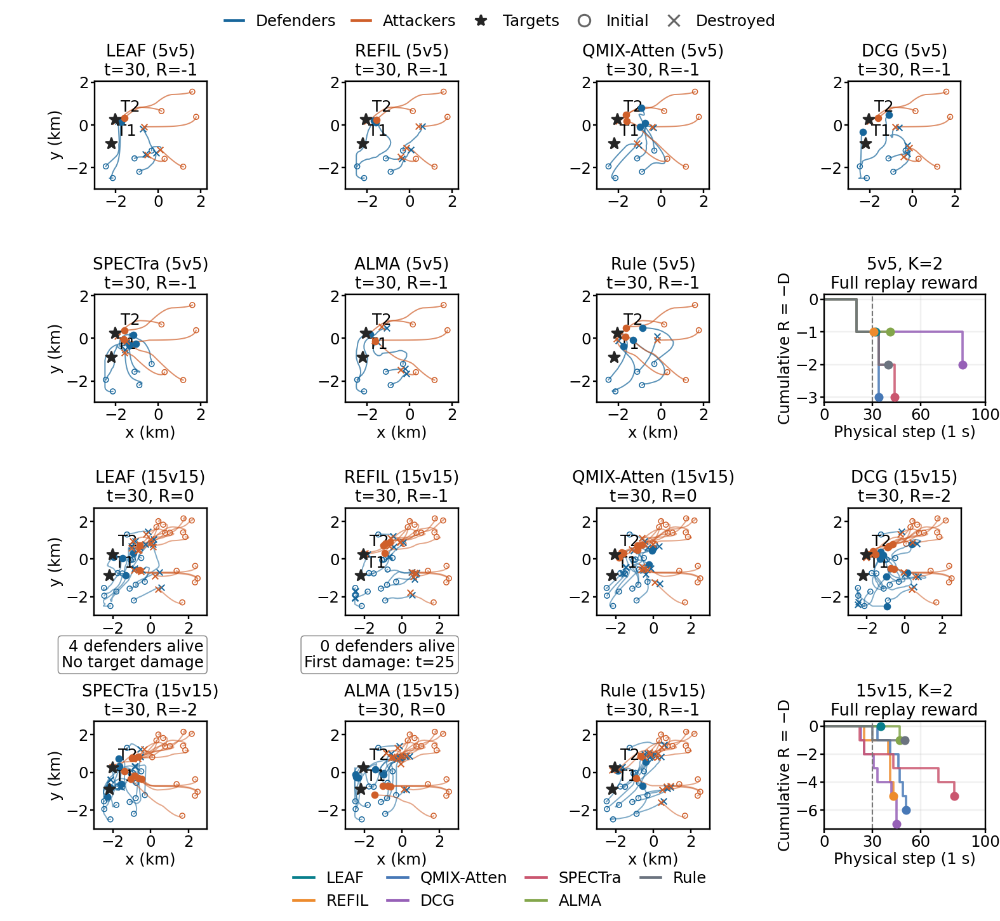

*图4. 每规模七方法共享初始状态，固定训练seed0 final及场景9000，快照取物理步30，奖励曲线延续到真实终止；图来自同一次本地回放。[逐步原始数据](../Papers/v3/data/trajectories1008.json.gz)。*

两规模的最终 R/终止步分别为：LEAF −1/32、0/35；REFIL −1/31、−5/43；QMIX-Atten −3/34、−6/51；DCG −2/86、−7/45；SPECTra −3/44、−5/81；ALMA −1/41、−1/47；Rule −2/40、−1/50。5v5中LEAF与REFIL、ALMA同奖励；15v15中LEAF在步30仍有4名防御者、2名攻击者，目标无损，最终拦截全部15名攻击者。REFIL于步25首次受损、步27失去最后防御者，此后继续受损。14个本地回放中11个匹配历史11字段，DCG的5v5及ALMA两规模存在登记差异；它们没有覆盖正式性能值，示例不代替300场景排序。

### 4.3 LEAF R1–R6：完整冻结深度补评

这部分来源 `leaf1009_nomem_depth_v1`，对原LEAF三个final在24配置×300场景9000–9299上固定R1–R6评估，`selection_use=false`。训练最大深度4，R5/R6是推理外推。补充包覆盖 **432/432单元、129,600逻辑评估**，其中R4复用21,600场，新增完成108,000场；它只有experiment、summary和单元CSV，**新增108,000场逐场JSONL未提供**。因此可复算种子均值与t区间，不能从本地缺失的逐场数据计算补评场景bootstrap。

**表6. LEAF冻结权重深度，D均值±三训练种子SD。**

| 深度 | All24 | ID | K-OOD | N-OOD | Joint-OOD | Extra |
|---|---:|---:|---:|---:|---:|---:|
| R1 | 0.8022±0.1849 | 0.4194±0.1436 | 1.0821±0.3344 | 0.6086±0.2540 | 1.0968±0.2704 | 0.4099±0.1108 |
| R2 | 0.7928±0.0493 | 0.3962±0.1029 | 1.0508±0.2097 | 0.5978±0.2121 | 1.1076±0.1257 | 0.3955±0.0841 |
| R3 | 0.7891±0.0471 | 0.4042±0.1000 | 1.0330±0.2563 | 0.5646±0.2394 | 1.1258±0.1043 | 0.3978±0.0935 |
| R4 | 0.7845±0.0434 | 0.4009±0.0969 | 1.0197±0.2412 | 0.5666±0.2258 | 1.1196±0.1043 | 0.3951±0.0851 |
| R5 | 0.7851±0.0425 | 0.4025±0.0980 | 1.0204±0.2435 | 0.5689±0.2284 | 1.1181±0.1006 | 0.3959±0.0858 |
| R6 | 0.7849±0.0423 | 0.4025±0.0980 | 1.0204±0.2435 | 0.5689±0.2284 | 1.1177±0.1002 | 0.3959±0.0858 |

**表7. All24配对深度收益，`D浅−D深`，正值表示加深有益；t95为三种子、df=2。**

| 比较 | 平均收益 | 训练种子t95 |
|---|---:|---:|
| R1→R2 | +0.009379 | [−0.390163,+0.408922] |
| R2→R4 | +0.008249 | [−0.008362,+0.024859] |
| R1→R4 | +0.017628 | [−0.380959,+0.416215] |
| R4→R5 | −0.000520 | [−0.003566,+0.002525] |
| R4→R6 | −0.000405 | [−0.003877,+0.003067] |

R1→R2三种子收益分别−0.171547、+0.136147、+0.063537；R2→R4为+0.007100、+0.002211、+0.015435，方向一致但很小。各分组对应收益的t95也跨零。R5/R6的总体均值接近R4，逐配置仍有细微变化；R5→R6只有3个配置均值改变，不能据此证明实体状态严格收敛。R1的三种子All24为0.5887、0.9048、0.9130，R4为0.7531、0.7664、0.8340；SD收窄是本次冻结出口观察，不能推广为训练方差的普遍改善。

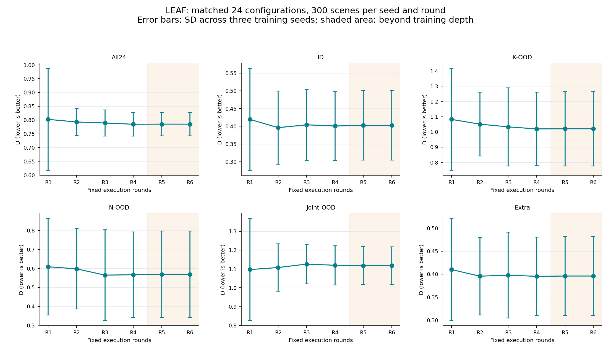

*图5. 误差线为三训练种子SD；R5/R6超出训练深度。原LEAF的learned JK在新增轮次时扩大softmax候选集合，闭环轨迹也会改变Temporal hidden，所以该表不是只增加一次attention更新的纯因果效应。该评估池与表1的`paper1007`正式汇总分别保留，细微数值差异不覆盖原表。*

### 4.4 人数外推的逐配置R1–R6

配置记为己方N v 对方N、目标K。数值为三训练种子D均值；每行最低值加粗，并列最低值全部加粗。

| 配置 | R1 | R2 | R3 | R4 | R5 | R6 |
|---|---:|---:|---:|---:|---:|---:|
| 15v15 K2 | 0.601843 | 0.576655 | 0.550153 | **0.547014** | 0.549236 | 0.549236 |
| 20v20 K2 | 0.630839 | 0.614122 | 0.602319 | 0.599578 | 0.594382 | **0.592159** |
| 25v25 K2 | 0.662712 | 0.639421 | **0.601082** | 0.612026 | 0.610078 | 0.610078 |
| 30v30 K2 | 0.642557 | 0.594796 | 0.568358 | **0.537001** | 0.549478 | 0.549478 |
| 40v40 K2 | 0.549711 | 0.596637 | **0.522798** | 0.543154 | 0.541949 | 0.544172 |
| 50v50 K2 | 0.564012 | 0.565282 | **0.543111** | 0.560596 | 0.568207 | 0.568207 |

### 4.5 目标数外推的逐配置R1–R6

配置记为己方N v 对方N、目标K。数值为三训练种子D均值；每行最低值加粗，并列最低值全部加粗。

| 配置 | R1 | R2 | R3 | R4 | R5 | R6 |
|---|---:|---:|---:|---:|---:|---:|
| 10v10 K4 | 0.730383 | 0.648261 | 0.641951 | 0.637177 | **0.634638** | **0.634638** |
| 10v10 K6 | 0.801271 | 0.742968 | 0.739926 | 0.727494 | **0.726383** | **0.726383** |
| 10v10 K9 | 1.135082 | 1.091205 | 1.028640 | **1.027406** | 1.032602 | 1.032602 |
| 10v10 K12 | **1.661490** | 1.720943 | 1.721341 | 1.686585 | 1.688048 | 1.688048 |

### 4.6 联合外推的逐配置R1–R6

配置记为己方N v 对方N、目标K。数值为三训练种子D均值；每行最低值加粗，并列最低值全部加粗。

| 配置 | R1 | R2 | R3 | R4 | R5 | R6 |
|---|---:|---:|---:|---:|---:|---:|
| 15v15 K4 | 0.829219 | 0.751930 | 0.745071 | 0.731787 | **0.731560** | **0.731560** |
| 15v15 K6 | 1.047030 | **0.885992** | 0.924854 | 0.916760 | 0.914163 | 0.914163 |
| 20v20 K4 | 0.962340 | 0.873812 | 0.827960 | 0.803394 | 0.801843 | **0.799069** |
| 20v20 K6 | 1.070570 | **1.061977** | 1.071589 | 1.095353 | 1.104167 | 1.104167 |
| 30v30 K4 | **0.859193** | 0.882921 | 0.912859 | 0.924329 | 0.918474 | 0.918474 |
| 30v30 K6 | 1.071756 | 1.094030 | **0.958024** | 0.972180 | 0.966204 | 0.966204 |
| 30v30 K9 | 1.296415 | **1.243541** | 1.369273 | 1.345823 | 1.344087 | 1.344087 |
| 30v30 K12 | **1.637831** | 2.066622 | 2.197002 | 2.167380 | 2.163967 | 2.163967 |

三张表来自主汇总的nomem_depth_analysis，逐种子单元见[loop_summary.csv](../Open-SCORE/outputs/main/had/loop_summary.csv)。人数外推中不同N的最佳出口不同，目标与联合外推中也同时出现浅轮和深轮最低值；例如30v30 K12的R1均值低于R4，50v50 K2的R2与R3排序又不同。组平均不能替代这些配置差异，也不能以事后逐行选择最低值当作一条已验证的部署策略。

### 4.7 独立场景池确认

以下confirm使用起始场景110000的另一场景池，三份LEAF final复用既有训练结果，seed0为final@1000006，其余为final@1000000；每配置300场。环境登记为had-workbench-2.1.0 / rebuild-calibrated-v3-r7-target-initialization。best和末段验证均值不替代预定final。

| 方法/出口 | 参照eval All24 D±SD | 独立confirm All24 D±SD |
|---|---:|---:|
| LEAF R4 | **0.7845±0.0434** | **0.7901±0.0395** |
| REFIL | 2.1394±0.1719 | 2.0857±0.1905 |
| SPECTra（19维） | 6.2871±0.0289 | 6.2964±0.0723 |
| TransfQMix（19维） | 4.2518±0.7733 | 4.2549±0.7413 |
| TransfQMix（历史10维确认参照） | 6.6379±1.3225 | 6.6259±1.3394 |

新19维基线采用本次完成的三个final，正式/确认各21,600场，以上All24取`paper_current`及其`confirmation`；历史TransfQMix行单列保留，不混入新模型均值。新基线确认分组结果如下：

| 方法（19维） | ID | K-OOD | N-OOD | Joint-OOD |
|---|---:|---:|---:|---:|
| SPECTra | 2.5251±0.1938 | 6.7793±0.5893 | 5.1562±0.5746 | 9.7550±0.4917 |
| TransfQMix | 1.4911±0.1962 | 4.0353±0.4261 | 4.0360±0.8674 | 6.6108±1.2653 |

独立池中LEAF仍保持较低D均值，数值与这一参照eval接近。这里LEAF的0.7845来自深度补评/确认参照池；主性能paper1007的All24为 **0.785439**，它与表1的正式分组统计同源。两套统计分别保存，不能用深度池值覆盖正式表或据小数差异声称新的训练结果。

### 4.8 决策时延：20回合部署测量与固定人数100次决策

本节按用户指定范围新增决策时间测量：LEAF分别执行R1–R4，One round执行R1，Fixed depth和Unshared rounds执行R4；配置固定为 **30v30 K2、50v50 K2**。每个方法／出口／配置使用 **20个共同场景9000–9019**，各方法只使用训练seed0的既有final权重，最长100个物理步。共完成 **280/280个唯一回合、14/14个测量单元**，没有新增训练或扩大种子范围。模型按本地final的真实保存配置加载，只设置执行深度，不改权重或查询形式。测量环境为`skyhad-3.0.0 / skyhad-v3-rigid-body-task-start-combat`，属于独立时延测量，不覆盖正式300场景的性能数据。

**计时口径。** 使用`perf_counter_ns`，在每次`policy.act`之前和之后同步CUDA。计时包含策略内部的实体与batch整理、CPU/GPU传输、全队actor前向、时序状态更新、合法动作选择及动作解码；排除模型加载、reset、预热、环境物理推进、对手更新、集中式mixer价值诊断、结果记录与文件写入。这是整支防御队伍的一次动作决策时间，不是单个智能体时间。所有回合串行执行，方法次序按场景和配置轮换。

硬件与设置为 **NVIDIA GeForce RTX 5070 Ti、Intel i7-14700KF、Windows、PyTorch 2.13.0+cu130、CUDA 13.0、驱动610.88**；Float32，TF32关闭，CPU intra/inter-op各1线程，环境batch为1。现有评估适配器固定padding为50名防御者和112个实体，死亡接收者跳过编码；实际处理数量随轨迹变化。每个方法／出口／配置在首个测试场景的初始状态做10次reset-and-forward预热，然后恢复随机状态并reset后开始计时；共140次预热调用，**没有额外测试回合**。

**表8. 每次全队决策耗时（ms）。前两列为20回合的有效步加权均值 [回合间标准差]；后两列为固定人数、同一输入下100次决策的算术平均。每次固定人数决策分别输出30个或50个智能体的动作，没有除以智能体数量。**

| 方法／执行深度 | 对局：30v30p2 | 对局：50v50p2 | 固定人数：30v30p2 | 固定人数：50v50p2 |
|---|---:|---:|---:|---:|
| LEAF R1 | 7.242 [1.013] | 7.474 [0.912] | 6.100 | 5.845 |
| LEAF R2 | 8.366 [1.246] | 8.667 [0.918] | 7.053 | 7.216 |
| LEAF R3 | 9.762 [1.925] | 9.550 [1.116] | 7.985 | 8.108 |
| LEAF R4 | 10.322 [1.160] | 10.586 [1.206] | 9.095 | 8.878 |
| One round（R1） | 7.617 [1.200] | 7.505 [0.824] | 5.790 | 5.878 |
| Fixed depth（R4） | 10.326 [1.250] | 10.519 [1.101] | 8.751 | 9.205 |
| Unshared rounds（R4） | 10.441 [1.366] | 10.484 [1.291] | 8.919 | 8.922 |

主均值为`Σ有效决策调用耗时 / 有效决策调用数`，有效决策步要求至少一名防御者存活。本次记录11,600次实际策略调用，其中 **11,438次有效决策、162次全体防御者阵亡后的空动作尾段**；尾段仍完整保存，但不纳入主均值以免稀释时延。方括号内是20个回合各自有效步均值的样本SD，围绕回合均值的等权平均计算，描述场景／运行波动；它不是训练种子SD，也不是均值的置信区间。原始文件同时保留包含全部实际调用的另一口径，便于复算。

**固定人数、100次直接决策。** 为消除对局中的损毁及人数变化，另按用户指定范围测量七个方法／出口和两个规模，完成 **14/14个单元、1,400/1,400次计时决策**。直接从同一批seed0 final构建原有MAC与actor，不加载、导入或推进HAD环境，不运行对局。30v30p2使用紧凑的62行实体表（30个防御者、30个攻击者、2个目标），50v50p2使用102行实体表；全部实体存活，全部九种动作合法，没有空槽padding。每种规模使用一份固定合成输入，位置／速度按种子`20261013 + N`生成，生命值与存活标记均为1、损伤为0；七个方法共享同一输入。模型权重与保存的架构配置保持原样，只调整人数／实体数元数据及执行深度。每次决策前，在计时区间之外恢复同一零GRU状态及固定上一动作，避免历史状态变化影响输入。

固定人数测量采用同一硬件、Float32、关闭TF32和CPU各1线程设置，batch为1。实体张量与batch预先放到GPU，每个单元做10次不计时预热后，调用原有`mac.select_actions(..., test_mode=True)` **100次**，用`perf_counter_ns`与调用前后CUDA同步计时。计时包含控制器输入拼接／mask处理、全队actor前向、时序状态更新、原有合法动作选择和动作列表回传CPU；不含模型加载、合成特征准备、初次上传GPU、隐藏状态恢复、预热、环境或集中式mixer。每次输出数量均核对为30或50。14个单元按重复序号轮换执行次序；100次全部纳入均值，不剔除较慢调用。逐次耗时、调用间SD和最后一次动作均保存，但表中后两列只展示用户要求的平均耗时。

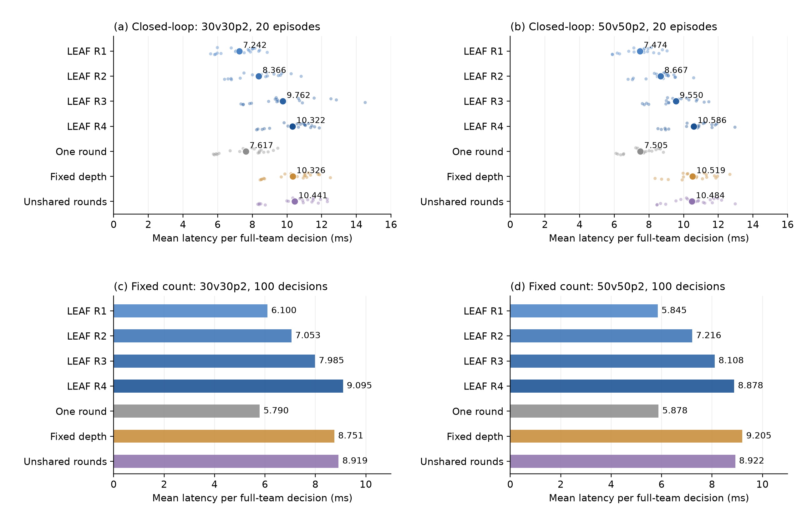

*图6. 上排为20回合测量：小点为回合均值，大点为有效步加权均值；下排为固定人数直接决策的100次算术平均。每排内部两种规模使用相同横轴。图与表来自同一原始文件；[矢量图](../Open-SCORE/outputs/main/had/figures/fig_decision_timing.pdf)。*

在本机本批回合中，LEAF从R1到R4的均值分别由7.242增至10.322 ms、由7.474增至10.586 ms，约为1.43倍、1.42倍。R4、Fixed depth和Unshared rounds的均值接近；不从这些小差异推导方法间显著的速度排序。同一初始场景会因策略不同产生不同轨迹及存活队伍，因此本表衡量真实闭环部署路径上的平均决策时间，不能直接当作同一输入下的纯模块成本或跨硬件通用速度结论。选择LEAF R1是外部固定执行预算；learned fusion本身仍不自动提前停止。

固定人数测量中，LEAF R4约为R1的1.49倍、1.52倍；R4与Fixed depth、Unshared rounds的均值仍接近。30与50个智能体的耗时接近，个别单元50个反而略低，因此本批100次调用支持固定人数下的深度成本描述，不据此声称耗时随人数严格单调或方法间微小差异显著。固定人数列使用紧凑输入且不计特征准备／初次上传；对局列使用固定50／112 padding且包含策略适配器工作，两类测量口径不同，不能用两列之差分解环境或某个模块的成本。

完整协议、checkpoint身份、每回合／每次决策完成状态、逐次纳秒耗时与人数，以及两套14单元的未舍入汇总，合并保存在 [decision_timing.json](../Open-SCORE/outputs/main/had/decision_timing.json)。原20回合数据保留，固定人数结果以`decision_timing_fixed100`字段区分。两次测量的临时测试代码均在记录完成后删除；删除状态记入相应协议。

### 4.9 Fixed depth 浅层退化：三场景临时对照

本节按用户确认的缩减范围，整理已有 Fixed depth（`regir_fixed4_sg`）冻结 final 逐局结果，**没有新增训练或对局**。配置为 **10v10 K2、30v30 K2、50v50 K2**，训练 seed 0/1/2，执行 R1–R4，统一取共同场景 **9000–9099**，每配置／模型／深度100局。共核对 **36/36个单元、3,600/3,600条唯一记录**；R1–R3复用2,700条，R4复用900条，重复、缺失、非有限D均为0。三个模型的`final@1000000`和artifact身份与归档权重对应。

**这三个场景中，Fixed depth在R1/R2的平均表现大幅变差，但种子表现不一致。** 三配置等权的D由R4的 **0.723** 增至R1的 **10.004**、R2的 **7.398**，分别为R4的 **13.84倍、10.23倍**。R3的平均伤害也高于R4。大幅退化主要来自seed0和seed2；seed1在R2/R3的三个配置中均优于其R4，R1仅在30v30 K2略差。因此不能将平均差解释为每个训练种子均稳定退化。

**Fixed depth：D均值±三训练种子样本SD，每单元100局。**

| 配置 | R1 | R2 | R3 | R4 |
|---|---:|---:|---:|---:|
| 10v10 K2 | 4.886±4.123 | 3.179±2.636 | 1.130±0.763 | 0.555±0.347 |
| 30v30 K2 | 10.618±9.634 | 7.918±7.493 | 3.043±3.405 | 0.755±0.358 |
| 50v50 K2 | 14.510±14.371 | 11.098±10.742 | 4.300±5.543 | 0.859±0.415 |
| 三配置等权 | 10.004±9.374 | 7.398±6.955 | 2.824±3.233 | 0.723±0.331 |

**LEAF参照：表6底层对应配置的D均值±三训练种子SD，每单元300局。**

参照沿用`nomem_depth_analysis`的原三份LEAF final、场景9000–9299和R1–R4单元，没有重新评估或替换表6。这里按同样三个配置重算等权汇总，不能将此汇总当作表6的All24或N-OOD。LEAF对应配置的平均深度曲线接近平坦，与Fixed depth的平均浅层退化形成趋势对照；两者局数不同，且LEAF浅层逐场日志未提供，**不计算跨方法逐场配对检验或同场景差分归因**。

| 配置 | R1 | R2 | R3 | R4 |
|---|---:|---:|---:|---:|
| 10v10 K2 | 0.497±0.141 | 0.494±0.093 | 0.498±0.099 | 0.498±0.094 |
| 30v30 K2 | 0.643±0.267 | 0.595±0.173 | 0.568±0.293 | 0.537±0.243 |
| 50v50 K2 | 0.564±0.428 | 0.565±0.355 | 0.543±0.364 | 0.561±0.350 |
| 三配置等权 | 0.568±0.262 | 0.551±0.196 | 0.536±0.233 | 0.532±0.209 |

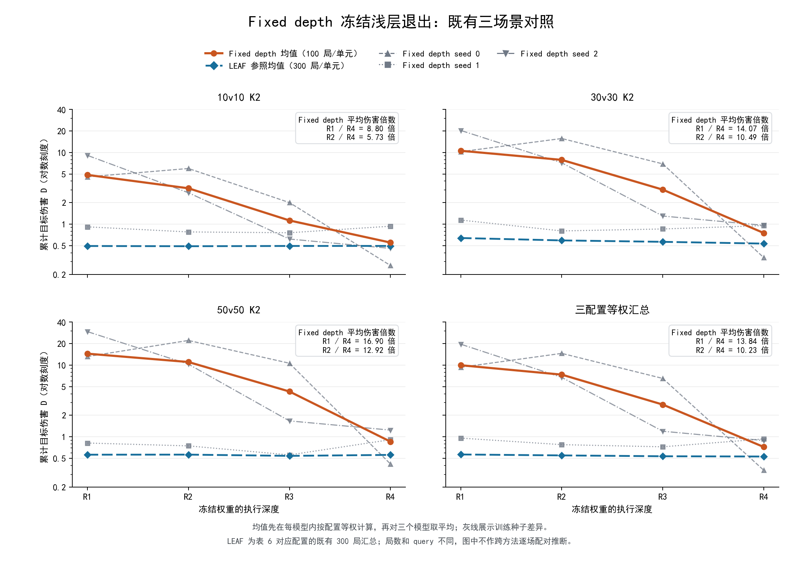

*图：纵轴为对数刻度的累计目标伤害D，越低越好。橙线为Fixed depth三模型均值，灰线为各训练种子的均值，蓝线为LEAF表6对应配置的300局参照均值。第四面板在每模型内先将三个配置等权，再跨三个模型平均；图中不画误差带，样本SD及配对t95见本节表格。局数与query差异保留，不将该图解释为严格的单因素因果对照。*

**Fixed depth内部的同场景深度配对差。**

定义`ΔD=D浅−D四`，正值表示浅层伤害更大；倍数为`平均D浅/平均D四`，不是逐场比值的平均。seed列按相同模型、配置和100个场景相减；t95以三个训练模型的配对差计算（df=2），不把100个场景当作100个独立训练种子。以下12个区间均跨零，说明三模型差异导致区间很宽；本结果支持平均退化观察，**不声称跨种子统计显著**。

| 配置 | 对比 | 平均ΔD；种子t95 | 伤害倍数 | seed0 ΔD | seed1 ΔD | seed2 ΔD |
|---|---|---:|---:|---:|---:|---:|
| 10v10 K2 | R1−R4 | +4.330；[-6.486, +15.147] | 8.80 | +4.321 | -0.019 | +8.689 |
| 10v10 K2 | R2−R4 | +2.623；[-4.732, +9.979] | 5.73 | +5.736 | -0.158 | +2.292 |
| 10v10 K2 | R3−R4 | +0.575；[-1.971, +3.120] | 2.04 | +1.742 | -0.178 | +0.161 |
| 30v30 K2 | R1−R4 | +9.863；[-14.051, +33.777] | 14.07 | +9.963 | +0.187 | +19.439 |
| 30v30 K2 | R2−R4 | +7.164；[-12.253, +26.580] | 10.49 | +15.400 | -0.151 | +6.242 |
| 30v30 K2 | R3−R4 | +2.288；[-7.056, +11.632] | 4.03 | +6.624 | -0.098 | +0.338 |
| 50v50 K2 | R1−R4 | +13.651；[-21.579, +48.881] | 16.90 | +12.812 | -0.093 | +28.234 |
| 50v50 K2 | R2−R4 | +10.239；[-17.120, +37.598] | 12.92 | +21.775 | -0.165 | +9.107 |
| 50v50 K2 | R3−R4 | +3.441；[-11.237, +18.120] | 5.01 | +10.249 | -0.353 | +0.427 |
| 三配置等权 | R1−R4 | +9.281；[-14.029, +32.592] | 13.84 | +9.032 | +0.025 | +18.787 |
| 三配置等权 | R2−R4 | +6.675；[-11.368, +24.719] | 10.23 | +14.304 | -0.158 | +5.880 |
| 三配置等权 | R3−R4 | +2.101；[-6.751, +10.953] | 3.91 | +6.205 | -0.210 | +0.309 |

**归因边界与来源。** 当前Fixed depth的实际checkpoint使用`global_query_detach_memory=true`，未启用`global_query_no_memory`（默认false）：历史Temporal hidden在query前停止梯度，但前向读取仍使用它。LEAF的`global_query_no_memory=true`将query中的历史hidden置零。因此两套现存权重除固定／随机训练深度外，还存在query历史输入差异；本对照不能单独证明“只因固定四轮训练而缺少浅层能力”，归因尚未闭环。整场改变执行深度也改变读出候选和后续时序轨迹，不是仅在同一物理状态多做一次更新。

Fixed depth原始记录来自main0928，保留`legacy_had_protocol_unspecified`来源标识；旧逐局日志未登记HAD核心版本或物理协议，不能反向补写为表6的`had-workbench-2.1.0 / rebuild-calibrated-v3-r7-target-initialization`。本次只整理三个已有K2场景，不代表完整24配置、目标数外推或联合外推，也不用于模型／深度选择。

未舍入的36个Fixed depth单元、LEAF对应36个300局参照单元、种子均值、配对差、t95、协议和checkpoint身份，合并保存在 [summary.json](../Open-SCORE/outputs/main/summary.json) 的`fixed_depth_pilot100`字段；原始3,600条记录继续保存在 [episodes.csv](../Open-SCORE/outputs/main/had/episodes.csv)，不复制逐局数据。分析通过一次性Python stdin命令完成，未加载HAD或运行模拟器，未生成或保留临时测试脚本。

### 4.10 目标覆盖关系的受控线性探针

本节仅执行用户确认的临时探针：冻结原LEAF和训练完成的Direct read三份final，以受控静态输入检验“X所指目标是否由B覆盖”是否可由接收者读出线性解码。**不运行HAD对局、不重训策略、不修改正式性能表**。共生成10v10 K2、30v30 K2、50v50 K2各100个模板，每模板六个状态，**1,800个唯一受控状态**；六份冻结模型复用同一输入与划分，18/18个模型／配置采集单元及36/36个主线性分类器完成。

**本次结果未形成“三阶对应两轮”的证据闭环。** 三配置等权的留出准确率为LEAF-H0 **50.19±0.32%**、H1 **51.30±2.70%**、H2 **52.41±0.98%**、训练完成的Direct read-H0 **50.37±0.70%**，均接近50%机会水平。H2略高于H1，但增幅小且种子方向不一致，不能表述为“前两者不能区分而R2能可靠区分”。

**场景与配对控制。** A位于两目标中点；目标沿随机方向对称置于距A 700–1,000米处。X在所指目标外侧600–900米，以80 m/s朝该目标运动。B分别置于两个目标朝A方向200米的位置，两种守卫位置到A等距，速度均为相同的60 m/s垂直方向。每模板交叉生成X→T1/T2 × B守T1/T2四状态，标签依次为`[1,0,0,1]`；固定X的成对状态只改变B位置。另生成X→T1/T2、B位于距A 1,800米垂直方向的两个远离控制，标签均为0。覆盖标签具体定义为“指定B距X唯一趋近的目标不超过300米”；其他防御者距两目标至少800米，背景实体在模板内固定。

所有输入使用现有damage实体特征与50红／50蓝／12目标padding，目标伤害为0、无人机健康为满值，历史动作和Temporal hidden均为0。生成种子固定为`20261013`，模板整体随机旋转和平移；不读取对手隐藏指派，也不执行对手决策或物理更新。该覆盖标签描述名义几何关系，不能等同于真实拦截有效性或reactive的连续覆盖权重。

**读出与线性探针。** 主比较为64维的融合前read，尚未经过`W_f`或Temporal GRU。LEAF-H1/H2来自正常R2前向捕获的`u[0]/u[1]`；LEAF-H0使用相同query和reader读取捕获的原始H0。H1还与真实冻结R1前向逐状态核对一致。Direct read-H0使用专门训练的`regir_r0_sg`原H0读取。主表的H2是第二阶段read，**不是R2出口中H1/H2的融合向量**。训练完成的Direct read通常使用截断梯度的历史query，本次所有初始hidden为0，保留其真实参数。

每配置、模型种子、读出独立拟合一个逻辑回归：仅用训练集StandardScaler，`C=1、solver=lbfgs、max_iter=1000、tol=1e-6`。70个模板训练、30个模板留出，整组反事实和远离控制不跨划分；所有模型与出口共享划分。训练仅使用四个主状态，每分类器280条训练、120条留出；60条留出远离控制不参与训练。没有留出调参、超参数搜索或额外模型种子。

**主结果：留出准确率，百分比均值±三模型样本SD。**

| 配置 | LEAF-H0 | LEAF-H1 | LEAF-H2 | Direct read-H0 |
|---|---:|---:|---:|---:|
| 10v10 K2 | 50.00±1.67 | 51.67±3.82 | 53.33±3.00 | 50.83±0.00 |
| 30v30 K2 | 50.00±1.44 | 51.39±5.42 | 51.67±1.67 | 50.28±1.27 |
| 50v50 K2 | 50.56±1.27 | 50.83±2.50 | 52.22±1.27 | 50.00±0.83 |
| 三配置等权 | 50.19±0.32 | 51.30±2.70 | 52.41±0.98 | 50.37±0.70 |

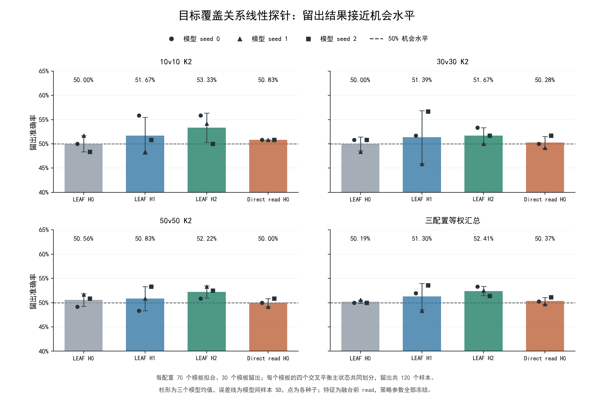

*图：纵轴显示40%–65%的准确率范围，虚线为50%机会水平。柱形先按模型内配置等权，再跨三个模型平均；点展示每个模型的结果，误差线为模型间样本SD，并非将120个相关状态当作独立训练模型后的标准误。该图展示原预定协议的结果，不选择最佳读出或最优种子来替代主表。*

**各种子留出准确率（%）。**

| 配置 | seed | LEAF-H0 | LEAF-H1 | LEAF-H2 | Direct read-H0 |
|---|---:|---:|---:|---:|---:|
| 10v10 K2 | 0 | 50.00 | 55.83 | 55.83 | 50.83 |
| 10v10 K2 | 1 | 51.67 | 48.33 | 54.17 | 50.83 |
| 10v10 K2 | 2 | 48.33 | 50.83 | 50.00 | 50.83 |
| 30v30 K2 | 0 | 50.83 | 51.67 | 53.33 | 50.00 |
| 30v30 K2 | 1 | 48.33 | 45.83 | 50.00 | 49.17 |
| 30v30 K2 | 2 | 50.83 | 56.67 | 51.67 | 51.67 |
| 50v50 K2 | 0 | 49.17 | 48.33 | 50.83 | 50.00 |
| 50v50 K2 | 1 | 51.67 | 50.83 | 53.33 | 49.17 |
| 50v50 K2 | 2 | 50.83 | 53.33 | 52.50 | 50.83 |

**H2−H1配对差（百分点）。** 以下先在同模型、同配置、同留出状态上比较，再按三个模型求均值和t95（df=2）。seed2在三个配置均不优于H1；各t95均跨零。

| 配置 | seed0 | seed1 | seed2 | 平均差±SD | 种子t95 |
|---|---:|---:|---:|---:|---:|
| 10v10 K2 | +0.00 | +5.83 | -0.83 | +1.67±3.63 | [-7.36, +10.69] |
| 30v30 K2 | +1.67 | +4.17 | -5.00 | +0.28±4.74 | [-11.49, +12.05] |
| 50v50 K2 | +2.50 | +2.50 | -0.83 | +1.39±1.92 | [-3.39, +6.17] |
| 三配置等权 | +1.39 | +4.17 | -2.22 | +1.11±3.20 | [-6.85, +9.07] |

**控制组。** 仅使用B二维位置、沿用同一训练／留出划分的线性分类器，在三个配置的主状态中均为**50.00%**；交叉平衡使每个B位置同时对应覆盖与未覆盖，位置本身不能泄露主标签。远离控制全为负类，以下为误报为“被覆盖”的比例，越低越好，不能与主表的平衡二分类准确率混用。这些远离位置未参与探针训练，结果同时反映位置分布外的泛化。

| 配置 | LEAF-H0误报率 | LEAF-H1误报率 | LEAF-H2误报率 | Direct read-H0误报率 |
|---|---:|---:|---:|---:|
| 10v10 K2 | 62.78±8.55 | 30.00±10.93 | 35.00±10.14 | 50.00±18.78 |
| 30v30 K2 | 63.89±3.47 | 31.11±15.84 | 45.56±7.88 | 62.22±6.74 |
| 50v50 K2 | 65.00±10.93 | 41.11±11.10 | 56.11±6.74 | 55.00±2.89 |
| 三配置等权 | 63.89±4.34 | 34.07±7.98 | 45.56±7.78 | 55.74±9.32 |

**动作价值补充，不作为主指标。** 真实冻结R1/R2出口使用同一模板的两个X固定反事实对，留出每配置／模型60对；记录A的9维动作价值变化。中心化ΔQ去掉各动作共同的价值偏移，贪心动作变化率表示覆盖扰动引起的动作敏感性，不说明改变后的动作是否正确或保护收益是否提高。

| 实际出口（三配置等权） | 中心化ΔQ RMS，均值±SD | 贪心动作变化率（%），均值±SD |
|---|---:|---:|
| R1 | 0.01839±0.00621 | 8.52±4.49 |
| R2 | 0.01809±0.00714 | 6.85±3.70 |

**解释范围。** 在本次预定的小型受控分布上，H2没有呈现可靠、明显的覆盖关系线性解码能力；远离控制误报也较高。它不足以支持“R2能区分而H0/H1不能”的动机闭环。线性探针失败不证明信息不存在，亦不证明策略在真实轨迹上没有利用覆盖关系。该输入为合成静态几何、零历史，仅判断指定B的邻近关系；并且全可见attention可能利用X与B的直接几何捷径，因此轮数不能作为严格递增关系阶数或必要深度下界。LEAF-H0是未作为部署出口训练的读取，训练完成的Direct read提供补充对照，两者仍有不同训练参数。没有为改善本次结果改场景、扩大配额、更换探针或重训策略。

受控输入、模板划分、四类读出、标签、预测概率、分类器标准化与线性参数、真实R1/R2的Q及R2融合权重统一保存在 [coverage_binding_probe.npz](../Open-SCORE/outputs/main/had/coverage_binding_probe.npz)。协议、六份final的artifact身份、36个分类器明细及汇总保存于 [summary.json](../Open-SCORE/outputs/main/summary.json) 的`coverage_binding_probe`字段。数据可直接复算分类准确率；未保存完整策略权重副本。结果核对后已删除临时采集脚本；只保留本节报告、原始受控数据、必要线性参数与图片，原训练和评估代码保持原样。

## 5. 结论与证据范围

LEAF将攻击者、目标与队友的同时刻信息加工为实体上下文，再由接收者读取并结合时序记忆行动。有限规模训练后的同一策略，在目标数、人数和联合外推中具有较低损伤；冻结同三份权重的R1–R6则展示了执行深度变化下的真实表现。正常融合、保护统计和轨迹将这一联合结构与实际群体保护连接起来。

| 主张 | 当前证据与表述范围 |
|---|---|
| 整体保护及实体规模外推 | 七个学习基线、参数匹配参照、Rule/Random、四组正式统计与独立confirm |
| 当前实体上下文、接收者读取与时序记忆的分工 | 实际前向与Memory query历史入口对照；Direct read/One round比较共同历史query基底，其余历史设计相对LEAF有query混杂 |
| 正常策略主要读取早期上下文 | 前两轮约99%权重，且随接收者和物理时刻变化；权重不等于因果贡献 |
| 执行深度变化与推理深度外推 | 同三final×24配置×R1–R6，包含配置和种子差异；R5/R6超出训练深度 |
| 单个模块的独立稳定收益 | 当前分别训练及冻结结果存在局部反例，不将联合性能拆成普遍增益 |

跨深度参数共享与中间读出融合组织了同一策略的计算，但没有回报单调改进或实体状态严格收敛保证。当前报告没有合格LEAF MAC对应数据；第4.8节包含指定硬件下的20回合部署时延与固定人数、同输入100次直接决策时延，不将其推广为训练吞吐、单个模块独立成本或跨硬件速度保证。历史探索见[补充实验结果分析](LEAF_补充实验结果分析.md)。

## 附录 A. 当前数据与模型索引

| 内容 | 入口与读取口径 |
|---|---|
| 正式、验证及保留的LEAF辅助逐局数据 | [had/episodes.csv](../Open-SCORE/outputs/main/had/episodes.csv)，按source_version、run、method、seed、phase、arm及场景区分 |
| 学习记录 | [had/learning.csv](../Open-SCORE/outputs/main/had/learning.csv)，性能曲线取train_eval奖励 |
| 主性能派生统计 | [had/aggregates.json](../Open-SCORE/outputs/main/had/aggregates.json)，当前主比较取paper_current，新基线确认取其confirmation；paper1007作为历史保留 |
| 冻结深度与确认逐场记录 | [had/loop_records.jsonl](../Open-SCORE/outputs/main/had/loop_records.jsonl)，不将复用回合增加为独立样本 |
| 深度单元统计 | [had/loop_summary.csv](../Open-SCORE/outputs/main/had/loop_summary.csv)，保留三种子、24配置与R1–R6 |
| 全队决策时延 | [had/decision_timing.json](../Open-SCORE/outputs/main/had/decision_timing.json)，seed0 final、七个方法／出口、两种规模；20回合部署测量与固定人数100次直接决策以run字段区分，逐次与汇总合并保存 |
| 总汇总与深度分析 | [summary.json](../Open-SCORE/outputs/main/summary.json)，nomem_depth_analysis保留完整单元、分组与配对种子统计；fixed_depth_pilot100保存三场景临时浅层对照；coverage_binding_probe保存受控覆盖关系探针统计 |
| 实验协议 | [experiment.json](../Open-SCORE/outputs/main/experiment.json)，保留来源与checkpoint身份 |
| LEAF主模型示例 | [final.pt](../Open-SCORE/outputs/main/had/regir_nomem/models/main0928/seed_0/final.pt)、[best.pt](../Open-SCORE/outputs/main/had/regir_nomem/models/main0928/seed_0/best.pt)，各种子final与验证best按来源保存 |
| 新基线模型与加载配置 | [SPECTra seed0](../Open-SCORE/outputs/main/had/spectra/models/main1013_base/seed_0/config.json)、[TransfQMix seed0](../Open-SCORE/outputs/main/had/transfqmix/models/main1013_base/seed_0/config.json)，各种子final/best及配置归入同一main目录 |
| 正常读取机制原始记录 | [mechanism1008.json.gz](../Papers/v3/data/mechanism1008.json.gz) |
| 展示轨迹原始记录 | [trajectories1008.json.gz](../Papers/v3/data/trajectories1008.json.gz) |

深度补评新增108,000场已完成评估且有完整单元汇总，逐场JSONL未提供。本地现存R4逐场文件不能重建并覆盖其余出口汇总；不补造场景bootstrap或逐场统计。正式数据、最终模型和验证最优模型保留实际来源与完成状态。

## 附录 B. 当前显示名称与内部标识

内部标识是既有数据/模型兼容键，不表示当前变体的设计基底或论文名称。显示名称按LEAF设计轴组织；历史保存变体的query条件与归因边界见第3.2节，Fixed depth的具体差异见第4.9节。

| 显示名称 | 内部保存标识 |
|---|---|
| LEAF | regir_nomem |
| LEAF–Memory query | regir_sg |
| LEAF–Direct read | regir_r0_sg |
| LEAF–One round | regir_r1_sg |
| LEAF–No host | regir_norefil_sg |
| LEAF–Last read | regir_last_sg |
| LEAF–Fixed depth | regir_fixed4_sg |
| LEAF–Unshared rounds | regir_untied4_sg |
| REFIL | refil |
| REFIL-matched | refil_matched |
| QMIX-Atten | b2_qmix_atten |
| DCG | dcg |
| SPECTra | spectra |
| ALMA | alma |
| TransfQMix | transfqmix |

Rule的保存标识为rule_nv1，Random为random / random_accel；二者没有训练种子。
