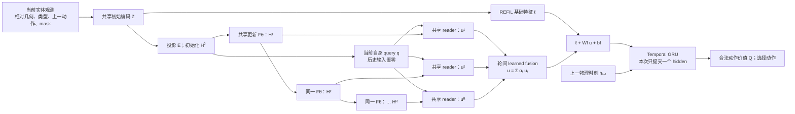
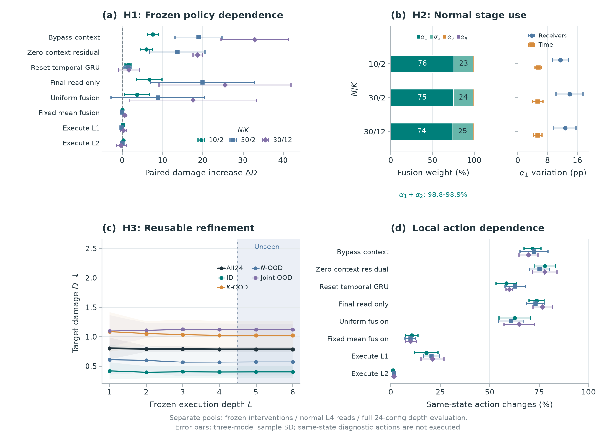

# LEAF 方法说明：威胁情境、共享循环与时序记忆

更新：2026-10-26。本文解释LEAF的实际计算、训练深度与执行深度两条轴，以及同一冻结策略的机制与读出诊断。结果与协议见[主实验结果分析](LEAF_主实验结果分析.md)，基线定义见[Baseline 与 Rule 实现说明](LEAF_Baseline与Rule实现说明.md)。

## 1. 威胁情境与双轴适应目标

多目标攻防中，攻击者的威胁取决于它指向哪个目标、这个目标又已经被谁覆盖，也就是由攻击者、目标和队友共同构成的威胁情境。部署时实体规模会变、可用于关系推理的计算深度也可能变。LEAF设计目标是一个策略同时适应两种变化。

LEAF以实体集合表达规模变化，在同一物理时刻用共享参数循环加工攻击者、目标与队友的上下文，接收者自身query读取各轮表示，再融合并交给Temporal GRU行动。第一轮已经可以访问全部有效实体；后续轮次重新加工上下文。实体循环状态与跨时刻记忆有不同生命周期，不能将循环深度解释为物理时间或严格递增的关系阶数。

保存键regir_nomem对应本文的LEAF；nomem只表示query不读取历史GRU hidden。Temporal GRU、上一动作特征及策略记忆仍然存在，不能把该键解释成No-memory。完整内部标识兼容映射见[主报告附录B](LEAF_主实验结果分析.md#附录-b-当前名称与内部标识)。

## 2. 输入、实体视图与REFIL宿主

### 2.1 每个防御者怎样看到实体

模型接收红方、蓝方与目标的实体表及 mask。HAD 基础实体特征为10维，包括归一化位置、速度、存活状态、生命值、目标累计损伤特征和三类实体标记。主方法还启用 entity_last_action：红方实体追加上一动作的9维 one-hot，其他实体的动作段为零。它与 obs_last_action 开关不是同一设置。

编码前为每个接收者建立自己的实体视图：

- 自身实体移到第0行，自身位置与速度保留绝对特征。
- 其他实体的位置、速度相对该接收者表达。
- 不可见、死亡和 padding 实体不能充当有效 key，对应工作状态按 mask 处理。
- REFIL 的 imagined 分支额外屏蔽部分 key，基础 attention 的自身 query 仍保留真实自身特征。LEAF 的 global query 使用 mask 后返回的实体 token；若 imagined 分支排除了自身 key，其 global query 也不保留该自身 token 的原特征。

实现中 mask=True 表示无效或排除。本文 attention 公式中的 $m$ 表示该掩码；需要乘权重时另用有效指示 $v_e$，避免将无效实体当作有效实体。

因此，不同防御者共享参数，却可形成不同的场景表示和读取结果。“global branch”是代码名称，处理的仍是接收者被允许使用的实体集合，并不引入额外不可观测信息。本轮 HAD 的公开实体接口也不能直接推广为所有局部观测任务的设定。细节见[features.py](../Open-SCORE/open_score/envs/features.py)和[HAD 环境与问题建模](HAD_环境与问题建模.md)。

### 2.2 REFIL 提供了哪些基础

对接收者 $i$ 的实体输入 $X_{i,t}$，先得到128维初始编码：

$$
Z_{i,t}=\operatorname{ReLU}(W_eX_{i,t}+b_e).
$$

REFIL 基础路径以自身条件注意力汇聚实体，经映射得到64维基础特征 $\ell_{i,t}$。新增关系路径将初始实体编码投影为64维：

$$
E_{i,t}=W_gZ_{i,t}+b_g,\qquad H_{i,t}^{(0)}=\operatorname{Mask}(E_{i,t}).
$$

两条路径共享初始编码，后续处理不同。基础路径输出一个接收者特征；关系路径先更新整个实体集合，再读取接收者特征。**关系路径不是从已经池化的 $\ell$ 重新生成实体。** 本文用 $E$ 表示已投影的初始实体状态，用 $\ell$ 表示 REFIL 基础特征。

主方法还保留 REFIL imagined 分组：训练中构造组内、跨组 masked 输入，用共享策略和混合网络学习辅助价值目标；部署使用正常主分支。“保留 REFIL”同时涉及基础特征路径、imagined 分支和辅助损失，而不只是保留一层 attention。

### 2.3 物理时间与循环深度是两条轴

| 状态 | 含义 | 初始化 | 是否跨物理时刻传递 |
|---|---|---|---|
| $H^{(r)}$ | 每个接收者的一组实体工作状态 | 每次新观测从 $E$ 开始 | 否 |
| $q$ | 接收者读取query | 每次新观测构造 | 否；本次决策内固定 |
| $h_{i,t}$ | 64维 Temporal GRU hidden | 每场开始置零 | 是 |

共享循环处理的是**同一物理时刻的场景**。跨时刻记忆由 Temporal GRU 承担。一个决策执行四轮上下文加工，最后只提交一次 Temporal hidden。

## 3. 共享循环、接收者读取、融合与时间记忆

### 3.1 信息流

下图按当前主模型前向展示信息流。

“共享更新”和“共享 reader”是两套参数，各自在轮间复用。**轮间融合**与 $\ell+W_fu+b_f$ 的**基础—关系特征融合**也是两个操作。

### 3.2 固定当前 query

实现保留与历史查询相同的输入维度，但将历史部分置零：

$$
q_{i,t}=W_q[E_{i,t,\mathrm{self}};\,0_{64}]+b_q.
$$

它等价于从当前自身编码形成仿射 query，在本次决策各轮保持不变。此处 $E_{\mathrm{self}}$ 是 global 路径实际返回并投影的 token；正常执行的存活自身 token 有效，imagined 分支须按2.1节的 mask 语义理解。有效自身编码包含上一动作，所以“不读 GRU hidden”并不意味着输入完全没有过去信息。

### 3.3 共享上下文更新

省略 $i,t$，LEAF 每轮为：

$$
\begin{aligned}
J^{(r)}&=\operatorname{LN}_a(H^{(r-1)}),\\
\widetilde H^{(r)}&=H^{(r-1)}
+\operatorname{MHA}_{\theta}(J^{(r)},H^{(r-1)},H^{(r-1)};m),\\
H^{(r)}&=\operatorname{Mask}_{m}
\left[\widetilde H^{(r)}
+\operatorname{FFN}_{\theta}(\operatorname{LN}_f(\widetilde H^{(r)}))\right].
\end{aligned}
$$

工作宽度64，注意力4头，FFN隐藏宽度128；$\theta$ 在轮间共享。 主模型 context attention 的 Q 用 LayerNorm 后状态，K/V 默认用未额外归一化的上一轮状态。

第一轮已允许所有有效实体互相注意。后续轮次重新加工已有上下文，不能解释成“多一轮才看见更远实体”或严格递增的图关系阶数。残差与 FFN 也不提供收敛或回报单调改进保证。

### 3.4 各轮读取与 learned fusion

各轮用相同 query、相同 reader：

$$
u^{(r)}=\operatorname{MHA}_{\mathrm{read}}(q,H^{(r)},H^{(r)};m).
$$

再由共享64→1线性评分器计算轮间权重：

$$
s_r=w_s^\top u^{(r)}+b_s,\qquad
\alpha_r=\frac{\exp(s_r)}{\sum_{j=1}^{R}\exp(s_j)},\qquad
u=\sum_{r=1}^{R}\alpha_ru^{(r)}.
$$

评分器**只接收该轮读出**，没有另拼 query 或 Temporal hidden；接收者信息通过 $u^{(r)}$ 间接影响权重。这个 softmax 选择跨轮信息，不停止计算：正常 R4 中，四轮上下文均已计算。

*图1. 复用共享机制图；(b)展示正常融合权重、同一物理状态不同接收者的权重差异及同一接收者相邻物理步的变化。三个规模下前两轮合计约99%。它说明实际读取以早期上下文为主，并随接收者和时间变化；不能把权重等同于奖励贡献，也不能据此声称节省计算。*

### 3.5 基础特征、时间记忆与动作

$$
\ell'_{i,t}=\ell_{i,t}+W_fu_{i,t}+b_f,\qquad
h_{i,t}=\operatorname{GRU}_{\mathrm{time}}(\ell'_{i,t},h_{i,t-1}),\qquad
Q_i(\cdot)=W_oh_{i,t}+b_o.
$$

$W_f,b_f$ 零初始化，使关系路径从不扰动基础特征的状态开始联合学习，训练后不保持为零。真实历史始终进入Temporal GRU；当前query负责读取当前上下文，时间历史在下游用于动作决策。

HAD 策略输出9个机动动作的价值，在合法动作中选最高值。模型没有显式的防御者—攻击者分配输出，协作通过机动决策产生。训练时 FlexQMIX 将个体价值组合成团队价值，部署不需要混合网络。

## 4. 训练深度与执行深度两条轴

LEAF 采集时每个环境均匀抽 R1–R4，并在一场内保持；replay 更新另按 minibatch 抽深度，online、target 和 imagined 分支一致。正式主性能用 final 权重、R4执行，显式 count 注入关闭。

保留主 TD 与 imagined TD：

$$
\mathcal L=(1-\lambda)\mathcal L_{\mathrm{TD}}
+\lambda\mathcal L_{\mathrm{imagined}},\qquad\lambda=0.5.
$$

这里0.5是辅助损失权重，仅用于主TD与imagined TD的组合。训练可含 potential shaping，正式奖励为 $R=-D$，$D$ 是目标累计损伤；价值学习与 HAD 环境接口没有因选择 LEAF 改变。

参数量不随实体数量或共享展开轮数增长，但计算仍增长。每个接收者的 dense context 约需 $O(R(M^2d+Md^2))$，还需基础路径、reader 和时序网络。不能由参数共享推导线性计算、实时加速或更低实际显存。

### 4.1 从头训练、冻结出口与读出诊断

| 比较 | 固定或改变什么 | 回答的问题 |
|---|---|---|
| 同一LEAF final执行R1–R6 | 固定checkpoint，改变整场执行出口 | 已训练策略对部署计算深度变化的表现 |
| 同状态固定计算的read1 / read4 / uniform | 状态与进入Temporal hidden相同，改变读出 | 冻结策略对读出选择的依赖 |

正式LEAF执行R4；冻结R1–R4位于训练范围内，R5/R6为推理深度外推。加深同时增加上下文更新并扩大融合softmax的候选集合，闭环动作与Temporal hidden也会改变，不能视为孤立一次attention的效应。完整深度矩阵覆盖同三份final×24配置×R1–R6；新增108,000场只有完整单元汇总，未提供逐场JSONL。

组均值、配对训练种子t95与三种外推逐配置表见[主报告](LEAF_主实验结果分析.md)。配置和种子差异限制了更深普遍改善的主张。learned fusion是信息融合规则，所有设定轮次仍被计算，不能解释成停止器或墙钟加速。

## 5. 怎样连接结构与已有证据

| 结构或目标 | 已有证据 | 边界 |
|---|---|---|
| 威胁情境进入个体动作决策 | 实体上下文、接收者reader与Temporal GRU的实际前向 | 不以attention权重直接证明某个物理关系的因果贡献 |
| 实体规模适应 | 人数、目标数及联合外推，七学习基线与Rule/Random参照 | HAD已有任务与协议内的性能 |
| 执行深度变化 | 同三份final在24配置上的R1–R6矩阵 | R5/R6是推理外推，没有单调改善保证 |
| 正常信息读取与保护行为 | 前两轮约99%融合权重、接收者/时间变化、保护统计和轨迹 | 局部示例不代替正式300场景排名 |
| 共享循环与中间融合 | 联合架构组成与同权重冻结干预 | 不宣称每一构件均有独立稳定增益 |

[REFIL](https://proceedings.mlr.press/v139/iqbal21a.html)提供随机实体分组与辅助价值训练基础；[Universal Transformers](https://arxiv.org/abs/1807.03819)为跨深度共享变换提供先例；[Jumping Knowledge](https://proceedings.mlr.press/v80/xu18c.html)与中间表示汇聚有关。这些工作说明构件有设计依据，不提供本任务奖励改善或深度收敛保证。LEAF的定位是威胁情境、接收者读取、阶段融合与时间记忆的具体组织及双轴适应结果。

冻结干预、同状态动作与稳定性边界见[主报告第4.10节](LEAF_主实验结果分析.md#410-leaf冻结干预同状态诊断与动作稳定边界)。

## 6. 实现与配套资料

| 内容 | 入口 |
|---|---|
| 当前query、共享更新、reader与融合 | [entity_encoder.py](../Open-SCORE/open_score/models/entity_encoder.py) |
| 结构注册 | [algos/__init__.py](../Open-SCORE/open_score/algos/__init__.py) |
| 主TD与imagined TD | [q_learner.py](../Open-SCORE/open_score/algos/pymarl/learners/q_learner.py) |
| LEAF实际保存配置 | [seed0 config.json](../Open-SCORE/outputs/main/had/regir_nomem/models/seed_0/config.json) |
| 主统计与协议 | [summary.json](../Open-SCORE/outputs/main/summary.json)、[experiment.json](../Open-SCORE/outputs/main/experiment.json) |
| 正式对照、正常机制与深度矩阵 | [主实验结果分析](LEAF_主实验结果分析.md) |

本文依据既有实现、保存配置及完成结果解释方法，没有新增训练、评估或模型。
