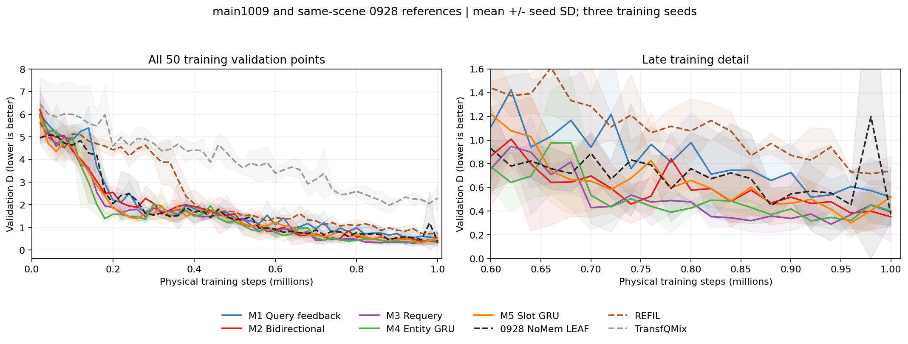
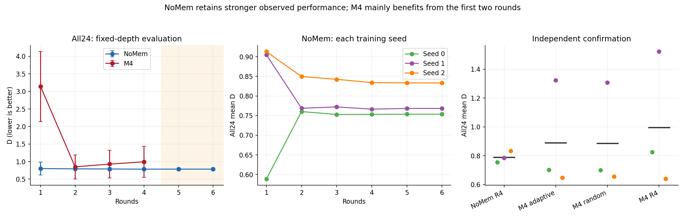
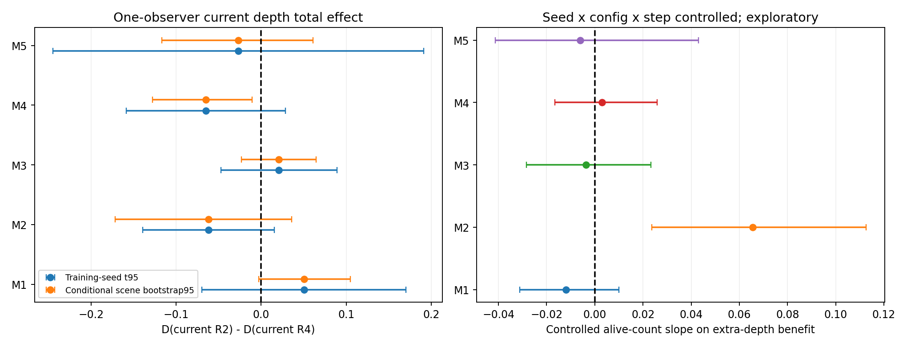
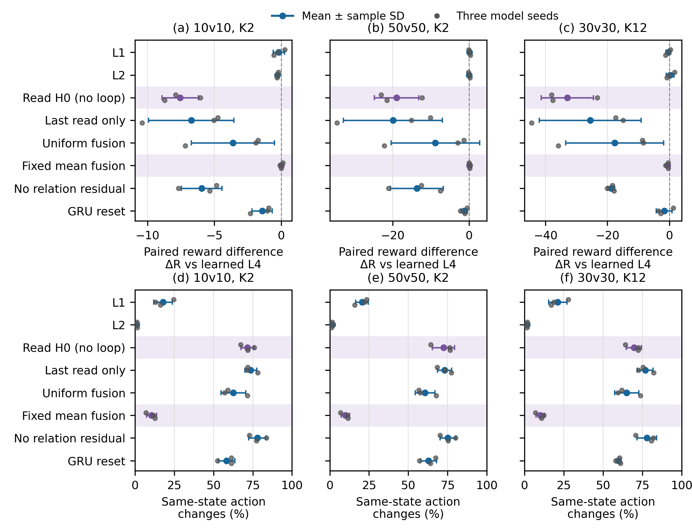
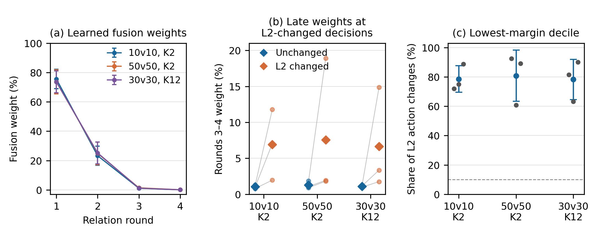
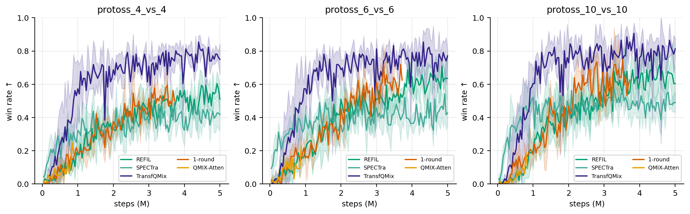

# LEAF 补充实验结果分析：设计探索、历史协议与来源边界

更新：2026-10-13。本文是[outputs/backup](../Open-SCORE/outputs/backup)中归档探索的唯一正式分析报告，与[主实验结果分析](LEAF_主实验结果分析.md)分工。当前主报告集中保留LEAF、七个学习基线、七个LEAF变体及双轴外推；本文合并以LEAF为参照的其他结构探索、历史协议与独有诊断。

M1–M5按LEAF基础上的探索描述；旧配置、原方法名、查询/count字段和统计口径作为历史来源保留，不重新包装为当前受控证据。结构、公式与结果在本报告内合并，M4只保留一套完整解释与表格。Refine、Set2及早期REFIL扩展的登记不等于完成结果。统计与模型入口为[backup/summary.json](../Open-SCORE/outputs/backup/summary.json)。

## 1. 主要结论

**五个候选中，M4 的直接实体状态承接与前两轮整合获得最清楚的奖励证据；继续加深到四轮、当前自适应退出和相对 LEAF 的性能优势均未成立。** M4 适合保留为有限步实体整合的研究结果，当前性能主线仍是 LEAF。

- M4 的正常四轮原生 D 为 0.9445；重置 EntityGRU 的直接 hidden 后为 4.8730，损失 **3.9286**，训练种子与场景条件区间均为正。
- M4 原生六配置池的 R1→R2 收益为 **2.4767**，两个区间均为正；完整24配置中 **72/72 配置×种子单元**同向改善，但三种子 t95 仍跨零。R2→R4 的三个种子整体结果均退化。
- M3 在小原生池有 R2→R4 读取收益；完整池的收益较小、种子区间跨零，不能据此确认更深读取的泛化价值。
- 五方法均没有稳定优于实际预算匹配随机的自适应收益。M4 独立确认同样没有优势，Joint-OOD 中随机反而更好。
- SMAC 与历史闸门结果独立保留。已有曲线、历史胜率或名为 `final.pt` 的权重，不自动表示当前预算下的训练和正式评估已完成。

## 2. 共同基础、结构与评估口径

### 2.1 五种循环结构

五候选继承 LEAF 的 REFIL 局部编码、imagined 分组训练、Temporal GRU、FlexQMIX 和 TD 目标。循环宽度64、attention为4 heads、FFN宽度128，轮间共享参数。本步 query 不输入上一物理时刻的 GRU hidden；Temporal GRU 和记忆、上一动作特征仍保留。

候选使用选中轮的末端读出，与局部表示融合后进入 Temporal GRU。这里的局部—全局融合不同于原 LEAF 的跨轮 learned JK 融合；新旧整体差异也包含训练深度抽样与读出方式，不能当作只增加一个反馈模块的单因素比较。

| 方法／注册名 | 实际结构 | 待检验的作用 |
|---|---|---|
| M1 `regir_loop_nomem` | 实体更新保留原观测锚定；读出更新下一轮私有 query | 读取结果修正下一次关注条件 |
| M2 `regir_bidirectional_nomem` | 在 M1 上将私有 query 加入实体 attention 的 K/V | 实体更新与读取形成双向反馈 |
| M3 `regir_requery_nomem` | 实体 context 与 reader K/V 只计算一次，随后迭代 query | 以较小边际计算反复修正读取 |
| M4 `regir_entitygru_nomem` | attention 消息和原观测进入共享 EntityGRU，承接上一轮实体 hidden | 当前决策内有限步、门控实体状态整合 |
| M5 `regir_slotgru_nomem` | 四个 slots 对实体竞争聚合，再由共享 SlotGRU 更新 | 固定工作空间内的迭代聚合 |

M4的节点GRU更新与[Gated Graph Sequence Neural Networks](https://arxiv.org/abs/1511.05493)的状态整合思想相关，M5的竞争聚合与[Slot Attention](https://proceedings.neurips.cc/paper/2020/hash/8511df98c02ab60aea1b2356c013bc0f-Abstract.html)相关；已有构件先例不提供本任务奖励或收敛保证。

M3/M5 的前置实体 context 仍含稠密 attention；小读取工作空间不能推出整个模型随实体数线性扩展。实现见 [实体编码器](../Open-SCORE/open_score/models/entity_encoder.py)、[候选注册](../Open-SCORE/open_score/algos/__init__.py) 和 [冻结评估协议](../Open-SCORE/scripts/leaf1009.py)。

### 2.2 实际完成范围与统计单位

main1009 的15个候选训练任务均完成1M环境步，每方法使用训练种子0/1/2；正式权重为各自 final，best只解释验证波动。训练按 observer、按决策均匀抽取R1–R4，并将深度保存到replay，使online、target、Double Q和imagined分支沿用对应深度。75,000条训练验证回合及原学习记录保留在同一数据目录。

正式eval为24配置×3训练种子，每配置每臂300场，比较fixed1–fixed4、adaptive与预算随机。ID calibration使用42000–42039，家族selection使用40000–40099，正式eval使用9000–9299，独立confirm使用110000–110299。**ID预先锁定M4家族，confirm只评fixed4/adaptive/random；二轮不是独立确认过的新赢家。** 原生机制池为六配置各十场景、三份训练权重，每臂180回合。

环境版本为 `had-workbench-2.1.0`，物理协议为 `rebuild-calibrated-v3-r7-target-initialization`。D是目标伤害，越低越好，奖励为−D。先对配置等权求每训练种子的均值，再报告三种子均值±样本SD；配对t95使用df=2。原生场景条件bootstrap反映固定三份权重下的场景不确定性，不能替代训练种子不确定性。

24配置包括ID 4、K-OOD 4、N-OOD 6、Joint-OOD 8、Extra 2；All24按配置等权。不同版本的相同注册名仍保留版本与checkpoint身份，历史重复或不同回报记录不增加独立样本数。

## 3. 五方法整体结果

### 3.1 固定深度、自适应与随机

下表均为正式eval的All24 D±训练种子SD。各出口使用同一方法的既有final，不是分别从头训练的固定深度模型。

| 方法 | R1 | R2 | R3 | R4 | adaptive | random |
|---|---|---|---|---|---|---|
| M1 | 1.9508±1.0340 | 1.2849±0.7802 | 1.3444±0.7726 | 1.5298±0.7878 | 1.2997±0.7816 | 1.2835±0.7744 |
| M2 | 2.0926±1.3055 | 1.0939±0.7085 | 1.4185±0.5390 | 1.9976±0.6301 | 1.1763±0.6025 | 1.1983±0.6220 |
| M3 | 1.3569±0.9253 | 1.2742±0.7758 | 1.2346±0.7088 | 1.2162±0.6558 | 1.2625±0.7465 | 1.2932±0.8010 |
| M4 | 3.1390±0.9961 | **0.8506±0.3446** | 0.9284±0.3927 | 0.9940±0.4455 | 0.8750±0.3573 | 0.8761±0.3637 |
| M5 | 1.7753±0.3199 | 1.6419±0.1785 | 1.6139±0.0889 | 1.6275±0.0837 | 1.6154±0.1271 | 1.6328±0.1611 |


M1/M2/M4的主要改善发生在前两轮，继续加深出现退化；M3的均值随深度缓慢改善；M5没有清晰的单调规律。M4二轮是新候选中观察到的最低均值，不能用这一事后出口选择替代预先冻结的家族确认。

| 方法 | 正式R2→R4奖励收益 | 种子t95 | 判断 |
|---|---|---|---|
| M1 | −0.2448 | [−0.4905, +0.0008] | 三种子均退化，区间仍跨零 |
| M2 | −0.9037 | [−1.1001, −0.7073] | 当前模型加深明显退化 |
| M3 | +0.0580 | [−0.2407, +0.3568] | 较小均值收益，训练种子证据不足 |
| M4 | −0.1435 | [−0.4581, +0.1711] | 三种子整体均退化 |
| M5 | +0.0144 | [−0.3136, +0.3423] | 方向与稳定性均不清楚 |

### 3.2 训练过程

M4验证终点D为 **0.4020±0.1304**，末五点均值为 **0.3687±0.0406**。seed1的终点及N/Joint-OOD较弱，是其较大种子差异的重要来源。训练验证只覆盖固定ID池，不替代正式外推；验证最优、末段均值均不替换预定final。



随机深度训练中，第1/2/3/4轮被执行的概率为100%/75%/50%/25%，最终出口被直接抽到的概率均为25%。轮间参数共享，深出口反传也经过前面实体更新；不能说深轮完全没训练。深层状态覆盖、出口目标竞争及混合时序历史与固定出口的差异，都可能影响结果，现有实验没有区分主因。

## 4. M4：有限步实体状态整合

### 4.1 完整计算路径

对于当前observer，E为当前实体表示，l为本地REFIL表示，h为进入本物理时刻的Temporal hidden，固定query为 `b0=Query(own_features, zero_history)`。每个物理时刻重置实体工作状态，`H0=E`：

```text
for r = 1 ... R:
    normalized = LN(H_previous)
    message_r = SharedEntityAttention(normalized, normalized, normalized, mask)
    input_r = concatenate(LN(E), MessageLN(message_r))
    updated_r = SharedEntityGRU(input_r, hidden=H_previous)
    normalized_r = ResidualLN(updated_r)
    H_r = FFNResidualLN(normalized_r + SharedFFN(FFNLN(normalized_r)))
    H_r = mask_invalid_entities(H_r)
    read_r = SharedReader(QueryLN(b0), H_r, H_r, mask)

encoded_R = local_REFIL + W_fuse(read_R)
candidate_hidden_R = TemporalGRU(encoded_R, entering_hidden)
Q_R = action_head(candidate_hidden_R)
```

EntityGRU输入宽度128、hidden宽度64，同一GRUCell共享于实体和轮次；attention和FFN也轮间共享。第一轮hidden为初始E，第一轮同样执行GRU。每轮原观测E继续进入输入，直接hidden承接上一轮实体状态。**EntityGRU处理当前决策内的关系状态，原Temporal GRU处理跨物理时刻记忆。**

固定深度只提交选中出口的Temporal hidden。自适应预览各轮Q/hidden时，候选都从同一个进入hidden出发，退出后只提交选中者；循环轮次不作为新的物理时间。每轮已经有全连接attention，因而不应把第二轮的作用解释为第一次才能看到更远实体。

### 4.2 直接承接与前两轮的奖励证据

| 实验 | 奖励收益／切断损失 | 训练种子t95 | 场景条件95 |
|---|---|---|---|
| 原生hidden reset | +3.9286 | [+2.3697, +5.4874] | [+3.4289, +4.4499] |
| 原生六配置R1→R2 | +2.4767 | [+0.4012, +4.5522] | [+2.0852, +2.8809] |
| 正式All24 R1→R2 | +2.2885 | [−0.5297, +5.1066] | 本表不报告 |
| 正式All24 R2→R4 | −0.1435 | [−0.4581, +0.1711] | 本表不报告 |

`entity_gru_hidden_reset`将GRU直接hidden改回E，但attention消息仍从上一轮状态计算，第一轮保持不变。正常R4 D=0.9445，重置后D=4.8730；三个种子损失均为正。这是**已训练M4对直接状态承接路径的奖励依赖**，不是移除全部循环，也不等于从头训练后GRU优于其他结构。

正式R1→R2在72/72单元改善，All24均值下降72.90%；完整池的三种子区间仍跨零，应与小原生池的双区间支持一起理解。R2→R4三种子收益为 **−0.1773、−0.2498、−0.0034**，24配置均值只有一个微小改善；当前证据更接近有限整合后饱和或退化，而非持续精炼。


### 4.3 独立确认与主方法参照

| 方法／出口 | eval All24 D±SD | confirm All24 D±SD |
|---|---|---|
| M4 R2 | 0.8506±0.3446 | 未评此出口 |
| M4 R4 | 0.9940±0.4455 | 0.9951±0.4655 |
| M4 adaptive | 0.8750±0.3573 | 0.8900±0.3752 |
| M4 random | 0.8761±0.3637 | 0.8868±0.3642 |
| LEAF R4（主实验参照） | 0.7845±0.0434 | 0.7901±0.0395 |



M4二轮仍比LEAF二轮的D=0.7928更高、种子SD更大；独立confirm中LEAF也保持较低均值与较小种子差异。M4 adaptive相对LEAF的confirm奖励收益为−0.1000，配对种子区间跨零：应报告这些样本结果，不宣称已证明两者的统计优越性。完整LEAF深度结果与HAD基线见[主报告](LEAF_主实验结果分析.md)。

同轮数参照中，LEAF的R1/R2/R3/R4分别为0.8022/0.7928/0.7891/0.7845；M4分别为3.1390/0.8506/0.9284/0.9940。M4相对LEAF奖励收益的配对种子t95依次为[−4.5006,−0.1731]、[−0.9728,+0.8572]、[−1.1723,+0.8936]、[−1.3777,+0.9586]。候选内部的一轮→二轮恢复不能代替相对LEAF的增益证据。

M4最合适的表述是“当前决策内、带实体状态承接的有限步消息整合”。二轮是既有随机深度训练模型的出口，尚非单独从头训练并独立确认的两轮新方法；从头训练的结构对照仍是循环贡献的缺口。

## 5. 其他候选与反馈机制

原生六配置池的切断损失如下，正值表示正常路径D更低。

| 方法 | 切断 | D损失 | 种子t95 | 场景条件95 |
|---|---|---|---|---|
| M1 | query update frozen | +0.0007 | [−0.1354, +0.1369] | [−0.3298, +0.3160] |
| M2 | query update frozen | +1.5921 | [−0.1966, +3.3807] | [+1.2266, +1.9749] |
| M2 | reverse K/V clamp | +1.3879 | [−0.1753, +2.9511] | [+0.9976, +1.8046] |
| M3 | query update frozen | +0.4244 | [−0.8962, +1.7449] | [+0.2064, +0.6492] |
| M4 | entity hidden reset | +3.9286 | [+2.3697, +5.4874] | [+3.4289, +4.4499] |
| M5 | slot hidden reset | +0.0806 | [−1.5520, +1.7132] | [−0.2691, +0.4114] |
| M5 | competition removed | +0.1234 | [−1.1014, +1.3481] | [−0.2885, +0.5060] |

**M1：** 读后query反馈参与计算，但切断奖励区间均跨零；主要收益发生在前两轮，不支持持续深轮或有效自适应的主张。

**M2：** 两种反馈切断有固定权重下的场景损失，训练种子区间仍跨零；正式R2→R4收益−0.9037、种子区间完全为负。存活实体数与局部加深价值的关系只是一条探索线索，不能覆盖整体深轮退化或停止器没有随机优势的事实。

**M3：** 原生R2→R4收益 **0.3127**，种子t95 **[0.0152,0.6102]**、条件95 **[0.0554,0.5543]**，三个种子均正，支持这个小池中的额外读取。正式All24收益仅 **0.0580**，三种子为 **−0.0266/+0.1957/+0.0049**，t95 **[−0.2407,0.3568]**；虽24配置中17个均值改善，主要收益集中于seed1，N-OOD四轮均值还略差于二轮。因此保留“固定context上的低边际成本迭代读取”，不把小池结果提升为稳健外推结论。

**M5：** slot表示和竞争路由未完全坍缩，但hidden与competition切断均没有稳定奖励损失，三至四轮也无清晰规律。固定四slot的表示差异不能充当物理分工、可扩展性或保护收益的证明。

### 5.1 M1：读出反馈更新 query

每轮先固定比例锚定初始证据，再更新并读取：

$
A_r=0.75H_{r-1}+0.25E,\quad
H_r=F_{\mathrm{stable}}(A_r;m),\quad
u_r=\operatorname{Read}(\operatorname{LN}(b_{r-1}),H_r).
$

需要下一轮时：

$
\begin{aligned}
\widehat b_r&=b_0+W_{\mathrm{feedback}}\operatorname{LN}(u_r)+b_{\mathrm{feedback}},\\
g_r&=\sigma(W_{\mathrm{gate}}
[\operatorname{LN}(b_{r-1});\operatorname{LN}(\widehat b_r)]+b_g),\\
b_r&=(1-g_r)\odot b_{r-1}+g_r\odot\widehat b_r.
\end{aligned}
$

query gate 是逐维可训练门，权重/偏置零初始化，所以初值0.5；**不是固定0.5反馈强度**。25%实体锚定才是固定选择，现有实验未证明其最优。末轮退出后不更新下一 query。

动态 query 只影响读取，**不影响 M1 实体 context 更新**。反馈存在，但现有结果没有稳定深轮收益，不作为主线。


### 5.2 M2：query 参与实体更新

在 M1 基础上，把上一 query 当接收者私有 K/V token：

$
K_r=V_r=[\operatorname{LN}(A_r);\operatorname{LN}(b_{r-1})].
$

实体 attention 的 Q 仍来自 $\operatorname{LN}(A_r)$。这个 token 不是新物理实体，也不是防御者间通信，由此形成 query→实体→读出→query 的双向通路。当前二轮后明显退化，不能讲成深轮协商增益。


### 5.3 M3：反复读取同一份上下文

初始化仅一次：

$
C=F_{\mathrm{stable}}(E;m),\qquad
(K_{\mathrm{read}},V_{\mathrm{read}})=\operatorname{ProjectKV}(C).
$

随后 query 经 M1 的门更新并读缓存 K/V，实体 $C$ 不再变化。循环放在“怎样提问”，而非重新加工全部实体。

缓存减少后续 K/V 投影和 context 更新；前置 dense context、REFIL host 仍在，不能称整个策略线性复杂度。完整池深读均值收益较小、种子区间跨零，保留为效率探索。


### 5.4 M5：四个 slots 竞争聚合实体

M5 先构建一次 context $C$，固定其 K/V。四个 slots 初始化：

$
S_0=\operatorname{LearnedSeeds}_{4\times64}
+W_{\mathrm{own}}b_0+b_{\mathrm{own}}.
$

slot query 与实体 key 点积后，对每个实体先沿**slot 轴** softmax 形成竞争，再对每个 slot 沿**实体轴**归一化。令 $v_e=1$ 表示实体有效：

$
A_{s,e}=\operatorname{softmax}_{s}(L_{s,e}),\quad
\widetilde A_{s,e}=\frac{v_eA_{s,e}}{\max(\sum_jv_jA_{s,j},10^{-8})},\quad
U_s=\sum_e\widetilde A_{s,e}V_e.
$

SlotGRU 用 $S_{r-1}$ 为 hidden 整合 $U$，再做 residual FFN；固定 query 从 slots 读取。无有效实体时按 mask 置零。**竞争路由是单头64维点积**，4头仅用于前置 context MHA 和 reader。

其故事是固定工作空间内的迭代聚合，与 Slot Attention 接近；不同于 Set Transformer ISAB，也不保证 slots 自动对应物理任务。当前没有稳定的 hidden/竞争路由奖励证据，简要保留探索。


## 6. 自适应预算与状态级反事实

### 6.1 实际预算随机对照

| 方法／阶段 | 实际匹配单元 | 三seed均匹配配置 | 匹配子集adaptive对random奖励收益 | 种子t95 | 对R4节省MAC |
|---|---|---|---|---|---|
| M1 eval | 71/72 | 23/24 | −0.01786 | [−0.08945, +0.05373] | 29.54% |
| M2 eval | 64/72 | 20/24 | +0.03049 | [−0.16846, +0.22943] | 30.29% |
| M3 eval | 72/72 | 24/24 | +0.03067 | [−0.10517, +0.16651] | −0.17% |
| M4 eval | 72/72 | 24/24 | +0.00114 | [−0.01644, +0.01872] | 28.20% |
| M5 eval | 72/72 | 24/24 | +0.01741 | [−0.07783, +0.11264] | 2.49% |
| M4 confirm | 71/72 | 23/24 | −0.00510 | [−0.03526, +0.02507] | 28.13% |

实际匹配容差为5%；confirm表剔除任一seed失配的整个配置。M4全部24配置confirm收益为 **−0.0033 [−0.0327,0.0262]**，Joint-OOD为 **−0.0228 [−0.0324,−0.0133]**，三种子均负。五方法都没有稳定的状态定向优势。

M4的ID资格可凭MAC节省通过：选型时节省25.91%，但对random的奖励收益为−0.0176。`qualified`确认的是预定规则下的资格，不是停止器已识别值得加深的状态。

M4 R2/R4/adaptive/random的正式MAC/episode分别为 **10.075/16.757/12.032/11.997G**。adaptive节省矩阵计算，但记录episode时长相对R4在eval/confirm反而增加 **7.65%/1.10%**。MAC只覆盖记录的矩阵乘加，整局成本还受轨迹长度影响；时长包含环境、调度与诊断，不能据此宣称已实现推理加速。LEAF成本缺失不记为零，也不作成本倍数比较。


### 6.2 困难状态是否更需要深轮

CF从各方法自己的fixed4前缀取step0/5/10，每快照最多两个存活observer，仅将一个observer当前深度强制为1/2/4，之后继续四轮。当前深度同时影响动作和提交的Temporal hidden，尾局差是总效应。每方法五配置、各十物理场景、三份权重；同场景的多个step/observer不是独立样本。

M4的 `Δ2=D(当前R2)−D(当前R4)` 为 **−0.0650**，种子t95 **[−0.1586,0.0287]**，条件95 **[−0.1275,−0.0105]**，五配置均值全部为负。900个干预中44个四轮更好、64个更差、792个不变；当前停止器选为四轮的145条描述均值为−0.1955，没有积极的深轮受益识别迹象。

控制 `seed×配置×step` 后，M4存活数量斜率 **0.00303 [−0.0166,0.0260]**、竞争斜率 **0.00121 [−0.0140,0.0157]**，partial R²仅 **0.000299**。M2的存活数量斜率有正向探索迹象，但总体加深收益仍负、完整四轮仍更差。十个“方法×物理指标”探索比较未作家族多重校正，不足以建立统一的简单/复杂计算分配规律。



### 6.3 冻结的退出规则

相邻轮使用合法 Q 方向与候选 Temporal hidden 判断稳定性。每轮预览从**同一个进入 hidden**计算：

$
\widehat h_r=\operatorname{GRU}_{\mathrm{time}}
(\ell+W_fu_r+b_f,\ h_{t-1}).
$

合法 Q 中心化、单位归一化得到 $v_r$。从第二轮起，greedy 动作相同，且至少两个合法动作、前后 Q 非退化且非并列，并满足

$
\max\left(\|v_r-v_{r-1}\|_2,\
\frac{\|\widehat h_r-\widehat h_{r-1}\|_2}
{\max(\|\widehat h_{r-1}\|_2,10^{-6})}\right)\le\tau
$

则退出，否则最多四轮。**没有第一轮自适应早退**。只提交所选 hidden，预览不连续推进物理时间。

阈值由 ID calibration 冻结，独立 ID selection 选择方法家族，不按 OOD 奖励重调；不是训练 ACT halting 网络，learned fusion 也不是停止器。fixed/random 只计算选中出口的 Temporal head，adaptive 在每个仍活动轮预览。预算随机使用与实际矩阵 MAC 接近的深度概率，按真实调用计入 host、前置 context、reader、反馈和 temporal preview；实际差距不超过5%才按匹配口径比较。MAC 不包括所有元素运算，也不是墙钟速度。当前无稳定超越预算随机的证据。


## 7. 历史协议、冻结诊断与设计探索

本节把原主报告中的独有历史资料归入同一份补充分析。source_version、保存配置、原显示名与查询/count等字段保留为来源事实；它们不重新定义当前LEAF与七个保留变体的基底，也不将跨版本汇总变成当前同协议单因素证据。

来源main0928的另两项归档探索保留原四组D均值±三训练种子SD：

| 历史探索 | ID | K-OOD | N-OOD | Joint-OOD |
|---|---:|---:|---:|---:|
| ARR | 0.469±0.091 | 1.221±0.344 | 1.778±1.292 | 2.370±1.164 |
| +Count | 0.596±0.145 | 1.301±0.427 | 1.075±0.449 | 1.685±0.844 |

这些探索均归补充，不进入当前八方法设计表。

### 7.1 旧no-SG协议：Full与Single

以下使用来源main0921的互斥四组，D为三种子均值，**±为95% t区间半宽（df=2）**，不是主表的SD。

| 方法 | ID | K-OOD | N-OOD | Joint-OOD |
|---|---:|---:|---:|---:|
| Full（旧ReGIR） | 0.419±0.383 | 1.036±0.463 | 0.861±0.794 | 1.477±1.091 |
| Single from scratch | 0.429±0.693 | 1.225±2.046 | **0.742±0.983** | 1.674±2.643 |

Single 在人数外推的均值低于Full；Full的seed0四组均优于Single，但seed1/2均反向，区间较宽。这一历史结果本身已经否定“多轮每个种子、每个外推轴都更好”的说法。该协议保留历史query且未采用SG，不能直接替代当前LEAF设计对照。

完整旧家族均值如下；其各配置、逐种子、原始区间见 [summary.json](../Open-SCORE/outputs/backup/summary.json) 的 `historical_report_tables`，导入旧no-SG行不重复计为新增训练。

| 方法 | ID D | K-OOD D | N-OOD D | Joint-OOD D |
|---|---:|---:|---:|---:|
| Full | 0.419 | 1.036 | 0.861 | 1.477 |
| Single | 0.429 | 1.225 | 0.742 | 1.674 |
| KV0 | 0.526 | 1.326 | 1.076 | 1.690 |
| Fixed4 | 1.520 | 3.664 | 4.461 | 6.974 |
| Untied4 | 0.321 | 0.860 | 0.486 | 1.165 |
| Last | 0.627 | 1.187 | 1.076 | 1.795 |
| No-count | 0.341 | 0.819 | 0.945 | 1.132 |
| No-REFIL | 0.331 | 1.028 | 0.887 | 1.472 |

### 7.2 历史SG/counts-on协议：ARR、IAR与Single

来源main0923的表使用 **D-IQM [层级bootstrap 95%区间]**。Single、ARR、IAR有五种子；其余设计三种子。五种子IQM裁去两端各一个，三种子IQM等于均值；bootstrap重采样种子与配置，10,000次、随机种子20260924。不同种子数、count设置和汇总方法使它不能与主报告的当前八方法表直接合并排名。

| 方法 | ID | K-OOD | N-OOD | Joint-OOD |
|---|---:|---:|---:|---:|
| Direct read（R0） | 0.992 [0.558,1.523] | 2.174 [1.320,3.053] | 2.659 [1.833,3.665] | 3.765 [2.281,5.434] |
| Single from scratch | 0.617 [0.353,1.312] | 1.366 [0.957,2.461] | 2.159 [0.767,3.671] | 2.569 [1.274,4.152] |
| ARR | 0.394 [0.255,0.616] | 1.179 [0.745,1.545] | 0.908 [0.511,1.793] | 1.529 [0.972,2.071] |
| IAR | 0.461 [0.272,0.672] | 1.241 [0.772,2.051] | 0.817 [0.662,1.173] | 1.491 [1.132,2.314] |
| Looped SG | 0.305 [0.173,0.493] | 0.695 [0.427,1.021] | 0.745 [0.407,1.316] | 1.130 [0.639,1.826] |
| Untied4 | 0.383 [0.224,0.612] | 1.116 [0.600,1.934] | 0.701 [0.543,0.853] | 1.598 [1.008,2.627] |
| ARR–NoMem | 0.471 [0.278,0.707] | 1.242 [0.760,1.868] | 0.770 [0.486,1.201] | 1.384 [0.874,1.966] |
| ARR–NoREFIL | 0.734 [0.351,1.299] | 1.875 [0.824,3.601] | 2.215 [0.964,4.372] | 2.658 [1.248,4.765] |
| ARR–Fixed4 | 0.495 [0.346,0.719] | 1.403 [0.825,2.336] | 0.859 [0.673,1.083] | 1.695 [0.924,3.001] |
| Tied Fixed4 | 0.443 [0.251,0.658] | 1.332 [0.909,1.908] | 1.953 [0.997,3.297] | 2.700 [1.652,3.939] |
| ARR–NoCount | 0.537 [0.324,0.827] | 1.060 [0.674,1.423] | 0.950 [0.396,1.616] | 1.613 [0.705,2.562] |

ARR–NoMem 的注册名为 `regir_kv0_nomem`，属于另一设计，不能改名为主方法 `regir_nomem`。这版Single相对R0均值改善，ARR/IAR相对Single的外推IQM更低，但历史闸门没有建立Single显著优于R0的基础条件。闸门的 O-IQM 为R0=2.866、Single=2.031、ARR=1.240、IAR=1.160；训练失败标记分别2/3、1/5、0/5、0/5。标记判据是最终验证D>1或500k验证D>3，描述训练表现，不是环境运行失败。选择ARR保留用户决策来源，不写成自动检验已证明赢家。

### 7.3 单轮训练的历史登记与来源边界

**历史单轮训练登记。**

| 来源协议 | 单轮注册名 | 训练与评估深度 | 种子与预算 | 同版循环参照 |
|---|---|---|---|---|
| 旧 no-SG，来源main0921 | `regir_r1`（Single） | `global_depths=[1]`，eval=1 | 0/1/2，每种子1M | Full `regir` |
| SG/counts-on，来源main0923 | `regir_r1_sg`（Single） | `[1]`，eval=1 | 0–4，每种子1M | ARR、IAR、Looped SG |
| 来源main0928，count-off保存设置 | `regir_r1_sg`（Single） | `[1]`，eval=1 | 0/1/2，每种子1M | LEAF及七个保留变体；原键见主报告 |


三版均有历史完成预算及终评记录；相同物理步预算不等于相同计算预算。早期部分来源只有报告/汇总，缺本地逐局raw或weights时不描述成可从模型重执行的完整实验。main0928的当前One round按主报告统一采用LEAF基底解释，保存键仅为兼容标识。

### 7.4 早期主快照及旧关系probe

最早来源main使用“pool / equal / targets”三个集合，集合不严格互斥，统计还含早期运行状态。Full的D均值为0.419/0.750/1.330，Single为0.429/0.664/1.524；这些数值保留为历史快照，不改名为当前ID/K/N/Joint。旧NDS以Random=0、Rule=1归一化，大于1表示优于Rule；不能与原始D拼接。该快照seed0单局的四轮平均权重约0.27/0.26/0.24/0.24，属于旧带历史query方法，不是当前LEAF约99%前两轮的记录。

来源main0921的Full冻结深度在10/30/50v同人数K2的D（±95%t半宽）为：R1 0.574±0.338 / 0.923±0.267 / 1.136±0.624；R4 0.499±0.295 / 0.930±0.839 / 1.070±1.034。真正Single为0.520±0.850 / 0.794±1.158 / 0.799±1.079。训练设计、冻结出口、固定计算reader和probe回答不同问题，不能互相充当对照。

旧probe使用500条共同真实轨迹、5配置各100场景，动作前缀由Full seed0与REFIL seed0各半生成，再以三个Full checkpoint重建hidden；ID内标准化并选择ridge正则，OOD分explore与confirm，包含H0、随机初始化与置乱标签控制。50v50 K2确认集最近目标线性可解码R²：训练H0=0.697±0.015、H1=0.858±0.092、H4=0.817±0.079、随机H4=0.767±0.039。另一防御者标签训练H0=0.335±0.004、H2=0.641±0.065、H4=0.597±0.190，随机H4=0.655±0.120；不平衡标签训练H0=−0.356±0.035、H4=−0.032±0.367，随机H4=+0.231±0.358。随机控制有时更高，故不能讲成高阶关系随轮次单调增长，更不能移植为当前LEAF的probe结果。完整标签、排除样本与逐checkpoint表保留在`historical_report_tables`。

### 7.5 ARR/IAR/SG 的深度、reader与意图干预

在来源main0923，10/30/50同人数K2的ARR R1/R4 D-IQM为0.512/0.612、0.978/1.012、1.100/1.018；IAR为0.573/0.546、0.890/0.922、1.211/1.059；Looped SG为0.401/0.433、0.763/0.795、0.934/0.904。随机深度支线的收益方向随配置改变。ARR-Fixed4的R1/R4为4.498/0.628、9.143/0.878、12.290/0.960；Untied4为6.419/0.458、12.837/0.825、17.265/0.789，说明固定深度训练的模型不能靠冻结早退替代单轮重训。

ARR在50v50 K2的learned/read1/read2/read3/read4/uniform D-IQM为1.018/1.100/8.271/11.852/14.357/10.355；30v30 K12为2.442/2.449/13.260/22.090/26.596/19.997。强制晚轮读出大幅变差，read1与learned接近；这些是冻结策略依赖，而非对应reader独立重训的收益。IAR的uniform、shuffle和oracle intent干预没有一致优势；50v50 K2 L4的五种子均值1.026，oracle均值1.066，这里的均值不等于其D-IQM 1.059。

来源main0928的SG、ARR、Fixed4、Untied4还保存48,600个历史深度回合，R4复用10,800场；SG reader非默认臂9,000场，默认臂复用1,800场。SG在50v50 K2的R1/R4/R6 D均值1.672/1.156/1.152，ARR为2.316/2.582/2.606；Fixed4、Untied4的R1早退严重退化。SG reader在50v50 K2 learned/read1/read4/uniform为1.156/1.670/17.175/4.736，30v30 K12为3.369/4.156/27.990/10.810。这些完整数值与误差仍存于归档aggregates的paper1007，属于该来源的历史冻结诊断，不并入当前LEAF的R1–R6矩阵。

历史probe的coverage、dynamics、deeprounds、global、readout-attention、intent文件分别记录27/22/14/16/13/5个完成项；数量表示已有文件覆盖，不替代权重及协议资格。历史全队时延有独立设备、真实前缀、batch1、float32/关闭TF32、50预热与200同步计时定义，统计actor编码而非环境或mixer。没有合格测量的旧表保留缺失，已有时延不移植给当前LEAF。

### 7.6 LEAF既有冻结干预

旧冻结辅助池为720回合：3种子×3配置（10v10 K2、50v50 K2、30v30 K12）×10场景×（7个LEAF臂+REFIL）。read1与L1的同状态Q最大差0，按登记复用；标准策略、本地干预配对，不覆盖正式300场景值。48,705个活跃agent决策的同状态诊断使用相同进入TemporalGRU的hidden，诊断动作不执行。

新增270回合包含90个标准复核、90个H0旁路、90个固定均值fusion；重复标准不增加独立样本。下表使用各臂与**同runtime本地standard**的配对 ΔR，均值±三种子SD。

| 干预 | 10v10 K2 | 50v50 K2 | 30v30 K12 |
|---|---:|---:|---:|
| L1 | −0.175±0.418 | +0.109±0.205 | −0.337±0.749 |
| L2 | −0.273±0.047 | +0.001±0.205 | +0.264±1.259 |
| 强制read4 | −6.728±3.186 | −19.937±12.955 | −25.558±16.414 |
| uniform融合 | −3.607±3.099 | −8.837±11.604 | −17.662±15.789 |
| 完整关系残差置零 | −5.950±1.525 | −13.695±6.899 | −18.788±1.144 |
| 每物理步TemporalGRU重置 | −1.423±0.760 | −1.294±0.869 | −1.655±2.563 |
| H0直接读取旁路 | −7.556±1.365 | −18.962±5.828 | −32.968±8.447 |
| 固定校准均值fusion | +0.006±0.109 | +0.092±0.121 | −0.612±0.471 |

read4、uniform、完整残差置零及H0旁路均9/9种子×配置下降；TemporalGRU重置8/9下降，但K12 seed0有+1.281反例。固定fusion前两配置接近或略高，K12三种子下降，约10%同状态动作改变；它使用同一事实池校准，不能视为独立部署收益。L2同状态动作改变约1.13–1.66%，L1约18–21%，read4约73–77%，uniform约61–65%，完整残差置零约75–78%，GRU重置约58–63%。这些定位冻结策略依赖，不证明删除模块后从头训练仍会失败。





最低10%的Q-margin决策包含约78–81%的L2动作变化；48,705个决策中L2改变753次，满足局部充分稳定条件的38,620个决策均未改动作。这是固定事实轨迹的局部诊断，不是跨策略性能保证。原始记录见 [v2机制数据](../Papers/v2/data/mechanism1008.json.gz)。

runtime必须按真实来源区分：旧720回合记录`had-workbench-2.1.0 / rebuild-calibrated-v3-r7-target-initialization`；新增270回合记录`skyhad-3.0.0 / skyhad-v3-rigid-body-task-start-combat`；14个展示轨迹为`skyhad-3.0.0rc2`及相同SkyHAD协议。90个标准复核的初始状态与11结果字段一致，是当前配对的实测依据，不代替完整环境等价证明。旧180个standard/REFIL与正式池比对有167个11字段全匹配、13个seed2差异（其中5个奖励不同），故辅助配对始终用本地standard。二维粒子/加速度实现不改称六自由度真实飞行验证。

### 7.7 历史查询、数量、锚定与意图结构

下列公式保留旧源文件的结构区别，属于历史来源说明。

#### 历史查询输入

三种查询区别为：

$
\begin{aligned}
q_{\mathrm{ReGIR}}&=W_q[E_{\mathrm{self}};h_{t-1}]+b_q,\\
q_{\mathrm{SG}}&=W_q[E_{\mathrm{self}};\operatorname{stopgrad}(h_{t-1})]+b_q,\\
q_{\mathrm{NoMem}}&=W_q[E_{\mathrm{self}};0]+b_q.
\end{aligned}
$

SG 仅切断历史 hidden 进入 query 的梯度，query 参数仍学习，Temporal GRU 时序反传仍保留。NoMem 连前向的 query 历史输入也移除。


数量编码对允许作为 key 的红方、蓝方、目标分别计算

$
\rho(n)=\left[\left(\frac{a}{a+2}\right)^2,\mathbf1[n=0]\right],
\qquad a=\max(n-1,0).
$

拼接为6维，经 MLP 映射并加到实体 context attention 的 Q 输入。NoMem 虽仍有 count_cond 字段和相关模块，但 global 路径的显式 count 注入已关闭，**不能据字段存在称它使用 count FiLM**。关闭 count 也不意味着完全无法感知数量，实体集合本身仍随规模变化。


#### ARR：状态反复访问固定初始实体

ARR 对应 rer_update=kv0。普通循环每轮用上一状态作 K/V，ARR 始终用初始 $E$：

$
\widetilde H^{(r)}=H^{(r-1)}
+\operatorname{MHA}_{\theta}
(\operatorname{LN}(H^{(r-1)})+c,\ E,\ E;m).
$

$c$ 仅在启用 count 时存在；之后仍有 residual FFN、各轮读取和融合。**固定的是实体更新的 K/V，最终 reader 仍读 $H^{(r)}$**。其动机是让变化的状态反复访问未被递归改写的原始证据。

ARR 有 SG、NoMem、NoREFIL、Fixed4、No-count 组合。ARR–NoMem（regir_kv0_nomem）保持固定初始 K/V，不是主 regir_nomem，也不是 M3：ARR 持续更新整个实体集合，M3 固定 context，只迭代读取 query。

#### IAR：ARR 中加入预测队友意图

IAR 从各轮工作状态预测可见队友的动作分布，将其嵌入加入下一轮 K/V：

$
p_j^{(r)}=\operatorname{softmax}(W_{\mathrm{intent}}H_j^{(r)}+b),\qquad
K_j^{(r+1)}=V_j^{(r+1)}
=E_j+W_{\mathrm{embed}}p_j^{(r)}.
$

嵌入只用于有效队友，不用于接收者自身、攻击者或目标。预测交叉熵用 replay 中队友同一物理时刻的实际动作作标签，默认权重0.02；意图嵌入零初始化。它是预测行为条件，不是收到队友真实当前动作的通信。

oracle、shuffle、uniform 是冻结诊断，oracle 真实动作不属于部署方法。现有意图干预与正式成绩未建立稳定额外收益，IAR 保留为历史探索。


### 7.8 其他已实现或登记分支

#### 7.8.1 读出探索、Refine与Set2

以下保存未进入当前八方法表的注册与结构探索。Refine、Set2及早期REFIL扩展在本地材料中主要保留登记和结构说明，不能以实现入口推断有完成训练、正式评估或迁移后的新结果。

| 配置 / 变体 | 实际结构 |
|---|---|
| regir_nomem_static | 全局可训练 round logits 决定权重，不随状态/接收者变化；不是固定均值 |
| regir_nomem_scorenorm | 读出 L2 归一化×$\sqrt d$ 后评分，融合 value 仍用原读出 |
| Refine：regir_refine_nomem | NoMem + stable context + 初始实体锚定 + 末轮读出 |
| Refine–R1 / Fixed4 / Untied4 | 固定一轮、固定四轮或四轮独立参数 |
| Refine–NoInput | 去锚定，保留其余设置 |
| Refine–FixedInput | 固定25%初始状态混合，代替学习门 |
| Refine–Mix | 保留 stable / input 设置，恢复 learned fusion |
| Set-style 两层：regir_set2_nomem | 两个不共享 stable context block，固定两层、末层读取；不是完整 Set Transformer 复现 |

Refine 的 input gate 从 $[\operatorname{LN}(E);\operatorname{LN}(H_{\mathrm{previous}})]$ 计算：

$
H_{\mathrm{in}}=(1-g)\odot H_{\mathrm{previous}}+g\odot E.
$

初始 bias 令 $g=0.25$。这是可学习的实体输入门，不同于 M1/M2 固定25%锚定，也不同于 M1–M3 query 门。

组合名的含义：kv0=ARR，intent=意图嵌入，sg=历史查询 stop-gradient，nomem=零历史 query，noaux=只删意图辅助损失。早期 regir_r1_nomem 继承 count-on，不能与 count-off 的 regir_nomem_r1 合并身份。

历史仅有pending登记的组合按source_version单独保存，包括Single–NoMem、Single–NoREFIL、Single–No-count、IAR–NoAux、IAR–NoMem、循环–Intent与IAR–NoREFIL；不能把这些登记代替主报告当前已完成的LEAF–One round或LEAF–No host结果。

#### 7.8.2 早期REFIL扩展

| 分支 | 具体结构 |
|---|---|
| REFIL–Local mild / mid | imagined 分组以0.15/0.30混合距离相关采样；不是新增实体循环 |
| REFIL–Count | 无 global 循环；数量嵌入对基础特征作缩放/偏移，初始 scale=1、shift=0；是否先做 LayerNorm 取决于历史配置 |
| REFIL–Cycle | 共享实体更新 + 中间读取融合的前身；refil_cycle / regia 是 ReGIR 历史别名 |
| REFIL–Card | 按红/蓝/目标分别 attention 读取，类型间 gate 汇合，再组合数量嵌入；无实体逐轮更新 |
| REFIL–Slot | 默认10个 learned slots，反复对初始实体 cross-attend，再 slot self-attention、FFN、读取融合；无 M5 的竞争归一化与 SlotGRU |
| REFIL–Feedback | 各接收者从自身工作状态预测动作偏好，按实体来源注入下一轮可见存活红方 token（含自身）；无 IAR 监督 CE，不是 M1 私有 query 更新 |

这些早期独有结果按来源保留，不与当前主性能均值混合。ALMA FullObs、Blue、Event、NoMask 分支改变任务划分、观测掩码或分配触发，不属于 LEAF 循环变体，归补充资料。

#### 7.8.3 历史内部标识速查

| 家族 | 主要名称 |
|---|---|
| 原循环与控制 | regir、regir_sg、regir_nomem；regir_r0[_sg]、regir_r1[_sg]、regir_fixed4[_sg]、regir_untied4[_sg]、regir_last[_sg]、regir_norefil[_sg]、regir_nocount、regir_count_sg |
| ARR | regir_kv0[_sg]、regir_kv0_nomem、regir_kv0_norefil[_sg]、regir_kv0_fixed4[_sg]、regir_kv0_nocount[_sg] |
| IAR / intent | regir_kv0_intent_sg、regir_kv0_intent_noaux_sg、regir_kv0_intent_nomem、regir_intent_sg、regir_kv0_intent_norefil_sg |
| 历史其他控制 | regir_prenorm、regir_r1_nomem、regir_r1_norefil_sg、regir_r1_nocount_sg |
| Refine 子变体 | regir_refine_nomem、regir_refine_r1_nomem、regir_refine_noinput_nomem、regir_refine_fixedinput_nomem、regir_refine_mix_nomem、regir_refine_fixed4_nomem、regir_refine_untied4_nomem |
| 新循环核心 | M1 regir_loop_nomem；M2 regir_bidirectional_nomem；M3 regir_requery_nomem；M4 regir_entitygru_nomem；M5 regir_slotgru_nomem |

[_sg] 是表内简写，不是可直接输入的名字。表中同时包含当前实现名和历史保存名；regir_nomem、regir_last_sg、regir_norefil_sg、regir_count_sg 等不能仅因保存名称就假定当前注册表有完整同名入口。完成状态以保存配置、权重与报告共同判断，同名跨来源记录分开解释；本文不是新增训练的操作指南。


#### 7.8.4 未注册QMIX学习探索

旧QMIX探索的239条学习记录保存在[backup/other/learning.csv](../Open-SCORE/outputs/backup/other/learning.csv)；环境未登记，不能据此确认完整训练或正式评估完成，也不推断为SMAC结果。

## 附录 A. SMACv2：历史结果与权重资格

SMACv2独立于本报告HAD候选实验。历史矩阵为5v5、10v10、12v12、15v15、20v20、10v11、10v12、10v15，每配置300局；10v10只计一次。main0921报告中的六方法八配置正式表为空，不能解释为零胜率。main0923修订训练预算为5M联合环境步，保留训练验证曲线和历史胜率登记。



*图保留protoss_4_vs_4、protoss_6_vs_6、protoss_10_vs_10的既有验证胜率。曲线描述已经发生的训练验证，不补齐正式外推覆盖或改变权重资格。*

以下为旧main0923报告登记的三个训练种子胜率均值；完整逐种子、区间、checkpoint与覆盖登记见 [历史表与元数据](../Open-SCORE/outputs/backup/summary.json) 的 `historical_report_tables`。旧表的±采用95% t半宽，不当作样本SD搬入本表。

| 历史方法 | 5v5 | 10v10 | 12v12 | 15v15 | 20v20 | 10v11 | 10v12 | 10v15 |
|---|---|---|---|---|---|---|---|---|
| REFIL | 0.578 | 0.648 | 0.608 | 0.574 | 0.443 | 0.210 | 0.049 | 0.000 |
| SPECTra | 0.382 | 0.449 | 0.429 | 0.378 | 0.283 | 0.122 | 0.026 | 0.000 |
| TransfQMix | 0.743 | 0.770 | 0.770 | 0.741 | 0.697 | 0.307 | 0.076 | 0.000 |

**训练完成、登记资格与终评覆盖分别按实际证据记录。** 本次保留的SMAC TransfQMix seed0/1/2权重，其checkpoint metadata均为 `progress.t_env=5000000`、`progress.status=completed`、`config.t_max=5000000`，支持三种子完成5M训练。旧inventory未登记这三份checkpoint，train仍标pending；归档同时保留 `registered_qualified=false`，不据过时pending否认训练完成，也不据权重或历史表补造正式终评覆盖。1-round、QMIX-Atten、ARR、Looped及IAR在旧main0923正式表仍为空。本报告因此不宣称关系方法已在SMAC复现HAD优势。

## 附录 B. 历史闸门与其他探索

main0923试训的O是N-OOD、K-OOD、Joint-OOD三组等权；五种子IQM去掉两端各一个，三种子IQM等于均值。历史闸门摘要如下，不与main1009的All24均值混算。

| 历史家族 | 训练种子数 | O-IQM D | 失败数 |
|---|---|---|---|
| R0直接读出 | 3 | 2.866 | 2 |
| C单轮训练 | 5 | 2.031 | 1 |
| A ARR | 5 | 1.240 | 0 |
| B IAR | 5 | 1.160 | 0 |

C相对R0的改善概率0.849未达到预定0.90阈值，地基检查未通过；B对A也未满足优势判据。最终分支A在2026-09-27由用户选择，不是自动闸门已经证明某一关系阶梯。IAR最后一轮预测准确率在10v10 K2为0.585、30v30 K2为0.579，高于多数类0.292/0.318；它说明预测任务可读，不单独证明预测辅助损失改善奖励。详细判定和协议文字保留于 [experiment.json](../Open-SCORE/outputs/backup/experiment.json) 的 `source_protocol_notes`。

当前LEAF与七个保留变体的正式表现归[主报告](LEAF_主实验结果分析.md)。ARR/Looped/IAR、旧协议与独有诊断已合并至本文第7节；未启动、失败或缺少终评的工作按实际状态保存。

## 附录 C. 数据、图与模型索引

| 内容 | 统一入口 |
|---|---|
| 候选正式与历史记录 | [had/loop_records.jsonl](../Open-SCORE/outputs/backup/had/loop_records.jsonl) |
| 各配置×种子×实验臂汇总 | [had/loop_summary.csv](../Open-SCORE/outputs/backup/had/loop_summary.csv) |
| 训练验证回合与学习记录 | [had/episodes.csv](../Open-SCORE/outputs/backup/had/episodes.csv)、[had/learning.csv](../Open-SCORE/outputs/backup/had/learning.csv) |
| 原生机制记录与分析 | [had/mechanism_records.jsonl](../Open-SCORE/outputs/backup/had/mechanism_records.jsonl)、[had/mechanism_analysis.json](../Open-SCORE/outputs/backup/had/mechanism_analysis.json) |
| 验证分析 | [had/validation_analysis.json](../Open-SCORE/outputs/backup/had/validation_analysis.json) |
| 独有历史SMAC中途曲线 | [PNG](../Open-SCORE/outputs/backup/smacv2/figures/main0923_lastgood_fig_learning_smac_appendix.png)、[PDF](../Open-SCORE/outputs/backup/smacv2/figures/main0923_lastgood_fig_learning_smac_appendix.pdf)，约1.8M步的历史部分方法快照，与5M完整曲线分别保存 |
| 历史正式、设计和机制派生统计 | [had/aggregates.json](../Open-SCORE/outputs/backup/had/aggregates.json)，保留原统计口径 |
| 旧深度与reader的逐种子汇总 | [had/loop_summary.csv](../Open-SCORE/outputs/backup/had/loop_summary.csv)与上述aggregates，按source_version过滤 |
| 共享主参照与模型单份引用 | [main/summary.json](../Open-SCORE/outputs/main/summary.json)，保留LEAF及七基线实际模型入口 |
| 全部统计与历史表 | [summary.json](../Open-SCORE/outputs/backup/summary.json) |
| 原协议与决策文字 | [experiment.json](../Open-SCORE/outputs/backup/experiment.json) |
| M4 seed0正式／验证最优模型 | [final.pt](../Open-SCORE/outputs/backup/had/regir_entitygru_nomem/models/main1009/seed_0/final.pt)、[best.pt](../Open-SCORE/outputs/backup/had/regir_entitygru_nomem/models/main1009/seed_0/best.pt) |

其余候选模型使用相同的 `had/<method>/models/main1009/seed_<seed>/` 布局。LEAF R1–R6补评与主HAD参考数据归main；本报告仅引用它们作横向参照，不将同一回合再计为补充新增实验。

清理前完整字段核对补齐了1,154条独有历史诊断：M1 559、M2 349、M3 6、M5 240，M4没有本项遗漏。它们涉及反事实、深度执行、MAC和反馈计数，标为 `historical_scientific_diagnostic_variant` 且 `official_aggregate=false`。归档的循环逐场/机制文件共806,398条，原正式记录及表中成绩不变。另将486个mechanism汇总单元的归档协议标签纠正为原始记录实际使用的 `leaf1009_native_feedback_v1`，所有数值保持原样。重复计时差异保留汇总，不作为额外奖励样本；来源与字段核对口径见 `summary.json` 的 `archive.retention_verification`。

归并前主性能来源包含17学习方法367,200个正式回合、Rule/Random各7,200场、255,000条验证、15,300条dup辅助、48,600条历史深度与9,000条历史reader；当时canonical episodes为709,500行，learning为157,065条。这是来源合并前的规模登记，不能当作当前backup或当前主报告的单独回合数。

既有补充151,200条基线正式数据与14,400条锚点和canonical一致，不增加独立评估数。补充6,300条dup记录有2,398个损伤冲突、最大差19.68796079；错误环境标签的补充b2配置也未覆盖正确登记。这6,300条旧协议诊断原样保留于 [backup/had/episodes.csv](../Open-SCORE/outputs/backup/had/episodes.csv)，归档保留来源冲突与排除口径。

历史来源的科学记录范围分别保存：循环探索合并前934,110条唯一正式记录、747条历史回报变体、1,154条独有科学诊断变体与4,626个单元汇总；诊断变体保留原协议、checkpoint、MAC、反馈计数及浮点原值，并标记official_aggregate=false。它们不作为新增独立奖励样本。只保留报告/汇总而缺逐场raw或本地weights的来源明确按这一范围解释；0923导入的历史基线权重仍属于main0921来源，不复制成另一次训练。

当前backup的HAD逐局文件为171,026行，学习记录67,996行，循环记录806,398行，循环汇总3,762行，原生机制记录8,769行，旧时延记录60行；模型、图与协议按方法和原source_version归并。此处是已保存文件覆盖，不用文件行数补造完成任务、终评范围或独立样本。
