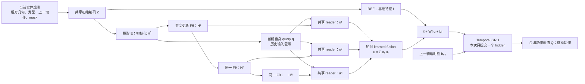
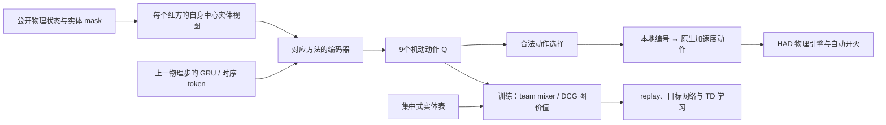
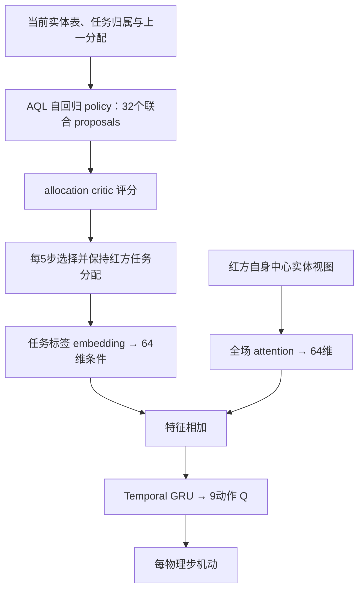
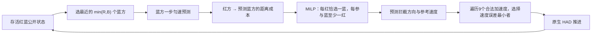

# 方法、基线与环境说明

本文合并 LEAF、七个学习基线、Rule / Random 及 PureHAD 的实际实现说明。代码入口、完整文件树和运行数据流见[项目框架](项目框架.md)。本文不承担正式结果分析；历史正式报告保留在 main 分支。

八个学习方法为 LEAF（内部键 `regir_nomem`）、REFIL、REFIL-matched、QMIX（内部键 `b2_qmix_atten`）、DCG、SPECTra、ALMA、TransfQMix。另有 Rule（`rule_nv1`）与 Random 两条不训练锚点；Random 执行策略为 `random_accel`、记录ID为 `random`、聚合显示键为 `random_accel`。QMIX 是公开显示名称，兼容键及保存配置中的历史别名保持不变；其本地实现是 attention actor + FlexQMIX，不能据名称误认为原论文的固定维度 state mixer。

当前 PureHAD 源自 SkyHAD 提交 `9536b74bdfaf75b832598e4b12d356f2e5a52ffc`，核心登记 `skyhad-3.0.0a1`，物理协议为 `rebuild-calibrated-v3-r7-target-initialization`。与曾固定的 `9e25a1c` 对照，48 个 Python 文件的 449 个函数 AST、类和物理常量相同；差别限于版本元数据和无效演示入口。更早的 r7 之前 HAD 物理并不相同，不能把这些源码对应关系扩展为所有历史成绩已严格重现。

历史主表中 LEAF 与部分方法的训练环境登记不完整，本次 60 个历史 final 对照案例中，SPECTra / TransfQMix 的 12 个案例登记为 `main1013_base_last_action_v1`；其余 48 个为 `legacy_had_protocol_unspecified`。相同模型、训练种子与场景编号也不保证 ALMA / Random 的随机动作序列一致。聚合、配置和来源字段继续保留这一边界。本分支的短运行只验证当前实现的训练、保存、恢复与冻结评估链路，不替代三种子、1M 步的正式科研评估。

当前保存的检查为：八个学习方法在 seed0 均通过两个独立进程会话的真实训练、保存与恢复，每方法累计2次优化更新。历史 final 对照完成60/60项，其中53项的目标损伤 D 与回合长度完全相同；3项长度相同，D 仅相差不超过1.8×10⁻¹⁵；另4项 ALMA 的 D 或长度与档案不同。对这4个已选开局使用旧工程和原9e25a1c环境重放，D 与长度均与新代码完全相同，说明这4项档案差异在重构前也存在；这不能写成 ALMA 历史成绩已完全复现，也不推定末位差的具体来源。完整证据集中在[检查汇总](../outputs/smoke/summary.json)，不另建实验分析报告。

环境动态对照已通过：同一 seed9000 与固定二维动作序列下，4v4/K2 和15v15/K2 的原生环境各比较100步；两个规模的旧 / 新封装对照分别覆盖35步和44步完整回合。状态、动作、奖励、事件、实体 mask、势函数塑形及终止字段均逐项精确相等，未采用容差。原生 `core_version` 标签改变，r7物理协议相同；48个原生 Python 文件的导入计算 AST 也相同（排除版本元数据与未使用演示入口）。该证据限于已约定的两个开局和动作序列。

## 一、LEAF：当前实体上下文、共享循环与时序记忆

### 1. 威胁情境与双轴适应目标

多目标攻防中，攻击者的威胁取决于它指向哪个目标、这个目标又已经被谁覆盖，也就是由攻击者、目标和队友共同构成的威胁情境。部署时实体规模会变、可用于关系推理的计算深度也可能变。LEAF设计目标是一个策略同时适应两种变化。

LEAF以实体集合表达规模变化，在同一物理时刻用共享参数循环加工攻击者、目标与队友的上下文，接收者自身query读取各轮表示，再融合并交给Temporal GRU行动。第一轮已经可以访问全部有效实体；后续轮次重新加工上下文。实体循环状态与跨时刻记忆有不同生命周期，不能将循环深度解释为物理时间或严格递增的关系阶数。

保存键regir_nomem对应本文的LEAF；nomem只表示query不读取历史GRU hidden。Temporal GRU、上一动作特征及策略记忆仍然存在，不能把该键解释成No-memory。该内部键保持与既有 checkpoint 和数据兼容。

### 2. 输入、实体视图与REFIL宿主

#### 2.1 每个防御者怎样看到实体

模型接收红方、蓝方与目标的实体表及 mask。HAD 基础实体特征为10维，包括归一化位置、速度、存活状态、生命值、目标累计损伤特征和三类实体标记。主方法还启用 entity_last_action：红方实体追加上一动作的9维 one-hot，其他实体的动作段为零。它与 obs_last_action 开关不是同一设置。

编码前为每个接收者建立自己的实体视图：

- 自身实体移到第0行，自身位置与速度保留绝对特征。
- 其他实体的位置、速度相对该接收者表达。
- 不可见、死亡和 padding 实体不能充当有效 key，对应工作状态按 mask 处理。
- REFIL 的 imagined 分支额外屏蔽部分 key，基础 attention 的自身 query 仍保留真实自身特征。LEAF 的 global query 使用 mask 后返回的实体 token；若 imagined 分支排除了自身 key，其 global query 也不保留该自身 token 的原特征。

实现中 mask=True 表示无效或排除。本文 attention 公式中的 $m$ 表示该掩码；需要乘权重时另用有效指示 $v_e$，避免将无效实体当作有效实体。

因此，不同防御者共享参数，却可形成不同的场景表示和读取结果。“global branch”是代码名称，处理的仍是接收者被允许使用的实体集合，并不引入额外不可观测信息。本轮 HAD 的公开实体接口也不能直接推广为所有局部观测任务的设定。细节见[env_wrapper.py](../envs/env_wrapper.py)和本文环境部分。

#### 2.2 REFIL 提供了哪些基础

对接收者 $i$ 的实体输入 $X_{i,t}$，先得到128维初始编码：

$$
Z_{i,t}=\operatorname{ReLU}(W_eX_{i,t}+b_e).
$$

REFIL 基础路径以自身条件注意力汇聚实体，经映射得到64维基础特征 $\ell_{i,t}$。新增关系路径将初始实体编码投影为64维：

$$
E_{i,t}=W_gZ_{i,t}+b_g,\qquad H_{i,t}^{(0)}=\operatorname{Mask}(E_{i,t}).
$$

两条路径共享初始编码，后续处理不同。基础路径输出一个接收者特征；关系路径先更新整个实体集合，再读取接收者特征。**关系路径不是从已经池化的 $\ell$ 重新生成实体。** 本文用 $E$ 表示已投影的初始实体状态，用 $\ell$ 表示 REFIL 基础特征。

主方法还保留 REFIL imagined 分组：训练中构造组内、跨组 masked 输入，用共享策略和混合网络学习辅助价值目标；部署使用正常主分支。“保留 REFIL”同时涉及基础特征路径、imagined 分支和辅助损失，而不只是保留一层 attention。

#### 2.3 物理时间与循环深度是两条轴

| 状态 | 含义 | 初始化 | 是否跨物理时刻传递 |
|---|---|---|---|
| $H^{(r)}$ | 每个接收者的一组实体工作状态 | 每次新观测从 $E$ 开始 | 否 |
| $q$ | 接收者读取query | 每次新观测构造 | 否；本次决策内固定 |
| $h_{i,t}$ | 64维 Temporal GRU hidden | 每场开始置零 | 是 |

共享循环处理的是**同一物理时刻的场景**。跨时刻记忆由 Temporal GRU 承担。一个决策执行四轮上下文加工，最后只提交一次 Temporal hidden。

### 3. 共享循环、接收者读取、融合与时间记忆

#### 3.1 信息流

下图按当前主模型前向展示信息流。



“共享更新”和“共享 reader”是两套参数，各自在轮间复用。**轮间融合**与 $\ell+W_fu+b_f$ 的**基础—关系特征融合**也是两个操作。

#### 3.2 固定当前 query

实现保留与历史查询相同的输入维度，但将历史部分置零：

$$
q_{i,t}=W_q[E_{i,t,\mathrm{self}};\,0_{64}]+b_q.
$$

它等价于从当前自身编码形成仿射 query，在本次决策各轮保持不变。此处 $E_{\mathrm{self}}$ 是 global 路径实际返回并投影的 token；正常执行的存活自身 token 有效，imagined 分支须按2.1节的 mask 语义理解。有效自身编码包含上一动作，所以“不读 GRU hidden”并不意味着输入完全没有过去信息。

#### 3.3 共享上下文更新

省略 $i,t$，LEAF 每轮为：

$$
\begin{aligned}
J^{(r)}&=\operatorname{LN}_a(H^{(r-1)}),\\
\widetilde H^{(r)}&=H^{(r-1)}
+\operatorname{MHA}_{\theta}(J^{(r)},H^{(r-1)},H^{(r-1)};m),\\
H^{(r)}&=\operatorname{Mask}_{m}
\left[\widetilde H^{(r)}
+\operatorname{FFN}_{\theta}(\operatorname{LN}_f(\widetilde H^{(r)}))\right].
\end{aligned}
$$

工作宽度64，注意力4头，FFN隐藏宽度128；$\theta$ 在轮间共享。 主模型 context attention 的 Q 用 LayerNorm 后状态，K/V 默认用未额外归一化的上一轮状态。

第一轮已允许所有有效实体互相注意。后续轮次重新加工已有上下文，不能解释成“多一轮才看见更远实体”或严格递增的图关系阶数。残差与 FFN 也不提供收敛或回报单调改进保证。

#### 3.4 各轮读取与 learned fusion

各轮用相同 query、相同 reader：

$$
u^{(r)}=\operatorname{MHA}_{\mathrm{read}}(q,H^{(r)},H^{(r)};m).
$$

再由共享64→1线性评分器计算轮间权重：

$$
s_r=w_s^\top u^{(r)}+b_s,\qquad
\alpha_r=\frac{\exp(s_r)}{\sum_{j=1}^{R}\exp(s_j)},\qquad
u=\sum_{r=1}^{R}\alpha_ru^{(r)}.
$$

评分器**只接收该轮读出**，没有另拼 query 或 Temporal hidden；接收者信息通过 $u^{(r)}$ 间接影响权重。这个 softmax 选择跨轮信息，不停止计算：正常 R4 中，四轮上下文均已计算。

#### 3.5 基础特征、时间记忆与动作

$$
\ell'_{i,t}=\ell_{i,t}+W_fu_{i,t}+b_f,\qquad
h_{i,t}=\operatorname{GRU}_{\mathrm{time}}(\ell'_{i,t},h_{i,t-1}),\qquad
Q_i(\cdot)=W_oh_{i,t}+b_o.
$$

$W_f,b_f$ 零初始化，使关系路径从不扰动基础特征的状态开始联合学习，训练后不保持为零。真实历史始终进入Temporal GRU；当前query负责读取当前上下文，时间历史在下游用于动作决策。

HAD 策略输出9个机动动作的价值，在合法动作中选最高值。模型没有显式的防御者—攻击者分配输出，协作通过机动决策产生。训练时 FlexQMIX 将个体价值组合成团队价值，部署不需要混合网络。

### 4. 训练深度与执行深度两条轴

LEAF 采集时每个环境均匀抽 R1–R4，并在一场内保持；replay 更新另按 minibatch 抽深度，online、target 和 imagined 分支一致。正式主性能用 final 权重、R4执行，显式 count 注入关闭。

保留主 TD 与 imagined TD：

$$
\mathcal L=(1-\lambda)\mathcal L_{\mathrm{TD}}
+\lambda\mathcal L_{\mathrm{imagined}},\qquad\lambda=0.5.
$$

这里0.5是辅助损失权重，仅用于主TD与imagined TD的组合。训练可含 potential shaping，正式奖励为 $R=-D$，$D$ 是目标累计损伤；价值学习与 HAD 环境接口没有因选择 LEAF 改变。

参数量不随实体数量或共享展开轮数增长，但计算仍增长。每个接收者的 dense context 约需 $O(R(M^2d+Md^2))$，还需基础路径、reader 和时序网络。不能由参数共享推导线性计算、实时加速或更低实际显存。

#### 4.1 从头训练、冻结出口与读出诊断

| 比较 | 固定或改变什么 | 回答的问题 |
|---|---|---|
| 同一LEAF final执行R1–R6 | 固定checkpoint，改变整场执行出口 | 已训练策略对部署计算深度变化的表现 |
| 同状态固定计算的read1 / read4 / uniform | 状态与进入Temporal hidden相同，改变读出 | 冻结策略对读出选择的依赖 |

正式LEAF执行R4；冻结R1–R4位于训练范围内，R5/R6为推理深度外推。加深同时增加上下文更新并扩大融合softmax的候选集合，闭环动作与Temporal hidden也会改变，不能视为孤立一次attention的效应。历史深度汇总保留在 outputs/summary.json；它不能替代逐场原始数据。

执行深度变化的实验必须保留 checkpoint、场景、种子和出口身份；结构本身不保证更深普遍改善。learned fusion是信息融合规则，所有设定轮次仍被计算，不能解释成停止器或墙钟加速。


## 二、基线与规则锚点

### 1. 总结：主实验到底在和什么比较

主实验包含七个学习基线，加上两个不训练的策略。它们的名字指的是**本项目的 HAD 适配版本**，不能仅按原论文名称猜测网络。

| 报告名称 | 保存方法名 | 实际核心 | 时间记忆 | 动作如何确定 |
|---|---|---|---|---|
| REFIL | refil | 一层自身查询的实体注意力 + imagined 分组辅助 TD + FlexQMIX | 每个红方的64维 GRU | 个体合法动作 Q 的贪心 / ε-greedy |
| REFIL-matched | refil_matched | REFIL 的 attention 后增加残差 MLP，使 actor 参数接近 LEAF | 64维 GRU | 同 REFIL |
| QMIX | b2_qmix_atten | REFIL 同型 actor + FlexQMIX，关闭 imagined 辅助训练 | 64维 GRU | 个体合法动作 Q 的贪心 / ε-greedy |
| DCG | dcg | 注意力 + GRU；个体 utility 与两两 payoff；完整协调图 | 64维 GRU | 8轮 Max-Sum 得到联合动作，再施加探索 |
| SPECTra | spectra | 类型投影 + 自身查询注意力 SAQA；集合超网络生成动态 mixer | 64维 GRU | 个体合法动作 Q 的贪心 / ε-greedy |
| ALMA | alma | 学习目标任务分配 AQL；任务条件 attention + GRU + FlexQMIX | 64维 GRU；另保留任务分配 | 每5步分配任务；每步输出9动作 Q |
| TransfQMix | transfqmix | actor 与 mixer 均使用 Transformer；时序 token 承接历史 | actor 32维 token；mixer 三个32维 token | 个体合法动作 Q 的贪心 / ε-greedy |
| Rule | rule_nv1 | 一步蓝方位置预测 + 0–1 整数指派 + 离散加速度控制 | 无学习记忆；每步重算 | 集中式 MILP 指派后逐机选动作 |
| Random | random / random_accel | 每个存活红方每步均匀随机选合法机动动作 | 随机数流 | 每个动作概率1/9 |

需要先记住四点：

1. **QMIX 在这里用的是 FlexQMIX**，不是把固定长度全局 state 展平后交给原始 QMIX。
2. **所有七个学习基线都有时间记忆**。TransfQMix 用时序 token，其余用 GRU；LEAF 的名称也不表示删除时间记忆。
3. **Rule 是 nv1 整数指派与一步预测拦截**。早期覆盖规则、原生 RulePolicy、蓝方 reactive 对手都是不同实现。
4. 各方法共享任务与环境步预算，但编码、学习目标、优化器和推理计算不同。已有结果证明的是这些保留实现之间的性能差异，不能直接解释成严格相同计算量下的比较。

### 2. 共同任务、输入与动作接口

#### 2.1 它们控制什么，学习什么

主实验为二维 HAD damage 任务：红方防御者保护目标，蓝方按照固定策略类别进攻。学习策略只控制红方。每个物理步输出各红方的机动动作，开火、自毁、碰撞和目标伤害由原生 HAD 引擎处理；模型没有单独的开火或“选择攻击实体”动作。

学习采用集中式团队价值训练。REFIL、QMIX、SPECTra、ALMA、TransfQMix 通过 mixer 学习团队 Q；DCG 直接将图中的 utility 和 payoff 合成团队 Q。物理动作执行不需要普通单调 mixer，但 DCG 需要联合动作消息计算，ALMA 需要上层任务分配。HAD 当前实体接口提供公开场景信息，不能据此宣称已经验证了任意局部观测场景下的通信限制。

正式性能指标为累计目标损伤 D，越小越好；未塑形回报 R=−D。damage 模式目标损伤不以目标初始 HP 封顶，不能将 D 当成失败率或胜率。

训练奖励另包含势函数塑形：

$$
r_t^{train}=-\Delta D_t+\beta\,[\gamma\Phi(s_{t+1})-\Phi(s_t)],
$$

其中保存配置的 β=1、γ=0.99；Φ 是存活蓝方接近最近目标的负向势函数，距离尺度为4000。自然结束与时间截断分别处理，红方全灭后仍推进蓝方的物理尾段。正式报告统计的是完整物理伤害，**不把塑形奖励作为论文成绩**。damage 路径也不能仅因配置保留 friendly_penalty 字段，就写成实际加入了友方碰撞惩罚。

接口和奖励细节见[环境封装](../envs/env_wrapper.py)及本文环境部分。

#### 2.2 输入不是图片，而是实体集合

基础实体特征为10维：

| 字段 | 含义 |
|---|---|
| x、y | 位置，按2500归一化 |
| vx、vy | 速度，按120归一化 |
| alive、health | 存活与归一化生命值特征 |
| target_damage_share | 目标累计损伤除以开局蓝方数量；用于目标行 |
| is_red、is_blue、is_target | 三类实体标记 |

每个 observer 的 actor 使用临时的自身中心视图：

- 自身移到第0行，保留自身绝对位置、速度。
- 其他实体的位置、速度减去自身位置、速度。
- 死亡、padding 和不可用实体按 mask 排除；mask=True 表示无效。
- 保留实体身份对应的槽位，死亡后不把其他红方的历史 hidden 挪过来。

REFIL、REFIL-matched、QMIX、DCG、ALMA 启用 entity_last_action：红方实体追加上一动作9维 one-hot，蓝方和目标的这一段为零，首步为零。因此这些 actor 的输入宽度是 **19**。当前 SPECTra 与 TransfQMix 也使用相同的19维实体输入。

19维重训将当前 HAD 两个基线的 actor、online/target mixer 和冻结评估输入统一补齐为19维，读取实际执行的 `actions_onehot[t-1]`，不读取本步动作。投影从头训练。obs_last_action=false 与 entity_last_action=true 可以同时成立，它们是不同开关；当前七方法均不额外附加 agent ID。这些历史配置与聚合仍保留来源标识；当前分支不重新解释其正式排名。

actor 的相对实体视图和训练 mixer 的集中式绝对实体表也不是同一个张量。基础特征与视图转换见[env_wrapper.py](../envs/env_wrapper.py)和[entity_encoder.py](../algos/common/entity_encoder.py)。

#### 2.3 场景人数、padding 与参数尺寸要分开

实际训练场景为红蓝平衡人数 N∈{4,6,8,10}、目标数 K∈{1,2,3}。当前训练回放接口上界为10红、10蓝、3目标，评估接口为50红、50蓝、12目标。部分旧配置保存了更大的 padding 上界；**保存槽数不等于当时每局真实人数**。

集合编码器的参数由特征宽度和 embedding 宽度决定，能重新构建更大的实体表。DCG 按运行 agent 槽位建立候选图边，SPECTra 按槽位生成 mixer 矩阵，TransfQMix 增加实体 token。加载权重时依据 checkpoint 保存配置还原算法，再按当前接口重建运行尺寸；并非在评估时训练新参数。槽位适配也不表示每步按存活数自动裁去全部图或 mixer 计算。ALMA 还有任务标签容量限制，见第7节。

这说明结构可以加载、表达更大场景，是否有效仍由正式 OOD 结果判断。

#### 2.4 九个动作是九个加速度基元

二维动作包括零加速度、四个轴向和四个归一化对角方向，来自原生27个三维动作中的 z=0 子集。学习网络使用本地编号0–8，由接口映射成原生动作编号；规则直接在允许的原生动作集合上选动作。

**动作0是零加速度，飞机继续惯性运动，不是静止。** 存活红方可选9动作；死亡与 padding 槽只允许动作0。训练的 ε-greedy 在合法动作中随机探索，评估物理动作的 ε=0。ALMA 的上层 proposal 仍可能采样，不能因此将整个 ALMA 推理写成完全确定性。



此图是共有接口概览；DCG 的联合动作计算和 ALMA 的上层分配分别见后文。

### 3. REFIL：自身查询的实体注意力与 imagined 辅助训练

#### 3.1 基础网络怎样前向

[REFIL 原论文](https://proceedings.mlr.press/v139/iqbal21a.html)利用随机实体分组辅助学习关系分解。本项目采用保留的 ALMA/REFIL attention、imagined 和 FlexQMIX 核心，再适配 HAD 输入、时间记忆与 mask。

HAD actor 的实际尺寸为：

```text
每个实体19维
  → 共享 Linear(19,128) + ReLU
  → 128维、4头实体 attention（自身是 query，实体集合是 K/V）
  → Linear(128,64) + ReLU
  → GRUCell(64,64)，承接上一个物理时刻 hidden
  → Linear(64,9)
```

可概括为：

$$
e_i=\operatorname{ReLU}\!\left[
W_2\operatorname{ReLU}\!\left(
\operatorname{MHA}(\operatorname{ReLU}(W_1X))_i
\right)\right],
$$
$$
h_{i,t}=\operatorname{GRUCell}(e_{i,t},h_{i,t-1}),\qquad
Q_i=W_Qh_{i,t}+b_Q.
$$

这里每个 observer 只读取自己的 attention 输出。它没有 LEAF 中“先更新全部实体工作状态，再从自身 query 读取”的 global 循环，也没有跨空间轮次融合。GRU 的跨物理步递归必须与 LEAF 的决策内循环区分。

#### 3.2 imagined 分支到底做什么

每次训练 minibatch 中，每条轨迹先采样分组概率 p∼U(0,1)，再给实体采样二分标签。这一分组在该条轨迹内保持不变。相同网络产生三个序列：

1. **正常分支**：使用真实可用实体关系。
2. **within 分支**：只允许组内实体关系。
3. **interaction 分支**：只允许跨组实体关系。

分组 mask 叠加真实可用性 mask；即使 imagined 分支屏蔽了自身 key，attention 的自身 query 仍保留真实自身特征。三个分支共享参数，各自展开时序 GRU。

它们不是新对局，也不重新选择训练动作。三个分支都评价 replay 中的同一动作；两个 imagined 分支组合成一个 imagined team Q，正常分支的下一状态生成共同 TD 目标 y：

$$
L_{\mathrm{REFIL}}
=(1-\lambda)\langle(Q_{\mathrm{tot}}-y)^2\rangle
+\lambda\langle(Q_{\mathrm{tot}}^{imagine}-y)^2\rangle,
\qquad \lambda=0.5.
$$

评估和正常 acting 只走完整分支。实现见[imagined 输入构造](../algos/common/pymarl/modules/agents/agent.py)与[QLearner](../algos/common/pymarl/learners/q_learner.py)。

#### 3.3 FlexQMIX 怎样合并个体 Q

FlexQMIX 的四个 attention hypernet 从集中式实体表生成第一层权重 W₁、偏置 b₁、第二层权重 W₂ 和状态项 V(s)：

$$
Q_{\mathrm{tot}}=\operatorname{ELU}(\mathbf qW_1+b_1)W_2+V(s).
$$

hypernet embedding=128、4 heads，混合宽度32。混合权重非负，b₁ 与 V(s) 保留符号；当前 softmax_mixing_weights 沿32维混合轴归一化，**不是沿 agent 轴分配一个总和为1的红方权重**。vector/scalar hypernet 对真实存活 agent query 平均，避免 padding 数量直接缩放偏置。

在固定状态与其他 mixer 输入下，团队值对个体 Q 单调，因而执行阶段可以采用各红方的合法动作 argmax。[QMIX 的原始单调分解思想](https://proceedings.mlr.press/v80/rashid18a.html)与这里的实体 hypernet 实现要分开描述。

源码为[FlexQMIX](../algos/common/pymarl/modules/mixers/flex_qmix.py)；[本地 mixer 包装](../algos/common/mixers.py)处理分块、未填 replay 与执行内存，不是新的算法变体。

### 4. QMIX 与 REFIL-matched：分别控制什么

#### 4.1 QMIX：关闭 imagined 学习

QMIX 的 actor、64维时序 GRU 和 FlexQMIX 与上述 REFIL 同型。关键区别是 **agent.imagine=false**：

- 不构建 within / interaction 分支。
- 不计算 imagined team Q 和辅助损失。
- 仅学习普通的一步 Double-Q 团队 TD 目标。

虽然保存配置仍有 lmbda=0.5，关闭 imagine 后该值不参与损失。因此它是“实体 attention + 时序 GRU + FlexQMIX”的对照，不应描述成普通扁平 state QMIX。

LEAF 保留 REFIL 的局部编码与 imagined 学习，额外引入当前实体工作状态、共享上下文更新和自身条件读取。因此与 REFIL 的比较比“与完全不同的 Transformer 方法比较”更接近共同基础；仍不能单凭这项整体比较拆出每一个新增模块的贡献。

#### 4.2 REFIL-matched：增加容量，不增加实体循环

REFIL-matched 保留 REFIL 的 attention、GRU、FlexQMIX 和 imagined 损失，只在64维 attention 输出与 GRU 之间增加残差 MLP：

$$
\widetilde e=e+W_b\operatorname{ReLU}(W_ae+b_a)+b_b.
$$

尺寸为 **64→576→64**，末层权重和偏置零初始化。增加参数：

$$
64\times576+576+576\times64+64=74{,}368.
$$

历史配置对应的 actor 参数账本为：REFIL 102,025、REFIL-matched 176,393、LEAF 175,754。matched 比 LEAF 多639，约0.36%。因此它提供了**actor 参数接近的 MLP 容量对照**，并非严格相同总训练参数、FLOPs 或推理时延的控制实验。

它没有增宽 GRU，没有更新实体工作状态，也没有多轮读取。matched_hidden=576 来自保留配置；本文不补造一个当前仓库没有保留的自动等参搜索过程。

实现见[EntityAgent 中的 matched 残差](../algos/common/entity_encoder.py)；配置依据见第11节。

### 5. DCG：图上显式协同，而非独立 Q 贪心

[DCG 原论文](https://proceedings.mlr.press/v119/boehmer20a.html)把团队动作价值分解为个体 utility 和图边的两两 payoff，再用消息传递寻找联合动作。本项目保留这一核心，将原扁平观察输入替换为 HAD 实体 attention。

#### 5.1 编码、节点与 payoff

DCG 输入19维实体，使用128维、4头 attention 和64维 GRU。其后：

- utility：共享 Linear(64,9)。
- payoff：共享 Linear(128,81)，接收两个红方 hidden 的拼接，输出9×9动作表。
- 保存配置的两个 hidden_dim 和 payoff_rank 均为 null：**当前是线性头与完整 payoff 表，不是隐藏层 MLP 或低秩版本**。
- 正反端点各算一次，再交换反向动作轴后平均，保证边的端点交换一致性。

$$
f_{ij}(a_i,a_j)=\tfrac12\left[
g(h_i,h_j)_{a_i,a_j}+g(h_j,h_i)_{a_j,a_i}
\right].
$$

协调图只有红方节点。蓝方和目标通过观察编码影响 h_i，不成为图节点。保存配置使用 full 完整无向图，没有学习拓扑或按距离筛边。

#### 5.2 图按开局身份保留，不随死亡缩成存活图

用 V₀、E₀ 表示该局开局存在的红方与对应完整图边：

$$
Q_{\mathrm{tot}}
=\frac{\sum_{i\in V_0}f_i(a_i)}{\max(|V_0|,1)}
+\frac{\sum_{(i,j)\in E_0}f_{ij}(a_i,a_j)}{\max(|E_0|,1)}.
$$

padding 节点和边不参与；真实红方死亡后仍保留开局节点和边的身份及分母，当前 hidden 清零、合法动作只剩0。不能写成“每步只在存活红方之间重新构图”。

真实 N 个红方有 N(N−1)/2 条有效边；例如10个真实红方时为45条。实际实现先按运行 n_agents 槽位构建并计算候选边，再以开局 mask 排除 padding；并没有将整个计算图物理裁成每局真实人数。增大运行槽位会增加成对价值与消息计算，参数共享本身并不使这一计算变成常数成本。

#### 5.3 八轮 Max-Sum 选择联合动作

归一化后的 utility / payoff 用于同步消息：

$$
m_{i\to j}^{(k)}(a_j)=
\max_{a_i\in\mathcal A_i}\left[
\bar f_i(a_i)+
\sum_{\ell\in\mathcal N(i)\setminus j}m_{\ell\to i}^{(k-1)}(a_i)
+\bar f_{ij}(a_i,a_j)
\right].
$$

当前 msg_iterations=8、msg_normalized=true、msg_anytime=true。每条消息减去目标端合法动作上的均值；每轮由节点的 utility 加入消息得到候选联合动作，anytime 保留团队值最高的候选。完整图有环，**八轮消息不保证全局精确最优**；代码里的 STAR 特殊求解路径不是当前保存实验。

探索仍可逐红方随机选合法动作；评估执行 Max-Sum 联合选择。一步 Double-Q 中，online DCG 选下一联合动作，target DCG 评价其团队值，无单独 mixer。

关键源码：[DCG controller](../algos/dcg/dcg_controller.py)、[特征 GRU](../algos/dcg/rnn_feature_agent.py)、[DCG learner](../algos/dcg/dcg_learner.py)。

DCG 的“八轮”是动作图上的优化消息；LEAF 的 R1–R4 是动作 Q 输出前的实体表征更新。二者并非同一种循环，不能直接按轮数认定等算力。

### 6. SPECTra：类型化集合编码与随人数变化的混合器

[SPECTra 原论文](https://arxiv.org/abs/2503.11726)讨论集合结构的策略与混合器，以及实体目标动作的解耦。HAD 只有固定9个机动动作，本文介绍的是保留源码里的 **HAD 路径**。

#### 6.1 actor：类型投影、一次自身查询、GRU

当前权重输入为19维自身中心实体视图，包含上一动作，不附加 agent ID。self、ally、enemy、target 使用四套 Linear(19,64) 类型投影，再合成一个集合；SAQA、GRU和动作头保留原结构：

$$
z_i=\operatorname{LayerNorm}\!\left[
e_{\mathrm{self}}+\operatorname{MHA}(e_{\mathrm{self}},E,E)
\right].
$$

该 SAQA 为4 heads、每头16维；自身是唯一 query。不是对三种其他实体分别做三次 attention，也没有三个独立“组 token”。此 attention 后没有额外 FFN，接 GRUCell(64,64)，动作头为 **64→64 ReLU→9**。

HAD 使用机动价值动作头，不执行目标动作 query-key 输出头或足球 pass pooling。可以讨论其类型编码和集合结构；不能在 HAD 方法图中画一个实际未执行的“对每个敌人输出攻击动作”分支。

#### 6.2 mixer：中间 Q 宽度随 N 变化

mixer 有两个独立 ST_HyperNet。每套从集中式19维实体表出发，用红方、蓝方、目标三类 Linear(19,32) 投影，以红方 token 为 query、全部有效实体为 K/V，经过4头 residual attention 与 LayerNorm。

attention 表征 X 随后经过两条独立的 **32→32 ReLU→32 残差 MLP**，形成权重特征 X_w=X+MLP_w(X) 与偏置特征 X_b=X+MLP_b(X)。QueryKeyBlock 生成 **N_pad×N_pad** 权重；学习 seed 的 PoolingQueryKeyBlock 生成 **1×N_pad** 偏置。N_pad 是运行 agent 槽位数；mask 后才等效于有效节点子矩阵，并未物理裁成每局真实人数。Q/K 分数按每头维度缩放、对头平均，**这一步没有 softmax**。最终：

$$
Q_{\mathrm{tot}}
=\sum_j\left[
\operatorname{ELU}(\mathbf q|W_1|+b_1)|W_2|+b_2
\right]_j.
$$

W₁、W₂ 取绝对值；b₁、b₂ 保留符号。死亡 / padding 对应的 Q、权重行列和偏置均清零。参数共享使 mixer 可适配运行槽位数；保存 mixing_embed_dim=32 **不代表这里使用固定 N→32→1 的普通 QMIX 网络**。

低层执行个体合法动作 argmax。学习采用 Adam、Double-Q 和 TD(λ=0.6)。源码见[HAD actor](../algos/spectra/spectra_rnn_agent.py)、[attention 与 QK 模块](../algos/spectra/spectra_attention.py)、[mixer](../algos/spectra/spectra_mixer.py)、[learner](../algos/spectra/nq_learner.py)。

### 7. ALMA：学习任务分配，再执行任务条件动作

[ALMA 原论文](https://proceedings.neurips.cc/paper_files/paper/2022/hash/2f27964513a28d034530bfdd117ea31d-Abstract-Conference.html)以层级任务分配组织多智能体控制。本项目的主 ALMA 保存配置是 **targets 子任务、固定5步分配周期、full_obs 低层、单个 team Q**；不能与其他 ALMA probes 混用。

#### 7.1 任务怎样定义

- 每个真实保护目标对应一个 task。
- 目标实体归到自身 task；蓝方根据当前几何最近目标归到 task，**不读取蓝方内部真实指派**。
- 红方的 task 由学习的 allocator 产生。
- 在物理步0、5、10……重新分配，期间保留分配；不是当前蓝方那种伤亡事件触发版本。

保存 n_tasks=3、n_extra_tasks=9，总任务标签 embedding 容量为12。extra 指备用标签宽度，**不是增加9个真实任务**。评估加载维持总宽度12，以真实评估任务接口更新 extra 数；旧 extra=3 的权重只有6个标签容量，不能替代当前可支持12目标的权重。

#### 7.2 上层 AQL 怎样给红方分任务

policy 用 pointer 形式逐红方自回归分配。实体 embedding=128，加入上一分配的信息；非红方实体按 task 汇聚，产生任务表征。每次生成 **32个联合分配 proposals**，critic 根据全场实体、任务标签与 agent / non-agent 数量特征评价 proposals，选择估计价值最大的分配。

critic 为 attention 集合网络，不是手写距离成本。训练有分配探索与 proposal 探索；AQL 将高价值 proposal 的搜索结果摊销到 policy。

评估关闭两种 ε 覆盖，但 TaskEmbedder 的标签排列和 proposal 采样仍有随机性。固定种子应按现有评估协议重置随机流，不应将它描述成确定性的规则指派。

#### 7.3 当前低层没有按 task 遮住场景

HAD 低层仍为19维实体输入、128维 attention、64维 GRU、9动作头。任务 embedding 为128维，经 Linear(128,64) **加在 attention 后的64维特征上**。

保存配置未启用 task_embed_in_attn；subtask_cond=full_obs 保留全场有效实体。mixer_subtask_cond=null，故 FlexQMIX 输出一个团队 Q，低层学习 team reward；并未走“每个 task 一个独立 Q、一个独立奖励”的路径。mask_subtask_actions=false，任务标签也不限制物理9动作。



#### 7.4 AQL 与低层是两套学习目标

低层用普通团队 Double-Q TD。上层 critic 和 policy 另有优化器：

$$
L_Q=\left\langle
\left(Q_{\mathrm{alloc}}(s,z)
-\left[\bar R+\gamma(1-d)Q_{\mathrm{alloc}}^-(s',z^*)\right]\right)^2
\right\rangle,
$$
$$
L_\pi=-\langle\log\pi(z^*\mid s)\rangle-0.01H(\pi).
$$

当前 interval 模式的 $\bar R$ 是分配区间内团队奖励未折扣求和后除以5；不是使用 γ⁵ 的 SMDP 分配目标。最近150K环境步内的 replay 足够采样时，每次低层更新还另抽样更新 AQL。

sel_task_upd=true 指自回归过程更新被选中 task 的 embedding，**不是额外 task-selection 辅助损失**。本次保存配置也没有开启 COPA / VI 或 LEAF 的 intent 辅助目标。

实现见[任务 mask 构造](../envs/env_wrapper.py)、[allocation policy](../algos/common/pymarl/modules/agents/allocation_policies.py)、[allocation critic](../algos/common/pymarl/modules/agents/allocation_critics.py)、[实体 controller](../algos/common/pymarl/controllers/entity_controller.py)与[QLearner](../algos/common/pymarl/learners/q_learner.py)。

### 8. TransfQMix：用时序 token 代替 GRU

[TransfQMix 原论文](https://aamas.csc.liv.ac.uk/Proceedings/aamas2023/pdfs/p1679.pdf)将实体 Transformer 用于 actor 和团队混合器。本项目为参照固定上游操作的独立 HAD 实现，源码集中于[transfqmix/__init__.py](../algos/transfqmix/__init__.py)，不是完整官方训练工程的原封复制。

#### 8.1 actor 的记忆怎样更新

当前权重输入19维实体，包含上一动作、不附加 ID，所有类型共用 Linear(19,32)，actor 和中央 mixer 同步接入。每个红方保存一个32维 memory token，首步为零。每步将上一 token 放在实体 token 前：

```text
[上一步 memory token, 当前自身与其他有效实体 tokens]
  → 2个 Transformer blocks
  → 第一个输出 token = 本步 memory
  → Linear(32,9) = 动作 Q
```

每个 block 为4个 heads，**每头宽度32**，不是把32均分成4份；Q/K/V 由32映射到128，拼接后映射回32。FFN 为32→128 ReLU→32，使用 residual、LayerNorm，dropout=0。

这里还有一个实现细节：**两层 K/V 均使用本步最初嵌入的 token，只有 query / 输出逐层推进**。它不等同于每层都重建 K/V 的普通 TransformerEncoder。两层参数也不是 LEAF 的共享空间循环参数。

该模型没有 GRU；memory token 通过物理时刻递推和序列反传学习历史。死亡红方的旧 memory、新 memory 和 Q 清零。

#### 8.2 mixer 也有自己的时间历史

mixer 输入为：

```text
[集中式实体 tokens, actor 本步 memory tokens, mixer 上步三个 temporal tokens]
```

全部宽度32，同样采用两层、4个全宽 heads 和固定原始 K/V。三个 mixer 时序 token 首步全零，每步更新，分别用于 b₁、w₂、b₂。从红方输出 token 生成第一层权重 $W_1\in\mathbb R^{N_{\mathrm{pad}}\times32}$：

$$
Q_{\mathrm{tot}}
=\operatorname{ELU}(\mathbf q|W_1|+b_1)|w_2|
+\operatorname{ReLU}(L(b_2^{token})).
$$

b₁ 保留符号，权重非负，最终 b₂ 经线性层与 ReLU。actor memory 进入 mixer 前 detach：actor 从选中动作 Q 的路径学习，mixer 的 hidden 输入不向 actor 反传；actor 自身跨时间反传仍保留。

当前死亡 agent 的 Q、memory 和 W₁ 行清零。团队人数可变，三个 mixer 时序 token 的数量固定。

学习采用 Adam、Double-Q、TD(λ=0.6)。保存配置继承的 rnn_hidden_dim=64、encoder=attention 等字段不决定真实 actor；必须看 builder 和上述专用 forward。

### 9. Rule 与 Random：没有训练权重的两条锚点

#### 9.1 正式表里的 Rule 对应哪个实现

正式锚点入口[anchors.py](../utils/eval/anchors.py)指定：

```python
Rule:   architecture="hierarchical", grouping="nv1", control="predictive_intercept"
Random: architecture="end_to_end", policy="random_accel"
Blue:   architecture="hierarchical", grouping="reactive", control="rush"
```

Rule / Random 的 YAML 是实际执行来源：anchors.py 通过 load_config 读取 rule.yaml 的 anchor_id=rule_nv1 与 hierarchical / nv1 / predictive_intercept，以及 random.yaml 的 anchor_id=random 与 end_to_end / random_accel；蓝方 hierarchical / reactive / rush 从 base.yaml 的 env_args 读取。此次移为配置读取后，有效策略字典保持与已执行60案例设置相同。random 是锚点记录ID，random_accel 是执行策略及公开聚合显示键，不能把二者误当成两条不同的随机基线。

Rule 类名是 CoveragePolicy / CoverageExecutor，版本为 rule_nv1_v1。类名保留兼容，**不意味着仍执行早期覆盖算法**。整数指派、执行与回放字段均在本节统一说明。

#### 9.2 nv1 第一步：选择本步能承担的蓝方

设存活红方为 R、存活蓝方为 B。蓝方按到最近红方的当前距离排序：

$$
d_b=\min_{i\in R}\|p_i-p_b\|_2.
$$

按距离、再按蓝方 ID 打破并列，选前 min(|R|,|B|) 个蓝方构成 B*。因此红方不足时，本步只考虑最近的 |R| 个蓝方，其他蓝方继续运动，但不进入此次指派，也没有额外避让责任。下一步重新选择。

代码计算三维欧氏距离；二维模式高度一致，等价于平面距离。

#### 9.3 第二步：一步匀速预测与0–1整数指派

预测蓝方下一步位置：

$$
\widehat p_b=p_b+v_b\Delta t,\qquad
c_{ib}=\|p_i-\widehat p_b\|_2.
$$

不预测蓝方加速度、转向、边界反弹或下一次目标切换，也不展开完整剩余时域。求解：

$$
\min_x\sum_{i\in R,b\in B^*}c_{ib}x_{ib},
$$
$$
x_{ib}\in\{0,1\},\qquad
\sum_bx_{ib}=1,\qquad
\sum_ix_{ib}\ge1.
$$

每个红方恰好负责一个参与蓝方，每个参与蓝方至少由一个红方负责；两方数量相等时是一对一，多余红方可以共同负责同一蓝方。

实际调用 SciPy milp，mip_rel_gap=0；**没有调用匈牙利算法**。求解后验证整数性、边界、行和与列覆盖；求解或验证失败直接报错，不悄悄回到旧规则。

这里优化的是当前预测距离。约束保证责任分配覆盖，不保证动力学可达、最终击杀或长期damage最优。

#### 9.4 第三步：把指派变成离散机动动作

对被指派蓝方的预测位置 q，设 d=||q−p||、指向 q 的单位向量为 u，当前速度方向与 u 的夹角为 θ：

$$
s_{\mathrm{cmd}}
=\operatorname{clip}\!\left(
\min\!\left[
v_{\max},\frac d{\Delta t},
\frac{a_{\max}}{\max(\theta,10^{-3})}
\right],
v_{\min},v_{\max}
\right),\qquad
v_{\mathrm{ref}}=s_{\mathrm{cmd}}u.
$$

遍历合法加速度基元，用代码内的一步运动学得到 v_next(a)，选择：

$$
a^*=\arg\min_{a\in\mathcal A_{\mathrm{valid}}}
\|v_{\mathrm{next}}(a)-v_{\mathrm{ref}}\|_2^2.
$$

相同误差选择较小原生动作 ID。一步运动学先更新并裁剪位置 p+vΔt，再更新并裁剪速度 v+a_max aΔt，最后清除越界方向速度。当前 nv1 调用使用一步 remaining_steps，不传额外 forbidden 避让集合。

Group.target 保存的是**保护目标 ID**，不是蓝方 ID。精确红→蓝关系存在 last_plan["assignment"] 中，executor 直接跟随该蓝方预测位置，不再按保护目标重新匹配。保护目标 metadata 从蓝方公开位置、速度的最近直线经过关系推断。



每个物理步重求。缓存只避免同一步、同一公开状态重复求解，并不是跨步缓存站位。缺少蓝方或目标时有 guard 分支；这与 MILP 求解失败回退是不同情况。

实现全部在[coverage_rule.py](../algos/rules/coverage_rule.py)。

**执行与回放顺序。** 本步动作前选择B*、进行一步匀速预测并求解MILP；executor直接读取精确红→蓝指派生成动作；原生物理推进后记录本步指派，下一步重新求解。CoveragePolicy与CoverageExecutor在分层路径共享同一策略实例，只复用同一步、同一公开状态的解。

`command_interval=5`控制蓝方事件指挥周期；nv1红方固定每物理步更新。回放帧的`interception`为本步红方ID→蓝方ID指派，`selected_blue`为参与此次规划的蓝方，`ignored_blue`为红方数量不足时排除的蓝方。帧位置为执行后的状态，指派为执行该步时采用的方案；忽略对象没有被本次责任分配覆盖。


#### 9.5 Random 是动作随机，不是随机分组

DirectActionPolicy 用场景种子初始化随机流，每个物理步对每个存活红方调用 rng.choice(action_ids)，故9个合法动作均匀采样。死亡实体动作0；它不运行 MILP，不决定保护目标，也不朝最近目标飞行。

Random 没有训练种子和 final.pt。它与 Rule 一样是策略锚点，不是“训练失败的模型”。

#### 9.6 固定蓝方 reactive + rush 是什么

蓝上层在开局、每5步及红蓝伤亡事件后重决策。reactive 根据红方对各目标的公开覆盖和蓝方到目标的平均距离，采样一个目标，将全部存活蓝方指派给该目标。默认距离尺度下：

$$
C_k=\sum_{i\in R}\max(0,h_i)e^{-\|p_i-g_k\|/850},
\qquad
T_k=\frac{\operatorname{mean}_{b\in B}\|p_b-g_k\|}{5000},
$$
$$
P(k)=\operatorname{softmax}_k(-2C_k-0.25T_k).
$$

h_i 此处是物理生命值，**不是神经网络 hidden**。蓝下层 rush 每步在合法加速度基元中最大化与已指派目标位移方向的点积；死亡或未指派者输出0。这与 nv1 的下一步速度误差匹配不同。对手读取公开物理状态，不读取红方待执行动作。

共享的是场景种子、对手策略和事件规则，**不是所有红方方法都会遭遇完全相同的蓝方动作序列**：各自红方位置和伤亡时刻不同，会改变 reactive 概率和重决策事件。学习路径和锚点路径都用 scene_seed XOR 0x375AC18F 初始化蓝方随机流。

此公式对应仓库内 PureHAD 的 had_env/grouping/opponents.py，rush 位于 grouping/adapter.py。接口与事件执行可在[env_wrapper.py](../envs/env_wrapper.py)及[coverage_rule.py](../algos/rules/coverage_rule.py)交叉核对。原生实现也允许 scene_scale 缩放距离尺度，正式协议以记录的环境参数为准。

#### 9.7 原生 RulePolicy、旧覆盖规则不等于论文 Rule

open_score.algos.rules 同时导出原生 RulePolicy 与本项目 CoveragePolicy，容易混淆：

| 名称 | 所在角色 | 实际含义 |
|---|---|---|
| CoveragePolicy / nv1 | 正式红方 Rule | 本文的整数指派 + 一步预测 |
| RulePolicy("rule") | 原生分组策略 | 目标人数配额后按交互半径拆空间连通组 |
| RulePolicy("grand") | 原生分组策略 | 目标配额与身份匹配，每目标一个大组 |
| RulePolicy("static_rule") | 原生分组策略 | 开局生成分组，此后仅移除死亡成员 |
| RulePolicy("random") | 原生分组策略 | 在候选 Grouping 中随机选择，**不是 Random 加速度** |
| 原生 RuleExecutor | 原生分组执行器 | 另一套组约束责任匹配与短步位置外推控制 |
| 旧覆盖规则 v7 | 历史实现 | 曾包含全剩余时域预测、D’Hondt、匈牙利等；不代表 nv1 |
| reactive + rush | 蓝方对手 | 事件式选目标 + 每步飞行 |

当前原生 grand / rule 的配额是最大余数法，不能把历史覆盖规则的 D’Hondt 名称移给它。原生分组定义位于 HAD 依赖的 grouping/policies.py 与 grouping/actions.py，执行器位于 grouping/rules.py。旧源码已移除的细节只能依据历史资料解释，不从现行实现补写。

Rule / Random 的历史统计和本分支新运行使用各自的 run / 场景 / 协议字段区分。

### 10. 实际训练设置与比较边界

#### 10.1 保存配置的关键差异

以下来自第11节列出的 HAD 权重配置。相同方法的保留训练来源有版本差异时，以对应权重配置为准，不用注册默认值替换历史配置。

| 方法 | actor 实体输入 | 时间状态 | 优化器 / LR | 低层 TD | ε退火环境步 | imagined |
|---|---:|---|---|---|---:|---|
| REFIL | 19 | GRU64 | RMSprop / 5e−4 | 一步 Double-Q | 100,000 | λ=0.5 |
| REFIL-matched | 19 | GRU64 | RMSprop / 5e−4 | 一步 Double-Q | 100,000 | λ=0.5 |
| QMIX | 19 | GRU64 | RMSprop / 5e−4 | 一步 Double-Q | 100,000 | 关闭 |
| DCG | 19 | GRU64 | RMSprop / 5e−4 | 图价值一步 Double-Q | 50,000 | 关闭 |
| SPECTra | 19 | GRU64 | Adam / 1e−3 | Double-Q + TD(λ=0.6) | 100,000 | 关闭 |
| ALMA | 19 | GRU64 | RMSprop / 5e−4；另有 AQL 两优化器 | 一步 Double-Q；另有分配目标 | 100,000 | 关闭 |
| TransfQMix | 19 | token32 | Adam / 1e−3 | Double-Q + TD(λ=0.6) | 100,000 | 关闭 |

共同保存设置为 γ=0.99、replay 容量5,000回合、batch=32、梯度裁剪10、目标网络每200回合硬更新、ε从1降至0.05、每训练种子1M物理环境步。RMSprop 的 alpha=0.99、eps=1e−5。

以上为历史保存配置的结构索引；当前新训练采用 configs/base.yaml 与方法 YAML 合并后的完整配置，保存的 config.json 是实际运行依据。

**更新次数应看执行入口。** 普通方法当前按 training_iters=8 更新；TransfQMix 虽保存 training_iters=1，入口特判按实际收集 episode_batch.batch_size 更新，通常8局对应8次。不得据该保存字段推断 TransfQMix 每批只训练一次。ALMA 的分配更新另计，REFIL 的三个训练分支也额外消耗计算。

当前入口与旧权重保存字段共同解释配置；若需要比较历史实际更新总量，应读其运行 metadata，不能仅从当前代码推回所有旧运行。本文不新增运行或补造计算量。

#### 10.2 两种 TD 目标不是同一件事

一步 Double-Q 的普通形式是：

$$
y_t=r_t+\gamma(1-d_t)
Q_{\mathrm{tot}}^-(s_{t+1},\mathbf a^*_{t+1}),
$$

online 网络选择合法下一动作，target 网络评价；DCG 选联合图动作，其余单调分解方法选各体动作。

SPECTra / TransfQMix 的 TD(λ) 还将一步 bootstrap 与后续回报递推结合。令 $B_{t+1}$ 为 Double-Q 下一状态团队值，$m_t$ 为 replay 有效步指示：

$$
G_t=m_t\left[
r_t+\gamma(1-d_t)
\left\{(1-\lambda m_{t+1})B_{t+1}
+\lambda m_{t+1}G_{t+1}\right\}
\right],\qquad \lambda=0.6.
$$

时间截断与自然终止单独处理，不把 padding 当成真实未来奖励。REFIL / DCG 的 masked MSE 与 SPECTra / TransfQMix 的 1/2 masked MSE 也不是完全相同的目标缩放。

#### 10.3 正式结果如何对应这些实现

主学习比较取`comparison`：SPECTra/TransfQMix使用19维重训结果，其余沿用原主表。各学习方法使用三个训练种子0/1/2、final.pt；正式池为24配置，每配置每训练种子300场，共同场景编号9000–9299。分组为 ID、K-OOD、N-OOD、Joint-OOD 和额外配置。best.pt 不替代正式 final.pt。

Rule / Random 不训练，每方法24×300=7,200场；误差按场景统计，**不是三个训练种子的标准差**。归并重复包不增加独立样本数。

旧来源有 archive_protocol=legacy_had_protocol_unspecified 标记。保留数据可以定位方法、场景和成绩；当前源码不能反向证明旧运行所有物理细节逐位一致。环境版本限制和来源保留在归并元数据；本分支只把它们作为历史材料，不声称已经用当前环境精确复现历史成绩。

### 11. 源码、权重配置与实现来源

#### 11.1 本文使用的保存配置

下面列 seed 0 作为结构索引；正式结果仍是全部三个训练种子，不把一个配置文件当成三种子统计。

| 方法 | HAD 保存配置 |
|---|---|
| REFIL | [config.json](../outputs/refil/models/seed_0/config.json) |
| REFIL-matched | [config.json](../outputs/refil_matched/models/seed_0/config.json) |
| QMIX | [config.json](../outputs/b2_qmix_atten/models/seed_0/config.json) |
| DCG | [config.json](../outputs/dcg/models/seed_0/config.json) |
| SPECTra | [config.json](../outputs/spectra/models/seed_0/config.json) |
| ALMA | [config.json](../outputs/alma/models/seed_0/config.json) |
| TransfQMix | [config.json](../outputs/transfqmix/models/seed_0/config.json) |

新基线的加载配置、final.pt和best.pt按`outputs/<方法>/models/seed_<种子>`保存。来源版本保留在数据与配置字段中；目录和报告方法名称按实际方法组织。保存配置仅用于定位本次 HAD 模型结构；原始权重没有随仓库发布。

当前代码分派见[algos 入口](../algos/__init__.py)与[模型 builder](../algos/common/entity_encoder.py)；冻结模型的身份、动作与时间状态适配见[policy.py](../algos/common/policy.py)。

#### 11.2 移植来源与本地改动

| 方法族 | 保留实现的来源 | 主要 HAD 适配 |
|---|---|---|
| REFIL / QMIX / ALMA | ALMA / REFIL 核心，源码标注上游 commit 81bd5c475972b982ce470b1ed78154ec39d236da | 相对几何、GRU、实体 / 死亡 mask、padding、任务定义、训练与分块执行 |
| DCG | 核心上游 commit 4de100cddf7c3a7035cd89a47d7c1b8a878e7428 | 实体 attention 输入；当前完整图；共享 replay / 更新设置；保留身份 mask |
| SPECTra | 核心上游 commit ffababf6187216c9d16b2109ee8ef6fe5fdf1172 | 去掉足球固定实体切片，增加目标类型与空集合处理，使用 HAD 9动作头 |
| TransfQMix | 参照[作者代码](https://github.com/mttga/pymarl_transformers) commit 2ef0a0726f1f186097b4b560509ceb5a801fdafe 的独立实现 | HAD actor 动作头、实体 mask、三 token mixer 初始化与训练接入 |
| Rule / Random | 本项目规则锚点 | 当前 nv1 与 random_accel；调用原生 HAD 物理过程 |

原论文说明思想，当前源码说明本地实现，保存配置说明保留模型采用了哪个分支。这三层证据不能互相替代。例如 上游原始 REFIL 配置的 recurrent=false，不能用来否认本次 HAD 保存配置的 recurrent=true；TransfQMix 继承了 GRU 相关字段，也不能用来宣称它实际执行 GRU。

本节保存配置是当前主结果的加载入口；旧配置不能替代当前模型。


## 三、PureHAD 环境与问题建模

### 1. 问题

场上有红方无人机、蓝方无人机和若干静止保护目标。红方协同拦截蓝方攻击机，使目标少受伤害。蓝方按固定规则行动，其策略是环境的一部分，不是另一支待学习的队伍。

规模由三元组 \((N_R,N_B,K)\) 给出：红方攻击机数、蓝方攻击机数、保护目标数。当前 Open-SCORE 适配层上限为 \(N_R\le 50\)、\(N_B\le 50\)、\(K\le 12\)。

构造时指定任务模式 `task_mode` 和空间维度 `spatial_dim`，实例内不能更换。

#### 1.1 任务目标

**伤害任务 `damage`。** 目标持续存在，血量保持初始正有限值，只累加受到的伤害，不设上限。红方目标是减小整局累计目标损伤

\[
D=\sum_t\Delta D_t,
\]

其中 \(\Delta D_t\) 是第 \(t\) 步全部目标新增伤害之和。逐步团队奖励为 \(r_t=-\Delta D_t\)，整局未折扣回报 \(G=-D\)。终局不再另加胜负项。蓝方对应奖励为 \(+\Delta D_t\)，整局回报为 \(+D\)。

**存活任务 `survival`。** 目标按伤害扣血，血量到 0 即失守。自然终止条件是任一目标被摧毁，或蓝方攻击机全灭。奖励沿用原生 `RealReward`，可含终局胜负项。时限到达后按 `horizon_policy`（红胜 / 平 / 蓝胜）结算。

两种模式的计分、终止和快照不能混用。

#### 1.2 决策形式

对给定规模和任务模式，红方是合作部分可观测过程，蓝方规则 \(\pi_B\) 并入转移：

\[
\mathcal M=\bigl\langle\mathcal S,\{\mathcal A_i\}_{i=1}^{N_R},P_{\pi_B},r,\{\Omega_i\}\bigr\rangle.
\]

- 状态包含全部实体的位置、速度、存活、生命值、目标累计损伤，以及蓝方当前私有指派。
- 每个红方每步选一个加速度动作。没有开火动作；开火由引擎按距离自动判定。
- 全体红方共享同一团队奖励，不能把各队员奖励再加总。
- 红方观测只有公开物理态势，不含蓝方私有指派。

### 2. 世界与实体

#### 2.1 场地

\[
x\in[-2500,2500],\quad y\in[-2500,2500],\quad z\in[0,2500].
\]

二维所有实体固定 \(z=100\)，垂直速度和加速度为 0。越界时位置裁到边界，并消去朝外的速度分量；越界本身不判死。目标静止，不参与无人机碰撞。

#### 2.2 实体

底层按固定顺序创建：红侦察、红干扰、红攻击、蓝侦察、蓝干扰、蓝攻击、目标。可以只创建攻击机与目标。

| 类型 | 运动 | 生命值 | 作用 |
|---|---|---|---|
| 攻击机 | 受加速度控制 | 1 | 红方受控，蓝方由规则控制 |
| 保护目标 | 静止 | 默认 2.0 | `damage` 下不扣血，只累加伤害；`survival` 下扣血至 0 |
| 侦察机 | 受控 | 1 | 航向扇区侦察，不造成攻击伤害 |
| 干扰机 | 受控 | 1 | 航向扇区内软杀伤 |

无人机生命值与目标血量分开设置。双方最低速度 35、最高速度 120、加速度尺度 40；蓝方速度与加速度系数默认为 1，与红方同性能。不能主动悬停。

实体有全局 `Id`。红、蓝、目标分三类放入固定槽位表，死亡和空槽保留，行号不因死亡重排。槽位掩码中 0 表示该槽有效，1 表示空，或对无人机而言已死亡。`damage` 中目标始终有效。

### 3. 初始化

目标布局与无人机开局分开设置。目标可选随机、固定区域中点等距，或显式坐标。无人机可选随机或按类型均匀阵列。相同种子与完整配置可复现。

#### 3.1 目标

默认随机区域：

\[
x\in[-2300,-1900],\quad y\in[-1200,1200],\quad
z\in\begin{cases}100,&\text{二维}\\ [500,1500],&\text{三维默认}\end{cases}.
\]

每个目标独立均匀采样。二维要求目标之间、以及随后无人机之间的平面间距大于 \(\max(30,20)\) 米。这只防止开局重叠，不保证后续不相撞，也不保证每个样本都存在零损伤策略。

固定模式：\(x,z\) 取区域中点，\(y\) 在区域内等距。显式 `target_positions` 优先。

#### 3.2 无人机

红方：随机选一个目标，在其 XY 平面环带 \([800,2200]\) 上按面积均匀采样。二维越界则重抽，三维裁到场地。

蓝方：\(x\sim U[0,2500]\)，\(y\) 用整个场地 \(y\) 范围。蓝方从场地右侧来袭，目标在左侧。

速度方向为高斯方向，速率由各维 \(U(35,120)\) 再按维度归一。二维把速度投影回平面并夹到 \([35,120]\)。均匀阵列按类型把无人机沿 \(y\) 等分，红方朝 \(+x\)、蓝方朝 \(-x\) 以最低速度出发。

### 4. 动作

底层是 27 个三维加速度方向：零向量，加上 \(\{-1,0,1\}^3\setminus\{\mathbf 0\}\) 的单位化方向。物理更新前乘该机的加速度上限。策略不输出开火位。

二维只使用其中 \(z=0\) 的 9 个，并保持官方顺序。索引 0 是零加速度，表示本步不加加速度，不是立即停车。三维离散空间是完整 27 维，索引不能跨维度复用。也提供连续加速度接口。

存活单位可选全部合法加速度。死亡槽仍占位，动作强制为零。

### 5. 物理

每步顺序固定。开火和伤害都用移动前位置。

1. **扫掠碰撞。** 用本步即将发生的直线位移，按同一归一化时间求两机最近距离。间距 \(\le 20\) 米则双方生命值置 0。目标不参与。外层已死亡者不再链式杀伤。
2. **自动开火。** 红方对存活蓝方攻击机、蓝方对存活目标，距离严格小于满伤半径才开火。友军不触发开火，也不承受队友爆炸伤害。
3. **运动。** 位置先按旧速度更新 \(p\leftarrow p+v\Delta t\)，再按本步加速度更新速度。本步动作最早影响下一步位移。已经注定的本步扫掠碰撞，无法靠本步加速度挽救。
4. **结算。** 用同一份移动前快照计算爆炸伤害。开火的攻击机随后自毁。`survival` 目标扣血；`damage` 目标只累加伤害并恢复初始血量。

#### 5.1 速度

\[
v_{t+1}=\mathrm{clip}_{\|v\|\in[v_{\min},v_{\max}]}\bigl(v_t+a_t\Delta t\bigr).
\]

预测速度接近 0 时，沿原航向回到最低速度；原先也接近 0 时取 \(+x\) 方向的最低速度。撞到边界后，朝外速度分量清零。二维把转向角限制在 \(w_{\max}=\pi\)；该上限等于平面转角的值域，实际上不额外砍转弯。

#### 5.2 伤害

满伤强度为 1。二维半径 \([200,400]\)，三维 \([300,600]\)，依次为满伤半径 \(R_{\mathrm{full}}\) 和归零半径 \(R_0\)。自动开火阈值默认等于满伤半径。距离 \(d\) 的衰减为

\[
\iota(d)=\begin{cases}
1,& d<R_{\mathrm{full}},\\
\dfrac{R_0-d}{R_0-R_{\mathrm{full}}},& R_{\mathrm{full}}\le d<R_0,\\
0,& d\ge R_0.
\end{cases}
\]

同一步多个来源同时结算，不按目标血量封顶。`damage` 中目标显示血量保持初值，累计伤害可以超过该初值。红方消灭某架蓝机，不能撤销该蓝机在同一步已经对目标造成的伤害。

干扰机若存在：在航向扇区内按高斯距离衰减造成软杀伤。侦察机若存在：在航向扇区内提供可见性，不造成攻击伤害。

### 6. 蓝方规则

蓝方由上层指派与下层飞机构成。上层在决策前状态上选择每个蓝方负责哪个目标；下层每步输出加速度。默认每 5 个物理步，或出现伤亡且本局未结束时，重新指派。下层每步执行。

红方观测不到这份指派。新目标在抽样瞬间未必已经表现在位置和速度上。

#### 6.1 上层

**`reactive`。** 对每个目标计算公开覆盖和行程

\[
\mathrm{cover}_k=\sum_{i\in R_{\mathrm{alive}}}\mathrm{HP}_i\exp\bigl(-\|p_i-p_k\|/850\bigr),
\qquad
\mathrm{travel}_k=\frac{1}{|B_{\mathrm{alive}}|}\sum_{b}\|p_b-p_k\|/5000.
\]

目标概率为 \(\mathrm{softmax}(-2\cdot\mathrm{cover}-0.25\cdot\mathrm{travel})\)。抽中一个目标后，全部存活蓝方都指派给它。覆盖用红方公开位置和生命值，不用红方本步将要执行的动作。

**`balanced`。** 按目标人数尽量均分。

**`concentrated`。** 全体压到行程最短的目标。

#### 6.2 下层

**`rush`。** 对已指派目标，选与指向目标的位移点积最大的合法加速度。未指派或已死亡者输出零加速度，按惯性飞。

**`split_rush`。** 在 `rush` 上沿世界 \(y\) 给同组蓝机留出间隔，间隔不超过开火半径的 90%。

### 7. 观测

#### 7.1 原生局部观测

每个其他实体一行，11 维：相对位置 3、相对速度 3、血量、存活、红 / 蓝 / 目标标志。二维仍留 \(z\) 槽，相对高度和垂直速度为 0。相对位置除以场地对角线，相对速度除以 \(2v_{\max}\)。死亡实体行全零，行顺序不随死亡改变。侦察角色不会在此接口自动引入遮挡。

集中状态是全部实体的绝对位置、速度、血量、存活和阵营标志展平。`damage` 目标保持有限血量和存活位。

#### 7.2 实体表

跨规模接口把红、蓝、目标排成一张绝对实体表，每行 10 维：

| 列 | 含义 | 红 / 蓝 | 目标 |
|---|---|---|---|
| 0–1 | \(x,y\)，除以 2500 | 绝对位置 | 绝对位置 |
| 2–3 | \(v_x,v_y\)，除以 120 | 速度 | 0 |
| 4 | 存活 | 1 | 0 |
| 5 | 生命比例 | \(\mathrm{HP}/1\) | 0 |
| 6 | 目标损伤份额 | 0 | \(d_k/N_B\) |
| 7–9 | 类型 one-hot | 红 / 蓝 / 目标 | 目标 |

`damage` 下目标血量和存活恒为常数，不写入第 4、5 列。第 6 列给出各目标已承受伤害相对蓝方初始人数的份额。死亡无人机整行置零并掩蔽；目标始终保留。

送给每个红方时，其他实体的位置、速度减去接收方的位置、速度；接收方自己的行保留绝对位置和速度。可附带上一环境步的红方动作。首步、蓝方和目标的动作附加为零。不使用固定智能体编号。

分层接口可以把每个真实目标或每个蓝方槽当作子任务。蓝方按公开几何挂到最近目标，不是蓝方私有指派。

### 8. 奖励与终止

逐步奖励必须取本步增量 \(\Delta D_t\)，不能取累计 \(D\)。整局结束时 \(\sum_t r_t=-D\)（`damage`）。每个队员收到完整的当步团队奖励，不是按人数分摊。

`damage` 的自然终止只有蓝方攻击机全灭。红方全灭不结束环境，后续目标损伤仍计入 \(D\)。到达最大物理步且未自然结束，是截断，不加胜负奖励。同一步既全灭又到时，以自然终止为准。

`survival` 在任一目标毁伤或蓝方攻击机全灭时自然结束；目标毁伤优先。死亡单位会从参与者集合中移除。

自然终止后没有未来，价值回传在该处停止。截断保留真实后继状态。死亡当步的动作更新使用动作发生前的存活集合，以免丢掉致死动作。

### 9. 实现位置

| 内容 | 文件 |
|---|---|
| 物理常数 | `envs/PureHAD/had_env/core/config.py` |
| 协议号 | `had_env/core/version.py` |
| 碰撞、开火、逐步物理 | `had_env/core/env/world.py` |
| 运动、边界、生命值 | `had_env/core/agents/base.py` |
| 开火自毁 | `had_env/core/agents/attack.py` |
| 伤害衰减、扫掠距离 | `had_env/core/function/Function.py` |
| 初始化 | `had_env/core/env/env.py` |
| 加速度基元 | `had_env/actions.py` |
| 蓝方上层 | `had_env/grouping/opponents.py` |
| 蓝方下层 | `had_env/grouping/adapter.py` |
| 原生接口 | `envs/PureHAD/had_env/environment.py`、`grouping/environment.py` |
| 实体包装 | `envs/env_wrapper.py` |
| 实体表 | `envs/env_wrapper.py` |


## 四、实现与材料索引

| 内容 | 当前入口 |
|---|---|
| LEAF 上下文更新、reader、轮间融合 | [leaf.py](../algos/leaf.py) |
| 共用实体视图、REFIL / matched / ALMA actor 与构建器 | [entity_encoder.py](../algos/common/entity_encoder.py) |
| 八学习方法注册、配置合并、训练与恢复 | [algos/__init__.py](../algos/__init__.py)、[configs](../configs/) |
| 冻结策略、hidden 与身份适配 | [policy.py](../algos/common/policy.py) |
| 主 TD、imagined TD 与 ALMA 更新 | [q_learner.py](../algos/common/pymarl/learners/q_learner.py) |
| 实体特征、动作映射、训练奖励及物理尾段 | [env_wrapper.py](../envs/env_wrapper.py) |
| 当前原生物理和蓝方策略 | [PureHAD](../envs/PureHAD/) |
| 历史 24 份完整权重配置 | [outputs](../outputs/) 下八方法的 `models/seed_0,1,2/config.json` |
| 历史聚合、checkpoint 来源及协议 | [aggregates.json](../outputs/aggregates.json)、[summary.json](../outputs/summary.json)、[experiment.json](../outputs/experiment.json) |

[REFIL](https://proceedings.mlr.press/v139/iqbal21a.html)提供随机实体分组与辅助价值学习基础；[Universal Transformers](https://arxiv.org/abs/1807.03819)给出跨深度共享变换先例；[Jumping Knowledge](https://proceedings.mlr.press/v80/xu18c.html)涉及中间表示汇聚。这些设计来源不提供本任务回报提升或深度收敛保证。方法差异、容量、优化目标和计算成本均须按本地实现解释。
