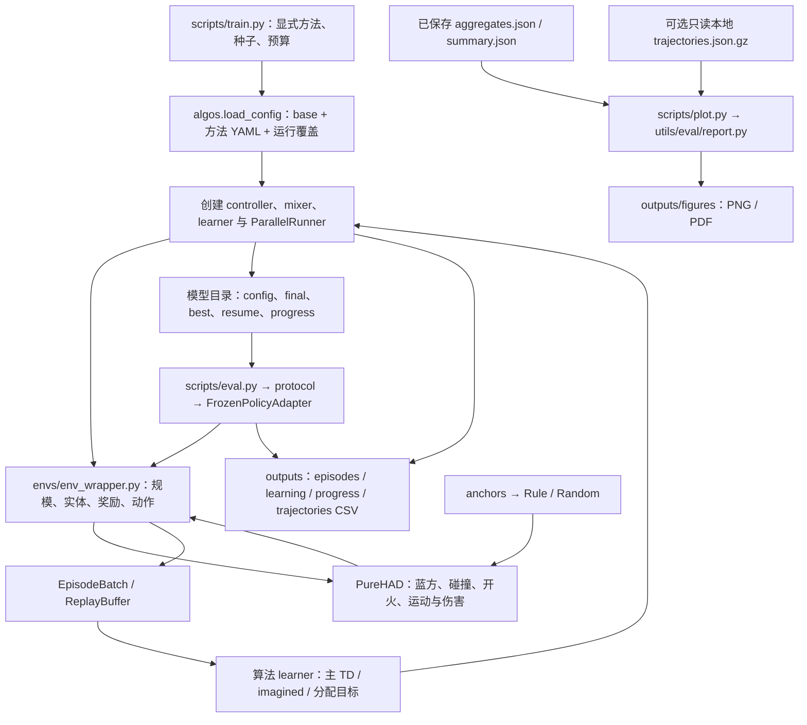

# 项目框架

本分支把原先嵌套的工程直接展开为仓库根目录。`algos/` 放算法及共用学习部件，`envs/` 放唯一环境封装和原生 PureHAD，`utils/` 放实验、记录与冻结评估工具，`configs/` 放可读配置，`scripts/` 放命令入口，`outputs/` 放同一实验的配置、数据与图片。Python 导入名仍为 `open_score`，由根 `pyproject.toml` 映射，不需要再建立一层源码目录。

## 完整仓库文件树

以下列出当前随仓库发布的文件及职责。PureHAD 的 48 个 Python 源文件、共用 PyMARL 的 31 个文件（其中 28 个 Python 源文件）均展开；原生 workbench 是随 PureHAD 保留的已有接口，训练与绘图不会自动启动它。树中输出仅为小型配置、聚合和图片，模型权重和原始记录另列为运行时材料。

<!-- TREE_START -->

```text
Open_Score/
├── algos/
│   ├── common/
│   │   ├── pymarl/
│   │   │   ├── components/
│   │   │   │   ├── __init__.py  # 包导出 / 命名空间
│   │   │   │   ├── action_selectors.py  # 合法动作、ε-greedy、分配动作选择
│   │   │   │   ├── episode_buffer.py  # EpisodeBatch、ReplayBuffer 与紧凑存储
│   │   │   │   ├── epsilon_schedules.py  # 探索率退火计划
│   │   │   │   └── transforms.py  # 动作 OneHot 等 replay 变换
│   │   │   ├── config/
│   │   │   │   └── default.yaml  # 共用 PyMARL 的基础字段
│   │   │   ├── controllers/
│   │   │   │   ├── __init__.py  # 包导出 / 命名空间
│   │   │   │   ├── basic_controller.py  # 基础共享参数 MAC
│   │   │   │   └── entity_controller.py  # 实体 MAC、imagined 组和任务控制
│   │   │   ├── learners/
│   │   │   │   ├── __init__.py  # 包导出 / 命名空间
│   │   │   │   └── q_learner.py  # 主 / imagined TD、target 网络与 ALMA 分配学习
│   │   │   ├── modules/
│   │   │   │   ├── agents/
│   │   │   │   │   ├── __init__.py  # 包导出 / 命名空间
│   │   │   │   │   ├── agent.py  # ALMA 基础 actor 组装
│   │   │   │   │   ├── allocation_common.py  # 任务 / count embedding 与分组 attention mask
│   │   │   │   │   ├── allocation_critics.py  # AQL 分配 critic
│   │   │   │   │   ├── allocation_policies.py  # 自回归任务分配 policy
│   │   │   │   │   ├── bases.py  # 实体与标准输入基座
│   │   │   │   │   └── heads.py  # GRU / feedforward 输出头
│   │   │   │   ├── layers/
│   │   │   │   │   ├── __init__.py  # 包导出 / 命名空间
│   │   │   │   │   └── attention.py  # 实体 attention 与 mask
│   │   │   │   ├── mixers/
│   │   │   │   │   ├── __init__.py  # 包导出 / 命名空间
│   │   │   │   │   └── flex_qmix.py  # attention hypernetwork 与 FlexQMIX
│   │   │   │   └── __init__.py  # 包导出 / 命名空间
│   │   │   ├── runners/
│   │   │   │   ├── __init__.py  # 延迟导入 runner，避免环境 worker 预载 Torch
│   │   │   │   └── parallel_runner.py  # 并行采集、环境 worker 与完整状态恢复
│   │   │   ├── utils/
│   │   │   │   ├── __init__.py  # 包导出 / 命名空间
│   │   │   │   ├── allocation.py  # 随机任务分配辅助
│   │   │   │   └── rl_utils.py  # TD(λ)、统计标准化与 masked mean
│   │   │   ├── LICENSE  # 上游许可证
│   │   │   ├── README.md  # 上游移植和本地适配说明
│   │   │   └── __init__.py  # 包导出 / 命名空间
│   │   ├── __init__.py  # 包导出 / 命名空间
│   │   ├── entity_encoder.py  # 相对实体视图、attention、GRU、REFIL / matched / ALMA 与 builder
│   │   ├── mixers.py  # FlexQMIX 分块包装及 mixer 构建
│   │   └── policy.py  # FrozenPolicyAdapter、模型身份和跨步状态适配
│   ├── dcg/
│   │   ├── LICENSE  # 上游许可证
│   │   ├── __init__.py  # DCG 上游来源与实现导出
│   │   ├── dcg_controller.py  # utility / payoff、完整协调图与 Max-Sum
│   │   ├── dcg_learner.py  # DCG 一步 Double-Q 图价值学习
│   │   └── rnn_feature_agent.py  # attention 输入与 DCG GRU 特征
│   ├── rules/
│   │   ├── __init__.py  # 规则策略及原生分组 API 导出
│   │   └── coverage_rule.py  # nv1 MILP 指派、预测拦截、Random 及规则逐场记录
│   ├── spectra/
│   │   ├── __init__.py  # SPECTra 上游来源与实现导出
│   │   ├── nq_learner.py  # SPECTra Double-Q 与 TD(λ) 更新
│   │   ├── rl_utils.py  # SPECTra TD(λ) / Q(λ) 递推
│   │   ├── spectra_attention.py  # 集合 attention、pooling 和 query-key 模块
│   │   ├── spectra_controller.py  # SPECTra 实体控制器与 hidden
│   │   ├── spectra_mixer.py  # 动态 ST-HyperNet 团队 mixer
│   │   └── spectra_rnn_agent.py  # 类型投影、SAQA 与 GRU actor
│   ├── transfqmix/
│   │   └── __init__.py  # TransfQMix actor、MAC、mixer、TD(λ) 与 learner
│   ├── __init__.py  # 八方法注册、完整配置、训练、checkpoint 与恢复
│   └── leaf.py  # LEAF GlobalBranch、共享上下文、reader、fusion 与 intent 辅助函数
├── configs/
│   ├── alma.yaml  # alma 方法配置
│   ├── base.yaml  # 公共训练与环境控制
│   ├── dcg.yaml  # dcg 方法配置
│   ├── leaf.yaml  # leaf 方法配置
│   ├── qmix.yaml  # qmix 方法配置
│   ├── random.yaml  # random 方法配置
│   ├── refil.yaml  # refil 方法配置
│   ├── refil_matched.yaml  # refil_matched 方法配置
│   ├── rule.yaml  # rule 方法配置
│   ├── spectra.yaml  # spectra 方法配置
│   └── transfqmix.yaml  # transfqmix 方法配置
├── docs/
│   ├── 方法、基线与环境说明.md  # 合并的方法、基线、规则与物理说明
│   └── 项目框架.md  # 完整文件职责与运行数据流
├── envs/
│   ├── PureHAD/
│   │   ├── had_env/
│   │   │   ├── core/
│   │   │   │   ├── agents/
│   │   │   │   │   ├── __init__.py  # 包导出 / 命名空间
│   │   │   │   │   ├── attack.py  # 攻击机自动开火与自毁
│   │   │   │   │   ├── base.py  # 实体运动、速度约束、边界和生命值
│   │   │   │   │   ├── disturb.py  # 干扰机扇区软杀伤
│   │   │   │   │   └── scout.py  # 侦察机扇区可见性
│   │   │   │   ├── env/
│   │   │   │   │   ├── __init__.py  # 包导出 / 命名空间
│   │   │   │   │   ├── env.py  # 实体创建、初始布局和 reset
│   │   │   │   │   └── world.py  # 扫掠碰撞、开火、运动与同步伤害结算
│   │   │   │   ├── function/
│   │   │   │   │   ├── Function.py  # 距离、角度、扫掠最近点、伤害衰减和观测归一化
│   │   │   │   │   └── __init__.py  # 包导出 / 命名空间
│   │   │   │   ├── render/
│   │   │   │   │   ├── __init__.py  # 包导出 / 命名空间
│   │   │   │   │   └── render.py  # 可选 pygame 原生画面
│   │   │   │   ├── resources/
│   │   │   │   │   ├── target.png  # 存活目标图标
│   │   │   │   │   └── target_dead.png  # 失守目标图标
│   │   │   │   ├── __init__.py  # 包导出 / 命名空间
│   │   │   │   ├── config.py  # 场地、速度、半径、生命值和初始化常量
│   │   │   │   ├── make_env.py  # 原生 HADEnv 包装
│   │   │   │   └── version.py  # 核心版本和物理协议身份
│   │   │   ├── grouping/
│   │   │   │   ├── __init__.py  # 包导出 / 命名空间
│   │   │   │   ├── actions.py  # 合法分组、配额与候选动作
│   │   │   │   ├── adapter.py  # 事件式命令、rush 飞行与共享世界适配
│   │   │   │   ├── domain.py  # 身份保留的 Entity / Group / Grouping / DecisionState
│   │   │   │   ├── environment.py  # 已知对手事件式 SMDP
│   │   │   │   ├── opponents.py  # reactive / balanced / concentrated 目标策略
│   │   │   │   ├── policies.py  # 原生 grand / rule / static / random 分组策略
│   │   │   │   ├── protocol.py  # 原生分组协议与调度独立场景种子
│   │   │   │   └── rules.py  # 原生组约束责任匹配与规则执行器
│   │   │   ├── scenarios/
│   │   │   │   ├── __init__.py  # 包导出 / 命名空间
│   │   │   │   └── defense.py  # 防护场景回调，不新增战斗规则
│   │   │   ├── workbench/
│   │   │   │   ├── __init__.py  # 包导出 / 命名空间
│   │   │   │   ├── __main__.py  # 原生 workbench 命令启动
│   │   │   │   ├── agent_session.py  # 异构原生机群的双队直接飞行会话
│   │   │   │   ├── cli.py  # 原生研究、回放与分支命令
│   │   │   │   ├── evaluation.py  # 原生 ID / OOD 计划与配对统计接口
│   │   │   │   ├── export.py  # 录制物理态的图像与视频导出
│   │   │   │   ├── gui.py  # 可选桌面工作台；渲染不推进物理
│   │   │   │   ├── identity.py  # 可视化来源身份与行为兼容检查
│   │   │   │   ├── live.py  # 拥有独立进程的调试 / 分支控制
│   │   │   │   ├── playback.py  # 只读插值和下一事件跳转
│   │   │   │   ├── protocols.py  # 显式版本的场景与协议描述
│   │   │   │   ├── recording.py  # 物理帧录制、回放及历史轨迹导入
│   │   │   │   ├── rng.py  # 私有随机流与策略导入隔离
│   │   │   │   ├── session.py  # 策略适配、原生分组会话与物理录制
│   │   │   │   ├── snapshot.py  # 可移植类型化快照及分支状态
│   │   │   │   └── views.py  # 可选 Qt 物理状态只读视图
│   │   │   ├── __init__.py  # 原生 make_env / parallel_env 公共 API
│   │   │   ├── actions.py  # 27 个加速度基元与保序二维子集
│   │   │   ├── environment.py  # 并行动作接口 HADParallelEnv / MPEEnv
│   │   │   └── factory.py  # MPE 风格场景工厂
│   │   ├── README.md  # PureHAD 来源、版本与独立接口
│   │   ├── make_env.py  # 原生包根 make_env 兼容入口
│   │   └── pyproject.toml  # 原生 had-env 包及可选可视化依赖
│   └── env_wrapper.py  # 唯一封装：规模、特征、mask、动作、奖励、诊断及 HAD 环境
├── outputs/
│   ├── alma/
│   │   └── models/
│   │       ├── seed_0/
│   │       │   └── config.json  # 历史完整模型配置；保留原运行来源
│   │       ├── seed_1/
│   │       │   └── config.json  # 历史完整模型配置；保留原运行来源
│   │       └── seed_2/
│   │           └── config.json  # 历史完整模型配置；保留原运行来源
│   ├── b2_qmix_atten/
│   │   └── models/
│   │       ├── seed_0/
│   │       │   └── config.json  # 历史完整模型配置；保留原运行来源
│   │       ├── seed_1/
│   │       │   └── config.json  # 历史完整模型配置；保留原运行来源
│   │       └── seed_2/
│   │           └── config.json  # 历史完整模型配置；保留原运行来源
│   ├── dcg/
│   │   └── models/
│   │       ├── seed_0/
│   │       │   └── config.json  # 历史完整模型配置；保留原运行来源
│   │       ├── seed_1/
│   │       │   └── config.json  # 历史完整模型配置；保留原运行来源
│   │       └── seed_2/
│   │           └── config.json  # 历史完整模型配置；保留原运行来源
│   ├── figures/
│   │   ├── coverage_binding_probe.pdf  # 保存统计图：coverage_binding_probe
│   │   ├── coverage_binding_probe.png  # 保存统计图：coverage_binding_probe
│   │   ├── fig_comparison.pdf  # 保存统计图：fig_comparison
│   │   ├── fig_comparison.png  # 保存统计图：fig_comparison
│   │   ├── fig_decision_timing.pdf  # 保存统计图：fig_decision_timing
│   │   ├── fig_decision_timing.png  # 保存统计图：fig_decision_timing
│   │   ├── fig_mechanism.pdf  # 保存统计图：fig_mechanism
│   │   ├── fig_mechanism.png  # 保存统计图：fig_mechanism
│   │   ├── fig_protection.pdf  # 保存统计图：fig_protection
│   │   ├── fig_protection.png  # 保存统计图：fig_protection
│   │   ├── fig_trajectory.pdf  # 保存统计图：fig_trajectory
│   │   └── fig_trajectory.png  # 保存统计图：fig_trajectory
│   ├── refil/
│   │   └── models/
│   │       ├── seed_0/
│   │       │   └── config.json  # 历史完整模型配置；保留原运行来源
│   │       ├── seed_1/
│   │       │   └── config.json  # 历史完整模型配置；保留原运行来源
│   │       └── seed_2/
│   │           └── config.json  # 历史完整模型配置；保留原运行来源
│   ├── refil_matched/
│   │   └── models/
│   │       ├── seed_0/
│   │       │   └── config.json  # 历史完整模型配置；保留原运行来源
│   │       ├── seed_1/
│   │       │   └── config.json  # 历史完整模型配置；保留原运行来源
│   │       └── seed_2/
│   │           └── config.json  # 历史完整模型配置；保留原运行来源
│   ├── regir_nomem/
│   │   └── models/
│   │       ├── seed_0/
│   │       │   └── config.json  # 历史完整模型配置；保留原运行来源
│   │       ├── seed_1/
│   │       │   └── config.json  # 历史完整模型配置；保留原运行来源
│   │       └── seed_2/
│   │           └── config.json  # 历史完整模型配置；保留原运行来源
│   ├── smoke/
│   │   └── summary.json  # 当前短链路、环境等价性和历史对照的紧凑汇总
│   ├── spectra/
│   │   └── models/
│   │       ├── seed_0/
│   │       │   └── config.json  # 历史完整模型配置；保留原运行来源
│   │       ├── seed_1/
│   │       │   └── config.json  # 历史完整模型配置；保留原运行来源
│   │       └── seed_2/
│   │           └── config.json  # 历史完整模型配置；保留原运行来源
│   ├── transfqmix/
│   │   └── models/
│   │       ├── seed_0/
│   │       │   └── config.json  # 历史完整模型配置；保留原运行来源
│   │       ├── seed_1/
│   │       │   └── config.json  # 历史完整模型配置；保留原运行来源
│   │       └── seed_2/
│   │           └── config.json  # 历史完整模型配置；保留原运行来源
│   ├── aggregates.json  # 已有比较与机制汇总
│   ├── experiment.json  # 方法、场景池、来源与材料登记
│   └── summary.json  # checkpoint 来源、深度、时延及探针汇总
├── scripts/
│   ├── eval.py  # 独立冻结 final / confirmation / depth / anchors 及60案例 reproduce
│   ├── plot.py  # 只读保存统计的绘图命令
│   └── train.py  # 训练调度、smoke 两会话诊断、状态、停止与恢复
├── utils/
│   ├── eval/
│   │   ├── __init__.py  # 冻结评估延迟导出
│   │   ├── anchors.py  # Rule / Random YAML 执行配置、场景任务与保存进度
│   │   ├── protocol.py  # 验证 / 正式 / 确认 / 深度配额、模型身份与60案例对照
│   │   └── report.py  # 保存统计与可选轨迹的六组 PNG / PDF
│   ├── experiment.py  # 平铺路径、环境来源检查、原子 JSON、进程锁与 GPU 映射
│   ├── logging.py  # CSV schema、并发写入、身份筛选与对局去重
│   ├── resources.py  # 停止请求和当前 CUDA 故障辅助
│   └── seeding.py  # 模型、规模、场景与验证独立随机流
├── .gitignore  # 原始数据、权重、恢复状态与本地缓存的发布边界
├── AGENTS.md  # 项目工作约定
├── README.md  # 安装、运行与材料导航
├── __init__.py  # open_score 公共导入与延迟环境加载
├── pyproject.toml  # open_score 根目录映射、依赖与 PureHAD 打包
└── requirements.txt  # 开发环境依赖入口
```

<!-- TREE_END -->

## 算法实现映射

| 公开方法 / 保存键 | actor / 控制器 | 训练价值与学习器 | 配置 |
|---|---|---|---|
| LEAF / `regir_nomem` | `common/entity_encoder.py` 的 EntityAgent 与 SharedEntityMAC；`leaf.py` 的 GlobalBranch 执行共享上下文、固定当前 query、reader 与轮间融合；TemporalHead 承接跨步 GRU | `common/mixers.py` 的 FlexQMIX 包装；`common/pymarl/learners/q_learner.py` 保留主 / imagined TD | `leaf.yaml` |
| REFIL / `refil` | 共用 AttentionEncoder、EntityAgent、SharedEntityMAC；一次自身查询 + Temporal GRU | FlexQMIX + QLearner，imagined 分组辅助 TD | `refil.yaml` |
| REFIL-matched / `refil_matched` | REFIL attention 后接残差 MLP，匹配 actor 参数规模 | 同 REFIL | `refil_matched.yaml` |
| QMIX / `b2_qmix_atten` | 同型 attention + Temporal GRU；内部键保留兼容 | FlexQMIX + QLearner，关闭 imagined | `qmix.yaml` |
| DCG / `dcg` | `dcg/rnn_feature_agent.py` 与 `dcg_controller.py`；utility / payoff 与 Max-Sum 联合动作 | `dcg/dcg_learner.py` 的一步 Double-Q 图价值 | `dcg.yaml` |
| SPECTra / `spectra` | `spectra_rnn_agent.py`、`spectra_attention.py`、`spectra_controller.py`；类型化实体、SAQA、GRU | `spectra_mixer.py` 的 ST-HyperNet；`nq_learner.py` 的 TD(λ) | `spectra.yaml` |
| ALMA / `alma` | 共用 EntityAgent；PyMARL allocation policy / critic 与任务条件 attention | FlexQMIX + QLearner；另有 AQL 分配目标 | `alma.yaml` |
| TransfQMix / `transfqmix` | `transfqmix/__init__.py` 中 agent、MAC、mixer、learner；32 维 memory token | 双 Transformer 分支、Double-Q、TD(λ) | `transfqmix.yaml` |
| Rule / `rule_nv1` | `rules/coverage_rule.py` 的 CoveragePolicy / CoverageExecutor；MILP + 一步预测拦截 | 不训练 | `rule.yaml` |
| Random / `random`（聚合 `random_accel`） | 同文件 DirectActionPolicy；每存活红方均匀采样合法加速度 | 不训练 | `random.yaml` |

配置表中的文件均位于 `configs/`。公共控制从 `base.yaml` 合并，命令传入的运行参数再次覆盖，最终完整值写入模型目录的 `config.json`。Rule / Random 的 YAML 是实际执行来源：anchors.py 通过 load_config 读取 rule.yaml 的 anchor_id=rule_nv1 与 hierarchical / nv1 / predictive_intercept，以及 random.yaml 的 anchor_id=random 与 end_to_end / random_accel；蓝方 hierarchical / reactive / rush 从 base.yaml 的 env_args 读取。此次移为配置读取后，有效策略字典保持与已执行60案例设置相同。random 是锚点记录ID，random_accel 是执行策略及公开聚合显示键，不能把二者误当成两条不同的随机基线。

当前运行配置与历史模型配置是两个用途：前者控制新训练，后者复原已有网络并保留原运行来源；历史快照中的路径或字段不因目录整理而改写。

`algos/__init__.py` 统一注册方法、合并配置、创建环境 / controller / mixer / learner、执行训练、保存和恢复；不把每个方法再复制一套运行器。`algos/common/policy.py` 的 FrozenPolicyAdapter 统一处理冻结模型的网络状态、合法动作、实体槽位和时间 hidden。Rule / Random 经锚点评估入口直接控制原生 HAD，不伪造学习权重。

## 环境责任边界

`envs/env_wrapper.py` 合并规模池、实体特征、mask、9 动作映射、诊断、HADWrapper 与 HADEntityEnv。它把原生物理状态转换为 10 维实体表，训练 actor 可附加上一红方动作形成 19 维输入；相对视图仍由共用编码器按接收者建立。死亡槽保留身份，避免把旧 hidden 转移给另一台无人机。

封装层负责训练势函数塑形、damage 增量奖励、自然终止与时间截断、红方全灭后的物理尾段，以及蓝方 reactive + rush 的一致接入。`envs/PureHAD/had_env/core/` 负责位置 / 速度、边界、扫掠碰撞、开火、自毁、伤害、目标初始化与底层观测；`grouping/` 负责原生事件式分组、蓝方目标策略和规则执行。外层算法不重新实现物理结算。

PureHAD 源自 `9536b74bdfaf75b832598e4b12d356f2e5a52ffc`，核心版本 `skyhad-3.0.0a1`，协议 `rebuild-calibrated-v3-r7-target-initialization`。`utils/experiment.py` 检查加载的原生模块确实来自本仓库路径与登记版本。旧 `9e25a1c` 的 48 个 Python 文件中，449 个函数 AST、类和物理常量与该来源一致；版本元数据与无效演示不同。更早 HAD 物理有变化，完整历史协议未知的案例不能据此宣称严格复现。

## 训练、冻结评估与绘图数据流



训练调度器区分训练池和评估池，训练完整批次写入 replay 后再学习；验证按显式门限进入冻结评估。新训练默认单 GPU 单槽，--devices / --per-gpu 控制并发；只有显式 --eval-after-train 才排入正式 final 评估，避免短运行触发完整配额。停止请求在完整批次 / 完整对局边界生效。完整恢复状态保存网络、优化器、replay、runner、随机数与进度；不能用只有 actor 权重的 final 代替完整训练恢复状态。恢复检查模型身份、结构与不可变配置，并保留可恢复的完整批次。

冻结评估通过 `utils/eval/protocol.py` 定义配置和场景任务、加载 final、记录 checkpoint 身份，按已经提交的匹配对局跳过重复工作；正式、独立确认及 LEAF 深度 sweep 各有明确 phase / arm。Rule / Random 不存在训练种子平均的含义。历史 CSV 可能混有旧实验臂，读取时必须同时筛选方法、来源、运行、种子、协议和模型身份。

绘图只消费保存统计和可选轨迹，不生成新科学统计，不调用环境，不自动把新训练写成历史成绩。`--data-root` 可指向平铺输出，也可只读旧 `outputs/main/`（其下有 `had/`），全部新图片写入选择的 `--output/figures/`。轨迹缺失或当前 final 身份覆盖不足时只跳过轨迹重绘。

## 发布文件与运行时材料

`outputs/aggregates.json` 保存已有比较与机制汇总，`summary.json` 保存 checkpoint 身份、历史来源、深度、时延和探针；`experiment.json` 登记方法、配置池和材料边界。八方法 × 三训练种子的 24 份 `models/seed_*/config.json` 和六组 PNG / PDF 随 Git 发布。历史正式结果报告保留在 main，本分支文档只有本框架与合并方法说明。

以下是运行时生成的路径约定，**不是随 Git 发布的文件树**：

```text
outputs/
├── episodes.csv / learning.csv / progress.csv / trajectories.csv
├── <method>/models/seed_<seed>/
│   ├── config.json                       # 新运行的完整解析配置
│   ├── final.pt / best.pt                # 正式 final 与验证最优备份
│   ├── resume.pt / resume.prev.pt        # 包含 replay / RNG 的可恢复进度
│   ├── progress.json / evaluation.json   # 当前进度
│   └── console.log / eval.console.log   # 本地日志
├── trajectories.json.gz / decision_timing.json
└── smoke/
    ├── summary.json                     # 唯一发布的紧凑链路与对照汇总
    ├── reproduction.csv                 # 本地60案例逐场对照
    ├── <method>/models/seed_0/           # 本地短运行配置、权重和恢复状态
    └── 其他逐场 / 日志材料                # 留本地
```

--stage smoke 默认限定八方法、seed0、4v4/K2，以及 batch_run=2、batch=2、buffer=16、每批一次更新；两个进程会话各完成真实优化后保存，第二会话恢复 optimizer / replay / RNG 与训练时钟，有限损失、梯度和参数变化证据保留在汇总。4096 为预算上限，不把两个更新描述成完整预算训练。--stage reproduce 读取 --reference-output 下的历史 final，固定十策略 × 两配置（4v4/K2、15v15/K2）× 场景9000–9002，共60个对照案例。

短运行、环境等价性检查和历史 final 对照写入同一个 `outputs/smoke/summary.json`，具体状态以该文件为准。该检查不扩大到新种子、1M 步训练或完整正式池；尚未结束、取消和失败项目不计为完成。若生成实际诊断图，可将 `summary.png` 与该汇总一并发布，不借用历史曲线表示短运行结果。

当前保存的检查为：八个学习方法在 seed0 均通过两个独立进程会话的真实训练、保存与恢复，每方法累计2次优化更新。历史 final 对照完成60/60项，其中53项的目标损伤 D 与回合长度完全相同；3项长度相同，D 仅相差不超过1.8×10⁻¹⁵；另4项 ALMA 的 D 或长度与档案不同。对这4个已选开局使用旧工程和原9e25a1c环境重放，D 与长度均与新代码完全相同，说明这4项档案差异在重构前也存在；这不能写成 ALMA 历史成绩已完全复现，也不推定末位差的具体来源。证据集中在[summary.json](../outputs/smoke/summary.json)。

环境动态对照已通过：同一 seed9000 与固定二维动作序列下，4v4/K2 和15v15/K2 的原生环境各比较100步；两个规模的旧 / 新封装对照分别覆盖35步和44步完整回合。状态、动作、奖励、事件、实体 mask、势函数塑形及终止字段均逐项精确相等，未采用容差。原生 `core_version` 标签改变，r7物理协议相同；48个原生 Python 文件的导入计算 AST 也相同（排除版本元数据与未使用演示入口）。该证据限于已约定的两个开局和动作序列。
